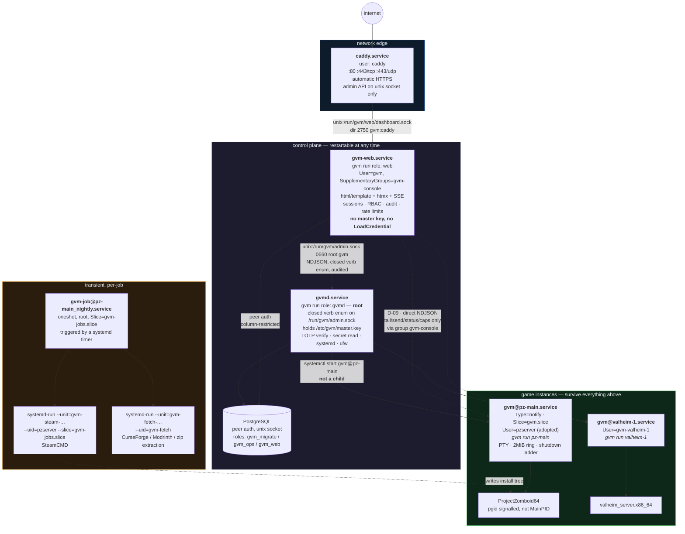

# gvm — Architecture

> **Target design; see the [README](../README.md) for what works today.** This document describes the finished system. Many components it specifies are not in the current build — the README "What works in this build" table is the authority on what runs now.

**A generalized VPS game-server manager built on the assumption that the daemon will be down when it matters.**

> The files on disk *are* the server. systemd does the supervising. Postgres is the logbook.

- **Module:** `github.com/S95F/gameVPSmanager` — binary `gvm`, built from `./cmd/gvm`.
- **Targets:** Debian 12, Ubuntu 22.04, Ubuntu 24.04. amd64 (arm64 secondary). systemd, root install.
- **Dev host:** Windows 11. `go build ./... && go vet ./... && go test ./...` must stay green there.
- **Status:** this document is the contract the implementation is built from. `docs/completed/IMPLEMENTATION-PLAN.md` is the build order.

---

## 0. How to read this document

Section [§2 Decision register](#2-decision-register) resolves every point where the candidate designs disagreed. Each decision is numbered `D-nn` and referenced from the section that implements it. If a later section appears to contradict an earlier one, the decision register wins; if the decision register contradicts shipped code in `internal/`, **the shipped code wins** and the register says so.

Three conventions used throughout:

- **Truth** means the artifact that a rebuild is derived from. **Mirror** means a copy kept for querying that is never read to make a decision. **Cache** means data reconstructible in one sweep.
- A **Decision** block marks a resolved contradiction.
- A quoted sentence in a *Why* clause is lifted from the legacy bash suite in `legacy/projectzomboid-bash/` and is preserved deliberately.

---

## 1. Thesis, and the one rule

**The filesystem is the control plane.** Everything required to start, stop, update, back up and firewall a game server lives in files on disk that a human can read, diff, version and edit. Postgres is authoritative for *people* — users, roles, sessions, audit, job history — and is a **mirror** for machines.

The rule this buys, defended everywhere below:

> Kill `gvmd`, kill `gvm-web`, kill Postgres, reboot the box.
> Every game server comes back up, keeps its nightly update timer, keeps its firewall, and keeps taking backups.

There is a CI job (`ci/control-plane-dead.sh`) that does exactly this on every PR.

### 1.1 What the bash suite already encodes, and where each lesson lands

I read all 14 files in `legacy/projectzomboid-bash/`. These behaviours are hard-won and survive verbatim in behaviour, even where the mechanism changes.

| Knowledge | Legacy mechanism | Where it lands in gvm |
|---|---|---|
| Never SIGKILL a live world | `KillSignal=SIGCONT` + screen-stuffed `save`/`quit` + `TimeoutStopSec=180` | Declarative `shutdown.steps` ladder executed by the runner, which **blocks until the game PID exits**. §11.6 |
| Boot-marker gating, not timers | `pz_boot_and_wait "SERVER STARTED" 3600` polling `server-console.txt` | `readiness.probes[log_marker]` → `sd_notify READY=1` + `EXTEND_TIMEOUT_USEC` gated on observed progress. §11.5 |
| Workshop IDs ≠ Mod IDs | `sync-mods.sh` resolves `mod.info` `id=`, writes both `WorkshopItems=` and `Mods=` | First-class **acquisition** vs **activation** namespaces in the content lockfile, `[]string` on both sides. §12 |
| Ambiguity is reported, never silently resolved | `sync-mods.sh` `check` rows + `AMBIGUOUS` warning | `LockEntry.Ambiguous` + `Evidence[]`, surfaced in `doctor`, the lock diff and the dashboard. §12.5 |
| Archive before destroy | `rebuild.sh` tars the world, *then* deletes — and only after downloads verify | One `archive.Create()` chokepoint; `Class=preserve`; `Destroy(ctx, ref, paths)` refuses a nil ref. §13.1 |
| Refuse to act on a bad parse | `RAW_COUNT != COUNT` → `die`, `mods.txt` untouched | `Plan.Unaccounted` is a fail-closed gate on every content source and every firewall read. §12.3, §17.6 |
| Don't lock yourself out | `detect_ssh_port()`: `SSH_PORT` → `SSH_CONNECTION` field 4 → `sshd_config` → 22, before any deny policy | `internal/sshport`, same order plus two rungs, promoted from "run it first" to "the computed rule set is **rejected** if it would not admit SSH". §17.5 |
| Failure must not leave the server stopped | `update.sh`: "no failure here may leave the server stopped" — `\|\| warn` and start anyway | `jobs.RunningGuard` installed with `defer` before any fallible work, plus a `gvm-guard` timer for the SIGKILL case. §13.4 |
| Items that failed to download stay listed | `read_mod_ids` pipes the whole file into `WorkshopItems=` | Missing acquire ids stay in the acquisition line so the server retries on next boot. §12.2 |
| Restart a second time only if the lists changed | `update.sh` `LISTS_BEFORE != LISTS_AFTER` | Folded away: activation is written **while stopped**, so one restart suffices; the post-start `Observe` catches the server-changed-a-mod-id case. §13.5 |
| A changed `OnCalendar` needs `restart`, not `enable` | `nightly.sh`: "enable --now is not enough" | `reconcile.TimerAction` issues `RestartUnit` whenever the rendered timer changed. §7.5 |
| Memory headroom is not optional | `config.env`: "B42 uses significant native memory OUTSIDE the Java heap … or the kernel OOM-kills the JVM mid-generation" | `sizing.native_headroom`; `MemoryHigh`/`MemoryMax` computed; `doctor` prints that sentence verbatim when it fails. §6.6 |
| Both PZ UDP ports, and why | `firewall.sh`: "16261 is browser + handshake + direct connect; 16262 is the data channel … Opening only one gives you a server people can see but never finish joining" | `PortSpec.Note`, carried verbatim into the ufw comment and the dashboard tooltip. §9.5a |
| Admin planes are not world-reachable | `ADMIN_IP` narrows RCON, otherwise it is closed | `expose: none\|admin\|public`, `admin_cidrs`, plus a doctor assertion that a non-public port is bound to loopback. §17.6 |
| Type the server name before destroying a world | `rebuild.sh` confirmation prompt | Typed-confirmation contract on every destructive route, server-side, identical for CLI, API and dashboard. §16.4 |
| Tell the operator to test SSH before hanging up | `firewall.sh` closing `warn` | Printed verbatim by `gvm firewall enable`. §17.5 |

### 1.2 Two latent bugs deliberately not inherited

1. **`ExecStop=screen -X stuff 'quit\015'` returns immediately.** systemd's own manual says a stop command that does not *wait* is insufficient. The only reason worlds survive today is that `KillSignal=SIGCONT` neuters the terminate step (systemd sends `SIGCONT` after `KillSignal=` anyway, so the JVM receives `SIGCONT, SIGCONT`). It works, but you cannot distinguish "saved and exited at 40s" from "hung and got SIGKILLed at 180s". gvm has **no `ExecStop=` at all**; the runner is the main process and blocks. §7.3
2. **`start-server.sh` launches `ProjectZomboid64` in a subshell without `exec`**, so the unit's `MainPID` is the shell and signalling it never reaches the JVM. gvm signals the **process group**, with identity pinned as `(pid, /proc/<pid>/stat` field 22 `starttime)` so PID reuse cannot fool it. §11.7

---

## 2. Decision register

Every contradiction between the candidate designs, resolved. Referenced by number from the sections that implement them.

### Identity and layout

**D-01 — Module path is `github.com/S95F/gameVPSmanager`.**
Several designs used `github.com/sfunk95/gvm`. `go.mod` in this repo says otherwise, and go.mod wins. The *binary* is still `gvm`.

**D-02 — Game secrets live in `/etc/gvm/secrets/`, not `/var/lib/gvm/`.**
The winning architecture called `/var/lib/gvm` "derived state, safe to lose" while simultaneously making it the sole home of every RCON/admin/join password and the CurseForge key. An operator following that stated mental model destroys every credential on the box. Layout is `/etc/gvm/secrets/instances/<name>/{rcon,admin,join}` and `/etc/gvm/secrets/host/{curseforge,modrinth,sftp_ed25519,age_recipient}`, mode `0600 root:root` inside a `0700 root:root` directory. `/var/lib/gvm` becomes genuinely disposable and the `rm -rf` claim becomes true. Every `LoadCredential=` path changes accordingly.
*Why:* a documentation fix cannot repair a layout that contradicts itself.

**D-03 — Content lockfile is intent: `/etc/gvm/instances/<name>.lock.json`.**
Observed content state stays derived at `/var/lib/gvm/instances/<name>/content.observed.json`. A pin is intent — diffable, git-able, secret-free — and losing it must not cost reproducibility.

**D-04 — The pinned game manifest is `/etc/gvm/instances/<name>.d/manifest.lock.yaml`.**
Not `/var/lib/gvm/...`. Same reason as D-03: the revision the operator accepted is intent.

**D-05 — `/run/gvm` is owned by `tmpfiles.d`, not by any unit's `RuntimeDirectory=`.**
systemd removes a unit's `RuntimeDirectory` when the unit stops, so `RuntimeDirectory=gvm` on `gvmd` would make `systemctl stop gvmd` delete every instance's `console.sock` and `status.json`; and `RuntimeDirectory=gvm` on a `User=gvm` unit recursively chowns the whole tree. `/usr/lib/tmpfiles.d/gvm.conf` creates `/run/gvm` `0755 root:root` and `/run/gvm/web` `2750 gvm:caddy`. Instance units keep `RuntimeDirectory=gvm/%i` (innermost-only removal), which is safe.

**D-06 — The dashboard socket is `/run/gvm/web/dashboard.sock`.**
Not `/run/gvm/dashboard.sock` (unresolvable ownership: `gvm` cannot `chgrp caddy`) and not `/run/gvm-web/` (unnecessary once D-05 removes the chown hazard). The **directory** carries the permission: `2750 gvm:caddy`, so the socket the web tier creates inherits group `caddy` via setgid; `gvm-web` runs `UMask=0007` and chmods the socket `0660`. Caddy can traverse and connect; caddy cannot unlink the socket.

### Control channel

**D-07 — Project Zomboid uses `rcon.DialectSimple`. The manifest names a dialect, not a terminator strategy.**
All three candidate designs specified `terminator: valve_empty_response` for PZ. The shipped, tested `internal/rcon/dialect.go` documents the opposite:

> `DialectSimple` is the conservative fallback for a server whose terminator support is unknown, **including Project Zomboid**. No probe is sent at all … only use it where the trick is known to misbehave.

Shipped code wins. The manifest carries `control.dialect: simple`, whose four legal values are exactly `rcon.Dialect`'s four constants (`source | minecraft | rust | simple`). The free-form `Profile{Terminator, StrictID, Charset, …}` struct is **deleted** — it is a second, unsynchronised copy of `specFor()`. `spec.Validate` rejects any dialect string that is not a registered `rcon.Dialect`, and `internal/spec/dialect_sync_test.go` fails the build if the manifest enum and the `rcon` constants drift.
*Why:* a wrong terminator hangs or truncates every RCON command on the one server that must work on day one, and `valve_empty_response` is precisely the trick `dialect.go` says is unsafe here. `gvm control probe` (§11.9) exists to replace the guess with evidence; until it runs, `simple` costs one idle interval per command and nothing else.

**D-08 — The PZ shutdown ladder uses the console, not RCON.**
PZ's RCON does not bind until the server is fully booted — with a large workshop list that is 40–60 minutes. The ladder's `save`/`quit` rungs go `via: console`, which always works. This also makes D-07 irrelevant to world safety: a wrong dialect degrades `players`/`broadcast`, never the save.

**D-09 — `gvm-web` dials `/run/gvm/<name>/console.sock` directly, for reads and writes. gvmd is not in the console data path.**
Two designs disagreed. Relaying through gvmd was justified as "console writes must be RBAC-gated and audited", but identity, sessions, RBAC and the audit log all live in `gvm-web` (that is where Postgres is), and gvmd can only verify that a *claimed* actor holds a role — it cannot verify the actor authenticated. So the relay adds no authorization while making a **root** process parse attacker-influenced mod output on every line of every modded server on the box. The privilege gradient runs the wrong way.
**Consequence, and the split that makes it safe:** the console socket's peer-credential table gains a group tier. `tail`/`send`/`status`/`caps` are available to uid 0 and to members of group `gvm-console`; **`verb` and `stop` remain uid-0 only**, and `gvm-web` reaches those through gvmd's closed verb enum. Data plane direct, lifecycle verbs via gvmd. §11.4

**D-10 — Group `gvm-console` contains exactly `gvm` and root. No instance user is ever a member.**
D-09 needs `gvm-web` to traverse `/run/gvm/<name>/`, so that directory is `2750 gvm-<name>:gvm-console` (setgid, so the socket inherits the group) and the socket is `0660`. Putting *instance* users in a shared console group — which one candidate design did — would let instance A's compromised mod drive instance B's console, i.e. arbitrary in-game command execution against another world. `gvm doctor` asserts `getgrouplist(gvm-<name>) == {gvm-<name>}` for every instance.

**D-11 — The runner owns a PTY. `screen` is demoted to an optional, sunsetting client.**
`screen -X stuff` returns immediately and lies about delivery; systemd cannot give an attachable stdin without the FIFO-EOF trap; and a `*os.File` PTY master bypasses `os/exec`'s copier goroutine, so `Wait()` cannot truncate the crash tail. `console_compat: screen` keeps `screen -r pzserver` working through the adoption week by running `gvm console` *inside* a screen session — a view, never the control path — with a declared 90-day sunset.

### Supervision and units

**D-12 — `TimeoutStartSec` is finite and derived from `readiness.hard_deadline`.**
`infinity` leaves a wedged runner in `activating` forever: `Restart=on-failure` never fires because nothing failed, and no alert exists. The template ships a finite floor (`600s`); the generated drop-in sets `TimeoutStartSec` from the manifest (PZ: `3600`). The runner extends it with `EXTEND_TIMEOUT_USEC` **only while console output is observably progressing**, under an absolute `readiness.hard_deadline` ceiling it enforces itself, and stops extending after `readiness.stall_timeout` of silence so systemd times the unit out. §11.5

**D-13 — Job units are `gvm-job@<instance>_<job>`.**
`_` is illegal in both instance and job names, so the split is unambiguous, and it avoids `:` — which is legal in a systemd unit name but awkward in filenames, shell completion and paths. `_guard` and `_verify` are host-level jobs with an empty instance part.

**D-14 — `gvm@.service` has no `PartOf=gvm.target`.**
`systemctl restart gvm.target`, which packaging will do on upgrade, would restart every live world. "Stop everything" is `gvm stop --all`, an explicit, audited verb.

**D-15 — `ProtectHome` is always emitted explicitly, and `gvm apply` write-probes the sandbox before writing the drop-in.**
The adopted PZ server's data lives at `/home/pzserver/Zomboid`; `ProtectHome=yes` makes `/home` empty, and `ReadWritePaths=` "takes precedence" is documented but version-dependent across systemd 249/252/255. The template ships `ProtectHome=read-only`; the generator emits `ProtectHome=no` whenever any instance path is under `/home` or `/root`; and `reconcile.ProbeWritable` launches a transient unit carrying the *identical* `User=`, `ProtectSystem=`, `ProtectHome=` and `ReadWritePaths=` and runs `gvm probe-write <paths…>` inside it. A failure aborts the apply *before* anything changes, naming the path and the directive that blocked it. Documentation becomes an executed test.
*Why:* this is the exact silent failure that disqualified a competing design, on the one migration the project is not allowed to get wrong.

**D-16 — Third-party code runs in a transient systemd **service**, never a scope, never as root.**
"`gvm job run` executes as root and calls hostops in-process" read literally runs SteamCMD — a self-updating binary that downloads and executes Valve-supplied code — as root, a regression from the bash suite's `as_pz`. Job *orchestration* is root (it needs systemctl, ufw, credentials); every step that executes third-party code is re-launched via `systemd-run --unit=… --slice=gvm-jobs.slice --uid=<owner>` with explicit hardening properties. A `--scope` inherits the caller's context and carries **no** confinement, which would give SteamCMD strictly less isolation than the game it installs.
**The uid is whichever account owns the destination:** SteamCMD writes into the instance install tree → runs as the instance user; CurseForge/Modrinth fetch and archive extraction write only into the shared blob cache → run as `gvm-fetch`, a uid in no group that can reach `admin.sock` and with no Postgres grant.

### Manifests and the game seam

**D-17 — Every instance pins its game manifest by revision + sha256, and the runner reads only the pinned copy.**
Without this, `apt upgrade gvm` shipping a new `projectzomboid.yaml` silently changes a live adopted server's argv, env, shutdown ladder and destroy globs at the next restart. Three version axes: `apiVersion` (schema), `metadata.revision` (content), `spec.driverABI` (behaviour). `gvm apply` copies the manifest's verbatim bytes to `/etc/gvm/instances/<name>.d/manifest.lock.yaml`; the runner, the job runner and the backup engine read **only** that file and exit 64 on a sha mismatch. `gvm manifest upgrade <name> --to N --dry` renders a field-level diff classified into `argv` / `destroy_globs` / `ports` / `shutdown` / `cosmetic`.

**D-18 — Postgres is never a manifest origin. Publishing an override writes a file.**
Storing code-equivalent content (argv + env + destruction globs) in the datastore the root daemon writes means a DB compromise yields arbitrary execution on every instance at the next restart. Resolution order reads disk only: `/etc/gvm/games/<id>.yaml` > `/usr/share/gvm/games/<id>.yaml` > `//go:embed games/<id>.yaml`. The `game_manifests` table is a mirror; `gvm game which <id>` prints the winner **and the losers**.

**D-19 — Publishing or overriding a manifest is `owner`-only, gated by a recorded sha256 approval.**
A manifest is argv plus env plus destruction globs. `admin` is not enough. An unapproved `/etc/gvm/games/*.yaml` override is **skipped with a loud warning**, not silently used and not fatal — a box whose Postgres is down still boots its games off the packaged manifest.

**D-20 — `PortSpec.expose` is `public | admin | none`, replacing `public: bool`.**
`firewall.sh` already needed three states via `ADMIN_IP`. `public: true` in an existing manifest is accepted as an alias and normalised at load. An instance may only make a port *more* restrictive than its manifest, except that `none → admin` is allowed (that is `ADMIN_IP`'s exact use case); `none → public` is a load-time validation error.

**D-21 — Resolvers are a closed Go registry with an exhaustively enumerated input struct; conditionality is seven `when:` predicates, not an expression language.**
`hooks: {post_content: [pz.resolve_mod_ids]}` with no stated contract is the plugin system the design exists to avoid. A `Resolver` receives read-only `fs.FS` handles for the declared roots, the acquired items with pre-fetched upstream metadata, and the manifest's `resolver_vars` — no network, no writer, no DB, no instance handle. Templates have **no control flow at all** (parse-tree walker rejects `if`/`range`/`with`/`template`/`call`/`printf`), and `when:` allows exactly one of seven predicates plus `not`. A YAML predicate like `field('versionMin') >= 42` has unspecified numeric-vs-lexicographic semantics against a real `versionMin=42.0.1`, and a wrong answer *silently omits a mod* while the server boots normally — regressing `sync-mods.sh`'s visible `check` warning into silent data loss.

**D-22 — Capabilities are computed triples `{cap, supported, available, reason, channel}`, not a `Can(verb) bool`.**
A boolean collapses "this game has no such feature" and "this feature is not reachable right now" into one `false`, which makes PZ's 40–60 minute first boot — the single most confusing window in the product — look like a broken dashboard. `supported:false` omits the control entirely; `supported:true, available:false` renders it disabled with `reason` as the tooltip. Zero per-game UI code.

### Datastore

**D-23 — Three Postgres roles, with column-level grants.**
`gvm_migrate` owns the schema; `gvm_ops` is gvmd / root CLI / jobs; `gvm_web` is the internet-facing tier. `gvm_web` has **no** `SELECT` on `users.totp_secret_ct`, **no** DML on `users`/`instances`/`instance_grants`/`game_manifests`, and `SELECT,INSERT` (never `UPDATE`/`DELETE`) on `audit_log`. Enforcement by the database, not by Go discipline, and it survives every future refactor.

**D-24 — `port_allocations` has no cross-instance `UNIQUE (proto, port)`.**
The winning architecture defined Postgres as a mirror and then gave the mirror a constraint that can reject a write the authoritative YAML already accepted. Restore a day-old dump, or hand-edit YAML while Postgres is down — the design's own headline scenario — and `gvm apply` succeeds on disk while the mirror write fails. A mirror that can refuse a write is not a mirror. Collisions are found by the pure allocator against disk + `/proc/net/*`, reported by a `port_conflicts` view and by `doctor`.

**D-25 — Instance identity is a UUIDv7 generated once in Go and written to the instance YAML as `metadata.uid`.**
Not `DEFAULT gen_random_uuid()`. Otherwise rebuilding the mirror after a DB restore reassigns UUIDs and silently cascades away every `instance_grants` row. Mirror sync upserts by `uid` and **never deletes**: a vanished YAML sets `absent_since`, because it may be a bad mount or a half-finished edit, and losing grants over that is unrecoverable.

**D-26 — No row-level security in v1.**
One trusted application, three DB roles, and an authorization predicate that is `GREATEST(global_role, grant_role)` across two tables — as a policy that is a correlated subquery on every row, debugged by staring at empty result sets rather than errors, and silently bypassed if anyone forgets `FORCE ROW LEVEL SECURITY` or writes `SET` instead of `SET LOCAL` on a pooled connection. The column grants of D-23 buy most of the property with none of that. Revisit only if a second consumer ever gets SQL access.

**D-27 — TOTP verification happens in gvmd, not in the web tier.**
`gvm-web.service` carries **no** `LoadCredential=`, so the master key never reaches the internet-facing process, and D-23 denies it `SELECT` on the ciphertext column. `auth.verify_totp` is a gvmd verb that decrypts, validates with `Skew:1`, and advances `users.last_totp_step` in one transaction — so the replay guard is owned by exactly one process. Total compromise of the web tier yields ciphertext it cannot read.

**D-28 — Game secrets are files, never Postgres columns.**
They must be written in cleartext into the game's own config file for the game to work (`RCONPassword=` in `<servername>.ini`), so encrypting them into the database defends against nothing the filesystem does not already expose, while creating a hard dependency on Postgres for a server to boot. Keeping them out means `pg_dump` contains zero game secrets — strictly better than encrypting them into it. Postgres stores metadata plus an HMAC fingerprint (an HMAC, not a bare hash: a join password is low-entropy and a bare digest in a dump is a dictionary attack).

### Scheduling, backups, updates

**D-29 — systemd timers, not an in-process scheduler.**
The nightly update, restart and backup must fire whether or not `gvmd` is alive, and `systemctl list-timers` plus `journalctl -u gvm-job@pz-main_nightly` are tools the operator already has and already trusts — which is exactly what `zomboid-restart.timer` gives them today. The "N instances × M kinds is an unmanageable pile of unit files" objection does not survive contact with 5 instances × 3 kinds = 15 generated files. Postgres records job runs; systemd triggers them. Never the reverse.

**D-30 — The steamcmd lock is a `flock`, not a Postgres advisory lock.**
Making the DB the primary lock reintroduces the dependency the design exists to delete. `/var/lib/gvm/locks/steamcmd.lock` is the host-wide lock and `/var/lib/gvm/locks/job_<name>.lock` the per-instance JOB lock; each lock file's first line names its holder (`pid:unit:kind:started_at`) so `doctor` can say who is blocking. Belt and braces: each instance also gets its **own** SteamCMD `HOME` under `/var/lib/gvm/cache/steam/homes/<name>`, which removes the shared `~/.steam` corruption class outright rather than only serialising around it.

**D-31 — The freeze watchdog is an out-of-process lease honoured by the runner.**
A goroutine dies with its process, and the failure being guarded against is precisely the process dying between `save-off` and `save-on` — which leaves a running server that silently stops persisting, the worst failure in the system. `/run/gvm/<name>/freeze.lease` carries a deadline and the thaw steps; the runner arms a timer on it and thaws unconditionally when it expires, including on its own next start (`Sweep`) if the box died mid-freeze.

**D-32 — Nightly `validate` is removed, and the compensating check is mandatory, not best-effort.**
`update.sh` runs `app_update 380870 validate` every night, which silently repairs partial downloads — but `validate` overwrites customised files and Valve says so explicitly. So `validate_on` containing `update` is a **load-time validation error**, and in exchange `verify: {appmanifest: true, byte_parity: true, single_acf: true}` is **required** in every steamcmd manifest: exactly one `appmanifest_<appid>.acf`, `StateFlags == 4`, `BytesDownloaded == BytesToDownload`, `BytesStaged == BytesToStage`, plus the declared sentinel. A failure sets `NEEDS_REPAIR`, starts the server anyway, and tells the operator to run `gvm update <n> --repair` — the only path that emits `validate`, and it takes a `preserve` archive first.

**D-33 — `sleep 180` is replaced by workshop quiescence detection.**
180s is simultaneously too long on a no-op night and too short after adding a 2 GB mod. `WaitForContentSettle` returns when every acquire id has a non-empty directory under a declared root (the positive signal — `rebuild.sh`'s own `NOT_DOWNLOADED` check) **or** nothing under the roots has changed size or mtime for `settle` (default 45s), under a hard budget.

**D-34 — Post-cutover world verification is file-set superset + advancing mtime, not digest equality.**
The server writes to the world on both clean stop and start, so a digest match is impossible and would false-alarm on every cutover. The superset test still catches the only catastrophe that matters — PZ generating a *fresh* world because the servername or `-cachedir` was wrong.

**D-35 — Rollback after the irreversible cutover step is automatic, and the rollback script is written to disk before anything reversible happens.**
Printing a rollback command is not enough at 2am, after the one step that cannot be undone. Any failure at or after `systemctl disable --now zomboid.service` triggers: stop `gvm@<name>` through its own ladder, re-enable the legacy unit, wait for its readiness marker, mark the instance degraded and held, print the archive restore command. The standalone `/var/lib/gvm/adopt/<name>-rollback.sh` depends only on `systemctl` and `tar`, so it works when the `gvm` binary is the broken thing.

### Network edge and web

**D-36 — Caddy's admin API listens on a unix socket, not `localhost:2019`.**
`gvm-web` is internet-reachable through this same Caddy; an SSRF that can POST to `127.0.0.1:2019` replaces the entire proxy config, which is exactly the shape of CVE-2026-27589. `admin unix//run/caddy/admin.sock|0660` with `enforce_origin` as belt-and-braces. Cost: one `--address` flag in the `ExecReload` drop-in, which gvm writes itself. Minimum Caddy version **2.11.1**; `gvm doctor` refuses to configure an older one. Caddy's `remote` admin (`:2021`) is never enabled — it has had two authorization-bypass advisories.

**D-37 — gvm owns `/etc/gvm/caddy/Caddyfile` and never writes `/etc/caddy/Caddyfile`.**
The latter is a dpkg conffile; rewriting it makes every `apt upgrade caddy` a conffile conflict that silently keeps the local version in noninteractive mode. A systemd drop-in points Caddy at gvm's file. **File-and-reload is the only write path**; gvm never writes through the admin API, because the unit does not pass `--resume` (so API changes vanish on restart) and mixing the two also permanently disables Caddy 2.11's SIGUSR1 reload.

**D-38 — SSE lives under a reserved `/stream/` path prefix.**
An edge matcher shaped like the app's route table (`/i/*/console/stream`) drifts every time a route is added, and Caddy's middle-of-path wildcard semantics are not something to bet a live console on. All SSE endpoints are `/stream/…` and `/api/v1/stream/…`; Caddy matches `handle /stream/*` with `flush_interval -1` and `stream_close_delay 5m`. `encode` uses an explicit Content-Type allowlist that **never** includes `text/*`, because that matches `text/event-stream`.

**D-39 — `trusted_proxies` is emitted only when configured.**
When Caddy *is* the edge there is no proxy in front, so trusting private ranges lets anything that can reach the box spoof `X-Forwarded-For` into gvm's audit log and per-IP lockout. Default: empty.

**D-40 — `/api/v1/*` ignores cookies entirely; session cookies are honoured only behind `CrossOriginProtection`.**
`net/http.CrossOriginProtection` allows any request sending neither `Sec-Fetch-Site` nor `Origin` — which is exactly what the `gvm` CLI looks like. If cookie auth were accepted there, CSRF protection would be opt-out for anything that can be made to look header-less. The two auth paths are **structurally separate muxes**, not a flag: the `/api/v1` mux is constructed without a `*scs.SessionManager` in scope, so a future handler cannot read a cookie by accident. `gorilla/csrf` is rejected outright (CVE-2025-24358, then the scheme-blind `TrustedOrigins` follow-up GO-2025-3884).

**D-41 — `gvm apply` never enables ufw and never installs a package.**
Both are moments an operator should be watching. Applying rules to a disabled ufw stages them and says so; `gvm firewall enable` is the only path that turns it on, it refuses when SSH detection is not confident, it re-verifies the SSH rules after enabling, and it prints `firewall.sh`'s closing warning verbatim. There is no `gvm firewall reset` — `firewall.sh --reset` exists because a single-purpose script owns the whole box; gvm does not.

**D-42 — gvm deletes only ufw rules carrying its own `gvm:<instance>:<port>` comment tag, and deletion is suppressed entirely when the status parse is not fully accounted for.**
An operator's VPN allow, a monitoring exporter, and fail2ban's transient bans all survive every gvm operation forever. The fail-closed parse gate is `rebuild.sh`'s `RAW_COUNT != COUNT` discipline generalised.

### Miscellaneous

**D-43 — Job state `skipped` is a first-class success.**
"No Steam build change, no content change, the server was never touched" is the correct outcome on most nights and must not page anyone.

**D-44 — `/var/backups/gvm/<name>` is `0700 root:root`.**
`install.sh` chowns `BACKUP_DIR` to `pzserver`; that is the one thing in it deliberately not ported. A compromised mod must not be able to read every world the server has ever had.

**D-45 — Instance names: `^[a-z0-9][a-z0-9-]{0,26}[a-z0-9]$`, no `--`, 2–28 characters, plus a reserved-word list.**
Lowercase because SteamCMD's `force_install_dir` fails on paths containing capitals on some distributions. `[a-z0-9-]` only so systemd's `%i` and `%I` are byte-identical and escaping never enters the picture, and so `_` stays free as the job separator (D-13). ≤28 because `useradd` caps at 32 and the `gvm-` prefix costs 4. Renaming is **not supported**; gvm prints the create-new-and-restore recipe instead of pretending.

**D-46 — Legacy `config.env` is renamed to `config.env.example` and the `.gitignore` negation is removed.**
`.gitignore:17` carries `!legacy/**/config.env`, which force-tracks a file matching the `*.env` ignore rule. The vendored copy *is* scrubbed today (`SERVER_PASSWORD="REDACTED-…"`), so no secret is in git — but the negation is a standing hazard: a future re-sync from the live box would commit the real join password. Renaming to `.example` removes the need for the negation entirely. Separately, the **live** box still has cleartext credentials in `/root/pz-server/config.env` and `/root/pz-credentials.txt`; `gvm adopt cutover --rotate-credentials` and a permanent `doctor` nag exist because of that. §19

---

## 3. System overview

### 3.1 Process topology



`systemctl restart gvmd` is a non-event. `systemctl restart gvm-web` is a non-event. Postgres going down is a non-event for the games.

### 3.2 Roles of the single binary

One binary, `/usr/local/bin/gvm`. Role is `argv[1]`.

| Role | Unit | User | Purpose |
|---|---|---|---|
| `gvm gvmd` | `gvmd.service` | **root** | Privileged verb gateway on `/run/gvm/admin.sock`. Nothing else. |
| `gvm web` | `gvm-web.service` | `gvm` | Dashboard + API on `/run/gvm/web/dashboard.sock`. Cannot touch the host except through gvmd. |
| `gvm run <name>` | `gvm@<name>.service` | `gvm-<name>` or adopted user | Per-instance supervisor: owns the PTY, ring buffer, console socket, readiness, shutdown ladder. |
| `gvm job run <slug>` | `gvm-job@<slug>.service` | root (orchestration only) | Backup / update / restart / content-sync / rebuild / guard / verify. |
| `gvm content-fetch` | transient, `--uid=gvm-fetch` | `gvm-fetch` | Hidden. Downloads and hashes third-party content. |
| `gvm <verb> …` | — | whoever ran it | The CLI. As root, calls `hostops` **in-process**. |

**Why two daemons.** An internet-reachable root web daemon is the largest blast radius available in this design. The split costs one unix socket and one hand-written verb enum. Critically it is **not a microservice split**: `gvmd` and `gvm-web` are always the same build (gvmd refuses a client whose build id differs), there is no versioning between them, and `hostops` has exactly one implementation — the root CLI calls it directly, `gvm-web` reaches it over the socket.

**Honest framing of what the split buys.** gvmd can verify that a *claimed* actor holds a role, which bounds escalation to the union of existing users' rights. It cannot verify the actor authenticated — a compromised `gvm-web` can claim to be the owner. The genuine second boundary is that gvm-web holds no master key and has no `SELECT` on the TOTP ciphertext (D-27), so total compromise of the web tier yields ciphertext it cannot read and game secrets it cannot fetch. `audit_log.actor_via` records `gvm-web` alongside the claimed actor, with the socket peer uid from `SO_PEERCRED`.

### 3.3 The CLI transport rule

```
1. --remote URL or $GVM_URL set          -> ModeRemote   (HTTPS + Authorization: Bearer)
2. euid == 0 and the verb is a host op   -> ModeLocalRoot (hostops in-process)
3. euid == 0 and the verb is `console`   -> ModeConsole   (direct AF_UNIX)
4. otherwise                             -> error naming --remote and `gvm token create`
```

**The CLI never dials `/run/gvm/admin.sock`.** That socket is `0660 root:gvm`; if the CLI dialled it, any member of group `gvm` would hold the full root verb surface, which is the escalation the two-daemon split exists to prevent. Root-local calls go in-process because the caller is already root and a socket hop adds nothing. This is also the answer to "what if Postgres is down": `sudo gvm stop pz-main` still works, records `actor_kind='root_cli'`, and logs a warning if the audit insert fails rather than refusing to act.

---

## 4. Repo layout

```
gameVPSmanager/
├── go.mod                    module github.com/S95F/gameVPSmanager ; go 1.26
├── Makefile                  build / build-arm64 / test / vet / check / deb / sqlc
├── README.md
├── docs/
│   ├── ARCHITECTURE.md              this document
│   ├── IMPLEMENTATION-PLAN.md
│   ├── adopt-projectzomboid.md      the §19 runbook, standalone
│   ├── writing-a-game-manifest.md
│   ├── manifest-reference.md
│   ├── control-channel.md
│   ├── content-model.md
│   ├── curseforge-blocked-mods.md
│   ├── network-edge.md
│   ├── tls-cases.md
│   ├── backups-and-restore.md
│   ├── what-happens-if-postgres-is-down.md
│   ├── bootstrap.md
│   ├── THREAT-MODEL.md
│   └── research/                    the six research digests (already present)
│
├── cmd/gvm/main.go           ONE binary; role dispatch on argv[1]
│
├── games/                    SHIPPED manifests -> /usr/share/gvm/games/
│   ├── embed.go              //go:embed *.yaml  (the floor; always present)
│   ├── projectzomboid.yaml   valheim.yaml       palworld.yaml
│   ├── 7daystodie.yaml       corekeeper.yaml    generic-steam.yaml
│   └── minecraft-neoforge.yaml  minecraft-forge.yaml            # v1.1
│
├── internal/
│   ├── version/              ✅ EXISTS
│   ├── rcon/                 ✅ EXISTS — client, packet, dialect (D-07 authority)
│   ├── pz/                   ✅ EXISTS — resolve.go, modsfile.go   (+ tags.go)
│   ├── gamecfg/              ✅ EXISTS — ini.go, sandboxvars.go    (+ 6 codecs)
│   │
│   ├── spec/                 THE ON-DISK TRUTH. pure structs + YAML, no build tags
│   │   ├── manifest.go  instance.go  host.go
│   │   ├── load.go  save.go  pin.go  diff.go  nodeindex.go
│   │   ├── validate.go  validate_instance.go
│   │   ├── render.go  render_guard.go  when.go
│   │   ├── capability.go  sizing.go  ports.go  duration.go  bytes.go
│   │   └── testdata/{good,bad,instances}/
│   │
│   ├── instance/             name.go  sizing.go  paths.go  jail.go  destroy.go
│   ├── ports/                allocate.go  occupancy.go  conflicts.go  ledger.go
│   │                         procnet.go (pure) + listeners_{linux,stub}.go
│   ├── lifecycle/            phase.go  observe.go  derive.go  reconcile.go
│   │                         lease.go  verbs.go  manager.go  status.go  doctor.go
│   ├── reconcile/            plan.go  apply.go  diff.go
│   │                         units.go  timers.go  users.go  dirs.go
│   │                         firewall.go  caddy.go
│   │                         probe_{linux,stub}.go   templates/  testdata/golden/
│   │
│   ├── runner/               runner.go  config.go  preflight.go
│   │                         process.go + process_{linux,stub}.go
│   │                         spawn_linux.go  pty_linux.go  pipe_linux.go  pump_linux.go
│   │                         readiness.go  shutdown.go  shutdown_standalone.go
│   │                         status.go  report.go  screencompat.go  procgroup_linux.go
│   ├── console/              line.go  ring.go  ingest.go  ansi.go  logfile.go
│   │                         hub.go  dialer_unix.go  protocol.go  fake.go
│   ├── socket/               codec.go  server.go  server_linux.go  client.go
│   ├── control/              control.go  commander.go  args.go  noop.go
│   │                         rconctl/  stdinctl/  telnet/ wsrcon/ httpapi/ mcmgmt/  # v1.1
│   │
│   ├── provider/             provider.go  jailed.go  blobs.go
│   │                         steamcmd/  adopted/  none/  minecraft/   # minecraft v1.1
│   ├── content/              content.go  digest.go  lock.go  plan.go  order.go
│   │                         resolver.go  source.go  schema.go
│   │                         blobstore/  jail/  fetch/
│   │                         steamworkshop/  modrinth/ (v1.1)  curseforge/ (v1.2)
│   ├── hook/                 hook.go  registry.go  pz.go  steam.go  pal.go  sdtd.go
│   │                         mc.go (v1.1)  validators.go  noexec_test.go
│   │
│   ├── jobs/                 jobs.go  execute.go  guard.go  lock.go  slug.go
│   │                         runner_{backup,update,restart,content,guard,prune,verify}.go
│   │                         sandbox_{linux,stub}.go
│   ├── update/               pipeline.go  decide.go  settle.go  repair.go
│   ├── rebuild/              rebuild.go
│   ├── archive/              archive.go  manifest.go  create.go  verify.go
│   │                         restore.go  destroy.go  fingerprint.go  index.go  retention.go
│   ├── backup/               engine.go  freeze.go  lease.go
│   │                         snapshot_{linux,stub}.go  remote.go  remote_sftp.go  remote_age.go
│   ├── adopt/                adopt.go  discover.go  discover_pz.go  configenv.go
│   │                         cutover.go  rollback.go  rollback_script.go  finalize.go
│   │                         proc_{linux,stub}.go  report.go  testdata/live-pz/
│   │
│   ├── store/                store.go  open.go  migrate.go  health.go  mirror.go
│   │                         reap.go  errors.go
│   │                         migrations/*.sql   queries/{ops,web}/*.sql   dbgen/{opsq,webq}/
│   ├── authz/                role.go  permission.go  matrix.go  scope.go  service.go
│   │                         scope_ast_test.go  lint_test.go  routes_test.go
│   ├── identity/             manager.go  password.go  totp.go  tokens.go  bootstrap.go
│   ├── secrets/              box.go  value.go  filestore.go  generate.go  refs.go
│   ├── audit/                audit.go  actions.go  spool.go  replay.go
│   │
│   ├── app/                  THE service layer. Only holder of an authz.ActorScope.
│   │                         app.go  scope.go  instance.go  capability.go  plan.go
│   │                         content.go  backup.go  secret.go  user.go  host.go
│   │                         adopt.go  confirm.go
│   ├── web/                  server.go  router.go  routes.go  middleware.go
│   │                         *_handlers.go  sse.go  confirm.go  render.go  funcs.go
│   │                         embed.go  health.go  peercred_{linux,stub}.go
│   │                         views/*.gohtml  views/partials/*.gohtml  static/
│   ├── webapi/               api.go  envelope.go  *.go  (JSON twins; same app calls)
│   │
│   ├── edge/                 edge.go  mode.go  tls.go  socket.go  snippet.go
│   ├── caddyconf/            render.go  validate.go  reload.go  rollback.go  applier.go
│   │                         admin.go  modules.go  version.go  ca.go
│   │                         runner_{linux,stub}.go  templates/  testdata/golden/
│   ├── firewall/             rule.go  ruleset.go  tag.go  desired.go  reconcile.go
│   │                         guard.go  plan.go  diff.go  backend.go  none.go  fake.go
│   │                         ufw/{parse.go,defaults.go,ufw_linux.go,ufw_stub.go}
│   │                         nft/nft.go   # v1.1 stub returning ErrUnsupported
│   ├── sshport/              detect.go  env_{linux,stub}.go
│   ├── listeners/            listeners.go (pure parser)  linux.go  stub.go
│   │
│   ├── hostops/              verbs.go  ops.go  server.go  client.go  attach.go
│   │                         systemd_{linux,stub}.go  user_{linux,stub}.go
│   │                         ufw_{linux,stub}.go  fs.go  shutdown_ingest.go
│   ├── platform/             platform.go  linux.go  stub.go
│   │                         notify_{linux,stub}.go  peer_{linux,stub}.go
│   │                         proc_{linux,stub}.go  flock_{linux,stub}.go
│   ├── probe/                a2s.go  udp.go  tcp.go  mcping.go  logmarker.go
│   └── cli/                  root.go  usage.go  transport.go  apiclient.go
│                             one file per verb group
│
├── packaging/
│   ├── systemd/{gvm@.service,gvm-job@.service,gvm.slice,gvm-jobs.slice,
│   │            gvmd.service,gvm-web.service,gvm-db-migrate.service,
│   │            gvm-guard.{service,timer},gvm-spool.{service,timer},
│   │            gvm-job@_verify.{service,timer}}
│   ├── tmpfiles/gvm.conf
│   ├── caddy/10-gvm.conf
│   ├── postgres/{pg_hba.gvm.conf,pg_ident.gvm.conf}
│   ├── fail2ban/gvm-sshd.local
│   ├── content/excludes.default.json
│   ├── nfpm.yaml   postinstall.sh   prerm.sh
│
├── ci/{control-plane-dead.sh,golden-units.sh}
└── legacy/projectzomboid-bash/    the reference implementation, read-only
```

**Build.** `CGO_ENABLED=0 GOOS=linux GOARCH=amd64 go build -trimpath -ldflags "-s -w -X …" -o bin/gvm ./cmd/gvm` — already what the `Makefile` does.

No cgo anywhere. `sdjournal` is **banned outright** (needs cgo plus libsystemd headers, breaks the Windows build); journal reading shells out to `journalctl -o json`. Every Linux-only surface — PTY, `SysProcAttr.Credential/Setpgid/Setsid`, `golang.org/x/sys/unix`, `/proc` reads, `unix.Statfs`, `unix.Flock`, `SO_PEERCRED`, systemd D-Bus, `systemd-run` — lives behind an interface with a `//go:build linux` implementation and a `//go:build !linux` stub returning `platform.ErrUnsupported`.

The consequence, which is the point: the `.acf`/VDF parser, the spec loader and validator, the template guard, the workshop and Modrinth API clients, the RCON packet codec, the buildid comparator, the port allocator, the `/proc/net` parser, the reconcile planner, the phase-derivation table, the ufw status parser, the archive manifest codec, the content resolution ladder and the whole authz matrix are pure Go with no build tags — which is most of the interesting logic and every place a bug would corrupt someone's world.

---

## 5. Filesystem layout — the control plane

```
/etc/gvm/                                   INTENT. operator-editable. git this (minus secrets/).
├── gvm.yaml                                host config: edge, firewall, pools, defaults
├── instances/
│   ├── pz-main.yaml                        0640 root:gvm  ← THE definition of one server
│   ├── pz-main.lock.json                   0644 root:root  content lock            (D-03)
│   └── pz-main.d/
│       └── manifest.lock.yaml              0640 root:gvm  pinned manifest bytes    (D-04)
├── games/<id>.yaml                         0640 root:gvm  operator overrides, owner-approved (D-19)
├── secrets/                                0700 root:root                          (D-02)
│   ├── instances/pz-main/{rcon,admin,join} 0600 root:root  LoadCredential= source
│   └── host/{curseforge,modrinth,sftp_ed25519,age_recipient,steam/}
├── master.key                              0400 root:root  TOTP column encryption ONLY
├── caddy/Caddyfile                         0640 root:caddy                         (D-37)
├── content/excludes.json                   itzg exclude/include schema, verbatim
└── jobs/<instance>_<job>.json              0644  slug -> {instance, job, action}   (D-13)

/usr/share/gvm/games/*.yaml                 SHIPPED manifests. dpkg-owned, never edited.

/var/lib/gvm/                 0751 root:root  DERIVED. rebuildable. genuinely safe to lose.
├── ports.lock.json                         0640 root:root  in-flight port reservations
├── archives.index.json                     0640 root:root  DB-free restore index
├── instances/<name>/                       0750 root:root
│   ├── content.observed.json               last Observe()
│   ├── observed.json                       last-read game config, buildid, StateFlags
│   ├── ports.json                          echo of the materialized allocation
│   ├── blocked-mods.json                   present iff AWAITING_MANUAL_FILES
│   ├── control-probe.json                  `gvm control probe` finding
│   ├── snap/                               reflink/btrfs snapshot staging
│   └── steam/{update.txt,check.txt}        generated runscripts
├── cache/steam/homes/<name>/               0700 gvm-<name>  SteamCMD's HOME      (D-30)
│                                           (every level above it 0751 root:root,
│                                            so that account can traverse to it)
├── blobs/sha256/<aa>/<sha256>              0444 gvm-fetch:gvm-content  content-addressed
├── blobs/tmp/                              staging, same fs, atomic rename
├── downloads/{mods,modpacks,worlds}/       0755 root:root  operator drop-box
├── restore-scratch/<name>/                 spot-restore verification target
├── locks/steamcmd.lock                     host-wide flock                        (D-30)
├── adopt/<name>{.plan.json,-rollback.sh,-legacy-units/}
└── spool/<boot_id>-<yyyymmdd>.ndjson       0600  unreplayed audit/job records

/srv/gvm/<name>/                            0750 gvm-<name>:gvm-<name>   NEW instances only
├── install/                                game binaries (provider-owned)
├── data/                                   world/saves (NEVER in a destroy set)
└── .steam/sdk64/steamclient.so -> …        the shim; lives in the GAME's HOME

/var/log/gvm/<name>/console.log             0640 gvm-<name>   LogsDirectory=, rotated by gvm
/var/log/gvm/<name>/shutdown.jsonl          0640 gvm-<name>   append-only, gvmd ingests
/var/log/gvm/<name>/jobs/<jobid>.log        0640 root:root
/var/backups/gvm/<name>/*.tar.gz            0700 root:root                         (D-44)

/run/gvm/                                   0755 root:root  tmpfiles.d             (D-05)
├── admin.sock                              0660 root:gvm    gvmd
├── web/                                    2750 gvm:caddy                         (D-06)
│   └── dashboard.sock                      0660 gvm:caddy
├── <name>/                                 2750 gvm-<name>:gvm-console            (D-10)
│   ├── console.sock                        0660 gvm-<name>:gvm-console
│   ├── status.json                         0640 gvm-<name>:gvm-console
│   ├── runner.json                         0640  pid/pgid/starttime pin
│   ├── shutdown.json                       0640  the rendered ladder, for run-shutdown
│   ├── last-shutdown.json                  0640
│   ├── freeze.lease                        0600  present iff a freeze is armed    (D-31)
│   ├── job.lock                            0600  the RUNNER's world lock, held for the unit's life (11.7 lock 1)
│   └── hold                                0644  present iff an operator stopped it
└── caddy/admin.sock                        0660 root:caddy  (Caddy's RuntimeDirectory) (D-36)
```

**Adopted instances keep their existing paths verbatim.** `pz-main` stays at `/opt/pzserver` and `/home/pzserver/Zomboid` forever; only the `/etc`, `/var/lib`, `/run`, `/var/log` and `/var/backups` entries above are new, and none of them are inside the adopted tree.

### 5.1 tmpfiles

`/usr/lib/tmpfiles.d/gvm.conf`:

```
d /run/gvm                  0755 root root -
d /run/gvm/web              2750 gvm  caddy -
d /var/log/gvm              0755 root root -
d /var/lib/gvm              0751 root root -
d /var/lib/gvm/instances    0750 root root -
d /var/lib/gvm/cache        0751 root root -
d /var/lib/gvm/cache/steam  0751 root root -
d /var/lib/gvm/cache/steam/homes 0751 root root -
d /var/lib/gvm/blobs        0755 gvm-fetch gvm-content -
d /var/lib/gvm/blobs/tmp    0750 gvm-fetch gvm-content -
d /var/lib/gvm/downloads    0755 root root -
d /var/lib/gvm/locks        0750 root root -
d /var/lib/gvm/spool        0700 root root -
d /var/backups/gvm          0700 root root -
d /srv/gvm                  0755 root root -
d /etc/gvm                  0750 root gvm  -
d /etc/gvm/instances        0750 root gvm  -
d /etc/gvm/games            0750 root gvm  -
d /etc/gvm/caddy            0750 root caddy -
d /etc/gvm/secrets          0700 root root -
```

`/etc/gvm` is `0750 root:gvm` so the unprivileged web tier can *read* specs for rendering; every file in it is `0640 root:gvm`, so it can never write, and `secrets/` at `0700 root:root` is untraversable to it.

`/var/lib/gvm` and the `cache/steam/homes` chain are `0751`, not `0750`, and the difference is load-bearing: `gvm-<name>` owns `cache/steam/homes/<name>` (D-30) and has to *traverse* to it to run steamcmd and to pass D-15's write-probe, while `doctor` asserts `getgrouplist(gvm-<name>) == {gvm-<name>}` (§7.6, §19) so no group can grant that. The absent `r` keeps the directories unlistable, so the instances on a box cannot be enumerated from here. `instances/` stays `0750 root:root` per §5.3 — which is why the SteamCMD runscript reaches its transient unit as a `LoadCredential=` rather than as a path the unit opens (§13.5).

### 5.2 Two HOMEs, deliberately

| Variable | New instance | Adopted `pz-main` | Why |
|---|---|---|---|
| `paths.home` — the **game's** `HOME` | `/srv/gvm/<name>` | `/home/pzserver` | Servers `dlopen("$HOME/.steam/sdk64/steamclient.so")`. Must be stable and must be where `steam.link_sdk` writes. |
| `paths.work` — **SteamCMD's** `HOME` | `/var/lib/gvm/cache/steam/homes/<name>` | same | Two concurrent steamcmd under one `HOME` corrupt `~/.steam` and race on appmanifests. Per-instance `HOME` removes the class outright; the host flock stays as belt-and-braces (D-30). |

`gvm.yaml` may set `steam.shared_cache: true` to collapse `work` onto one host-wide dir when disk is tight — then the host lock is the *only* protection, and `doctor` says so.

### 5.3 What is deliberately not here

- **No `StateDirectory=` on the instance unit.** `/var/lib/gvm/instances/<name>/` is root-owned `0750` and written only by gvmd and jobs — a compromised mod must not be able to rewrite `content.lock.json` or `lease.json`.
- **No `overrides.systemd:` free-text field in the instance YAML.** A systemd unit fragment is argv plus a set of capabilities; letting `admin` paste one in is arbitrary code execution as the instance user. Operators who need something gvm does not model write `/etc/systemd/system/gvm@<name>.service.d/90-local.conf`, which gvm never writes, reads or deletes — but which `gvm doctor` *reports* so it is not invisible.

---

## 6. The instance model

### 6.1 The spec on disk

`/etc/gvm/instances/pz-main.yaml` — this file, and only this file, is what a server *is*. No secrets in it, so it is safe to git or paste into a support thread.

```yaml
apiVersion: gvm/v1
kind: Instance
metadata:
  name: pz-main
  uid: 019f2c7a-8b31-7c4e-9d20-3f61a5b7c9e2   # UUIDv7, generated once, never changes (D-25)
  created: 2026-09-04T18:22:11Z
  adopted_from: "bash-suite:/root/pz-server"
spec:
  game: projectzomboid
  manifest:                       # PIN — apt upgrade gvm cannot silently change argv (D-17)
    revision: 7
    sha256: 1b40c9de4f7a2c8e5d3b1a09f6e4c2b8d7a5930e1c4f6b8a2d0e3c5f7a9b1d3e5
    origin: shipped               # embedded | shipped | override
  enabled: true
  managed_install: false          # ADOPTED — the provider refuses app_update/validate
  user: pzserver                  # pre-existing; gvm did not create it
  group: pzserver
  paths:
    install: /opt/pzserver
    data:    /home/pzserver/Zomboid
    home:    /home/pzserver
    work:    /var/lib/gvm/cache/steam/homes/pz-main
  ports:                          # MATERIALIZED, never recomputed. stable and greppable.
    game:   16261
    direct: 16262
    rcon:   27015
  vars:
    server_name: servertest       # immutable: names the world directory
    jvm_xmx: 5g
    jvm_xms: 2g
    public_name: "MadGaymers.club"
    public_desc: "Modded Build 42 - vehicles, QoL, no PvP"
    public: "true"
    open: "true"
    max_players: "8"
    pvp: "false"
    pause_empty: "true"
    sandbox_preset: ""
  resources:                      # computed by `gvm create`, editable, re-checked by doctor
    cpu_weight: 100
    io_weight: 100
    memory_high: 7G               # jvm_xmx(5g) + native_headroom(3G) - 1G soft margin
    memory_max: 8G
    memory_swap_max: "0"
    tasks_max: 4096
    nofile: 100000
  console:
    compat: screen                # transitional; sunset below (D-11)
    sunset: 2026-12-03
  firewall:
    expose:
      rcon: none                  # may only narrow the manifest, except none->admin (D-20)
    admin_cidrs: []
  egress:
    policy: open                  # open | allowlist
    allow: []
  content:
    workshop:
      source: steam_workshop
      collection: "3795231359"
      collection_sync: manual     # manual | on_update | off
      activation_policy: preserve # adoption never rewrites Mods=; see §19.3
      acquire:                    # this IS mods.txt, as data. ORDER MATTERS.
        # --- Libraries / frameworks (must load first) ---
        - {id: "3171167894", note: "that DAMN Library (required by all KI5 vehicle mods)"}
        - {id: "3508537032", note: "NeatUI Framework [B42]"}
        # --- Vehicles ---
        - {id: "3435796523", note: "'88 Toyota Hilux"}
        - {id: "3536052310", note: "Neat Building [B42]", requires: ["3508537032"]}
  jobs:
    nightly:
      schedule: "*-*-* 05:00:00 America/Denver"
      action: update              # update | restart | backup | content_sync
      randomized_delay: 120s
      persistent: false           # a missed restart must NOT fire at boot
      on_failure: start_anyway
    backup:
      schedule: "*-*-* 04:00:00 America/Denver"
      action: backup
      randomized_delay: 300s
      persistent: true            # a missed backup SHOULD catch up
      on_failure: fail
  backup:
    keep: 14
    keep_days: 45
    dir: /var/backups/gvm/pz-main
    remote: {kind: none}
```

The YAML is read and written through `gopkg.in/yaml.v3`'s `Node` API so head comments (`# --- Libraries ---`) survive an automated collection sync, exactly as `mods.txt`'s section headers do today. `notes` carry what the trailing `#` comments carried, as data.

`requires:` is new and earns its place: Steam Workshop publishes **no** machine-readable dependency data (the "Required items" block is HTML, and scraping it is the fragile thing this design just replaced). So gvm does not guess — it lets the operator declare what `mods.txt`'s comments already say in prose, and then **enforces** it: `gvm apply` and `gvm content sync` refuse an ordering where a dependent precedes its dependency, naming both.

### 6.2 Go types

```go
// internal/spec/instance.go — pure structs + YAML. No build tag.
package spec

type Instance struct {
	APIVersion string       `yaml:"apiVersion"` // "gvm/v1"
	Kind       string       `yaml:"kind"`       // "Instance"
	Metadata   InstanceMeta `yaml:"metadata"`
	Spec       InstanceSpec `yaml:"spec"`
}

type InstanceMeta struct {
	Name        string            `yaml:"name"`
	UID         uuid.UUID         `yaml:"uid"`   // UUIDv7, generated once (D-25)
	Created     time.Time         `yaml:"created"`
	AdoptedFrom string            `yaml:"adopted_from,omitempty"`
	Labels      map[string]string `yaml:"labels,omitempty"`
}

type InstanceSpec struct {
	Game           string                 `yaml:"game"`
	Manifest       ManifestPin            `yaml:"manifest"`
	Enabled        bool                   `yaml:"enabled"`
	ManagedInstall bool                   `yaml:"managed_install"`
	User           string                 `yaml:"user"`
	Group          string                 `yaml:"group,omitempty"` // defaults to User
	Paths          Paths                  `yaml:"paths"`
	Ports          map[string]int         `yaml:"ports"`
	Vars           map[string]string      `yaml:"vars"`
	Resources      Resources              `yaml:"resources"`
	Console        ConsoleCompat          `yaml:"console,omitempty"`
	Firewall       InstanceFirewall       `yaml:"firewall,omitempty"`
	Egress         EgressPolicy           `yaml:"egress,omitempty"`
	Content        map[string]ContentList `yaml:"content,omitempty"`
	Jobs           map[string]Job         `yaml:"jobs,omitempty"`
	Backup         BackupPolicy           `yaml:"backup"`
}

// ManifestPin is what makes `apt upgrade gvm` safe (D-17). The runner compares
// it against the manifest it actually loaded and exits 64 on a mismatch rather
// than silently running new argv against a live world.
type ManifestPin struct {
	Revision int    `yaml:"revision"`
	SHA256   string `yaml:"sha256"`
	Origin   string `yaml:"origin"` // embedded | shipped | override
}

type Paths struct {
	Install string `yaml:"install"`
	Data    string `yaml:"data"`
	Home    string `yaml:"home"`           // the GAME's HOME
	Work    string `yaml:"work,omitempty"` // SteamCMD's HOME
	Logs    string `yaml:"logs,omitempty"`
	Backups string `yaml:"backups,omitempty"`
}

// Resources render verbatim into the drop-in. Strings, not int64, so the diff
// an operator reads is the string they wrote ("8G", not 8589934592).
type Resources struct {
	CPUWeight     int    `yaml:"cpu_weight"`
	IOWeight      int    `yaml:"io_weight"`
	MemoryHigh    string `yaml:"memory_high"`
	MemoryMax     string `yaml:"memory_max"`
	MemorySwapMax string `yaml:"memory_swap_max"`
	TasksMax      int    `yaml:"tasks_max"`
	NoFile        int    `yaml:"nofile"`
}

func LoadInstance(path string) (*Instance, error)  // every error names file:line
func SaveInstance(path string, i *Instance) error  // tmp in same dir -> fsync -> rename -> fsync(dir) -> .bak
func (i *Instance) Validate(m *Manifest) Diags     // cross-checks against the PINNED manifest
func (i *Instance) SHA256() [32]byte               // over canonical YAML bytes
```

### 6.3 Naming (D-45)

```go
// internal/instance/name.go
var nameRE = regexp.MustCompile(`^[a-z0-9][a-z0-9-]{0,26}[a-z0-9]$`)

var reservedNames = map[string]bool{
	"all": true, "none": true, "web": true, "gvmd": true, "run": true,
	"job": true, "jobs": true, "host": true, "default": true, "system": true,
	"guard": true, "verify": true,
}

func ValidateName(s string) error       // + rejects "--"
func UnitName(name string) string       // "gvm@pz-main.service"
func JobUnit(inst, job string) string   // "gvm-job@pz-main_nightly.service"   (D-13)
func SplitJobSlug(slug string) (inst, job string, err error)
func DropInPath(name string) string     // /etc/systemd/system/gvm@<n>.service.d/10-gvm.conf
```

Each clause earns its place — see D-45. Job names obey the same charset, which is what makes `_` an unambiguous separator.

### 6.4 Unix users and the group topology

One real system user per instance:

```bash
groupadd --system gvm-<name>
useradd  --system --gid gvm-<name> \
         --home-dir /srv/gvm/<name> --no-create-home \
         --shell /usr/sbin/nologin \
         --comment "gvm instance <name>" gvm-<name>
```

Not `DynamicUser=`: its UIDs come from 61184..65519 and change across restarts while world files on disk do not, and it implies `ProtectSystem=strict` plus `/var/lib/private` relocation, which breaks both the SteamCMD install tree and the `/home/pzserver/Zomboid` layout adoption depends on. Not a shared account: one compromised workshop item would read every world on the box.

**Adopted instances keep their existing user.** `spec.user: pzserver` with `managed_install: false` means gvm creates no user, chowns nothing, and `gvm apply` reports `= user pzserver (pre-existing, not managed by gvm)`.

```
root             gvmd, gvm job run, gvm apply, gvm <verb> as root
group gvm        gvm-web only.  Grants: read /etc/gvm, dial /run/gvm/admin.sock
group gvm-console  gvm-web and root ONLY.  Grants: traverse /run/gvm/<n>/, dial console.sock  (D-10)
group caddy      caddy.  Grants: traverse /run/gvm/web/, dial dashboard.sock
group gvm-<n>    gvm-<n> only.  Grants: its own tree, and nothing else
group gvm-content  gvm-fetch and root.  Grants: the blob store
user  gvm-fetch  content downloads. In NO group that can reach admin.sock. No DB grant.  (D-16)
```

**Instance users are members of no shared group at all.** `gvm doctor` asserts `getgrouplist(gvm-<n>) == {gvm-<n>}` for every instance, and that no instance user is in `gvm`, `gvm-console`, `gvm-content` or `caddy`.

### 6.5 The runtime directory prepare step

D-09 needs `gvm-web` to traverse `/run/gvm/<name>/`, which `RuntimeDirectory=gvm/%i` alone cannot express:

```ini
# in the shipped gvm@.service
RuntimeDirectory=gvm/%i
RuntimeDirectoryMode=0750
# The '+' prefix runs this one command as root regardless of User=.
# setgid, so the socket the runner creates inherits group gvm-console.
ExecStartPre=+/usr/local/bin/gvm run-prepare %i
```

`gvm run-prepare <name>` (root, ~30 lines) does exactly:

```
chown gvm-<name>:gvm-console /run/gvm/<name>
chmod 2750                   /run/gvm/<name>
```

The runner then `net.Listen("unix", …/console.sock)` and `os.Chmod(sock, 0o660)`; the setgid bit gives the socket group `gvm-console`. `status.json` gets `0640` the same way. Result: `gvm-web` reads and writes any instance console; instance user A cannot even `stat` instance B's runtime dir.

### 6.6 Resource computation

```go
// internal/instance/sizing.go
//
// PZ's config.env is explicit about the failure this prevents:
//   "B42 uses significant native memory OUTSIDE the Java heap during world
//    streaming, so the heap must leave ~3GB free or the kernel OOM-kills the
//    JVM mid-generation."
// MemoryMax is a BACKSTOP: exceeding it invokes the kernel OOM killer, which is
// precisely that failure. MemoryHigh is the working limit -- throttle + reclaim.

const softMarginCap = 1 << 30 // 1 GiB

func ComputeResources(m *spec.Manifest, vars map[string]string) (spec.Resources, error) {
	base := int64(m.Spec.Sizing.RAMFloorMB) << 20
	if hv := m.Spec.Sizing.HeapVar; hv != "" { // e.g. "jvm_xmx"
		b, err := ParseBytes(vars[hv])
		if err != nil {
			return spec.Resources{}, fmt.Errorf("vars.%s: %w", hv, err)
		}
		base = b
	}
	headroom, err := ParseBytes(m.Spec.Sizing.NativeHeadroom)
	if err != nil {
		return spec.Resources{}, err
	}

	max := base + headroom
	margin := max / 8
	if margin > softMarginCap {
		margin = softMarginCap
	}

	return spec.Resources{
		CPUWeight:     100,
		IOWeight:      100,
		MemoryHigh:    FormatBytes(roundDownMiB(max - margin)),
		MemoryMax:     FormatBytes(max),
		MemorySwapMax: "0", // a swapped JVM is a dead server; TPS collapses long before OOM
		TasksMax:      4096,
		NoFile:        m.Spec.Runtime.Limits.NoFile,
	}, nil
}

// ParseBytes accepts systemd's 1024-based suffixes (K M G T) and bare bytes.
// FormatBytes renders the largest suffix that divides evenly, else bare bytes,
// so `memory_max: 8G` round-trips instead of becoming 8589934592 in the diff.
func ParseBytes(s string) (int64, error)
func FormatBytes(n int64) string
```

`gvm doctor` asserts `memory_max >= heap + native_headroom` and prints the `config.env` sentence verbatim when it fails — which is how that comment reaches the person editing the number.

### 6.7 Port allocation

The manifest declares ports with a **group**; the game declares a **stride per group**. A group shifts as a unit, which is why contiguity requirements survive (ARK 7777+7778, Squad 7787+7788, DayZ 2302–2305, Valheim 2456–2458, 7DTD 26900–26902).

```yaml
# in the manifest
port_stride: {pz: 10, admin: 1}
ports:
  - {name: game,   proto: udp, default: 16261, group: pz,    expose: public}
  - {name: direct, proto: udp, default: 16262, group: pz,    expose: public}
  - {name: rcon,   proto: tcp, default: 27015, group: admin, expose: none, bind: 127.0.0.1}
```

Instance 1 → `16261/16262/27015`. Instance 2 → `16271/16272/27016`; the `admin` group shifts by 1 independently of `pz` shifting by 10, because each group carries its own shift counter. The result is **written literally into the instance YAML** and never recomputed at runtime.

**Five occupancy sources, all of them load-bearing:**

| Source | Where from | Why it is not optional |
|---|---|---|
| `instance` | every `/etc/gvm/instances/*.yaml` `ports:` block | **Authoritative.** Includes `enabled: false` instances — a disabled server's ports stay reserved so re-enabling never collides |
| `ledger` | `/var/lib/gvm/ports.lock.json` | In-flight reservations between `gvm create` and the YAML write, so two concurrent creates cannot both take 16261. Rebuildable from `/etc` at any time |
| `listener` | `/proc/net/{tcp,tcp6,udp,udp6}` | Catches what gvm did not create: a hand-run server, an exporter, sshd on a nonstandard port |
| `reserved` | `gvm.yaml: reserved_ports` | The operator's own don't-touch list |
| `ephemeral` | `/proc/sys/net/ipv4/ip_local_port_range` | **The one everybody forgets.** Binding a listener inside the ephemeral range produces intermittent, unreproducible bind failures weeks later when an outbound connection grabs it first |

Any listener on `(proto, port)` occupies it regardless of bind address — `127.0.0.1:8080` and `0.0.0.0:8080` do collide. `tcp/27015` and `udp/27015` are distinct.

```go
// internal/ports — pure. This is where the interesting logic lives, so it must
// test on Windows. No exec.Command("ss"): the /proc parser takes an io.Reader.
func Allocate(reqs []Requirement, strides map[string]int, occ *Occupancy,
	self string, pins []Pin) (Allocation, error) {

	const maxShift = 200
	out := Allocation{}
	pinned := map[string]int{}
	for _, p := range pins { pinned[p.Name] = p.Port }

	for _, g := range groupOrder(reqs) {
		stride := strides[g]
		if stride <= 0 { stride = 1 }
		members := membersOf(reqs, g)

		var placed Allocation
		for k := 0; k <= maxShift; k++ {
			cand := Allocation{}
			ok := true
			for _, r := range members {
				p := r.Default + k*stride
				if v, isPinned := pinned[r.Name]; isPinned {
					if k != 0 { ok = false; break } // a pin fixes the group at k=0
					p = v
				}
				// Never wander into privileged ports, never past 65535, and never
				// into the ephemeral range (intermittent bind failures months later).
				if p > 65535 || (p < 1024 && r.Default >= 1024) || occ.InEphemeral(p) {
					ok = false; break
				}
				for _, pr := range r.Protos {
					if !occ.Free(Endpoint{pr, p}, self) { ok = false; break }
				}
				if !ok { break }
				cand[r.Name] = p
			}
			if ok { placed = cand; break }
		}
		if placed == nil {
			return nil, fmt.Errorf("%w %q after %d shifts of %d starting at %d: %s",
				ErrExhausted, g, maxShift, stride, members[0].Default, describeBlockers(occ, members))
		}
		for name, p := range placed {
			out[name] = p
			for _, pr := range requirementByName(members, name).Protos {
				occ.Add(Claim{Endpoint{pr, p}, self, "gvm@" + self + ":" + name, SourceInstance})
			}
		}
	}
	return out, nil
}
```

Failure is never silent — `describeBlockers` names *what* holds each rejected window:

```
ports: no free window for group "pz" after 200 shifts of 10 starting at 16261:
  udp/16261 held by gvm@pz-main:game
  udp/16271 held by gvm@pz-eu:game
  udp/16281 held by a foreign listener (pid 4412 python3)
```

Adoption calls `Allocate` with **pins taken from the live `.ini`** (`DefaultPort`, `UDPPort`, `RCONPort`), never from manifest defaults, so discovery can never propose moving a live server's ports.

---

## 7. systemd generation

### 7.1 Template + drop-in, and why

Per-instance unit **files** would mean a gvm upgrade that fixes the shutdown ladder fixes it only for instances created afterwards. A package-owned template plus a small generated drop-in means one supervision policy for the whole box, all variance in a diffable file with a sha256 header, and `systemctl cat gvm@pz-main` showing the merged truth.

Drop-in numbering is a contract:

| File | Owner | Contents |
|---|---|---|
| `10-gvm.conf` | `gvm apply` — rewritten every apply | user, paths, env, credentials, resources, sandbox, arch, JIT |
| `20-adopt.conf` | `gvm adopt cutover` — written once | `Conflicts=` against the legacy unit |
| `90-local.conf` | the operator — gvm never touches it | anything gvm does not model; `doctor` reports its existence |

### 7.2 Slices

```ini
# /usr/lib/systemd/system/gvm.slice
[Unit]
Description=gvm game servers
Before=slices.target

[Slice]
MemoryAccounting=yes
CPUAccounting=yes
IOAccounting=yes
TasksAccounting=yes
CPUWeight=100
IOWeight=100
# Deliberately NO MemoryMax here. Capping the sum means one instance's leak
# throttles every other world on the box; limits belong per-instance.
```

```ini
# /usr/lib/systemd/system/gvm-jobs.slice
# systemd derives the parent from the name, so gvm-jobs.slice sits under
# gvm.slice. That is what makes CPUWeight below a RATIO against the games:
# a 65 GB CS2 download must not starve a live world.
[Unit]
Description=gvm provisioning jobs (SteamCMD, modpack installers, archiving)

[Slice]
MemoryAccounting=yes
CPUAccounting=yes
IOAccounting=yes
TasksAccounting=yes
CPUWeight=20
IOWeight=20
MemoryHigh=2G
MemoryMax=3G
TasksMax=2048
```

Game instances set `Slice=gvm.slice` **directly**, never `gvm-jobs.slice`, so a job's memory cap can never apply to a world.

### 7.3 The instance template — `/usr/lib/systemd/system/gvm@.service`

Package-owned. Never rewritten by gvm.

```ini
[Unit]
Description=gvm game server instance %i
Documentation=man:gvm(8)
After=network-online.target
Wants=network-online.target
# Deliberately NOT After=postgresql.service or gvmd.service, and deliberately
# no PartOf=gvm.target (D-14). A game server must come back on a reboot with
# the control plane and the database dead. ci/control-plane-dead.sh asserts it.
StartLimitIntervalSec=600
StartLimitBurst=5

[Service]
Type=notify
NotifyAccess=main
Slice=gvm.slice
ExecStartPre=+/usr/local/bin/gvm run-prepare %i
ExecStart=/usr/local/bin/gvm run %i

# There is deliberately NO ExecStop=. systemd's own manual: it is "usually not
# sufficient to specify a command ... that only asks the service to terminate
# ... but does not wait for it to do so." The legacy zomboid.service survived
# that only because KillSignal=SIGCONT neutered the terminate step -- correct,
# but load-bearing magic with no observability. Here KillMode=mixed sends
# SIGTERM to the RUNNER only; the runner walks the per-game shutdown ladder
# (PZ: console "save", wait for the save marker, "quit", poll the real game
# PID) and blocks until the game process group is gone. "Saved cleanly at 40s"
# and "hung and got SIGKILLed at 180s" become distinguishable outcomes.
KillMode=mixed
KillSignal=SIGTERM
SendSIGKILL=yes
FinalKillSignal=SIGKILL

# FINITE (D-12). The drop-in raises this from the manifest's
# readiness.hard_deadline; the runner extends it with EXTEND_TIMEOUT_USEC only
# while it can prove progress. `infinity` would leave a wedged boot in
# "activating" forever with Restart=on-failure never firing.
TimeoutStartSec=600
TimeoutStopSec=300

# Catches a runner that is alive but stuck. SIGTERM, not the default SIGABRT,
# so a wedged runner still gets one attempt at the shutdown ladder. The
# runner's watchdog goroutine takes no locks, so a ring-buffer deadlock still
# trips it.
WatchdogSec=60
WatchdogSignal=SIGTERM

Restart=on-failure
RestartSec=20
# 64 spec/manifest-pin invalid, 65 preflight failed, 66 port unavailable,
# 78 sandbox blocks a required write. Restarting cannot fix any of these and a
# restart loop hides the error. 70 (panic) and 75 (orphan) DO retry.
RestartPreventExitStatus=64 65 66 78
OOMPolicy=stop

RuntimeDirectory=gvm/%i
RuntimeDirectoryMode=0750
RuntimeDirectoryPreserve=restart
LogsDirectory=gvm/%i
LogsDirectoryMode=0750

# Only runner diagnostics reach the journal; the console goes to the ring and
# to /var/log/gvm/%i/console.log. journald drops >10k msgs/30s per service by
# default and a modded server WILL hit that and lose crash lines.
StandardOutput=journal
StandardError=journal
LogRateLimitIntervalSec=0
LogRateLimitBurst=0
SyslogIdentifier=gvm-%i

MemoryAccounting=yes
CPUAccounting=yes
IOAccounting=yes
TasksAccounting=yes

# Baseline hardening. Everything per-instance -- User=, WorkingDirectory=,
# Environment=, ReadWritePaths=, ProtectHome=, memory limits,
# SystemCallArchitectures=, MemoryDenyWriteExecute= -- lives in 10-gvm.conf.
NoNewPrivileges=yes
PrivateTmp=yes
PrivateDevices=yes
ProtectSystem=full
# read-only, not yes: `yes` makes /home EMPTY, and the adopted PZ world lives
# at /home/pzserver/Zomboid. The generated drop-in ALWAYS emits an explicit
# value and `gvm apply` write-probes it first (D-15).
ProtectHome=read-only
ProtectControlGroups=yes
ProtectKernelTunables=yes
ProtectKernelModules=yes
ProtectKernelLogs=yes
ProtectClock=yes
RestrictSUIDSGID=yes
RestrictRealtime=yes
RestrictNamespaces=yes
LockPersonality=yes
RemoveIPC=yes
# AF_NETLINK is required: the JVM enumerates interfaces through it, and
# dropping it makes NetworkInterface.getNetworkInterfaces() fail at startup.
RestrictAddressFamilies=AF_INET AF_INET6 AF_UNIX AF_NETLINK

[Install]
WantedBy=multi-user.target
```

### 7.4 The generated drop-in — adopted Project Zomboid

`/etc/systemd/system/gvm@pz-main.service.d/10-gvm.conf`

```ini
# GENERATED BY `gvm apply` -- DO NOT EDIT.
# source      /etc/gvm/instances/pz-main.yaml
# spec sha256 9f2c1a4e8b7d3056f1a4c9e2b8d70536a1c4f6b8a2d0e3c5f7a9b1d3e5c7f9a1b
# manifest    projectzomboid rev 7 sha256:1b40c9de... (origin: shipped)
# rendered    2026-09-04T18:22:11Z by gvm 0.1.0
# Operator overrides go in 90-local.conf, which gvm never writes, reads or deletes.

[Unit]
# Adoption guard: systemd itself refuses to run the legacy unit and the gvm unit
# against the same world. The reciprocal lives in
# /etc/systemd/system/zomboid.service.d/20-gvm-adopt.conf.
Conflicts=zomboid.service
After=zomboid.service

[Service]
User=pzserver
Group=pzserver
UMask=0027
# Adopted: this user pre-dates gvm and may own other objects on the box, so the
# template's RemoveIPC=yes (which clears the user's IPC objects at stop) is off.
RemoveIPC=no

WorkingDirectory=/opt/pzserver
Environment=HOME=/home/pzserver
Environment=LANG=en_US.UTF-8
Environment=TERM=dumb
Environment=GVM_INSTANCE=pz-main

# The data dir is under /home, which the template's ProtectHome=read-only hides.
# `gvm apply` write-probed every path below inside a transient unit carrying
# these exact properties before writing this file (D-15).
ProtectHome=no
ReadWritePaths=/opt/pzserver /home/pzserver/Zomboid /var/log/gvm/pz-main /var/backups/gvm/pz-main /var/lib/gvm/cache/steam/homes/pz-main /var/lib/gvm/instances/pz-main

LoadCredential=rcon:/etc/gvm/secrets/instances/pz-main/rcon
LoadCredential=admin:/etc/gvm/secrets/instances/pz-main/admin
LoadCredential=join:/etc/gvm/secrets/instances/pz-main/join

# vars.jvm_xmx 5g + sizing.native_headroom 3G = 8G hard ceiling; MemoryHigh sits
# 1G below so the kernel throttles and reclaims before it OOM-kills. Crossing
# MemoryMax invokes the kernel OOM killer -- exactly the failure config.env
# warns about: "B42 uses significant native memory OUTSIDE the Java heap".
MemoryHigh=7G
MemoryMax=8G
# A swapped JVM is a dead server long before it is an OOM.
MemorySwapMax=0
CPUWeight=100
IOWeight=100
TasksMax=4096
LimitNOFILE=100000

# spec.runtime.arch=native. 32-bit engines (Garry's Mod, L4D2, srcds) set
# "native x86" from the manifest -- a hardcoded `native` makes them fail to
# start with no useful error.
SystemCallArchitectures=native

# spec.runtime.jit=true -- the JVM JIT needs W^X off. Do NOT "harden" this line
# to yes: it breaks every Java server on this box (Project Zomboid, Minecraft)
# with an obscure fault at class-load time. This line exists to survive a
# future security pass.
MemoryDenyWriteExecute=no

# spec.readiness.hard_deadline=3600s (D-12); spec.shutdown.budget=300s
TimeoutStartSec=3600
TimeoutStopSec=300
```

And the reciprocal, written once at cutover and deliberately **not** removed by `gvm apply`:

```ini
# /etc/systemd/system/zomboid.service.d/20-gvm-adopt.conf
# Written by `gvm adopt cutover pz-main`. Removed by `gvm adopt finalize pz-main`.
[Unit]
Conflicts=gvm@pz-main.service
```

For contrast, the same generator's output for a fresh Core Keeper instance — every line derived from manifest fields:

```ini
# game manifest: corekeeper revision 1 sha256 7ab41c… (pinned)
[Service]
User=gvm-ck-1
Group=gvm-ck-1
WorkingDirectory=/srv/gvm/ck-1/install
ProtectHome=yes
ReadWritePaths=/srv/gvm/ck-1/install /srv/gvm/ck-1/data /var/log/gvm/ck-1
LoadCredential=join:/etc/gvm/secrets/instances/ck-1/join
# sizing: flat, ram_floor 2048M + native_headroom 512M, high_margin 256M
MemoryHigh=2304M
MemoryMax=2560M
MemorySwapMax=0
CPUWeight=100
LimitNOFILE=65535
TasksMax=2048
SystemCallArchitectures=native
MemoryDenyWriteExecute=yes
TimeoutStartSec=600
TimeoutStopSec=120
```

### 7.5 Job units and timers

```ini
# /usr/lib/systemd/system/gvm-job@.service
# %i is "<instance>_<job>", e.g. "pz-main_nightly" (D-13). Host-level jobs use
# an empty instance part: "_guard", "_verify".
[Unit]
Description=gvm job %i
After=network-online.target
Wants=network-online.target
# Deliberately NOT PartOf=gvm.target: stopping gvm.target must not abort a
# running backup halfway through a freeze window.

[Service]
Type=oneshot
User=root
Slice=gvm-jobs.slice
ExecStart=/usr/local/bin/gvm job run %i

# Finite (D-12). 4h is comfortably above the legitimate worst case (a 3600s PZ
# workshop boot inside a rebuild) and far below "forever".
TimeoutStartSec=14400

# The job runs its own shutdown ladder; systemd must not race it.
KillMode=mixed
KillSignal=SIGTERM
TimeoutStopSec=600
SendSIGKILL=yes

StandardOutput=journal
StandardError=journal
LogRateLimitIntervalSec=0
LogRateLimitBurst=0

NoNewPrivileges=yes
PrivateTmp=yes
ProtectSystem=full
ProtectHome=no          # jobs must reach /home/pzserver/Zomboid
ProtectControlGroups=no # systemd-run needs the manager
RestrictAddressFamilies=AF_INET AF_INET6 AF_UNIX AF_NETLINK
```

```ini
# /etc/systemd/system/gvm-job@pz-main_nightly.timer      GENERATED by gvm apply
# spec sha256: 9f2c1a…  -- edit /etc/gvm/instances/pz-main.yaml, then: gvm apply
[Unit]
Description=gvm nightly update for pz-main

[Timer]
Unit=gvm-job@pz-main_nightly.service
OnCalendar=*-*-* 05:00:00 America/Denver
RandomizedDelaySec=120
# false, exactly like zomboid-restart.timer: a missed nightly restart must not
# fire the moment the box boots, mid-day, with players on.
Persistent=false
AccuracySec=1min

[Install]
WantedBy=timers.target
```

The **backup** timer sets `Persistent=true` — a missed restart is nothing; a missed backup is a gap.

**The subtlety `nightly.sh` already discovered, carried forward verbatim:**

```go
// internal/reconcile/timers.go
//
// `systemctl enable --now` is NOT enough for a timer whose OnCalendar changed:
// a live timer only recomputes its next elapse on restart. nightly.sh has the
// comment; this is the code.
func (a *TimerAction) Do(ctx context.Context, _ *archive.Ref) error {
	if err := a.write(); err != nil { return err }
	if err := a.sd.Reload(ctx); err != nil { return err }
	if err := a.sd.EnableUnitFiles(ctx, []string{a.unit}, false, true); err != nil { return err }
	if a.calendarChanged {
		return a.sd.RestartUnit(ctx, a.unit, "replace") // NOT StartUnit
	}
	return a.sd.StartUnit(ctx, a.unit, "replace")
}
```

`OnCalendar` is validated **before** the file is written, by shelling out to `systemd-analyze calendar "<expr>"` exactly as `nightly.sh` does. That is the only place in this subsystem where shelling out is correct: systemd's calendar grammar has no Go implementation worth trusting, and reimplementing it is a bug farm.

### 7.6 The write-probe (D-15)

```go
// internal/reconcile/probe_linux.go   //go:build linux
//
// ProbeWritable starts a transient systemd SERVICE with the same User=,
// ProtectHome=, ProtectSystem= and ReadWritePaths= the generated drop-in will
// carry, and runs `gvm probe-write <paths...>` inside it. This is the only way
// to know the sandbox actually permits the writes -- and it is the check that
// would have caught the adopted-instance failure (data under /home hidden by
// ProtectHome) that disqualified a competing design.
func ProbeWritable(ctx context.Context, p ProbeSpec) ([]ProbeResult, error)
```

Concretely:

```
systemd-run --collect --wait --pipe --quiet \
  --unit=gvm-probe-pz-main --slice=gvm-jobs.slice \
  --uid=pzserver --gid=pzserver \
  --property=ProtectSystem=full --property=ProtectHome=no \
  --property=PrivateTmp=yes --property=NoNewPrivileges=yes \
  --property='ReadWritePaths=/opt/pzserver /home/pzserver/Zomboid /var/log/gvm/pz-main' \
  /usr/local/bin/gvm probe-write /opt/pzserver /home/pzserver/Zomboid /var/log/gvm/pz-main
```

`gvm probe-write` creates `.gvm-probe-<pid>` in each path, fsyncs, unlinks, and reports per-path results as NDJSON on stdout. A failure aborts the apply *before* anything is changed, naming the path and the sandbox directive that blocked it. `gvm doctor` re-probes.

### 7.7 Sandboxed third-party execution (D-16)

```go
// internal/jobs/sandbox_linux.go   //go:build linux
//
// RunSandboxed launches cmd as a transient systemd SERVICE -- not a scope.
// A scope inherits the caller's context and carries none of the hardening, so
// SteamCMD self-update would run with strictly LESS confinement than the game
// it installs. A transient service also survives `systemctl restart gvmd`,
// because it is not a child of any daemon.
func RunSandboxed(ctx context.Context, s Sandbox, cmd []string, out io.Writer) error

type Sandbox struct {
	Unit           string        // gvm-steam-<instance> | gvm-fetch-<jobid>
	UID, GID       string        // whichever account OWNS THE DESTINATION (D-16)
	Home           string        // paths.work for steamcmd; blobs/tmp for fetch
	ReadWritePaths []string
	BindReadOnly   []string
	Credentials    map[string]string // name -> host path, for LoadCredential=
	MemoryMax      string
	Timeout        time.Duration // becomes RuntimeMaxSec; generalizes update.sh's `timeout 1800`
}
```

SteamCMD, emitted as argv with no shell (so no property-escaping hazard):

```
systemd-run --collect --wait --pipe --quiet \
  --unit=gvm-steam-pz-main --slice=gvm-jobs.slice \
  --uid=pzserver --gid=pzserver \
  --setenv=HOME=/var/lib/gvm/cache/steam/homes/pz-main \
  --setenv=LANG=en_US.UTF-8 \
  --property=WorkingDirectory=/opt/steamcmd \
  --property=ProtectSystem=strict --property=ProtectHome=no \
  --property=PrivateTmp=yes --property=NoNewPrivileges=yes \
  --property=MemoryMax=2G --property=RuntimeMaxSec=1800 \
  --property=LimitNOFILE=8192 \
  --property='ReadWritePaths=/opt/pzserver /var/lib/gvm/cache/steam/homes/pz-main' \
  /opt/steamcmd/steamcmd.sh +runscript /var/lib/gvm/instances/pz-main/steam/update.txt
```

`RuntimeMaxSec=1800` is the kernel-enforced version of `update.sh`'s `timeout 1800`. `--uid=pzserver` is the enforced version of `as_pz`.

Content fetching, which never touches an instance tree:

```
systemd-run --collect --wait --pipe --unit=gvm-fetch-<jobid> \
  --slice=gvm-jobs.slice --uid=gvm-fetch --gid=gvm-fetch \
  --property=Type=exec --property=WorkingDirectory=/var/lib/gvm/blobs/tmp \
  --property=ProtectSystem=strict --property=ProtectHome=yes \
  --property=PrivateTmp=yes --property=NoNewPrivileges=yes \
  --property=RestrictSUIDSGID=yes \
  --property='RestrictAddressFamilies=AF_INET AF_INET6' \
  --property=SystemCallFilter=@system-service \
  --property=SystemCallFilter=~@privileged @resources \
  --property=MemoryMax=1G --property=TasksMax=64 \
  --property=ReadWritePaths=/var/lib/gvm/blobs \
  --property=BindReadOnlyPaths=/var/lib/gvm/downloads \
  --property=LoadCredential=curseforge:/etc/gvm/secrets/host/curseforge \
  /usr/local/bin/gvm content-fetch --plan=/var/lib/gvm/blobs/tmp/<jobid>.plan.json
```

A zip-slip in an ATM10 pack lands in a uid that owns nothing but a cache. gvmd then validates the returned lock against a schema and calls `hostops.LinkContent()` — a step that parses nothing: for each `(digest, dest)` it calls `blobstore.Get(digest)` (which re-verifies) and `os.Link()`.

### 7.8 Exit code table

| Code | Meaning | `Restart=on-failure` |
|---|---|---|
| 0 | clean exit | — |
| 64 `EX_USAGE` | spec invalid, or manifest pin mismatch | **prevented** |
| 65 `EX_DATAERR` | preflight failed (missing dirs, secrets, sentinel) | **prevented** |
| 66 | port unavailable at bind time | **prevented** |
| 70 `EX_SOFTWARE` | runner panicked; ladder was attempted | retries |
| 75 `EX_TEMPFAIL` | orphaned game process from a previous run still alive | retries |
| 78 `EX_CONFIG` | the sandbox blocks a required write | **prevented** |

---

## 8. The game manifest schema

**Three narrow interfaces, one closed template grammar, one closed hook registry, one closed codec registry. Everything else about a game is data — and the data is version-pinned per instance so a package upgrade cannot change a live world's argv.**

> ~90% of a game's knowledge is genuinely data. The other ~10% is real logic. Pretending the 10% is data produces a scripting language; pretending the 90% is code produces a plugin per game. Name the 10% in the manifest and be honest about it.

### 8.1 Three version axes (D-17)

```yaml
apiVersion: gvm/v1        # SCHEMA. Changes when a field is added or renamed.
                          # gvm refuses an apiVersion it does not know.
kind: Game
metadata:
  id: projectzomboid
  revision: 7             # CONTENT. Bumped by whoever edits the manifest.
                          # Monotonic per id. `manifest upgrade` diffs by this.
spec:
  driverABI: 1            # BEHAVIOUR. Bumped when the MEANING of an existing
                          # field changes, or when the manifest needs a driver
                          # feature older binaries lack. gvm refuses a
                          # driverABI higher than it implements.
```

`apiVersion` protects the parser, `revision` protects the operator, `driverABI` protects the runtime. Only the third can make an old binary refuse to load a new manifest.

### 8.2 Go structs

```go
// internal/spec/manifest.go
package spec

type Manifest struct {
	APIVersion string   `yaml:"apiVersion"`
	Kind       string   `yaml:"kind"`
	Metadata   GameMeta `yaml:"metadata"`
	Spec       GameSpec `yaml:"spec"`

	// Provenance, filled by the loader -- never by the file.
	Origin    Origin `yaml:"-"` // OriginEmbedded | OriginPackage | OriginOverride
	SourceRef string `yaml:"-"`
	SHA256    string `yaml:"-"`
	Raw       []byte `yaml:"-"` // verbatim bytes written to manifest.lock.yaml
}

type GameMeta struct {
	ID         string   `yaml:"id"`       // ^[a-z0-9][a-z0-9-]{1,31}$
	Name       string   `yaml:"name"`
	Revision   int      `yaml:"revision"`
	Doc        string   `yaml:"doc"`      // rendered in the dashboard's game header
	Tags       []string `yaml:"tags"`
	Deprecated string   `yaml:"deprecated,omitempty"` // non-empty => warn on apply
}

type GameSpec struct {
	DriverABI  int                `yaml:"driverABI"`
	Provider   ProviderSpec       `yaml:"provider"`
	Runtime    RuntimeSpec        `yaml:"runtime"`
	Readiness  ReadinessSpec      `yaml:"readiness"`
	Shutdown   ShutdownSpec       `yaml:"shutdown"`
	Control    *ControlSpec       `yaml:"control,omitempty"` // nil => console only
	Verbs      map[string]Verb    `yaml:"verbs"`
	Ports      []PortSpec         `yaml:"ports"`
	PortStride map[string]int     `yaml:"port_stride"`
	Configs    []ConfigFile       `yaml:"config_files"`
	Content    []ContentSpec      `yaml:"content"`
	Presets    *PresetSpec        `yaml:"presets,omitempty"`
	Legal      *LegalSpec         `yaml:"legal,omitempty"` // EULA gate
	Hooks      HookSpec           `yaml:"hooks"`
	Validators []string           `yaml:"validators"`      // named, closed registry
	Backup     BackupSpec         `yaml:"backup"`
	Vars       map[string]VarSpec `yaml:"vars"`
	Sizing     Sizing             `yaml:"sizing"`
	Jobs       RecommendedJobs    `yaml:"recommended_jobs"`
	Egress     []EgressRule       `yaml:"egress"` // documentation + doctor, not enforcing
}
```

#### provider

```go
type ProviderSpec struct {
	Kind      string         `yaml:"kind"` // steamcmd | minecraft | adopted | none
	SteamCMD  *SteamCMDSpec  `yaml:"steamcmd,omitempty"`
	Minecraft *MinecraftSpec `yaml:"minecraft,omitempty"`
}

type SteamCMDSpec struct {
	InstallAppID      int      `yaml:"install_appid"`
	Anonymous         bool     `yaml:"anonymous"`
	Branch            string   `yaml:"branch"`   // "public" is stable, not ""
	BranchPasswordVar string   `yaml:"branch_password_var,omitempty"`
	Platform          string   `yaml:"platform"` // linux | windows | macos
	ValidateOn        []Intent `yaml:"validate_on"` // containing "update" is a LOAD ERROR (D-32)
	Sentinel          Sentinel `yaml:"sentinel"`    // REQUIRED
	Verify            Verify   `yaml:"verify"`      // REQUIRED
	ExtraApps         []int    `yaml:"extra_apps,omitempty"` // e.g. 1007 SDK redist
}

type Sentinel struct {
	Path       string `yaml:"path"` // relative to Install
	Executable bool   `yaml:"executable"`
	MinBytes   int64  `yaml:"min_bytes,omitempty"`
}

// Verify is mandatory because gvm bans `validate` on the nightly cycle, and
// that nightly validate is what silently repaired partial downloads in
// update.sh. Removing it without a real compensating check is a regression (D-32).
type Verify struct {
	AppManifest bool `yaml:"appmanifest"` // StateFlags == 4
	ByteParity  bool `yaml:"byte_parity"` // Downloaded==ToDownload && Staged==ToStage
	SingleACF   bool `yaml:"single_acf"`  // guard 0 or >1 appmanifest files
}
```

`validate_on` containing `update` is a load-time error with the message *"`validate` overwrites customised files; use intent `repair` (gvm doctor will suggest it)"*.

#### runtime

```go
type RuntimeSpec struct {
	Exec    string            `yaml:"exec"`
	Cwd     string            `yaml:"cwd"`
	Args    []Arg             `yaml:"args"`
	Env     map[string]string `yaml:"env"` // values are templates
	Wrapper *Wrapper          `yaml:"wrapper,omitempty"` // xvfb | proton | wine

	Console ConsoleSpec `yaml:"console"`

	// ProcessGroup=true when the launch script does not exec its child.
	// PZ's start-server.sh runs ProjectZomboid64 in a subshell, so MainPID is
	// the shell and signalling it does nothing to the JVM.
	ProcessGroup bool `yaml:"process_group"`

	// ConsoleCompat=screen keeps `screen -r <name>` working through an
	// adoption week. Sunsets 90 days after first use; doctor warns from T-14.
	ConsoleCompat string `yaml:"console_compat,omitempty"`

	Limits Limits `yaml:"limits"`

	// Arch drives SystemCallArchitectures=. A hardcoded "native" makes 32-bit
	// engines (GMod, L4D2, srcds) fail to start with no useful error.
	Arch string `yaml:"arch"` // native | i386 | any

	// JIT=true emits `MemoryDenyWriteExecute=no` with an inline comment.
	// Every Java title needs W^X off; a future hardening PR must not "fix" it.
	JIT bool `yaml:"jit"`
}

// Arg is a bare string, or {value|values, when}. UnmarshalYAML accepts both,
// so the common case stays terse.
type Arg struct {
	Value  string   `yaml:"value,omitempty"`
	Values []string `yaml:"values,omitempty"` // expands in place
	When   *When    `yaml:"when,omitempty"`
}

type ConsoleSpec struct {
	Mode       string `yaml:"mode"`        // pty | pipe | none
	StripANSI  bool   `yaml:"strip_ansi"`
	Charset    string `yaml:"charset"`     // utf8 | latin1
	LineEnding string `yaml:"line_ending"` // lf (default) | cr | crlf
	RingBytes  int    `yaml:"ring_bytes"`  // default 2097152
	Rows, Cols uint16 `yaml:"rows,cols"`   // pty only; default 50 / 200
	EchoInput  bool   `yaml:"echo_input"`  // echo operator input into the ring, attributed
}

type Limits struct {
	NoFile int `yaml:"nofile"`
	Tasks  int `yaml:"tasks_max"`
}
```

#### readiness and shutdown

```go
type ReadinessSpec struct {
	Probes []ReadyProbe `yaml:"probes"`
	Fail   []FailMarker `yaml:"fail_markers"`

	// Progress markers gate EXTEND_TIMEOUT_USEC. Seeing one (or any console
	// output at all) resets the stall clock; HardDeadline is never extended.
	Progress        []string `yaml:"progress"`
	ProgressPattern string   `yaml:"progress_pattern,omitempty"`

	// StallTimeout: no progress and no console output for this long => fail,
	// even if HardDeadline has not elapsed.
	StallTimeout Duration `yaml:"stall_timeout"`

	// HardDeadline is REQUIRED and finite. TimeoutStartSec is set from it (D-12).
	HardDeadline Duration `yaml:"hard_deadline"`
}

type ReadyProbe struct {
	Kind    string   `yaml:"kind"` // log_marker|tcp_probe|udp_probe|a2s|mc_ping|control_auth
	Pattern string   `yaml:"pattern,omitempty"` // RE2, compiled at LOAD time
	Port    string   `yaml:"port,omitempty"`    // manifest port NAME, not a number
	After   string   `yaml:"after,omitempty"`   // sequence probes
	Timeout Duration `yaml:"timeout,omitempty"`
	Every   Duration `yaml:"every,omitempty"`
}

type FailMarker struct {
	Pattern string `yaml:"pattern"`
	Fatal   bool   `yaml:"fatal"`
	Hint    string `yaml:"hint,omitempty"` // shown verbatim in the failure report
}

type ShutdownSpec struct {
	Budget                 Duration       `yaml:"budget"` // => TimeoutStopSec
	ExtendWhileProgressing bool           `yaml:"extend_while_progressing"`
	ProgressWindow         Duration       `yaml:"progress_window"`
	Steps                  []ShutdownStep `yaml:"steps"`
}

// ShutdownStep generalises PZ's screen-stuffed save/quit. The ladder always
// ends in SIGTERM-to-process-group then SIGKILL, both recorded as a degraded
// shutdown. There is no ExecStop= anywhere.
type ShutdownStep struct {
	Via        string   `yaml:"via"` // console | control | signal | wait_exit
	Send       string   `yaml:"send,omitempty"`
	Signal     string   `yaml:"signal,omitempty"` // Valheim: SIGINT, not SIGTERM
	Scope      string   `yaml:"scope,omitempty"`  // process | process_group (default)
	WaitForLog string   `yaml:"wait_for_log,omitempty"`
	Wait       Duration `yaml:"wait,omitempty"`
	OnTimeout  string   `yaml:"on_timeout,omitempty"` // continue (default) | escalate
	// TolerateDisconnect: a control-channel step that stops the server will have
	// its socket closed under it. Defaults TRUE for a step whose Send matches
	// verbs.stop.control. Without it, `quit` over an idle-terminated dialect
	// returns EOF and looks like a failure when it worked.
	TolerateDisconnect *bool `yaml:"tolerate_disconnect,omitempty"`
}
```

**`wait_for_log` + `wait` semantics, stated once:** wait up to `wait` for the pattern; if it appears, advance immediately; if it does not, **advance anyway** and record `shutdown_step_timeout`. It is a *hurry-up*, not a gate. This preserves the bash suite's `stuff 'save'; sleep 10` behaviour exactly (worst case identical, best case faster) while making "saved at 4s" distinguishable from "waited the full 10s" — which the bash could not tell you.

#### control (D-07)

```go
// ControlSpec carries a Dialect, not a terminator strategy. The four values are
// exactly internal/rcon.Dialect's constants, so a manifest cannot disagree with
// the client. Project Zomboid is "simple" per internal/rcon/dialect.go.
type ControlSpec struct {
	Kind                   string   `yaml:"kind"` // control.Kind
	Port                   string   `yaml:"port"`
	Password               string   `yaml:"password"` // template; tainted
	Dialect                string   `yaml:"dialect"`  // source|minecraft|rust|simple
	AvailableOnlyWhenReady bool     `yaml:"available_only_when_ready"`
	NotReadyReason         string   `yaml:"not_ready_reason"`
	MinPoll                Duration `yaml:"min_poll"` // default 60s
	FallbackPlanned        string   `yaml:"fallback_planned,omitempty"`
	Deprecation            string   `yaml:"deprecation,omitempty"`
}

// Verb declares which channel serves an intent. A game with no control entry
// for "players" renders that button disabled. gvm never pretends.
type Verb struct {
	Console string `yaml:"console,omitempty"`
	Control string `yaml:"control,omitempty"`
}
```

#### ports, config files, content

```go
type PortSpec struct {
	Name    string `yaml:"name"`
	Proto   string `yaml:"proto"`   // tcp | udp | both
	Default int    `yaml:"default"`
	Group   string `yaml:"group"`   // a group shifts as a unit (contiguity)
	Expose  string `yaml:"expose"`  // public | admin | none   (D-20)
	Bind    string `yaml:"bind,omitempty"` // "127.0.0.1" -- doctor asserts it

	// ConfigKey is the ONLY way a port reaches a config file. Naming the same
	// key in config_files[].keys is a validation error, so the allocator and
	// the file cannot drift.
	ConfigKey  string `yaml:"config_key,omitempty"`
	ConfigFile string `yaml:"config_file,omitempty"` // default: first config file
	Note       string `yaml:"note,omitempty"`        // UI tooltip + ufw comment
}

type ConfigFile struct {
	Name   string `yaml:"name"`   // referenced by ports and hooks
	Path   string `yaml:"path"`   // template
	Format string `yaml:"format"` // gamecfg codec registry key

	// Owner=server means the game rewrites this file on shutdown, so gvm only
	// mutates it while STOPPED and re-reads it after every clean stop.
	Owner string `yaml:"owner"` // server | gvm

	CreateIfMissing bool   `yaml:"create_if_missing"`
	Mode            string `yaml:"mode"` // "0640"

	// Keys is the declarative owned_keys list. Every other key in the file is
	// PROVABLY left alone -- that is a guarantee, not an implementation detail.
	Keys map[string]string `yaml:"keys"` // value is a template

	// DenyKeys are refused even to hooks.
	DenyKeys []string `yaml:"deny_keys,omitempty"`
}

// ContentSpec is the two-list model, lifted straight out of sync-mods.sh:
// acquisition ids (numeric workshop / CF projectID:fileID) are a DIFFERENT
// NAMESPACE from activation ids (mod.info `id=` / jar filename), and both must
// persist.
type ContentSpec struct {
	Name             string `yaml:"name"`
	Source           string `yaml:"source"` // steam_workshop | modrinth | curseforge
	OrderSignificant bool   `yaml:"order_significant"`
	Acquisition      struct {
		Mechanism   string   `yaml:"mechanism"` // server_boot | steamcmd_item | http
		WriteKey    string   `yaml:"write_key"` // "WorkshopItems"
		WriteFile   string   `yaml:"write_file"`
		Separator   string   `yaml:"separator"` // ";" -- a comma breaks PZ silently
		KeepMissing bool     `yaml:"keep_missing"` // missing ids stay listed so the server retries
		BootTimeout Duration `yaml:"boot_timeout,omitempty"`
		Verify      struct {
			DirNonEmpty bool `yaml:"dir_non_empty"`
		} `yaml:"verify"`
	} `yaml:"acquisition"`
	Activation struct {
		WriteKey     string            `yaml:"write_key"` // "Mods"
		WriteFile    string            `yaml:"write_file"`
		Separator    string            `yaml:"separator"`
		Resolver     string            `yaml:"resolver"` // closed registry: "pz.resolve_mod_ids"
		ResolverVars map[string]string `yaml:"resolver_vars,omitempty"`
	} `yaml:"activation"`
	WorkshopAppID     int      `yaml:"workshop_appid,omitempty"` // 108600, NOT 380870
	Roots             []string `yaml:"roots,omitempty"`
	MetadataAPI       string   `yaml:"metadata_api,omitempty"`
	CollectionSync    bool     `yaml:"collection_sync,omitempty"`
	EnvironmentFilter string   `yaml:"environment_filter,omitempty"`
	OnBlocked         string   `yaml:"on_blocked,omitempty"` // halt | continue
	OwnedKeys         []string `yaml:"owned_keys,omitempty"`
	Impact            map[string]string `yaml:"impact,omitempty"` // add/remove/reorder/update/repin
}
```

#### vars — the dashboard form's single source

```go
type VarSpec struct {
	Type     string   `yaml:"type"` // string|int|bool|memory|enum|duration|secret|password
	Default  string   `yaml:"default,omitempty"`
	Required bool     `yaml:"required,omitempty"`
	Enum     []string `yaml:"values,omitempty"`
	EnumFrom string   `yaml:"values_from,omitempty"` // closed: "presets"
	Min, Max *int     `yaml:"min,omitempty"`
	Pattern  string   `yaml:"pattern,omitempty"` // RE2, applied at validate

	// Immutable vars cannot change after creation. server_name is immutable
	// because it names the world directory; changing it orphans the save.
	Immutable bool `yaml:"immutable,omitempty"`

	// Apply drives the badge next to every dashboard field.
	Apply string `yaml:"apply"` // live | restart | rebuild

	// Help is rendered as the field tooltip. This is where config.env's
	// "B42 native memory lives OUTSIDE the heap -- leave ~3GB free or the
	// kernel OOM-kills the JVM mid-generation" reaches the person editing the
	// number, at the moment they edit it, instead of dying in a comment.
	Help     string `yaml:"help,omitempty"`
	Advanced bool   `yaml:"advanced,omitempty"`
	Group    string `yaml:"group,omitempty"` // form section
	Unit     string `yaml:"unit,omitempty"`  // rendered suffix, e.g. "GiB"
}

type Sizing struct {
	Model          string `yaml:"memory_model"` // heap_plus_headroom | flat
	HeapVar        string `yaml:"heap_var,omitempty"`
	NativeHeadroom string `yaml:"native_headroom"`
	HighMargin     string `yaml:"high_margin"`
	RAMFloorMB     int    `yaml:"ram_floor_mb"`
	DiskFloorGB    int    `yaml:"disk_floor_gb"`
}

type BackupSpec struct {
	Include          []string   `yaml:"include"`
	IncludeOptional  []string   `yaml:"include_optional"`  // absent => note, not error
	Exclude          []string   `yaml:"exclude"`
	WorldPaths       []string   `yaml:"world_paths"`       // never destroyed without --rebuild
	DestroyProtected []string   `yaml:"destroy_protected"` // rebuild.sh's survivors
	Freeze           FreezeSpec `yaml:"freeze"`
}

// FreezeSpec is a state machine with a MANDATORY unfreeze. Dying between
// save-off and save-on leaves a running server that silently stops persisting,
// so `after` is guarded by a defer AND an out-of-process lease (D-31).
type FreezeSpec struct {
	Before      *ShutdownStep `yaml:"before,omitempty"`
	During      *ShutdownStep `yaml:"during,omitempty"`
	After       *ShutdownStep `yaml:"after,omitempty"`
	LeaseBudget Duration      `yaml:"lease_budget"`
}
```

### 8.3 Templating — a closed grammar with no control flow (D-21)

**Variables (the complete list):**

| Expression | Type | Notes |
|---|---|---|
| `.Name` `.Game` | string | instance name, game id |
| `.Install` `.Data` `.Home` `.Work` | string | `.Work` is the per-instance SteamCMD `HOME` |
| `.User` `.Group` | string | |
| `.Port.<name>` | int | validation error if `<name>` is not in `ports[]` |
| `.Var.<name>` | string | validation error if `<name>` is not in `vars` |
| `.Secret.<name>` | string | **sets the taint flag** |
| `.Content.<name>.Acquire` / `.Activate` | []string | joined by the block's separator |
| `.Host.RamMB` `.Host.CPUs` `.Host.IP4` | int/string | defaults and sizing only |
| `.Phase` | string | `install` \| `content` \| `normal` |
| `.Msg` `.Player` `.Reason` `.Duration` | string | **verbs only** |

**Functions (the complete list — seven):**
`join sep list` · `lower s` · `upper s` · `quote s` (Go-style double-quote + escape; this is what makes Palworld's `ServerName="…"` correct) · `default fallback s` · `mib s` (parse `5g` → `5120`) · `plusBytes a b`.

**No `env`.** One candidate design listed it; it reads the daemon's environment into a game's argv and is a data-exfiltration primitive with no legitimate use here.

**No control flow at all.** Templates are parsed with `text/template`, `Option("missingkey=error")`, then the parse tree is **walked and rejected** unless every node is `NodeText`, `NodeList`, or a `NodeAction` whose pipe is a single command made of a field chain over an allowlisted root, a call to an allowlisted function, or a literal:

```go
// internal/spec/render_guard.go
func guard(t *parse.Tree) error {
	var walk func(parse.Node) error
	walk = func(n parse.Node) error {
		switch v := n.(type) {
		case *parse.ListNode:
			for _, c := range v.Nodes {
				if err := walk(c); err != nil { return err }
			}
		case *parse.TextNode:
		case *parse.ActionNode:
			return guardPipe(v.Pipe)
		case *parse.IfNode, *parse.RangeNode, *parse.WithNode,
			*parse.TemplateNode, *parse.BreakNode, *parse.ContinueNode:
			return fmt.Errorf("template: %T is not allowed; express conditionals "+
				"with a `when:` guard on the arg or key", v)
		default:
			return fmt.Errorf("template: unsupported node %T", n)
		}
		return nil
	}
	return walk(t.Root)
}
```

That is ~60 lines and it makes "a manifest scripting language" structurally impossible. `printf`, `call`, `index`, `js`, `urlquery` and every other stdlib builtin are removed from the FuncMap and rejected by name.

**`when:` — seven predicates, no expression language.** Conditionality lives on the *arg* and on the *config key*, not inside the template:

```go
type When struct {
	VarTrue         string   `yaml:"var_true,omitempty"`
	VarSet          string   `yaml:"var_set,omitempty"` // non-empty
	VarEquals       *NameVal `yaml:"var_equals,omitempty"`
	SecretSet       string   `yaml:"secret_set,omitempty"`
	PortSet         string   `yaml:"port_set,omitempty"`
	ContentNonEmpty string   `yaml:"content_nonempty,omitempty"`
	Phase           string   `yaml:"phase,omitempty"` // install|content|normal
	Not             *When    `yaml:"not,omitempty"`
}
```

Exactly one field (plus optional `not`) may be set; two is a validation error naming the line. There is nothing to get subtly wrong, no comparison-semantics ambiguity, and no debugger needed.

**Taint.** `Renderer.Render` returns `(string, Taint)`. Any expansion of `.Secret.*` sets `TaintSecret`. A tainted result is suppressed from `gvm apply --diff` (the line renders `Password=••••••`), from the console ring's echo of injected commands, from the dashboard's rendered-config view unless the actor holds `secret:read`, and is stored in the audit `params` only as `{"key":"Password","value":"<redacted>"}`. `RenderedFile` carries `TaintedKeys []string` so the differ masks without re-rendering.

### 8.4 Config file codecs

One interface, one registry, one rule: **the game owns the file; gvm makes surgical edits and preserves everything it does not understand.** That rule is already the doc comment on `internal/gamecfg`; this generalises it.

```go
// internal/gamecfg/codec.go
type Doc interface {
	Get(key string) (string, bool)
	Set(key, value string) error // ErrKeyNotFound where invention is unsafe
	Delete(key string) int
	Keys() []string
	Bytes() []byte
}

type Codec interface {
	Name() string
	Parse(data []byte) (Doc, error)
	New() (Doc, error) // ErrCannotCreate when the game must generate the file
	// KeySyntax validates a key at MANIFEST LOAD time, so a typo in a config
	// key fails `gvm game validate`, not a restart at 3am.
	KeySyntax(key string) error
}

func Register(c Codec)
func Lookup(name string) (Codec, bool)
```

| `format:` | File | Status | Notes |
|---|---|---|---|
| `pz_ini` | PZ `<name>.ini` | ✅ `ini.go` | flat `key=value`, no sections; `matchesKey` prefix-matches `key=` so `Public` cannot land on `PublicName` |
| `lua_sandboxvars` | PZ `<name>_SandboxVars.lua` | ✅ `sandboxvars.go` | `Set` returns `ErrKeyNotFound` rather than inventing — a key the game's schema lacks is a typo, and inventing it looks like it worked |
| `java_properties` | `server.properties`, `eula.txt` | new | ISO-8859-1; escape `\ = : # !` and leading whitespace on write; non-Latin-1 → `\uXXXX`; comments and order preserved |
| `xml_property_list` | 7DTD `serverconfig.xml` | new | `<property name="X" value="Y"/>`; attribute-surgical edit on the raw byte range, so unknown elements, comments and indentation survive |
| `ue_option_settings` | Palworld `PalWorldSettings.ini` | new | sectioned INI whose `OptionSettings` value is one parenthesised `K=V,K="V"` list; quote-aware split, order preserved, unknown inner keys untouched |
| `json_path` | Enshrouded, V Rising | new | order-preserving document (`[]kv`, not `map`), dotted paths, 2-space re-indent; ~150 lines, no dependency |
| `toml_kv` | future | new | line-oriented like `ini.go`. **Deliberately cannot** edit inside inline tables or arrays-of-tables; a manifest key resolving into one is a load-time error. Comments survive by construction, which no round-tripping TOML library guarantees |
| `owned_lines` | Minecraft `user_jvm_args.txt` | new | the one codec that does **not** preserve unknown content — correct for a gvm-owned file, and named so that is obvious in review |

Every codec is pure Go with no build tags, so the whole set unit-tests on Windows.

**Server-owned files and drift.** `owner: server` files are never written while the unit is active. After every clean stop the runner re-reads them into `/var/lib/gvm/instances/<name>/observed.json`; `gvm apply` diffs desired vs observed and offers keep-mine / take-theirs. Both PZ's `.ini` and Minecraft's `server.properties` are rewritten by the game on shutdown, and blind-overwriting silently discards an in-game admin's `/adduser` or a hand-fixed port.

### 8.5 Capabilities — computed, never declared (D-22)

```go
// internal/spec/capability.go
type Capability string

const (
	CapConsoleRead    Capability = "console.read"
	CapConsoleWrite   Capability = "console.write"
	CapControl        Capability = "control"
	CapPlayers        Capability = "players"
	CapBroadcast      Capability = "broadcast"
	CapKick           Capability = "kick"
	CapSaveOnDemand   Capability = "save"
	CapWorkshopMods   Capability = "content.workshop"
	CapCurseForge     Capability = "content.curseforge"
	CapModrinth       Capability = "content.modrinth"
	CapSandboxPresets Capability = "presets"
	CapEULA           Capability = "eula"
	CapConfigEdit     Capability = "config.edit"
	CapUpdateCheck    Capability = "update.check"
	CapRebuild        Capability = "rebuild"
	CapBackupFreeze   Capability = "backup.freeze"
	CapManagedInstall Capability = "install.managed"
	CapPlatformShim   Capability = "platform.shim"
)

// CapState is the triple the dashboard renders directly. Supported is a fact
// about the GAME; Available is a fact about THIS INSTANCE RIGHT NOW; Reason is
// the disabled button's tooltip.
type CapState struct {
	Cap       Capability `json:"cap"`
	Supported bool       `json:"supported"`
	Available bool       `json:"available"`
	Reason    string     `json:"reason,omitempty"`
	Channel   string     `json:"channel,omitempty"` // console | control
	Verb      string     `json:"verb,omitempty"`    // POST target when available
}

// Live comes from /run/gvm/<name>/status.json, so capabilities are computable
// with Postgres down.
type Live struct {
	State        string // inactive|activating|ready|stopping|failed
	ControlReady bool
	Blocked      int    // AWAITING_MANUAL_FILES count
	EULAAccepted bool
}

func Capabilities(m *Manifest, inst *Instance, l Live) []CapState
```

Derivation table — this *is* the implementation:

| Capability | Supported when | Available when | Reason when not |
|---|---|---|---|
| `console.read` | `runtime.console.mode != none` | `state != inactive` | "the server is stopped" |
| `console.write` | same | `state in {activating, ready}` | "the server is stopped" |
| `control` | `spec.control != nil` **and** `control.Lookup(kind) == SupportImplemented` | `l.ControlReady` | `SupportPlanned` → "telnet control ships in v1.1"; not ready → `control.not_ready_reason` |
| `players`/`broadcast`/`kick` | the verb exists in `verbs` **and** names a channel the game has | that channel is available | "Valheim has no query channel" |
| `save` | a `save` verb, or `backup.freeze.before` is set | as above | |
| `content.workshop` | any `content[].source == steam_workshop` | `state == inactive` when `acquisition.mechanism == server_boot` | "PZ downloads workshop items on boot; stop the server to change the list" |
| `content.curseforge` | any `content[].source == curseforge` | `l.Blocked == 0` | "3 files await manual download" |
| `presets` | `spec.presets != nil` | `presets.source_glob` resolves to ≥1 file | "the server must boot once before its preset list exists" |
| `eula` | `spec.legal.eula != nil` | `!l.EULAAccepted` | |
| `update.check` | provider implements `Available()` | always | |
| `rebuild` | `backup.world_paths` non-empty | `instance.managed_install` | "adopted instance; run `gvm instance promote` first" |
| `install.managed` | provider kind != `adopted` | `instance.managed_install` | |
| `platform.shim` | `runtime.wrapper != nil \|\| provider.steamcmd.platform != linux` | — | informational badge |

The dashboard template is:

```gohtml
{{ range .Caps }}{{ if .Supported }}
  <button {{ if not .Available }}disabled title="{{ .Reason }}"{{ end }}
          hx-post="/i/{{ $.Name }}/{{ .Verb }}">{{ capLabel .Cap }}</button>
{{ end }}{{ end }}
```

Zero per-game UI code. PZ's 40–60 minute first boot renders as *"RCON does not bind until the server finishes booting"* instead of looking like a broken dashboard.

### 8.6 Validation

Everything below runs in `gvm game validate <file>`, in `gvm apply`, and in a Go test over `games/*.yaml` — so a broken shipped manifest fails CI, not a customer's restart.

**Line numbers.** Decode twice: once into `yaml.Node` to build a `path → (line, col)` index, once into the structs. Every diagnostic is
`projectzomboid.yaml:118:7: spec.control.dialect: "valve_empty_response" is not a dialect (want source|minecraft|rust|simple)`.

```go
type Diag struct {
	File      string
	Line, Col int
	Path      string   // "spec.shutdown.steps[1].signal"
	Msg       string
	Fix       string   // one actionable sentence, printed indented
	Sev       Severity // SevError | SevWarning
}
type Diags []Diag
```

Checks, in order:

1. **Schema** — `apiVersion` known; `kind == Game`; `driverABI <= builtDriverABI`; `metadata.id` matches `^[a-z0-9][a-z0-9-]{1,31}$`; `revision >= 1`.
2. **Registry closure** — every `provider.kind`, `content[].source`, `config_files[].format`, `readiness[].kind`, `hooks.*[]`, `activation.resolver`, `validators[]` name resolves. Unknown → **Error** naming file:line and the nearest match. Known-but-`SupportPlanned` → **Warning** plus a capability reason.
3. **Dialect (D-07)** — `control.dialect ∈ rcon.Dialect`. `spec/dialect_sync_test.go` cross-checks the manifest enum against the constants in `internal/rcon/dialect.go` **and asserts `projectzomboid.yaml` specifies `simple`**.
4. **Templates** — every template field parses, passes `guard()`, and references only declared `vars`/`ports`/`secrets`/`content`. An undeclared `.Var.foo` is an Error. `.Secret.*` outside `config_files[].keys`, `runtime.args`, `runtime.env`, `control.password` and `verbs` is an Error.
5. **Ports** — names unique; `proto ∈ {tcp,udp,both}`; every `group` has a stride; `bind` is a literal IP; `expose: public` **and** `bind: 127.0.0.1` is an Error (contradiction).
6. **Config keys** — `config_files[].name` unique; `path` renders; `format` known; every key passes `codec.KeySyntax`; no key in both `keys` and `deny_keys`; **no key written by both a `ports[].config_key` and a `keys` entry**.
7. **Provider** — `sentinel.path` non-empty and relative; `verify.appmanifest && verify.byte_parity` true for `steamcmd` (Error otherwise, D-32); `IntentUpdate ∉ validate_on`.
8. **Shutdown** — `budget >= sum(steps[].wait)`; a `via: control` step requires `spec.control != nil`; a `via: console` step requires `console.mode != none`; `signal` parses.
9. **Readiness** — `hard_deadline` present and finite; `stall_timeout < hard_deadline`; at least one probe; every `port:` reference exists; every `pattern` compiles as RE2 **at load time**, so a bad regex is a validation error, never a runtime hang.
10. **Sizing** — `memory_model` known; `heap_var` names a `type: memory` var; `native_headroom` and `high_margin` parse.
11. **Vars** — `type` known; `default` parses as `type`; `enum` non-empty when `type: enum`; `apply ∈ {live,restart,rebuild}`; `required && immutable && default==""` is an Error (uncreatable instance).
12. **Cross-cutting warnings** — `control != nil` but no `players` verb; `world_paths` not a subset of `backup.include`; `deprecated` non-empty.
13. **Named validators** — `spec.validators` runs closed-registry Go functions at instance-apply time (they need var *values*): `valheim.password_rules` (Valheim refuses to boot if the join password is under 5 chars or is a substring of the server name — a real, otherwise-invisible boot failure), `pz.server_name_is_world_dir`, `mc.port_triple_distinct`.

### 8.7 Manifest resolution, approval and pinning

```
1. /etc/gvm/games/<id>.yaml         operator override   (owner-approved, D-19)
2. /usr/share/gvm/games/<id>.yaml   package-owned       (never edited)
3. embed.FS  games/<id>.yaml        the floor           (always present)
```

Highest wins. `embed.FS` is the floor so `gvm doctor` and `gvm adopt discover` work on a box whose `/usr/share` was mangled.

```
$ gvm game which projectzomboid

  WINNER   /etc/gvm/games/projectzomboid.yaml
           revision 9   driverABI 1   sha256 4c1e8a…   approved by steve@… 2026-08-30
  shadowed /usr/share/gvm/games/projectzomboid.yaml   revision 7   sha256 9f2c1a…
  shadowed embedded games/projectzomboid.yaml          revision 7   sha256 9f2c1a…

  2 instances pinned to revision 7 (pz-main, pz-test) — `gvm manifest upgrade --dry`
```

Three shadowing layers with no way to ask which one won is a 2am trap; this is the answer.

```go
// internal/spec/load.go
func (c *Catalog) Load(id string, auth OverrideAuthorizer) (*Manifest, Diags, error)

// OverrideAuthorizer is satisfied by the store (checks game_manifest_approvals)
// or by RootCLIAuthorizer when the operator passes --unapproved-override.
type OverrideAuthorizer interface {
	ApproveOverride(id, sha256 string) error // ErrOverrideUnapproved
}

// LoadPinned reads /etc/gvm/instances/<name>.d/manifest.lock.yaml. The runner,
// job runner and backup engine use ONLY this, never the catalog (D-17).
func LoadPinned(instanceDir string) (*Manifest, error)
func WritePin(instanceDir string, m *Manifest) error

func Diff(from, to *Manifest) *ManifestDiff
```

`gvm manifest upgrade pz-main --to 9 --dry` renders a field-level diff over the parsed structs (not a text diff), classified so the risky classes cannot be skimmed past:

```
  projectzomboid  revision 7 → 9   (/etc/gvm/games/projectzomboid.yaml)

  ~ spec.shutdown.budget              300s → 420s
  ~ spec.shutdown.steps[0].wait        20s → 45s
  + spec.readiness.fail_markers[1]     {pattern: "OutOfMemoryError", fatal: true}
  ~ spec.runtime.args[3]              "-Xmx{{ .Var.jvm_xmx }}"
                                    → "-Xmx{{ .Var.jvm_xmx }}" "-XX:+UseZGC"
      ^ CHANGES THE LAUNCH COMMAND OF A LIVE SERVER
  = 41 other fields unchanged

  1 argv change, 0 destroy-glob changes, 0 port-default changes.
  Requires a restart of gvm@pz-main to take effect.
```

### 8.8 The hook registry — full contract (D-21)

```go
// internal/hook/hook.go
type Phase string

const (
	PhaseValidate    Phase = "validate"     // gvm apply / game validate; read-only
	PhasePostInstall Phase = "post_install" // job proc, after Provider.Apply
	PhasePostContent Phase = "post_content" // job proc, after Materialize, before Activate
	PhasePreStart    Phase = "pre_start"    // runner, before exec, as the instance user
	PhasePostStart   Phase = "post_start"   // runner, after READY=1
	PhasePreBackup   Phase = "pre_backup"
	PhasePostBackup  Phase = "post_backup"
)

// Hook is the ~10% of a game that cannot honestly be data.
//
// CONTRACT -- all five enforced by tests, not convention:
//  1. A hook MUST NOT exec a process. If it needs to, it is a Provider.
//     Enforced on the IMPORT GRAPH first: internal/platform/deps_test.go
//     resolves `go list -deps ./internal/hook` for linux and windows and fails
//     if os/exec or internal/jobs is reachable. The graph is what matters,
//     because internal/jobs exports RunSandboxed and nothing in hook's import
//     set prevents importing it -- a grep walks straight past that, and past
//     os.StartProcess. internal/hook/noexec_test.go is the second line of
//     defence: an ImportsOnly parse banning os/exec, syscall and x/sys/unix,
//     plus a token scan for the os.* spawns and the shell spellings.
//  2. A hook MUST be idempotent. Every phase can re-run after a crash.
//  3. A hook MUST NOT start, stop or signal the game.
//  4. A hook writes ONLY through Ctx.Fs, jailed to the instance root.
//  5. A hook MUST NOT read the database, another instance, or the network
//     except via Ctx.HTTP (rate-limited, User-Agent pinned).
type Hook interface {
	Name() string
	Phases() []Phase
	Doc() string // rendered by `gvm game hooks` and the manifest reference
	Run(ctx context.Context, h *Ctx) error
}

// Ctx is the complete surface. Anything not here is unreachable from a hook.
type Ctx struct {
	Phase    Phase
	Name     string
	Manifest *spec.Manifest  // read-only
	Vars     spec.VarValues  // read-only
	Ports    spec.PortValues // read-only
	Paths    provider.Paths  // Jailed
	Render   *spec.Renderer

	// Config rejects deny_keys, and rejects any owner:server file while the
	// unit is active.
	Config func(name string) (gamecfg.Doc, Commit, error)

	// Content is non-nil only in PhasePostContent -- the one place a hook may
	// mutate the two-namespace lock.
	Content *content.Lock

	// Console is read-only: hooks never inject commands. That is a verb, and
	// verbs are RBAC-gated and audited.
	Console interface{ Snapshot(n int) []console.Line }

	Secret func(name string) (string, error) // returns a tainted string
	Fs     JailedFS
	HTTP   *http.Client
	Log    *slog.Logger
}

type Commit func() error // atomic write + .bak + fsync(dir)

func Get(name string) (Hook, error) // unknown name => LOAD-time error, file:line
func All() []Hook                   // `go doc ./internal/hook` is the complete list
```

**Ordering and failure:** hooks in a phase run sequentially in list order. First error aborts the phase and fails the job — except `post_start`, where the server is already up and serving players, so an error is logged, recorded as `hook_degraded`, and surfaced in `doctor`.

**The v1 registry:**

```go
var registry = map[string]Hook{
	"pz.first_boot":        pzFirstBoot{},     // boot -> wait "SERVER STARTED" -> quit,
	                                           //   so <name>.ini exists before it is edited
	"pz.apply_sandbox":     pzApplySandbox{},  // preset from the server's OWN
	                                           //   media/lua/shared/Sandbox/*.lua,
	                                           //   `return {` -> `SandboxVars = {`, then
	                                           //   per-key overrides validated against the
	                                           //   live file (never invented)
	"pz.resolve_mod_ids":   pzResolveModIDs{}, // wraps internal/pz.Resolve: mod.info scan,
	                                           //   B41/B42 scoring, Steam tags cross-check
	"steam.link_sdk":       steamLinkSDK{},    // ~/.steam/sdk64|sdk32/steamclient.so
	"steam.appid_shim":     steamAppIDShim{},  // SteamAppId env + steam_appid.txt
	"steam.home_layout":    steamHomeLayout{}, // ~/.steam/{root,steam} -> ~/.local/share/Steam
	"pal.settings_seed":    palSettingsSeed{}, // copy DefaultPalWorldSettings.ini into
	                                           //   Pal/Saved/Config/LinuxServer/ on first run
	"sdtd.seed_config":     sdtdSeedConfig{},  // copy the shipped serverconfig.xml into Data
	// v1.1
	"mc.accept_eula":       mcAcceptEULA{},    // only after an explicit operator flag
	"mc.select_jdk":        mcSelectJDK{},     // piston-meta majorVersion -> absolute
	                                           //   /usr/lib/jvm/temurin-<N>-jdk-amd64/bin/java
	"mc.write_properties":  mcWriteProps{},
	"mc.gamerule_fallback": mcGamerules{},     // pvp/allowNether/spawnMonsters moved to game
	                                           //   rules in 25w35a; writing the old
	                                           //   server.properties keys is a silent no-op
}
```

`pz.resolve_mod_ids` is a **Go function, not a YAML predicate**, deliberately — see D-21. `internal/pz/resolve.go` already implements the scoring correctly and is tested against the live 33-item `mods.txt`.

---

## 9. Example manifests

The v1 shipped set is chosen to prove the seam across its three axes before a fourth game is added:

| Manifest | Proves |
|---|---|
| `projectzomboid.yaml` | console + RCON + workshop content + presets + two config codecs |
| `valheim.yaml` | console-only, signal shutdown (SIGINT), appid shim, **zero** config files |
| `palworld.yaml` | RCON + a bespoke config codec (`ue_option_settings`) + no content |
| `7daystodie.yaml` | XML config; a control kind that is `SupportPlanned` in this build |
| `corekeeper.yaml` | the "new Steam game, zero Go code" case (§9.5) |
| `generic-steam.yaml` | the start-here template |
| `minecraft-neoforge.yaml`, `minecraft-forge.yaml` | v1.1 — non-Steam provider, EULA gate, game-rule fallback |

### 9.1 `games/projectzomboid.yaml` — the rich case

```yaml
apiVersion: gvm/v1
kind: Game
metadata:
  id: projectzomboid
  name: Project Zomboid (Build 41/42)
  revision: 7
  tags: [steam, survival, workshop, rcon]
  doc: |
    Console-first. RCON exists but does NOT bind until the server is fully
    booted; during a first boot with a large workshop list that is 40-60
    minutes, which is exactly the window you most want visibility into.

    start-server.sh launches ProjectZomboid64 in a subshell WITHOUT exec, so
    the unit's MainPID is the shell, not the JVM. Everything signals the
    process group.

spec:
  driverABI: 1

  provider:
    kind: steamcmd
    steamcmd:
      install_appid: 380870      # the Valve wiki says 108600 / purchase-required.
                                 # It is wrong; 380870 anonymous is what install.sh does.
      anonymous: true
      branch: public
      platform: linux
      validate_on: [install, repair]   # NEVER update: validate overwrites customised files
      sentinel: {path: start-server.sh, executable: true}
      verify: {appmanifest: true, byte_parity: true, single_acf: true}

  runtime:
    exec: ./start-server.sh
    cwd: "{{ .Install }}"
    args:
      - "-cachedir={{ .Data }}"
      - "-servername"
      - "{{ .Var.server_name }}"
      - "-Xmx{{ .Var.jvm_xmx }}"
      - "-Xms{{ .Var.jvm_xms }}"
      # install.sh passes -adminpassword only on the very first boot, because
      # that is when the admin account is created.
      - {value: "-adminpassword", when: {phase: install}}
      - {value: "{{ .Secret.admin_password }}", when: {phase: install}}
    env:
      HOME: "{{ .Home }}"
      LANG: en_US.UTF-8          # SteamCMD and the JVM misbehave without UTF-8
      TERM: dumb                 # keeps ANSI escapes out of the captured console
    console:
      mode: pty
      strip_ansi: true
      charset: utf8
      line_ending: lf
      rows: 50
      cols: 200
      echo_input: true
      ring_bytes: 2097152
    process_group: true          # start-server.sh does not exec
    console_compat: screen       # `screen -r pzserver` keeps working; 90-day sunset
    arch: native
    jit: true                    # JVM JIT needs W^X off
    limits: {nofile: 100000, tasks_max: 4096}

  readiness:
    hard_deadline: 3600s         # install.sh's mod-download boot budget
    stall_timeout: 600s          # 10 min of total silence == wedged
    progress_pattern: "(?i)(workshop|downloading|mod|steam|loading)"
    probes:
      - {kind: log_marker, pattern: "SERVER STARTED", timeout: 3600s}
      - {kind: udp_probe, port: game, after: log_marker, timeout: 60s, every: 3s}
    fail_markers:
      - {pattern: "Address already in use", fatal: true,
         hint: "another server holds this port; check `gvm doctor` and `ss -lunp`"}
      - {pattern: "java\\.lang\\.OutOfMemoryError", fatal: true,
         hint: "B42 native memory lives OUTSIDE the heap; raise memory_max or lower jvm_xmx"}
      - {pattern: "(?i)could not find or load main class", fatal: true,
         hint: "install tree is incomplete; run `gvm update <name> --repair`"}

  shutdown:
    budget: 300s                 # the old unit's 180s is NOT generous for a large
                                 # modded world with 8 players
    extend_while_progressing: true
    progress_window: 45s
    steps:
      # Console, not control: PZ's dialect is idle-terminated and RCON is
      # unavailable for the whole first boot. The channel that always works is
      # the one the stop path uses (D-08).
      - via: console
        send: "save"
        wait_for_log: "(?i)\\bsave(d|\\s+complete|\\s+finished)"
        wait: 30s
        on_timeout: continue     # the legacy script slept 10s blind; a real marker
                                 # with a fallback strictly dominates
      - {via: console, send: "quit", wait: 5s}
      - {via: wait_exit, wait: 240s}
      - {via: signal, signal: SIGTERM, scope: process_group, wait: 30s}
      # SIGKILL is the implicit last rung. Always logged as a degraded shutdown.

  control:
    kind: source_rcon
    port: rcon
    password: "{{ .Secret.rcon_password }}"
    # D-07: matches internal/rcon/dialect.go. PZ's terminator support is
    # unknown; the Valve empty-RESPONSE_VALUE trick risks hangs or truncated
    # replies on the one game that must work on day one.
    dialect: simple
    available_only_when_ready: true
    not_ready_reason: "RCON does not bind until Project Zomboid finishes booting"
    min_poll: 60s

  verbs:
    save:      {console: "save",  control: "save"}
    stop:      {console: "quit",  control: "quit"}
    players:   {control: "players"}
    broadcast: {control: "servermsg \"{{ .Msg }}\""}
    kick:      {control: "kickuser \"{{ .Player }}\""}
    ban:       {control: "banuser \"{{ .Player }}\""}

  port_stride: {pz: 10, admin: 1}
  ports:
    - {name: game,   proto: udp, default: 16261, group: pz, expose: public,
       config_key: DefaultPort, config_file: server_ini}
    - {name: direct, proto: udp, default: 16262, group: pz, expose: public,
       config_key: UDPPort, config_file: server_ini,
       note: "the handshake completes on 16261 but data flows on 16262 - opening
              only one gives a server people can see but never join"}
    - {name: rcon,   proto: tcp, default: 27015, group: admin, expose: none,
       bind: 127.0.0.1, config_key: RCONPort, config_file: server_ini,
       note: "plaintext remote console; reach it with ssh -L 27015:127.0.0.1:27015"}

  config_files:
    - name: server_ini
      path: "{{ .Data }}/Server/{{ .Var.server_name }}.ini"
      format: pz_ini
      owner: server              # PZ rewrites it on shutdown
      create_if_missing: false   # generated by the first boot; see pz.first_boot
      mode: "0640"
      keys:
        PublicName:        "{{ .Var.public_name }}"
        PublicDescription: "{{ .Var.public_desc }}"
        Public:            "{{ .Var.public }}"
        Open:              "{{ .Var.open }}"
        Password:          "{{ .Secret.join_password }}"
        MaxPlayers:        "{{ .Var.max_players }}"
        PVP:               "{{ .Var.pvp }}"
        PauseEmpty:        "{{ .Var.pause_empty }}"
        RCONPassword:      "{{ .Secret.rcon_password }}"
        UPnP:              "false"      # pointless on a VPS
      deny_keys: [SteamVAC, ServerPlayerID]

    - name: sandbox
      path: "{{ .Data }}/Server/{{ .Var.server_name }}_SandboxVars.lua"
      format: lua_sandboxvars
      owner: server
      create_if_missing: false
      keys: {}                   # written entirely by pz.apply_sandbox

  presets:
    # The presets are the server's OWN files, so the list is whatever this build
    # actually ships -- never a hardcoded table that drifts.
    source_glob: "{{ .Install }}/media/lua/shared/Sandbox/*.lua"
    exclude: [SandboxVars]
    target: sandbox
    transform: pz_return_to_sandboxvars   # `return {` -> `SandboxVars = {`
    overrides_var: sandbox_overrides

  content:
    - name: workshop
      source: steam_workshop
      workshop_appid: 108600     # the GAME appid, not the 380870 server appid
      order_significant: true
      roots:
        - "{{ .Data }}/steamapps/workshop/content/108600"
        - "{{ .Install }}/steamapps/workshop/content/108600"
      acquisition:
        mechanism: server_boot   # PZ downloads its own items from WorkshopItems=
        write_key: WorkshopItems
        write_file: server_ini
        separator: ";"           # a comma breaks the list with NO error
        keep_missing: true       # missing ids stay listed so the server retries
        boot_timeout: 3600s
        verify: {dir_non_empty: true}
      activation:
        write_key: Mods
        write_file: server_ini
        separator: ";"
        resolver: pz.resolve_mod_ids
        resolver_vars:
          target_build: "{{ .Var.pz_build }}"
      metadata_api: steam_remote_storage   # keyless; tags[] gives Build 41/42
      collection_sync: true
      owned_keys: [WorkshopItems, Mods]
      impact:
        add: download_cycle
        remove: restart
        reorder: restart
        update: download_cycle
        repin: download_cycle

  hooks:
    post_install: [pz.first_boot]
    post_content: [pz.resolve_mod_ids]
    pre_start:    [pz.apply_sandbox]
  validators: [pz.server_name_is_world_dir]

  backup:
    include:
      - "{{ .Data }}/Server"                                        # ini + SandboxVars
      - "{{ .Data }}/Saves/Multiplayer/{{ .Var.server_name }}"
      - "{{ .Data }}/Saves/Multiplayer/{{ .Var.server_name }}_player"
      - "{{ .Data }}/db"                                            # accounts, whitelist
    include_optional:
      - "{{ .Data }}/Lua"
    exclude:
      - "**/*.lock"
      - "{{ .Data }}/steamapps/workshop/**"   # re-downloadable; 6 GB of nothing
      - "{{ .Data }}/server-console.txt"
    world_paths:                 # never in a destroy set without --rebuild
      - "{{ .Data }}/Saves/Multiplayer/{{ .Var.server_name }}"
      - "{{ .Data }}/Saves/Multiplayer/{{ .Var.server_name }}_player"
    destroy_protected:           # rebuild.sh's "accounts and settings survive"
      - "{{ .Data }}/Server"
      - "{{ .Data }}/db"
    freeze:
      before: {via: console, send: "save",
               wait_for_log: "(?i)(save complete|saved)", wait: 20s}
      after:  none               # PZ's save is a one-shot flush, not a mode toggle
      lease_budget: 120s

  vars:
    server_name:
      type: string
      default: servertest
      immutable: true
      apply: rebuild
      help: "Names the world directory under Saves/Multiplayer. Changing it orphans the save, so it is fixed at creation."
    pz_build:
      type: enum
      values: ["42", "41"]
      default: "42"
      apply: rebuild
      help: "Which Build the mod resolver prefers when an item ships both variants."
    jvm_xmx:
      type: memory
      default: 5g
      apply: restart
      group: Memory
      help: "Java heap ceiling. Build 42 uses significant native memory OUTSIDE the heap during world streaming, so on an 8GB box the heap must leave ~3GB free or the kernel OOM-kills the JVM mid-generation. 5g is the ceiling here, not a conservative starting point."
    jvm_xms:
      type: memory
      default: 2g
      apply: restart
      group: Memory
    public_name:  {type: string, required: true, apply: restart, group: Identity}
    public_desc:  {type: string, default: "", apply: restart, group: Identity}
    public:       {type: bool, default: "true", apply: restart, group: Identity}
    open:
      type: bool
      default: "true"
      apply: restart
      group: Access
      help: "false = whitelist only."
    max_players:
      type: int
      default: "8"
      min: 1
      max: 64
      apply: restart
      help: "8 is a realistic ceiling for an 8GB box with this mod list."
    pvp:          {type: bool, default: "false", apply: restart}
    pause_empty:
      type: bool
      default: "true"
      apply: restart
      help: "Frees the CPU entirely when nobody is online."
    sandbox_preset:
      type: enum
      values_from: presets
      default: ""
      apply: rebuild
      group: Difficulty
      help: "A preset the server itself ships. Empty leaves the generated settings alone (B42's default equals apocalypse). Population and loot changes apply on any restart; world-generation keys only shape a freshly rebuilt world."
    sandbox_overrides:
      type: string
      default: ""
      apply: rebuild
      group: Difficulty
      help: "Per-key overrides applied on top of the preset, one 'Key = value' or 'Section.Key = value' per line. A key that does not exist in the live SandboxVars file is skipped with a warning, never invented."

  sizing:
    memory_model: heap_plus_headroom
    heap_var: jvm_xmx
    native_headroom: 3G
    high_margin: 1G
    ram_floor_mb: 8192
    disk_floor_gb: 12

  recommended_jobs:
    nightly:
      action: update
      at: "05:00"
      jitter: 120s
      persistent: false
      why: "heap pressure accumulates faster when the heap is tight; a nightly
            restart clears it before players notice GC stutter"
    backup: {at: "04:00", keep: 14, persistent: true}

  egress:
    - {host: "*.steampowered.com", why: "SteamCMD + workshop downloads"}
    - {host: "*.steamcontent.com", why: "Steam CDN"}
    - {host: "steamcommunity.com", why: "workshop collection sync"}
```

### 9.2 `games/valheim.yaml` — the small case, proving the seam

Valheim shares **nothing** with PZ operationally: no RCON, `SIGINT` (not SIGTERM) is what saves the world, and the server installs under one appid but must announce a different one at runtime. If the seam only works for PZ, it is not a seam.

```yaml
apiVersion: gvm/v1
kind: Game
metadata:
  id: valheim
  name: Valheim Dedicated Server
  revision: 4
  tags: [steam, survival, no-rcon]
  doc: |
    NO RCON of any kind. Console (stdin) is the only command channel, so the
    dashboard omits players/broadcast/kick with a real reason.
    systemd's default KillSignal=SIGTERM does NOT trigger Valheim's save.

spec:
  driverABI: 1

  provider:
    kind: steamcmd
    steamcmd:
      install_appid: 896660
      anonymous: true
      branch: public
      platform: linux
      validate_on: [install, repair]
      sentinel: {path: valheim_server.x86_64, executable: true}
      verify: {appmanifest: true, byte_parity: true, single_acf: true}

  runtime:
    exec: ./valheim_server.x86_64
    cwd: "{{ .Install }}"
    args:
      - "-nographics"
      - "-batchmode"
      - "-name"
      - "{{ .Var.public_name }}"
      - "-port"
      - "{{ .Port.game }}"
      - "-world"
      - "{{ .Var.world_name }}"
      - "-savedir"
      - "{{ .Data }}"
      - {values: ["-password", "{{ .Secret.join_password }}"],
         when: {secret_set: join_password}}
      - {value: "-public", when: {var_true: public}}
      - {value: "1",       when: {var_true: public}}
      - {value: "-crossplay", when: {var_true: crossplay}}
    env:
      HOME: "{{ .Home }}"
      SteamAppId: "892970"                       # runtime appid != install 896660
      LD_LIBRARY_PATH: "{{ .Install }}/linux64"  # Unity ships its own libs
    console: {mode: pipe, charset: utf8, echo_input: true}
    process_group: true
    arch: native
    jit: false
    limits: {nofile: 65535, tasks_max: 2048}

  readiness:
    hard_deadline: 900s
    stall_timeout: 300s
    progress: ["Load world", "Zonesystem Awake"]
    probes:
      - {kind: log_marker, pattern: "Game server connected", timeout: 600s}
      - {kind: udp_probe, port: query, after: log_marker, timeout: 60s}
    fail_markers:
      - {pattern: "Address already in use", fatal: true}
      - {pattern: "Password is invalid", fatal: true,
         hint: "Valheim refuses a join password under 5 chars, or one that is a
                substring of the server name"}

  shutdown:
    budget: 180s
    steps:
      - {via: signal, signal: SIGINT, scope: process_group, wait: 150s}
      # SIGTERM does not save. There is no console 'stop' command. This is it.

  control: null                  # console only; `verbs` reflects that honestly

  verbs:
    save: {console: "save"}
    # no players/broadcast/kick -- the dashboard OMITS those, with the derived
    # reason "Valheim has no query channel". Not hand-written (D-22).

  port_stride: {vh: 10}
  ports:
    - {name: game,  proto: udp, default: 2456, group: vh, expose: public}
    - {name: query, proto: udp, default: 2457, group: vh, expose: public}
    - {name: spare, proto: udp, default: 2458, group: vh, expose: none,
       note: "Valheim reserves 2456-2458; the third is unused but must not be
              handed to another instance"}

  config_files: []               # everything is argv. Proves the empty case.
  content: []

  hooks:
    post_install: [steam.home_layout, steam.link_sdk, steam.appid_shim]
  validators: [valheim.password_rules]

  backup:
    include: ["{{ .Data }}/worlds_local", "{{ .Data }}/adminlist.txt",
              "{{ .Data }}/permittedlist.txt", "{{ .Data }}/bannedlist.txt"]
    world_paths: ["{{ .Data }}/worlds_local"]
    destroy_protected: ["{{ .Data }}/adminlist.txt", "{{ .Data }}/permittedlist.txt"]
    freeze:
      before: {via: console, send: "save", wait: 10s}
      after:  none
      lease_budget: 60s

  vars:
    world_name:
      type: string
      default: Dedicated
      immutable: true
      apply: rebuild
      help: "Names the .db/.fwl pair under worlds_local."
    public_name: {type: string, required: true, apply: restart}
    public:      {type: bool, default: "true", apply: restart}
    crossplay:   {type: bool, default: "false", apply: restart}

  sizing:
    memory_model: flat
    native_headroom: 1G
    high_margin: 512M
    ram_floor_mb: 2048
    disk_floor_gb: 4

  recommended_jobs:
    backup: {at: "04:00", keep: 14, persistent: true}

  egress:
    - {host: "*.steampowered.com", why: "SteamCMD"}
    - {host: "*.valheimgame.com",  why: "Steam relay / crossplay backend"}
```

What changed versus PZ: `control: null`, a two-entry `verbs` map, a signal-only shutdown, two extra env keys, three hooks, one validator, **zero** config files. The runner, reconciler, firewall generator, backup engine and dashboard are untouched.

### 9.3 `games/minecraft-neoforge.yaml` — the non-Steam case (v1.1)

```yaml
apiVersion: gvm/v1
kind: Game
metadata:
  id: minecraft-neoforge
  name: Minecraft (NeoForge)
  revision: 2
  tags: [minecraft, modded, java, rcon]
  doc: |
    NeoForge's installer produces no fat jar: it writes run.sh, user_jvm_args.txt
    and a libraries/ tree whose argfile path embeds the loader version, so any
    cached launch command goes stale on the next loader bump. gvm standardises on
    ServerStarterJar, which restores a stable `java @user_jvm_args.txt -jar
    server.jar` across loader upgrades.

    Java major version is read from piston-meta, never from a hardcoded table.
    update-alternatives is global and breaks multi-instance, so the interpreter
    is an absolute path pinned per instance.

    Since 25w35a, pvp / allow-nether / spawn-monsters / enable-command-block were
    DELETED from server.properties and became game rules. Writing them is a
    silent no-op, so mc.gamerule_fallback applies them post-start instead.

spec:
  driverABI: 1

  provider:
    kind: minecraft
    minecraft:
      loader: {kind: neoforge, version: "{{ .Var.loader_version }}"}
      mc_version: "{{ .Var.mc_version }}"
      java: {from: piston_meta, vendor: temurin}
      entrypoint: serverstarterjar
      # Paperclip/Fabric/NeoForge first boot DOWNLOADS from the network. That
      # must be an explicit, observable install step -- never on a user's first
      # "Start" click, and never inside a firewalled rebuild.
      materialize_is_explicit: true
      sentinel: {path: server.jar, executable: false, min_bytes: 16384}
      verify: {appmanifest: false, byte_parity: false, single_acf: false}

  runtime:
    exec: "{{ .Var.java_path }}"
    cwd: "{{ .Data }}"
    args: ["@user_jvm_args.txt", "-jar", "server.jar", "--nogui"]
    env:
      HOME: "{{ .Home }}"
      TERM: dumb                 # JLine ANSI escapes otherwise pollute the ring
    console: {mode: pipe, strip_ansi: true, charset: latin1, echo_input: true}
    process_group: true
    arch: native
    jit: true                    # MemoryDenyWriteExecute=no -- do not "harden" this
    limits: {nofile: 65535, tasks_max: 4096}

  readiness:
    hard_deadline: 1800s         # a 300-mod pack legitimately takes many minutes
    stall_timeout: 420s
    progress: ["Loading [0-9]+ mods", "Preparing spawn area", "ModLauncher running"]
    probes:
      - {kind: log_marker, pattern: "Done \\([0-9.]+s\\)! For help, type", timeout: 1800s}
      - {kind: mc_ping, port: game, after: log_marker, timeout: 120s}
    fail_markers:
      - {pattern: "FAILED TO BIND TO PORT", fatal: true}
      - {pattern: "You need to agree to the EULA", fatal: true,
         hint: "accept it with `gvm instance set <name> eula_accepted=true`"}
      - {pattern: "java\\.lang\\.OutOfMemoryError", fatal: true}

  shutdown:
    budget: 600s                 # systemd's 90s default silently SIGKILLs a
                                 # modpack mid-save; region files corrupt
    extend_while_progressing: true
    progress_window: 60s
    steps:
      - {via: control, send: "save-all flush", wait: 60s}
      - {via: control, send: "stop"}
      - {via: console, send: "stop"}
      - {via: wait_exit, wait: 480s}
      - {via: signal, signal: SIGTERM, scope: process_group, wait: 45s}

  control:
    kind: source_rcon
    port: rcon
    password: "{{ .Secret.rcon_password }}"
    dialect: minecraft           # rejects a client-sent RESPONSE_VALUE with
                                 # "Unknown request 0"; the Valve trick breaks
    available_only_when_ready: true
    not_ready_reason: "RCON binds after the world finishes loading"
    min_poll: 60s
    fallback_planned: mc_mgmt    # JSON-RPC/WS, 1.21.9+ -- v1.1

  verbs:
    save:      {console: "save-all flush", control: "save-all flush"}
    stop:      {console: "stop", control: "stop"}
    players:   {control: "list"}
    broadcast: {control: "say {{ .Msg }}"}
    kick:      {control: "kick {{ .Player }}"}
    ban:       {control: "ban {{ .Player }}"}

  port_stride: {mc: 10, admin: 1}
  ports:
    - {name: game,  proto: tcp, default: 25565, group: mc, expose: public,
       config_key: server-port, config_file: properties}
    - {name: query, proto: udp, default: 25565, group: mc, expose: none,
       config_key: query.port, config_file: properties,
       note: "only reachable when enable-query is true"}
    - {name: rcon,  proto: tcp, default: 25575, group: admin, expose: none,
       bind: 127.0.0.1, config_key: rcon.port, config_file: properties}
    - {name: mgmt,  proto: tcp, default: 25585, group: admin, expose: none,
       bind: 127.0.0.1, config_key: management-server-port, config_file: properties}

  config_files:
    - name: properties
      path: "{{ .Data }}/server.properties"
      format: java_properties
      owner: server              # regenerated on shutdown, comments dropped,
                                 # values re-escaped -- same trap as PZ's .ini
      create_if_missing: true
      mode: "0640"
      keys:
        motd:                "{{ .Var.motd }}"
        max-players:         "{{ .Var.max_players }}"
        difficulty:          "{{ .Var.difficulty }}"
        gamemode:            "{{ .Var.gamemode }}"
        hardcore:            "{{ .Var.hardcore }}"
        level-name:          "{{ .Var.level_name }}"
        level-seed:          "{{ .Var.level_seed }}"
        online-mode:         "{{ .Var.online_mode }}"
        white-list:          "{{ .Var.whitelist }}"
        enforce-whitelist:   "{{ .Var.whitelist }}"
        view-distance:       "{{ .Var.view_distance }}"
        simulation-distance: "{{ .Var.simulation_distance }}"
        max-tick-time:       "{{ .Var.max_tick_time }}"
        allow-flight:        "{{ .Var.allow_flight }}"
        sync-chunk-writes:   "true"
        enable-rcon:         "true"
        rcon.password:       "{{ .Secret.rcon_password }}"
        broadcast-rcon-to-ops: "false"
        server-ip:           ""
        enable-query:        "{{ .Var.enable_query }}"
      # These were DELETED in 25w35a. Writing them looks like it worked and does
      # nothing; mc.gamerule_fallback applies them for real.
      deny_keys: [pvp, allow-nether, spawn-monsters, enable-command-block,
                  spawn-animals, spawn-npcs]

    - name: eula
      path: "{{ .Data }}/eula.txt"
      format: java_properties
      owner: gvm
      create_if_missing: true
      mode: "0644"
      keys: {eula: "{{ .Var.eula_accepted }}"}

    - name: jvm_args
      path: "{{ .Data }}/user_jvm_args.txt"
      format: owned_lines        # gvm owns this file entirely; see §8.4
      owner: gvm
      create_if_missing: true
      mode: "0640"
      keys: {__lines: "{{ .Var.jvm_args }}"}

  legal:
    eula:
      var: eula_accepted
      url: https://aka.ms/MinecraftEULA
      prompt: "Minecraft's EULA must be accepted before the server will start."

  content:
    - name: mods
      source: modrinth           # keyless, sha512+sha1 on every file, and
                                 # env.server flags make client-only filtering
                                 # deterministic instead of heuristic
      order_significant: false
      roots: ["{{ .Data }}/mods"]
      acquisition: {mechanism: http}
      activation:  {resolver: mc.jar_manifest}
      environment_filter: server
      impact: {add: restart, remove: restart, update: restart, repin: restart}

  hooks:
    post_install: [mc.select_jdk, mc.accept_eula]
    pre_start:    [mc.write_properties]
    post_start:   [mc.gamerule_fallback]
  validators: [mc.port_triple_distinct]

  backup:
    include:
      - "{{ .Data }}/{{ .Var.level_name }}"
      - "{{ .Data }}/server.properties"
      - "{{ .Data }}/ops.json"
      - "{{ .Data }}/whitelist.json"
      - "{{ .Data }}/banned-players.json"
      - "{{ .Data }}/banned-ips.json"
      - "{{ .Data }}/usercache.json"
      - "{{ .Data }}/mods"
      - "{{ .Data }}/config"
    world_paths:
      # NeoForge/Forge/Fabric/vanilla keep the Nether and End INSIDE the level
      # dir as DIM-1/DIM1. Paper/Spigot/Purpur split them into <level>_nether
      # and <level>_the_end -- a backup routine that only archives <level>/
      # loses two dimensions there. This manifest is the Forge-family layout.
      - "{{ .Data }}/{{ .Var.level_name }}"
    destroy_protected:
      - "{{ .Data }}/ops.json"
      - "{{ .Data }}/whitelist.json"
      - "{{ .Data }}/banned-players.json"
      - "{{ .Data }}/banned-ips.json"
      - "{{ .Data }}/server.properties"
    freeze:
      # save-off without a GUARANTEED save-on is the worst failure in the
      # system: the server keeps running and silently stops persisting. The
      # freeze lease (D-31) re-issues `after` unconditionally on a deadline.
      before: {via: control, send: "save-off", wait: 5s}
      during: {via: control, send: "save-all flush", wait: 120s}
      after:  {via: control, send: "save-on", wait: 5s}
      lease_budget: 300s

  vars:
    mc_version:
      type: string
      required: true
      apply: rebuild
      help: "Since 26.1 Mojang uses year.drop[.hotfix] (26.2), not 1.x.y. Both eras are valid."
    loader_version:
      type: string
      required: true
      apply: rebuild
      help: "NeoForge tracks MC directly: MC 26.2 -> 26.2.0.<build>. maven-metadata.xml's <latest> and <release> are WRONG (they lag behind backports); gvm parses the full <versions> list and sorts."
    java_path:
      type: string
      default: ""
      apply: restart
      advanced: true
      help: "Absolute JDK path, filled in by mc.select_jdk from piston-meta's javaVersion.majorVersion. update-alternatives is global and breaks a box running three MC versions."
    jvm_args:
      type: string
      apply: restart
      group: Memory
      default: "-Xms4G\n-Xmx4G\n-XX:+UseG1GC\n-XX:+ParallelRefProcEnabled\n-XX:MaxGCPauseMillis=200\n-XX:+UnlockExperimentalVMOptions"
      help: "Aikar's G1GC flags are correct on Java 21 and below. On Java 25 (all of 26.x) use Generational ZGC instead. NEVER mix the two sets - G1 tuning alongside -XX:+UseZGC is silently ignored and looks tuned. -XX:+AlwaysPreTouch commits the whole heap at startup, which multiplies across instances on one box."
    heap_max:
      type: memory
      default: 4g
      apply: restart
      group: Memory
      help: "Must match -Xmx in jvm_args. gvm sizes the cgroup from this plus native_headroom; the JVM's off-heap use (metaspace, direct buffers, GC structures) routinely adds 1-2GB."
    motd:          {type: string, default: "A gvm server", apply: restart}
    max_players:   {type: int, default: "20", min: 1, max: 200, apply: restart}
    difficulty:    {type: enum, values: [peaceful, easy, normal, hard], default: normal, apply: live}
    gamemode:      {type: enum, values: [survival, creative, adventure, spectator],
                    default: survival, apply: restart}
    hardcore:      {type: bool, default: "false", apply: rebuild}
    level_name:    {type: string, default: world, immutable: true, apply: rebuild}
    level_seed:    {type: string, default: "", immutable: true, apply: rebuild}
    online_mode:   {type: bool, default: "true", apply: restart}
    whitelist:     {type: bool, default: "false", apply: live}
    view_distance: {type: int, default: "10", min: 3, max: 32, apply: restart}
    simulation_distance: {type: int, default: "10", min: 3, max: 32, apply: restart}
    max_tick_time:
      type: int
      default: "60000"
      apply: restart
      advanced: true
      help: "-1 disables the watchdog. Heavy modpacks often need that during world generation, at the cost of losing crash detection."
    allow_flight:
      type: bool
      default: "true"
      apply: restart
      help: "Many mods add legitimate flight; false produces false-positive kicks."
    enable_query:  {type: bool, default: "false", apply: restart}
    eula_accepted: {type: bool, default: "false", apply: restart, group: Legal}

  sizing:
    memory_model: heap_plus_headroom
    heap_var: heap_max
    native_headroom: 2G
    high_margin: 512M
    ram_floor_mb: 6144
    disk_floor_gb: 12

  recommended_jobs:
    nightly: {action: restart, at: "05:00", jitter: 120s, persistent: false}
    backup:  {at: "04:00", keep: 14, persistent: true}
    # Deliberately NOT an update job: a modpack version bump is world-affecting
    # in a way a PZ dedicated-server patch is not. Default is check-and-notify.

  egress:
    - {host: piston-meta.mojang.com, why: "version manifest + java version"}
    - {host: piston-data.mojang.com, why: "vanilla server.jar"}
    - {host: maven.neoforged.net,    why: "loader installer"}
    - {host: api.modrinth.com,       why: "mod resolution"}
    - {host: cdn.modrinth.com,       why: "mod downloads"}
    - {host: packages.adoptium.net,  why: "Temurin JDK"}
```

**The Forge variant** is this file with three fields changed, shipped as `games/minecraft-forge.yaml`:

```yaml
metadata: {id: minecraft-forge, name: Minecraft (Forge)}
spec:
  provider:
    minecraft:
      loader: {kind: forge, version: "{{ .Var.loader_version }}"}
  vars:
    loader_version:
      help: "Forge maven uses <mc>-<forge> (1.20.1-47.4.23). Resolve latest/recommended
             from promotions_slim.json (keys '<mc>-latest' / '<mc>-recommended'); its
             maven-metadata.xml has the same stale-<latest> problem as NeoForge."
```

That two-field delta is the seam working.

### 9.4 `games/corekeeper.yaml` — a new Steam game with zero Go code

Core Keeper needs an appid shim, a bundled-library path, a headless display wrapper, and has no RCON — four things that would each look like a code change. All four are already schema fields.

```yaml
apiVersion: gvm/v1
kind: Game
metadata:
  id: corekeeper
  name: Core Keeper Dedicated Server
  revision: 1
  tags: [steam, survival, no-rcon]
  doc: |
    Installed under 1963720 but must announce 1621690 at runtime, ships its own
    Unity libraries, and needs a virtual framebuffer. The primary join path is a
    printed Game ID written to GameID.txt, which needs no port forwarding -- the
    ports below only matter for direct/LAN connections.

spec:
  driverABI: 1

  provider:
    kind: steamcmd
    steamcmd:
      install_appid: 1963720
      anonymous: true
      branch: public
      platform: linux
      validate_on: [install, repair]
      sentinel: {path: CoreKeeperServer.x86_64, executable: true}
      verify: {appmanifest: true, byte_parity: true, single_acf: true}

  runtime:
    exec: ./CoreKeeperServer.x86_64
    cwd: "{{ .Install }}"
    wrapper: {kind: xvfb, args: ["-a"]}
    args:
      - "-batchmode"
      - "-nographics"
      - "-datapath"
      - "{{ .Data }}"
      - "-world"
      - "{{ .Var.world_index }}"
      - "-worldname"
      - "{{ .Var.world_name }}"
      - "-maxplayers"
      - "{{ .Var.max_players }}"
      - {values: ["-password", "{{ .Secret.join_password }}"],
         when: {secret_set: join_password}}
    env:
      HOME: "{{ .Home }}"
      SteamAppId: "1621690"
      LD_LIBRARY_PATH: "{{ .Install }}/linux64"
    console: {mode: pipe, charset: utf8, echo_input: true}
    process_group: true
    arch: native
    jit: false
    limits: {nofile: 65535, tasks_max: 2048}

  readiness:
    hard_deadline: 600s
    stall_timeout: 240s
    progress: ["Loading world", "Steam initialized"]
    probes:
      - {kind: log_marker, pattern: "Game ID: ", timeout: 600s}   # VERIFY via `gvm game try`

  shutdown:
    budget: 120s
    steps:
      - {via: signal, signal: SIGINT, scope: process_group, wait: 90s}

  control: null
  verbs: {}

  port_stride: {ck: 10}
  ports:
    - {name: game,  proto: udp, default: 27015, group: ck, expose: public}
    - {name: relay, proto: udp, default: 27016, group: ck, expose: public}

  config_files: []
  content: []
  hooks:
    post_install: [steam.home_layout, steam.link_sdk, steam.appid_shim]

  backup:
    include: ["{{ .Data }}/worlds", "{{ .Data }}/GameID.txt"]
    world_paths: ["{{ .Data }}/worlds"]
    freeze: {before: none, after: none, lease_budget: 30s}

  vars:
    world_name:  {type: string, default: gvm, immutable: true, apply: rebuild}
    world_index: {type: int, default: "0", min: 0, max: 4, immutable: true, apply: rebuild}
    max_players: {type: int, default: "8", min: 1, max: 20, apply: restart}

  sizing:
    memory_model: flat
    native_headroom: 512M
    high_margin: 256M
    ram_floor_mb: 2048
    disk_floor_gb: 4

  recommended_jobs:
    backup: {at: "04:00", keep: 14, persistent: true}

  egress:
    - {host: "*.steampowered.com", why: "SteamCMD"}
```

### 9.5 Onboarding a game — the full loop, no rebuild

```
$ gvm game validate /etc/gvm/games/corekeeper.yaml

  ✓ apiVersion gvm/v1, driverABI 1 (this build implements 1)
  ✓ provider steamcmd, sentinel + verify present, `validate` not on update
  ✓ 5 templates parse, 0 control-flow nodes, 0 undeclared references
  ✓ 2 ports, group "ck" stride 10, no expose/bind contradiction
  ✓ 3 hooks resolve (steam.home_layout, steam.link_sdk, steam.appid_shim)
  ✓ 0 config files, 0 content sources — console-only game
  ! spec.readiness.probes[0]: no secondary probe. A log marker alone is the
      weakest readiness signal. Add a udp_probe once the port is confirmed.
  ! spec.runtime.wrapper.kind=xvfb requires package `xvfb`; not installed.
      Fix: apt install xvfb  (gvm doctor will repeat this)

  0 errors, 2 warnings.

$ sudo gvm game publish /etc/gvm/games/corekeeper.yaml --note "new title, sha reviewed"
  approved corekeeper sha256 7ab41c… by steve@… — now loadable        (owner only, D-19)

$ sudo gvm game try corekeeper --scratch

  Provisioning a throwaway instance in /srv/gvm/.try-corekeeper (destroyed on exit)…
  steamcmd 1963720 → 1.4 GB, StateFlags=4, bytes match, sentinel present ✓
  hooks: steam.home_layout ✓  steam.link_sdk ✓  steam.appid_shim (SteamAppId=1621690) ✓
  starting with the manifest's argv…

  [00:41] Game ID: 4NrX-8fQ2-…             ← readiness.probes[0] MATCHED
  [00:41] READY after 41s (hard_deadline 600s, 6.8% used)
  [00:42] udp/27015 answers                ← suggests: add {kind: udp_probe, port: game}
  sending shutdown ladder: SIGINT → exited in 3.1s, clean ✓

  Suggested manifest patch written to /tmp/corekeeper.try.patch
  Destroyed the scratch instance. Nothing else on this host was touched.

$ sudo gvm instance create ck-1 --game corekeeper --var world_name=Hollow
  ports  game 27015/udp  relay 27016/udp   (no collision)
  pinned corekeeper revision 1 sha256 7ab41c…
         → /etc/gvm/instances/ck-1.d/manifest.lock.yaml
$ sudo gvm apply --diff && sudo gvm apply
```

**Lines of Go written: zero.** The dashboard immediately renders a Core Keeper page with a console, start/stop, a backup schedule, an *omitted* Players button (Core Keeper has no query channel — omitted, not greyed, per D-22), and a `world_name` field badged **rebuild** and locked after creation.

`gvm game try` is what makes the guesswork in a hand-written manifest safe: it provisions a throwaway instance, exercises the real argv and the real shutdown ladder, and writes a suggested patch. A wrong `log_marker` degrades to a slow-but-correct readiness rather than a failure, but it should still be pinned down before a manifest ships at revision 1.

---

## 10. The provider seam

`Plan → Apply → Observe`, plus a mandatory read-only `Inspect`, with one rule made structural: **`Apply` may only write bytes that trace to a `Digest` returned by `Plan`.** `Plan` is network-reads-only and unit-testable on Windows against recorded fixtures; `Apply` is shared machinery; `Observe` is the disk-owns-facts half.

```go
// internal/provider/provider.go
package provider

// Intent is what the caller wants, not how to get it.
type Intent string

const (
	IntentInstall Intent = "install" // first materialisation
	IntentUpdate  Intent = "update"  // buildid differs -> fetch delta
	IntentRepair  Intent = "repair"  // operator-requested; MAY validate (D-32)
	IntentVerify  Intent = "verify"  // read-only integrity check
)

type Provider interface {
	Kind() string

	// Inspect is read-only and MUST be safe against a live, running server.
	// Mandatory on every provider: adoption, drift detection and "has someone
	// hand-edited this install" become one call graph rather than three
	// per-game special cases, and every future provider author has to answer
	// the question up front.
	Inspect(ctx context.Context, c *Ctx) (*Inspection, error)

	// Plan performs network READS only. No writes, no side effects, no process
	// spawning outside the sandboxed job slice. Safe with players online.
	Plan(ctx context.Context, c *Ctx, in Intent) (*Plan, error)

	// Apply executes a plan. Every byte it writes must come from
	// c.Blobs.Get(digest) for a digest present in p.Artifacts.
	Apply(ctx context.Context, c *Ctx, p *Plan, pr Progress) (*Applied, error)

	// Observe reads local disk only. Never network, never the database. This
	// is what makes "what is installed" answerable with Postgres down.
	Observe(ctx context.Context, c *Ctx) (*Observation, error)
}

// Ctx is everything a provider is allowed to see. Deliberately not the instance
// struct: a provider cannot reach RBAC, the database, or systemd.
type Ctx struct {
	Name     string
	Manifest *spec.Manifest  // the PINNED manifest, never the catalog's (D-17)
	Vars     spec.VarValues
	Ports    spec.PortValues
	Paths    Paths           // all Jailed
	RunAs    UnixIdent       // the uid the provider must drop to (D-16)
	Blobs    BlobStore
	Log      *slog.Logger
	Render   *spec.Renderer  // the closed template surface, pre-bound
}

// Paths are Jailed: the type has unexported fields and is constructed only by
// resolving through EvalSymlinks and prefix-checking against the instance root.
// A plain string will not compile where a destructive op wants a path.
type Paths struct{ Install, Data, Home, Work instance.Jailed }

type Plan struct {
	Intent      Intent
	Reason      string     // human sentence for the diff and the audit row
	Artifacts   []Artifact // everything Apply is permitted to write
	Bytes       int64      // pre-flight against unix.Statfs
	Destructive bool
	Steps       []string   // Describe() lines for `gvm apply --diff`
	Opaque      any        // provider-private; never rendered, never logged
}

// Authorize is the single choke point for managed_install:false. It lives on
// the PLAN, not inside each provider, so a future provider cannot forget it.
func (p *Plan) Authorize(managedInstall bool) error {
	if p.Destructive && !managedInstall {
		return fmt.Errorf("provider: %s plan is destructive and this instance is "+
			"adopted (managed_install:false); run `gvm instance promote` first", p.Intent)
	}
	return nil
}

type Artifact struct {
	Digest  Digest // "sha256:…" | "sha1:…" | "buildid:380870:18452901"
	Size    int64
	Source  string // https URL, or "steamcmd:app_update 380870"
	DestRel string // relative to Paths.Install; validated to contain no ".."
}

// BlobStore returns a path ONLY on digest match. There is no "trust me" path.
// The system downloads and executes third-party code by design; this is the
// chokepoint that makes that survivable.
type BlobStore interface {
	Get(ctx context.Context, d Digest) (instance.Jailed, error) // ErrDigestMismatch is terminal
	Put(ctx context.Context, r io.Reader, want Digest) (instance.Jailed, error)
	Has(d Digest) bool
	Link(want Digest, dst instance.Jailed) error // hardlink; copy fallback on EXDEV
	GC(keep func(Digest) bool) (freed int64, err error)
}

// Inspection is what Inspect found on disk, without judgement.
type Inspection struct {
	Present     bool
	Version     Version
	Sentinel    SentinelResult      // manifest-declared file present + mode
	Integrity   IntegrityResult     // StateFlags, byte pairs, jar manifest (D-32)
	HandEdits   []string            // files differing from the provider's record
	Unmanaged   []string            // files the provider did not put there
	Fingerprint archive.Fingerprint // file count + inodes of world_paths
}

// Observation is the cheap, disk-only, every-30s version of Inspection.
type Observation struct {
	Version Version
	Healthy bool
	Detail  string
	ReadAt  time.Time
}

type Version struct {
	ID    string // "18452901" | "26.2.0.76"
	Label string
	At    time.Time
}

func Register(p Provider)
func Lookup(kind string) (Provider, bool)
```

v1 implementations: `steamcmd`, `adopted` (`Plan()` always empty and non-destructive; refuses `app_update`/`validate` at the type level), `none` (exec-only games). `minecraft` lands in v1.1 behind the same interface.

### 10.1 The destroy jail

```go
// internal/instance/jail.go
//
// Jailed is an EvalSymlinks-resolved, prefix-checked path with unexported
// fields, so a plain string does not compile where a destructive operation
// needs a path. rebuild.sh's care deserves compiler enforcement, not review.
type Jailed struct {
	root string
	abs  string
}

type Jail struct {
	root      string
	protected []string // rendered manifest backup.world_paths + secrets
	strict    bool     // require lexical == resolved (rejects any symlink)
}

var ErrProtected = errors.New("instance: path is a protected world path")

func NewJail(cfg JailConfig) (*Jail, error)

// Rebuild returns a jail identical to j except that the named world paths move
// from protect into allow. It is the ONLY way to make a world destroyable, it
// is called from exactly one place (rebuild.Run), and it CONSTRUCTS A NEW JAIL
// rather than mutating one.
func (j *Jail) Rebuild(worldPaths []string) (*Jail, error)

// Resolve runs Clean, then EvalSymlinks, then re-checks the prefix against
// every allow root and every protect root. It rejects: paths outside all allow
// roots, paths at or under a protect root, ".." surviving Clean, a resolved
// target on a different device than its allow root, and -- when strict -- any
// path whose resolved form differs from its lexical form.
func (j *Jail) Resolve(rel string) (Jailed, error)
func (j *Jail) ResolveAll(paths []string) ([]Jailed, error)
```

Zip-slip and "the modpack overwrote my world" both become compile-time impossibilities rather than review findings.

### 10.2 Control kinds and the Support tri-state

```go
// internal/control/control.go
type Kind string

const (
	KindNone       Kind = "none"
	KindSourceRCON Kind = "source_rcon"
	KindTelnet     Kind = "telnet"         // 7DTD 8081        — v1.1
	KindWSRCON     Kind = "websocket_rcon" // Rust 28016       — v1.1
	KindHTTPAPI    Kind = "http_api"       // Satisfactory     — v1.1
	KindMCMgmt     Kind = "mc_mgmt"        // JSON-RPC/WS      — v1.1
)

// Support lets a manifest name a kind this build lacks without a load error.
// Unknown name => error. Known-but-unimplemented => degraded capability.
type Support int

const (
	SupportUnknown Support = iota
	SupportPlanned
	SupportImplemented
)

func Lookup(k Kind) (Factory, Support)
```

That is what lets `7daystodie.yaml` ship in v1 declaring `kind: telnet` and render honestly as *"telnet control ships in gvm v1.1; use the console meanwhile"* instead of failing to load.

---

## 11. The control channel — runner, console, RCON, shutdown

`gvm run <instance>` is the per-instance supervisor: one process per game server, the main process of `gvm@<name>.service`, never root.

### 11.1 Why the runner owns a PTY (D-11)

Three candidates, judged against the requirement that is not negotiable — *send `save`, then `quit`, then wait for the JVM to actually be gone, and never SIGKILL a live world.*

| Model | Verdict |
|---|---|
| **screen/tmux** (status quo) | `screen -X stuff` **returns immediately** and its exit status does not reliably reflect delivery. After a stop you cannot distinguish "saved and exited at 40s" from "hung and got SIGKILLed at 180s" — both look identical in `systemctl status`. For a product whose headline promise is "your world survives", that is the wrong place to have no evidence. Rejected as a supervision mechanism. |
| **systemd unit + FIFO stdin** | When the last writer closes the FIFO the game reads EOF on stdin and typically exits or busy-loops; the only safe holder keeps an `O_RDWR` fd open forever, which reintroduces a long-lived daemon as a single point of failure for stdin. systemd also opens the FIFO at unit start, so `ExecStartPre=mkfifo` cannot create it. And there is still no output capture except journald, which drops >10 000 msgs/30 s per service — a modded server will hit that and lose the crash lines. Rejected. |
| **PTY owned by the runner** | **Chosen.** `Shutdown()` becomes a function that returns an error and a `Report`. Because the master is an `*os.File`, `os/exec` passes the fd straight through with no copier goroutine — which also means `Wait()` cannot truncate the crash tail, the failure mode of the naive `go io.Copy(ring, stdoutPipe); cmd.Wait()`. It is the only channel that exists during PZ's 40–60 minute first boot, and it generalises to the ~half of the catalogue with no RCON at all. |

`console.mode: pipe` exists for games that misbehave on a TTY (Valheim, Minecraft): the runner creates explicit `os.Pipe()` pairs and assigns the `*os.File` ends — **not** `cmd.StdoutPipe()`, whose fds `Wait()` closes.

**The honest cost:** the runner is now safety-critical code in the save path, and a runner panic during a save is worse than a screen session dying. §11.8 is the mitigation, three layers deep.

### 11.2 Process topology

```
gvm@pz-main.service          Type=notify   User=pzserver   Slice=gvm.slice
└── gvm run pz-main                                     <- MainPID, the runner
    ├── /dev/ptmx master ──────┐
    ├── ring buffer (2 MiB)    │
    ├── console.sock listener  │
    ├── rcon client (lazy)     │
    └── setsid ────────────────┴──▶ start-server.sh   pid 41799 = pgid 41799
                                     └── ProjectZomboid64  pid 41822   <- the JVM
                                          (no exec; MainPID is the SHELL)
```

`Setsid: true` at spawn makes the child a session leader, so its pgid equals its pid and `kill(-41799, sig)` reaches both the shell and the JVM. The runner **never runs as root** — `User=` is set by systemd, so there is no `SysProcAttr.Credential` and no setuid path in this subsystem at all.

### 11.3 Console capture

```go
// internal/console/line.go
type Source uint8

const (
	SourceGame   Source = iota // bytes read from the child
	SourceRunner               // gvm's own annotations: "-- gvm: sending save"
	SourceActor                // echo of an injected command, attributed
)

// Line is one console line. Seq is monotonic per runner process and is the
// cursor for every reader: the socket, SSE (`id:`), and the log tail.
type Line struct {
	Seq     uint64    `json:"seq"`
	At      time.Time `json:"t"`
	Source  Source    `json:"src"`
	Actor   string    `json:"actor,omitempty"` // "user:alice@x" | "token:ab12" | "root_cli" | "unix:pzserver"
	Text    string    `json:"line"`
	Partial bool      `json:"partial,omitempty"` // flushed on the idle timer, no newline seen
}
```

The ring stores **lines with a byte budget**, not raw bytes with a line index — subscribers consume lines, and the log file gets bytes straight from the pump before the splitter. Defaults: 2 MiB, 20 000 lines, subscriber channel depth 64 batches.

```go
// internal/console/ring.go
//
// Ring never blocks the producer: a subscriber that cannot keep up is marked
// lagged and its backlog dropped, because stalling the pump would stall the
// game's stdout and eventually the game itself.
func NewRing(maxBytes, maxLines int) *Ring
func (r *Ring) Append(l Line) uint64
func (r *Ring) Snapshot(from uint64, limit int) (lines []Line, oldest, head uint64)
func (r *Ring) Head() uint64
func (r *Ring) Subscribe(from uint64, depth int) *Subscription
// WaitFor blocks until a line with Seq >= since matches re. This is the
// primitive behind readiness markers, fail markers and shutdown wait_for_log.
func (r *Ring) WaitFor(ctx context.Context, since uint64, re *regexp.Regexp) (Line, error)
```

**Ingest rules, in order** (`internal/console/ingest.go` — the only place bytes become lines, so each rule is implemented once):

1. Write raw bytes to the rotating log file first, so the on-disk log is complete even if the ring later evicts.
2. Normalise `\r\n` → `\n`; a bare `\r` not followed by `\n` terminates a line (progress bars — SteamCMD does this) and the line is marked non-partial.
3. Strip ANSI CSI/OSC when `strip_ansi: true`: `\x1b\[[0-9;?]*[ -/]*[@-~]|\x1b\][^\x07\x1b]*(\x07|\x1b\\)`.
4. A line longer than `maxLine` (64 KiB) is force-split with `Partial: true`, so a mod dumping a 40 MB stack trace cannot exhaust memory.
5. If no newline has arrived for `partialAfter` (250 ms), emit what is buffered with `Partial: true`; the completed line supersedes it. This is what makes an interactive prompt visible.

**The pump, and its two traps:**

```go
// internal/runner/pump_linux.go   //go:build linux
//
// TRAP 1: reading a pty master after the last slave closes returns EIO on
// Linux, not io.EOF. Treating EIO as an error loses the crash tail.
//
// TRAP 2: the parent MUST close its copy of the slave immediately after
// cmd.Start(), or the master never sees the child's exit at all.
func pump(master *os.File, in *console.Ingest) error {
	buf := make([]byte, 32*1024)
	for {
		n, err := master.Read(buf)
		if n > 0 { _, _ = in.Write(buf[:n]) }
		if err != nil {
			if errors.Is(err, io.EOF) || errors.Is(err, unix.EIO) {
				in.Flush()
				return nil
			}
			return err
		}
	}
}
```

**Persistence.** `/var/log/gvm/<name>/console.log`, rotated by the runner at 64 MiB, keep 5, gzip on rotate in a goroutine so rotation does not stall the pump. `fsync` on rotate only; ordinary writes go through a 64 KiB `bufio.Writer` flushed every 2 s. The console does **not** go to journald — journald's default rate limit would put holes in exactly the post-mortem you need. Only runner diagnostics reach the journal, and even there the unit disables the limit.

### 11.4 The console socket and its authorization (D-09, D-10)

NDJSON over `SOCK_STREAM` unix — boring, greppable, debuggable with `socat - UNIX-CONNECT:/run/gvm/pz-main/console.sock`.

```
→ {"op":"hello","client":"gvm-cli/0.1.0"}
← {"ev":"hello","ok":true,"proto":1,"instance":"pz-main","build":"a1b2c3d","peer":{"uid":0,"write":true}}

→ {"op":"tail","from":0,"backlog":500,"follow":true}
← {"ev":"lines","head":18999,"oldest":901,"lines":[{"seq":18442,"t":"…","src":"game","line":"SERVER STARTED"}]}
← {"ev":"lagged","dropped":137,"resume_from":19140}
← {"ev":"truncated","oldest":901}

→ {"op":"send","line":"players","actor":"user:alice@example.com"}
← {"ev":"sent","ok":true,"seq":19141}

→ {"op":"verb","verb":"broadcast","args":{"Msg":"restart in 5 minutes"},"actor":"user:alice@example.com"}
← {"ev":"verb","ok":true,"channel":"control","output":"Message sent."}

→ {"op":"status"}   → {"op":"caps"}   → {"op":"ping"}
→ {"op":"stop","reason":"operator requested","actor":"user:alice@example.com"}
← {"ev":"shutdown","phase":"step","rung":"console","send":"save"}
← {"ev":"shutdown","phase":"done","report":{…}}
```

`tail` with `follow:true` upgrades that connection to a stream; a client may still interleave `send`/`status` on the same connection because every frame is self-delimiting.

**Authorization is by `SO_PEERCRED` on accept**, with a group tier that implements D-09:

| op | uid 0 (gvmd, root CLI) | group `gvm-console` (gvm-web) | socket owner (instance user) | anyone else |
|---|---|---|---|---|
| `hello` `ping` `tail` `status` `caps` | yes | **yes** | yes | unreachable — dir is 2750 |
| `send` | yes | **yes** | yes | — |
| `verb` | yes | **no** — routed via gvmd | no | — |
| `stop` | yes | **no** — routed via gvmd | no | — |

`send` is allowed for the socket owner because the instance user *is* the game and can already write to its own stdin via `/proc/self/fd/0`; forbidding it buys nothing and it is what makes screen-compat work. Every `send` is echoed into the ring as `SourceActor` with the resolved actor string (`unix:pzserver` for an owner-uid connection), **so the console log itself records who typed what**.

`verb` and `stop` are lifecycle actions. `gvm-web` reaches them through gvmd's closed verb enum, which is where they get RBAC-gated and audited a second time.

```go
// internal/platform/peer_linux.go   //go:build linux
type Peer struct{ PID int32; UID, GID uint32 }

func PeerCred(c *net.UnixConn) (Peer, error) {
	raw, err := c.SyscallConn()
	if err != nil { return Peer{}, err }
	var ucred *unix.Ucred
	var serr error
	if err := raw.Control(func(fd uintptr) {
		ucred, serr = unix.GetsockoptUcred(int(fd), unix.SOL_SOCKET, unix.SO_PEERCRED)
	}); err != nil { return Peer{}, err }
	if serr != nil { return Peer{}, serr }
	return Peer{PID: ucred.Pid, UID: ucred.Uid, GID: ucred.Gid}, nil
}
```

**`gvm console <name>` is line-oriented, deliberately.** The PTY is the *game's* terminal, shared by every viewer, so per-client `TIOCSWINSZ` on a shared terminal is wrong: there is no resize op and the PTY is fixed at 200×50 at spawn. The client prints incoming lines, reads whole lines from stdin, and detaches on `Ctrl-D` or `:detach`. Strictly simpler than screen and it loses nothing PZ operators actually use.

**`status.json`** is rewritten atomically (temp + rename in the same dir) every 2 s and on every transition. It is the DB-free source of truth for gvmd and the dashboard, readable with `cat` when nothing else works:

```json
{
  "proto": 1, "instance": "pz-main", "game": "projectzomboid",
  "manifest_sha256": "1b40c9de…", "unit": "gvm@pz-main.service",
  "state": "ready", "state_since": "2026-09-04T18:23:58Z",
  "started_at": "2026-09-04T18:22:11Z", "ready_at": "2026-09-04T18:23:58Z",
  "process": {"pid": 41799, "pgid": 41799, "start_ticks": 8391244,
              "game_pid": 41822, "game_start_ticks": 8391290},
  "console": {"mode": "pty", "head": 18999, "oldest": 901,
              "log": "/var/log/gvm/pz-main/console.log", "subscribers": 2},
  "control": {"kind": "source_rcon", "dialect": "simple", "ready": true,
              "last_ok": "2026-09-04T19:02:03Z", "last_error": "", "consecutive_failures": 0},
  "players": {"online": 3, "max": 8, "at": "2026-09-04T19:02:03Z"},
  "readiness": {"probe": "log_marker", "extended_usec_total": 2700000000,
                "last_progress": "2026-09-04T18:23:57Z"},
  "shutdown": {"in_progress": false, "rung": "", "degraded": false}
}
```

States: `preflight → spawning → booting → ready → stopping → exited`, plus `failed`. `degraded` is a flag on `ready`/`exited`, not a state.

**`console_compat: screen`** — the adoption-week bridge. After readiness the runner spawns `screen -dmS <session> /usr/local/bin/gvm console --socket <path> --no-color` as the instance user, so `screen -r pzserver` keeps working with exactly the legacy capability set (`tail` + `send`, never `verb`/`stop`). `gvm doctor` warns from T-14 days and `gvm apply` refuses to render it past the sunset date.

### 11.5 Readiness, and the fix for `TimeoutStartSec=infinity` (D-12)

```
preflight  -> verify install dir exists+x, data dir writable, log dir writable,
              manifest.lock.yaml sha matches the pin, flock(job.lock) acquired,
              secrets present at $CREDENTIALS_DIRECTORY, no live orphan from a
              previous run. ANY failure: sd_notify STATUS=<exact reason>, exit
              64/65/75/78. A ProtectHome mistake fails HERE, loudly, in under a
              second -- not silently at the first world write.
spawning   -> open pty (or pipes), setsid, exec, close the parent's slave fd,
              pin (pid, pgid, start_ticks) into runner.json, start the pump.
booting    -> run readiness probes; sd_notify STATUS= per probe;
              EXTEND_TIMEOUT_USEC while progressing; watch fail_markers.
ready      -> sd_notify READY=1 + STATUS=; open the control gate; write
              status.json; optionally spawn the screen-compat bridge.
stopping   -> on SIGTERM: sd_notify STOPPING=1, run the ladder.
exited     -> write the Report, release the flock, exit with the child's code.
```

```go
// internal/runner/readiness.go
//
// Three independent bounds replace `infinity`:
//   1. systemd's TimeoutStartSec (from readiness.hard_deadline) is the floor.
//   2. We extend it repeatedly, but ONLY while progress is observable.
//   3. hard_deadline is an absolute wall the runner enforces itself.
func (r *Runner) extendLoop(ctx context.Context) error {
	const extendBy = 90 * time.Second
	tick := time.NewTicker(30 * time.Second)
	defer tick.Stop()
	deadline := r.clock().Add(r.spec.Readiness.HardDeadline)

	for {
		select {
		case <-ctx.Done():
			return ctx.Err()
		case <-tick.C:
			now := r.clock()
			if now.After(deadline) {
				return fmt.Errorf("readiness: hard_deadline %s exceeded without %s",
					r.spec.Readiness.HardDeadline, r.probeDesc())
			}
			since := now.Sub(r.lastProgress())
			if since > r.spec.Readiness.StallTimeout {
				// Stop extending. systemd's current timeout expires within
				// extendBy and the unit FAILS -- which is what we want:
				// Restart=on-failure fires and an alert exists.
				r.notify("STATUS=stalled: no console output for " +
					since.Truncate(time.Second).String())
				return nil
			}
			r.notify(fmt.Sprintf("EXTEND_TIMEOUT_USEC=%d", extendBy.Microseconds()))
			r.extendedUsec.Add(extendBy.Microseconds())
		}
	}
}
```

`lastProgress()` is updated by the ingest on **any** byte from the child, and additionally when a line matches `readiness.progress_pattern`. For PZ that means an hour of workshop downloads keeps extending, while a JVM deadlocked with a silent console fails in ten minutes.

**sd_notify is hand-rolled**, 25 lines, so the runner's dependency surface stays at zero:

```go
// internal/platform/notify_linux.go   //go:build linux
func (n *Notifier) Notify(state string) error {
	if n.addr == "" { return nil } // not under systemd; a no-op, not an error
	a := n.addr
	if strings.HasPrefix(a, "@") { a = "\x00" + a[1:] } // abstract namespace
	c, err := net.DialUnix("unixgram", nil, &net.UnixAddr{Name: a, Net: "unixgram"})
	if err != nil { return err }
	defer c.Close()
	_, err = c.Write([]byte(state))
	return err
}
```

`Type=notify-reload` is **not** used: it requires systemd 253 and Ubuntu 22.04 ships 249.

### 11.6 The shutdown ladder

```go
// internal/runner/shutdown.go
type Rung string

const (
	RungConsole  Rung = "console"
	RungControl  Rung = "control"
	RungSignal   Rung = "signal"
	RungWaitExit Rung = "wait_exit"
	RungSIGTERM  Rung = "sigterm" // implicit
	RungSIGKILL  Rung = "sigkill" // implicit, ALWAYS degraded
)

type Report struct {
	Instance     string        `json:"instance"`
	Reason       string        `json:"reason"`
	Actor        string        `json:"actor"`
	StartedAt    time.Time     `json:"started_at"`
	FinishedAt   time.Time     `json:"finished_at"`
	Duration     time.Duration `json:"duration_ms"`
	Steps        []StepResult  `json:"steps"`
	FinalRung    Rung          `json:"final_rung"`
	Degraded     bool          `json:"degraded"`
	ExitCode     int           `json:"exit_code"`
	Signal       string        `json:"signal,omitempty"`
	ExtendedUsec int64         `json:"extended_usec"`
	ConsoleTail  []string      `json:"console_tail"` // last 30 lines, ALWAYS
}

// Shutdown runs the manifest ladder and BLOCKS until the game process group is
// empty. It is the only function permitted to signal the game.
func (r *Runner) Shutdown(ctx context.Context, actor, reason string) *Report
```

Execution rules, each earned from the bash suite or the research:

1. **Capture `seq := ring.Head()` before every `send`.** A `wait_for_log` only accepts a match with `Seq > seq`. Without this, a `save` typed an hour ago satisfies the wait instantly and `quit` lands mid-write.
2. **`on_timeout: continue` is the default.** `save` not producing a marker in 30 s is not a reason to refuse to `quit` — `update.sh` already establishes that a stuck server must still make progress.
3. **`via: control` steps swallow disconnect errors** when `tolerate_disconnect` is true: `io.EOF`, `net.ErrClosed`, `ECONNRESET`, `rcon.ErrClosed`. `DialectSimple` reads until idle; a `quit` closes the socket first, so a strict reading would report failure on a shutdown that worked perfectly.
4. **`via: wait_exit` polls the pinned identity**, `(pid, /proc/<pid>/stat` field 22`)`, at 250 ms — never `MainPID`, which is `start-server.sh`.
5. **`EXTEND_TIMEOUT_USEC` every `progress_window/3`** while console output is still arriving, so a genuinely slow save is not guillotined at `TimeoutStopSec=300` while a hung one still dies.
6. **Signals go to the process group.** `kill(-pgid, sig)`.
7. **After the last declared step, the implicit rungs:** SIGTERM to the pgid (30 s), SIGKILL to the pgid, then SIGKILL to every pid remaining in the cgroup. Either SIGKILL sets `Degraded: true`.
8. **The report always carries the last 30 console lines**, mirroring `pz_boot_and_wait`'s `tail -n 30` on early exit. That is the thing you actually want at 2am.
9. The report is appended to `/var/log/gvm/<name>/shutdown.jsonl` and written to `/run/gvm/<name>/last-shutdown.json`. **The runner never writes to Postgres** — it has no DB grant, and Postgres must never be on the game's stop path. gvmd tails the JSONL by byte offset and inserts.

**The `Process` seam, so this tests on Windows:**

```go
// internal/runner/process.go  (no build tag)
type Process interface {
	PID() int
	PGID() int
	Alive() bool                        // pid + /proc/<pid>/stat starttime
	Signal(sig Signal, scope Scope) error
	Wait(ctx context.Context) (ExitStatus, error)
	Empty() (bool, error)               // no game pids left in the cgroup
}
```

`process_stub.go` (`//go:build !linux`) returns an error from every method; `fakeProcess` in `shutdown_test.go` makes the entire ladder testable on the dev box.

**Parsing `/proc/<pid>/stat` field 22 — the trap:**

```go
// internal/platform/proc_linux.go   //go:build linux
//
// TRAP: field 2 is the comm, it is wrapped in parens, and it MAY CONTAIN
// SPACES AND PARENS ("(Web Content)"). Splitting on whitespace is wrong.
// Scan to the LAST ')' and index from there.
func StartTicks(pid int) (uint64, error) {
	b, err := os.ReadFile(fmt.Sprintf("/proc/%d/stat", pid))
	if err != nil { return 0, err }
	i := bytes.LastIndexByte(b, ')')
	if i < 0 || i+2 >= len(b) {
		return 0, fmt.Errorf("platform: malformed /proc/%d/stat", pid)
	}
	f := strings.Fields(string(b[i+2:])) // after "(comm) ", next field is state (3)
	if len(f) < 20 {
		return 0, fmt.Errorf("platform: /proc/%d/stat has %d fields after comm", pid, len(f))
	}
	return strconv.ParseUint(f[19], 10, 64) // starttime is field 22
}

// Alive is PID-reuse-proof: a recycled pid has a different start time.
func Alive(pid int, want uint64) bool {
	got, err := StartTicks(pid)
	return err == nil && got == want
}
```

### 11.7 World-safety: never two servers on one world

Three independent locks, because this is the failure that destroys a world:

1. **`flock(LOCK_EX|LOCK_NB)` on `/run/gvm/<name>/job.lock`**, held for the runner's whole life. Catches an operator running `gvm run pz-main` by hand while the unit is up. This is the RUNNER's lock and not the job engine's: the job engine serialises on `/var/lib/gvm/locks/job_<name>.lock` (D-30). They were one file in an earlier draft of this document, and sharing them means no instance-scoped job can run while the server is up — the runner already holds it — while a job that acquires it on a stopped instance makes its own `gvm run` exit 75. `/run/gvm/<name>` is also the unit's `RuntimeDirectory=`, which systemd deletes on a stop the job itself performs, unlinking a flocked file under its holder.
2. **`Conflicts=` in both directions** with the legacy unit, so systemd itself refuses (§7.4). `gvm doctor` treats a simultaneously-enabled pair as a **hard error**.
3. **Stale-identity check.** On start, if `runner.json` exists (preserved by `RuntimeDirectoryPreserve=restart`) and its pinned `(pid, start_ticks)` is still alive, the runner **refuses to spawn**, notifies `STATUS=orphaned game process <pid> still running`, and exits **75** so `Restart=on-failure` retries rather than racing.

### 11.8 Runner death — three layers

1. **`recover()` at every goroutine boundary.** The socket accept loop, each connection handler, the ring fan-out and the rotation goroutine each carry a recover that logs into the ring. A panic in a connection handler must never reach the supervise loop.
2. **`recover()` in `main`, then run the ladder anyway**, mark the report `Degraded`, exit 70.
3. **A standalone second code path.** At spawn the runner writes the fully rendered ladder and the pinned process identity to `/run/gvm/<name>/shutdown.json`. `gvm run-shutdown <name>` reads that file and executes the ladder with no ring, no socket and no manifest loading — a few hundred lines that gvmd or a human can invoke when the runner is gone. (`via: console` degrades there to writing the line into `/proc/<gamepid>/fd/0`; if that fails the step is recorded as skipped and the ladder escalates. Honest, and better than nothing.)

If the runner is SIGKILLed outright (OOM), the game is orphaned in the cgroup and `KillMode=mixed` reaps it; the *next* runner start finds a stale `runner.json` with no matching live process and records a degraded shutdown.

### 11.9 Control — an accelerator, never the control plane

```go
// internal/control/control.go
type Control interface {
	Kind() Kind
	// Ready is false for the whole of PZ's 40-60 minute first boot.
	Ready() bool
	// Unready explains why, in one sentence, rendered verbatim in the
	// disabled button's tooltip.
	Unready() string
	Exec(ctx context.Context, cmd string) (string, error)
	Close() error
}
```

**`internal/rcon` already exists and is tested** (25 tests, a real loopback fake server, golden wire captures). It implements exact framing with `10 <= size <= 4110` sanity checks, the auth handshake including the optional junk `RESPONSE_VALUE`, `DialectSource`'s mirror terminator plus `swallowTrailingJunk()`, `DialectMinecraft`'s second-EXECCOMMAND terminator and 1446-byte cap, `DialectRust`'s type-4 discard and `id == -1` remap, `DialectSimple`'s idle window, and `decodeText`'s UTF-8-else-Latin-1 fallback that preserves Minecraft's `0xA7`. **It is not rewritten.** `internal/control/rconctl` wraps it with the three things a supervisor needs and a raw client should not have:

1. **Never dial before the gate opens.** `gate()` returns `state == ready`. Before that, `Ready()` is false and `Unready()` returns the manifest's `not_ready_reason`. Dialling early produces connection-refused noise for an hour.
2. **Close and redial on any error other than `ErrCommandTooLong`.** `client.go`'s own comment is the reason: an unread fragment poisons every subsequent command on that connection. Never reuse.
3. **Auth-failure backoff.** `ErrAuthFailed` sets `nextDial = now + 5m` and surfaces `control.last_error` in `status.json` — retrying a wrong password against a plaintext console fills logs and trips fail2ban.

`min_poll` is 60 s: RCON commands run on the game's **main server thread**, so a chatty poll loop costs TPS. **Health checking is not RCON's job** — that is `internal/probe` (A2S for Source-family, server-list-ping for Minecraft, TCP/UDP probe otherwise, log marker as the universal fallback). RCON is used for mutations and for a player count on a slow timer, and the address always comes from a `bind: 127.0.0.1` port.

**`gvm control probe` — replacing the D-07 guess with evidence:**

```
$ sudo gvm control probe pz-main
  connected      127.0.0.1:27015   auth ok in 41ms
  simple         "players" -> 187 bytes in 1 packet, idle-terminated (412ms)   OK
  mirror-probe   sent empty SERVERDATA_RESPONSE_VALUE id=7
                 -> server sent nothing for 5s, connection still open
                 VERDICT: PZ does NOT implement the Valve terminator.
                 Keep dialect: simple. Recorded in
                 /var/lib/gvm/instances/pz-main/control-probe.json
```

Read-only (`players` is the only command it sends), records its finding with a timestamp and the server build id, and is re-run by `doctor` after a game update. It **never** rewrites the manifest automatically — a dialect change is an `apply` with a diff.

### 11.10 Commander — verb routing and honest capabilities

```go
// internal/control/commander.go
type Commander struct{ /* verbs, console, control, audit */ }

func (c *Commander) Capabilities() []spec.CapState
func (c *Commander) Do(ctx context.Context, actor, verb string, args map[string]string) (Result, error)
```

Routing: prefer `Control` when `Ready()` **and** the verb declares a `control:` form (structured reply); otherwise fall back to `console:` (always works, no reply). This is the whole answer to "covering both RCON games and console-only games": **console is the control plane, control is an accelerator, and the manifest says honestly which verbs exist.**

**Argument escaping is a real injection surface.** `broadcast: {control: "servermsg \"{{ .Msg }}\""}` interpolates operator input into a game console; a `"` in a player name breaks the command and a `\n` in a Minecraft message is `/op attacker`:

```go
// internal/control/args.go
//
// A game console has no quoting standard, so the only safe rule is to refuse
// anything that could terminate or extend the command.
var argSafe = regexp.MustCompile(`^[\p{L}\p{N} _.,:;!?@#%^&*()\[\]{}+=/<>~'|-]{0,512}$`)

var ErrUnsafeArg = errors.New("control: argument contains a character that cannot be safely quoted")
```

Rejected outright: `"`, `\`, backtick, `$`, `\r`, `\n`, and every C0/C1 control character. Verb templates use the same closed surface as the rest of the manifest.

### 11.11 Reattach after a control-plane restart — precise semantics

| Event | What actually happens | Reattach work |
|---|---|---|
| `systemctl restart gvmd` | Games are children of their **own units**, not of gvmd. Nothing happens to them. | gvmd re-enumerates and re-dials. Milliseconds. |
| `systemctl restart gvm-web` | Same. Browsers' `EventSource` reconnect with `Last-Event-ID` and resume at the exact `Seq`. | None. |
| gvmd **and** Postgres both dead | Games run, timers fire, firewall stands, backups run. | None. |
| Runner restart | Cannot happen without the game restarting: with `KillMode=mixed` a runner exit ends the unit. | N/A — there is deliberately no fd-store, no `FDSTORE=1`, no PID-reuse re-adoption code. |

That last row is the whole reason the runner is a *unit* rather than a child of gvmd: the fd-store path needs hand-written `SCM_RIGHTS` (go-systemd's `daemon` package has no fd passing) and `FileDescriptorStorePreserve=` is systemd 254+, absent on Debian 12 and Ubuntu 22.04.

gvmd's reattach, on start and every 30 s, reads `status.json` (the DB-free truth), ensures one pooled console connection per active instance, mirrors to Postgres **best-effort**, and tails each `shutdown.jsonl` by offset.

---

## 12. Content and mods

**Two namespaces, one lockfile, four phases, and a fetcher that never runs as root.**

Everything a mod system gets wrong is one of three mistakes: conflating the ID you *ask for* with the ID the game *enables*; losing load order; or trusting bytes you did not hash. `sync-mods.sh` already got the first two right for one game. This subsystem makes them structural for all three sources, and adds the third.

### 12.1 The common model

| Source | Acquisition ID | Activation ID | Artifact |
|---|---|---|---|
| Steam Workshop | `3171167894` (publishedfileid) | `ThatDamnLibrary` (`mod.info` `id=`) | **tree** at `…/workshop/content/108600/3171167894` |
| Modrinth | `P7dR8mSH` / `fabric-api` + version id | `fabric-api-0.92.2+1.20.1.jar` | **file**, sha512 + sha1 |
| CurseForge | `238222:5246076` (`projectID:fileID`) | `jei-1.20.1-15.2.0.27.jar` | **file**, sha1 from the API |

```go
// internal/content/content.go
type Ref struct {          // ACQUISITION namespace: the only thing a human writes
	ID       string   `yaml:"id"`
	Pin      string   `yaml:"pin,omitempty"`
	Note     string   `yaml:"note,omitempty"`     // mods.txt comments are documentation
	Requires []string `yaml:"requires,omitempty"` // operator-declared, ENFORCED
	Vendored bool     `yaml:"vendored,omitempty"` // operator bytes; never fetched, never pruned
}
```

`LockEntry.ActivationIDs` is a **slice**, not a string, because one workshop item legitimately contains several mods (`sync-mods.sh`'s `multi` status). Anything that models it one-to-one is wrong on day one.

**Artifact kind matters.** `SHA256 string` cannot describe a Steam Workshop item, which is a directory the *server itself* downloaded:

- `ArtifactFile` — one blob, one digest, in the content-addressed store, hardlinked into place.
- `ArtifactTree` — a directory gvm did not download. Verified by presence + non-emptiness + a `tree-sha256` over a canonical `relpath\0size\0sha256\n` listing. The cheap change signal is the API's `time_updated`; the full tree digest is recomputed only on `gvm content verify --deep`.

Being honest about this is what lets one `Source` interface serve `server_boot` acquisition and HTTP acquisition without either lying.

### 12.2 The Source interface

```go
type Source interface {
	Kind() SourceKind

	// Resolve performs network reads and writes nothing. Safe against a live
	// server with players online. It MUST account for every Ref: anything it
	// cannot classify goes in Plan.Unaccounted.
	Resolve(ctx context.Context, in *Input, want []Ref) (*Plan, error)

	// Materialize refuses a Plan whose Unaccounted is non-empty, may only write
	// inside in.Jail, and may only accept bytes whose Digest appears in p.
	// An unverified download is a HARD FAILURE, never a warning.
	Materialize(ctx context.Context, in *Input, p *Plan, pr Progress) (*Lock, error)

	// Activate maps the materialized set into the game's own identifiers.
	// No network. Returns LINES, not writes. Honours VerbatimActivation.
	Activate(ctx context.Context, in *Input, l *Lock) (*Activation, error)

	// Observe reads local state only. Mandatory, so adoption, drift detection
	// and "has someone hand-edited mods/" are one call graph.
	Observe(ctx context.Context, in *Input) (*Observed, error)
}
```

Load-bearing invariants:

- **`Unaccounted` is the fail-closed gate.** A non-empty `Unaccounted` makes `Materialize` and `Activate` refuse. That is `rebuild.sh`'s `RAW_COUNT != COUNT` check, generalised to a type.
- **`Ambiguous` is not `Unaccounted`.** An ambiguous item (no build marker) is enabled *with a warning* — today's behaviour, preserved exactly — and flagged. An unaccounted item aborts. Two different failures, two different responses.
- **`Activate` never writes.** The privileged config write is a separate, tiny step through `internal/gamecfg`'s surgical editors, touching only the manifest-declared `owned_keys`.

### 12.3 The lockfile (D-03)

`/etc/gvm/instances/pz-main.lock.json`, written atomically, `0644 root:root`, no secrets, safe to paste into a support thread.

```json
{
  "version": 1,
  "instance": "pz-main",
  "game": "projectzomboid",
  "manifest_sha256": "1b40c9de…",
  "generated_at": "2026-09-04T18:22:11Z",
  "gvm_version": "0.1.0",
  "sources": {
    "workshop": {
      "kind": "steam_workshop",
      "order_significant": true,
      "verbatim_activation": false,
      "acquisition_line": "3171167894;3508537032;3435796523;…",
      "activation_line": "ThatDamnLibrary;NeatUIFramework;Hilux88;…",
      "entries": [
        {
          "ordinal": 0,
          "source": "steam_workshop",
          "acquire_id": "3171167894",
          "note": "that DAMN Library (required by all KI5 vehicle mods)",
          "activation_ids": ["ThatDamnLibrary"],
          "resolution": "server_boot",
          "artifact": {
            "kind": "tree",
            "path": "/home/pzserver/Zomboid/steamapps/workshop/content/108600/3171167894",
            "digest": "tree-sha256:4b19c0…", "size": 48211934, "members": 412
          },
          "upstream": {
            "api": "steam_remote_storage",
            "time_updated": "2026-08-21T04:11:09Z",
            "title": "that DAMN Library",
            "tags": ["Build 41", "Build 42"], "consumer_app_id": 108600
          },
          "evidence": ["modinfo:versionMin>=42", "tags:Build 42"]
        },
        {
          "ordinal": 26,
          "acquire_id": "2866258937",
          "note": "Mini Health Panel [B41/B42.20]",
          "activation_ids": ["MiniHealthPanel", "MiniHealthPanelB41"],
          "ambiguous": true,
          "evidence": ["modinfo:no-build-marker", "tags:Build 41", "tags:Build 42"],
          "resolution": "server_boot"
        }
      ]
    }
  }
}
```

- **`verbatim_activation: true` is the adoption switch.** When set, `Activate` returns the recorded `activation_line` untouched and refuses to re-derive it. That is how "the live ini's `Mods=` list is PRESERVED VERBATIM" becomes a property of the data rather than a promise in a doc.
- **`manifest_sha256`** pins the manifest the lock was computed against; `gvm content lock --check` fails if it moved.
- The same lockfile goes **inside every backup tarball's `manifest.json`**, so a rebuild is reproducible from a tarball copied off the box with Postgres gone.

### 12.4 Where content code runs (D-16)

`gvm content-fetch` is the only part of gvm that talks to the internet *and* parses attacker-supplied archives, so it runs as **neither root nor the instance user** — see the `systemd-run` invocation in §7.7. `gvm-fetch` is in no group that can reach `admin.sock` and has no Postgres grant.

**Egress, honestly.** `fetch.Policy.Hosts` is a hard per-source hostname allowlist enforced in `DialContext`, **including across redirects** (a redirect off-list is an error, not a follow):

```go
var (
	hostsSteam      = []string{"api.steampowered.com", "steamcommunity.com"}
	hostsModrinth   = []string{"api.modrinth.com", "cdn.modrinth.com",
	                           "github.com", "raw.githubusercontent.com", "gitlab.com"}
	hostsCurseForge = []string{"api.curseforge.com", "edge.forgecdn.net",
	                           "mediafilez.forgecdn.net"}
)
```

That bounds **gvm's own** traffic. It does **not** bound a malicious mod's traffic once the game is running — see §18.4. Do not pretend the fetch allowlist solves that.

**Secrets.** CurseForge and Modrinth tokens are operator-supplied, `0600 root:root` under `/etc/gvm/secrets/host/`, delivered via `LoadCredential=`. **Never embedded in the binary** — the CurseForge third-party terms make the key non-transferable and shipping one is how the pre-Java-17 itzg images got theirs revoked. Never in the lockfile, never in an audit `params`, and CF's signed URLs are redacted to their path before being recorded.

### 12.5 Project Zomboid specifics

`internal/pz` already exists with `resolve.go` and `modsfile.go`, passing tests against the live `mods.txt` (33 ids, byte-identical round trip). **It is extended, not rewritten, and not duplicated** under `internal/content/steamworkshop/pzmods.go`: `internal/pz` stays a stdlib-only leaf package and `internal/content/resolver.go` wraps it into the registry.

`b42Score` becomes `buildScore(fsys, path, data, target)`, parameterised so a B41 instance is expressible (`resolver_vars.target_build`). Scoring is unchanged (3 explicit / 1 layout / 0 none), and **variant selection within an item stays purely file-based**: highest score wins, losers land in `Dropped`.

Steam `tags[]` from the keyless `GetPublishedFileDetails` are layered on as **evidence only**:

| `mod.info` score | Steam tags | Outcome |
|---|---|---|
| 3 | has `Build 42` | `ok` — evidence `modinfo:versionMin>=42`, `tags:Build 42` |
| 3 | `Build 41` only | `ok` but **conflict** recorded; doctor warns "file says 42, Workshop says 41" |
| 1 | has `Build 42` | `ok` |
| 0 | `Build 42` only | `ok` — promoted. A single-build item's ids are all B42; no marker needed |
| 0 | both 41 and 42 | `check` (ambiguous) — **all ids enabled, warned**. This is `2866258937` |
| 0 | `Build 41` only, target 42 | `check` + a hard doctor warning: a B41-only item on a B42 server |
| 0 | API unreachable | `check` — degrades to exactly today's behaviour |

**The rule that makes this safe: tags never drop an item.** Dropping happens only between variants *inside* one item, by file score, as today. Tags add evidence and set `Ambiguous`. A Steam API outage therefore degrades to the current heuristic rather than silently emptying `Mods=`.

`Evidence []string` on every entry (`"modinfo:42-dir"`, `"tags:Build 42"`, `"tags:conflict"`) means a surprising inclusion or exclusion is explainable months later without re-running anything — what `sync-mods.sh`'s "skipped non-B42: …" line was reaching for.

**Collection sync**, `rebuild.sh` step 1 upgraded:

1. `POST https://api.steampowered.com/ISteamRemoteStorage/GetCollectionDetails/v1/` → `collectiondetails[0].children[]`.
2. Batch `GetPublishedFileDetails` for every child: `title`, `time_updated`, `file_size`, `tags[]`, `banned`, `consumer_app_id`.
3. **Cross-checks, all fail-closed:** every child must return `result==1` or be explicitly banned/removed and recorded as such — anything unaccounted for refuses the YAML rewrite; `consumer_app_id == workshop_appid` for every item (an item from another game means a mistyped collection id, hard error); `result==9` on the collection means private or removed, refuse rather than fall through to an empty list.
4. **HTML fallback** (`--allow-html-fallback`, or automatic with a loud warning on `result==9`): the exact `awk` pairer ported to Go, **keeping the raw-count cross-check** — count unique `id="sharedfile_(\d+)"` in the raw HTML minus the collection id, and refuse if it disagrees with the paired count.

Merge semantics are `internal/pz.ModsFile.SyncCollection`'s, moved onto the YAML sequence: **known items keep their position** (hand-tuned load order is not knowable from a collection), delisted items are removed, new items are appended under a dated head comment. The collection's `sortorder` is recorded as `upstream_order` for display and **never** used for load order.

### 12.6 Change classification — how a mod edit picks its restart

```go
type Impact int
const (
	ImpactNone          Impact = iota // metadata only (note, label)
	ImpactRestart                     // stop, write activation, start
	ImpactDownloadCycle               // + an acquisition boot between the stops
	ImpactRebuild                     // archive-before-destroy; world-affecting
)
```

A plan's impact is `max` over its changes, from the manifest's `impact:` map plus two structural rules:

- **Any change introducing an unmaterialized item on a `server_boot` source escalates to `ImpactDownloadCycle`** — the bytes are not there yet.
- **Removing an item whose manifest declares `world_data: true` escalates to `ImpactRebuild`** and requires typed confirmation. Minecraft mods that add dimensions and blocks are the case; PZ workshop items generally are not, so this stays opt-in per manifest rather than a blanket scare.

**The `ImpactDownloadCycle` sequence for PZ** — and the deliberate deviation from `update.sh`:

```
 1. Plan               read-only; safe with players online
 2. Archive            if impact >= ImpactRebuild (preserve class)
 3. Stop               shutdown ladder: console "save" -> "quit" -> wait_exit
 4. Write acquisition  WorkshopItems=<ids;>   (stopped: PZ cannot discard it)
 5. Acquisition boot   systemctl start gvm@pz-main; wait for state=ready
                       (budget 3600s, EXTEND_TIMEOUT_USEC on observed progress)
                       -- SKIPPED entirely if Observe() already finds every item
 6. Stop               clean ladder again
 7. Observe + resolve  scan roots -> mod.info -> cross-check tags -> activation ids
 8. Write activation   Mods=<ids;>   + write the lock
 9. Start
10. Post-start Observe re-read the ini (PZ rewrites it on shutdown) -> record drift
```

Steps 3–9 are one job under a `defer` that guarantees the instance ends up started (§13.4).

**Why this beats `update.sh`.** `update.sh` starts, sleeps 180, syncs, then restarts *again* if `LISTS_BEFORE != LISTS_AFTER`. That second restart exists because the activation write happened against a running server that had already read the ini. Here activation is written **while stopped**, so the final start loads the correct list first time. The second-cycle logic survives as its data-driven descendant: step 10's `Observe` detects when the *server itself* pulled a new version of an already-listed item and changed its internal id, files that as an `ImpactRestart` change, and surfaces it — instead of a blind timer.

**Step 5 reuses the instance unit.** No `gvm-acquire@.service`, no second unit that could race the first against the same world. The job holds the per-instance flock for the whole window. `--no-boot` skips step 5 and refuses to proceed if anything is unmaterialized; it is the default for `gvm adopt`, because booting a live world for acquisition is not something adoption gets to do silently.

Locking: the per-instance lock always; the **host** steamcmd lock only when `mechanism: steamcmd_item` — PZ's `server_boot` needs no steamcmd, so N instances can sync concurrently.

### 12.7 Ordering

```go
// CheckOrder enforces every declared Requires edge against the ordinal order.
// It NEVER reorders on its own: load order is hand-tuned, and silently moving
// an entry would destroy the knowledge mods.txt's section comments encode. It
// reports violations and lets `gvm content move` fix them.
func CheckOrder(entries []LockEntry) []OrderViolation
```

### 12.8 CurseForge — the blocked-mod problem (v1.2)

**Modrinth ships first (v1.1), CurseForge second (v1.2).** Modrinth needs no API key, has no distribution opt-out, publishes a 300 req/min limit with headers, carries sha512+sha1 on every file, and its `server-overrides/` layering plus `files[].env.server` removes the client-only-mod guessing problem by construction.

Two Modrinth traps the client must encode:

- **Filters are silently dropped when not JSON-encoded.** `?loaders=["fabric"]&game_versions=["26.2"]` returns 12 correctly-filtered versions; `?loaders=fabric&game_versions=26.2` returns **1190** unfiltered ones, HTTP 200, no error. A Go client using `url.Values.Set("loaders","fabric")` will install a snapshot mod onto a release server. Marshal to JSON, then URL-encode, **and re-verify the returned `game_versions`/`loaders` before writing any jar to disk.**
- **`dependency_type == "embedded"` must not be downloaded** — it is already inside the parent jar and fetching it produces duplicate-mod crashes. `required` is a hard fetch, `incompatible` aborts the plan, `optional` is offered not taken. There is no transitive-closure endpoint, so gvm BFSes.

For CurseForge, the fallback ladder **is** the feature, expressed as a typed result rather than nested error handling:

```go
type ResolutionPath string
const (
	ResolutionAPI         ResolutionPath = "api"              // 1. batch downloadUrl
	ResolutionDownloadURL ResolutionPath = "download_url"     // 2. per-file endpoint
	ResolutionCache       ResolutionPath = "cache"            // 3. blob store by sha1
	ResolutionManual      ResolutionPath = "manual"           // 4. downloads drop-box
	ResolutionMirror      ResolutionPath = "mirror_modrinth"  // 5. same sha1 on Modrinth
	ResolutionServerBoot  ResolutionPath = "server_boot"
	ResolutionVendored    ResolutionPath = "vendored"
	ResolutionAdopted     ResolutionPath = "adopted"
)
```

Rung 5 looks the file up on Modrinth **by the sha1 CurseForge itself returned** — fully legitimate, since the author opted into Modrinth's CDN, and it silently rescues a large fraction of "blocked" mods because most modern mods dual-publish.

**Rung 6 is `BLOCKED`, and the resolver continues.** It never aborts on the first blocked mod, and it **never synthesizes** `https://edge.forgecdn.net/files/{fileId[:4]}/{fileId[4:]}/{fileName}`. That URL shape is trivially derivable, which is precisely why using it against an opt-out is circumvention of the author's expressed choice, a terms breach, and how the operator loses their key. There is a build gate:

```go
// internal/content/curseforge/nosynth_test.go
// Greps the package for "edge.forgecdn.net" outside a response-derived URL.
func TestNoSynthesizedForgeCDNURLs(t *testing.T)
```

Three classifications, three messages, three branches: `isAvailable == false` (file withdrawn — **terminal**, retrying and manual download both fail), `allowModDistribution == false` / `downloadUrl == null` / 403 (author opted out — a human can fetch it), plain 404 (bad id).

Consolidated report, then the `AWAITING_MANUAL_FILES` state — Prism Launcher's modal, headless:

```
$ sudo gvm content sync atm10

  resolved 247 of 250 files   (api 231, cache 12, downloads-repo 2, modrinth-mirror 2)

  3 files require manual download (author opted out of API distribution):

    Oculus                oculus-1.20.1-1.7.0.jar        1.8 MB  sha1 4f2a…
      https://www.curseforge.com/minecraft/mc-mods/oculus/download/5346281
    Embeddium             embeddium-0.3.18.jar           2.1 MB  sha1 9c0b…
      https://www.curseforge.com/minecraft/mc-mods/embeddium/download/5301199
    TexTrue's Embeddium   textrues-embeddium-options.jar 0.2 MB  sha1 1d77…

  Put them in /var/lib/gvm/downloads/mods, then:
      sudo gvm content resolve-blocked atm10

  written: /var/lib/gvm/instances/atm10/blocked-mods.json
  state:   AWAITING_MANUAL_FILES   (the server was not started)
```

`AWAITING_MANUAL_FILES` blocks `start` on an instance that has **never** successfully started, and never stops an already-running one — a blocked mod discovered during a nightly check must not take down a live server.

Extraction targets are `jail.Path` values (§10.1) and protected paths (`world/`, `server.properties`, `ops.json`, `whitelist.json`, `banned-*.json`, `usercache.json`) are never overwritten without `--force`. Exclusions use **itzg's schema verbatim** so community lists are reusable, matching by slug **or** numeric id, `forceIncludes` beating `excludes`, and every decision logged with its source.

### 12.9 CLI

`gvm mods` is an alias for `gvm content` — operators say "mods".

```
gvm content list <inst> [--source S] [--observed] [--blocked] [--json]
gvm content add <inst> <ref>… [--first|--after ID|--before ID] [--pin V] [--note T]
                              [--requires ID,…] [--with-deps] [--apply]
gvm content remove <inst> <ref>… [--apply]
gvm content move <inst> <ref> (--first|--last|--after ID|--before ID)
gvm content sync <inst> [--source S] [--dry-run] [--yes] [--no-boot]
                        [--boot-budget 60m] [--allow-ambiguous] [--confirm NAME]
gvm content update <inst> [<ref>…] [--to VERSION] [--dry-run]
gvm content lock <inst> [--check] [--refresh]
gvm content diff <inst> [--against declared|lock|observed] [--json]
gvm content verify <inst> [--deep]
gvm content collection sync <inst> [--dry-run] [--no-fetch] [--allow-html-fallback]
gvm content resolve-blocked <inst> [--from DIR]
gvm content blocked <inst> [--json]
gvm content why <inst> <activation-id>
gvm content import <inst> (--from-ini | --from-dir PATH)     # adoption
gvm content promote <inst>                                   # verbatim -> resolved
gvm content reconcile-db [--all]                             # re-derive the mirror
gvm content gc [--dry-run]
```

**`gvm content diff` — the three-way view that makes this debuggable:**

```
$ sudo gvm content diff pz-main

  declared  /etc/gvm/instances/pz-main.yaml       33 items
  locked    /etc/gvm/instances/pz-main.lock.json  33 items, 34 activation ids
  observed  live ini + workshop roots             33 items, 34 activation ids

  DECLARED vs LOCKED
    + 3778511497  Skully's Zombie Collision   declared, never acquired
    ~ 3536052310  ordinal 33 -> 28            (requires 3508537032, satisfied)

  LOCKED vs OBSERVED
    = all activation ids present in Mods=
    ! 2866258937  ambiguous: MiniHealthPanel, MiniHealthPanelB41
                  evidence: modinfo:no-build-marker, tags:Build 41, tags:Build 42
                  both enabled (unchanged from the bash suite).

  impact: download_cycle   1 item needs an acquisition boot (budget 60m)
  apply:  sudo gvm content sync pz-main
```

**`gvm content why` — the reverse map adoption needs:**

```
$ sudo gvm content why pz-main MiniHealthPanelB41
  MiniHealthPanelB41
    from workshop item 2866258937  "Mini Health Panel [B41/B42.20]"
    ordinal 26, enabled because the item carries no build marker (status: check)
    sibling in the same item: MiniHealthPanel
    evidence: modinfo:no-build-marker  tags:Build 41  tags:Build 42
```

That is the command that explains the "`WorkshopItems=` has 32 entries, `Mods=` has 33" discovery finding during adoption, instead of leaving the operator to guess.

### 12.10 Mirror split-brain (D-24 applied to content)

The lock is truth; `content_entries` is a mirror. If a mirror write fails (Postgres down, a stale restore, a hand-edited YAML applied while the DB was offline), `gvm content sync` **still succeeds** — the write is best-effort with a logged warning, `content_applied_sha256` is left stale, the generated `content_drift` column goes true, and `doctor` says so. `gvm content reconcile-db [--all]` re-derives every mirror row from the lockfiles on disk and is safe at any time. **No content operation ever blocks on the database.**

---

## 13. Archives, jobs, updates and rebuild

### 13.1 `internal/archive` — the one chokepoint

Every destructive path in gvm goes through here, and the type system enforces it: `Action.Do` takes a `*archive.Ref` that is non-nil **iff** `Destructive()` is true, and `archive.Destroy` will not compile against a `string` path.

Every archive carries a `.gvm/manifest.json` **as its first member**, so `gvm restore --list` reads it by streaming the first ~8 KB rather than decompressing 2.4 GB.

```json
{
  "schema": 1,
  "gvm_version": "0.4.1", "gvm_commit": "9f2c1a7",
  "created_at": "2026-09-04T18:22:11Z",
  "created_by": {"kind": "root_cli", "user": null, "reason": "adopt cutover"},
  "instance": {
    "name": "pz-main", "game": "projectzomboid",
    "game_manifest_sha256": "1b40c9de…", "game_manifest_revision": 7,
    "unix_user": "pzserver",
    "paths": {"install": "/opt/pzserver", "data": "/home/pzserver/Zomboid"}
  },
  "class": "preserve",
  "reason": "adopt-pre-cutover",
  "spec_yaml": "apiVersion: gvm/v1\nkind: Instance\n…",
  "content_lock": { "…verbatim copy of pz-main.lock.json…" },
  "world_fingerprint": {
    "paths": ["Saves/Multiplayer/servertest", "Saves/Multiplayer/servertest_player"],
    "files": 8412, "dirs": 191, "bytes": 2251799813,
    "newest_mod": "2026-09-04T18:21:59Z", "digest": "sha256:7c1e…"
  },
  "roots": [
    {"prefix": "data/",   "base": "/home/pzserver/Zomboid"},
    {"prefix": "etcgvm/", "base": "/etc/gvm"}
  ],
  "members": [
    {"path": "data/Server/servertest.ini", "size": 4211, "mode": "0600",
     "uid": 1001, "gid": 1001, "mtime": "2026-09-04T18:20:03Z", "sha256": "3a9f…"}
  ],
  "secrets_included": true,
  "secrets_redacted_from_spec": ["Password", "RCONPassword"]
}
```

Four details that are load-bearing:

- **`roots[]` with prefixes.** `backup.sh` did `tar -C $DATA_DIR Server Saves/...`, fine for one base but unable to also carry `/etc/gvm`. Prefixing lets one archive span several bases while restore stays unambiguous.
- **Per-member `sha256`.** `backup.sh` had no integrity story at all. This is what makes `gvm backup verify` and streaming-verified restore possible.
- **`spec_yaml` with secret *values* redacted.** The archive is self-describing enough to rebuild the instance on a different box; secret values travel in `etcgvm/secrets/...` members only when `secrets_included` is true, never in the spec copy.
- **`game_manifest_sha256` + `revision`.** Restoring a 2026 world onto a 2027 manifest whose shutdown ladder changed is a thing restore must be able to warn about (§13.3).

**Compression:** `github.com/klauspost/pgzip` (pure Go, drop-in for `compress/gzip`) at level 5. On a 4-vCPU VPS that cuts a 2.4 GB world archive from ~4 min to ~70 s. That number *is* the adoption downtime, so it earns the dependency.

```go
// Destroy is the ONLY function that removes instance data. It PANICS if ref is
// nil or ref.VerifiedAt is zero -- reaching it that way is a programming error,
// and a panic in a job is recovered, audited and reported, whereas a silent nil
// check could be routed around by a future caller.
func Destroy(ctx context.Context, ref *Ref, paths []instance.Jailed) error
```

`Fingerprint.Contains(other)` is the post-cutover check (D-34): the pre-cutover relative-path set must be a **subset** of the post-start set, and the newest mtime must have advanced. Digest equality is impossible (the server writes on both clean stop and start) and would false-alarm every time; the superset test still catches the only catastrophe that matters — a freshly generated empty world.

### 13.2 Backups

**What gets archived is manifest-declared** (§9.1). Two details worth calling out: excluding `{{ .Data }}/steamapps/workshop/**` is the difference between a 2.4 GB nightly and an 8 GB one (`rebuild.sh` never archived it either — it just never said so), and Minecraft's `include` lists the Paper-family `_nether`/`_the_end` siblings because a backup that only takes `<level>/` silently loses two dimensions there.

**The freeze state machine and the out-of-process watchdog (D-31):**

```
backup job                                     runner (gvm run pz-main)
──────────                                     ────────────────────────
1. write /run/gvm/<n>/freeze.lease  ─────────▶ inotify/poll picks it up,
   {deadline, thaw_steps, owner_pid}           arms its own timer at deadline
2. execute freeze.before via console
3. snapshot (reflink / btrfs / tar)
4. execute freeze.after
5. unlink freeze.lease              ─────────▶ disarms

   if the job dies at ANY point 1-4:
      the lease remains, the deadline passes ▶ the runner executes thaw_steps
                                               and logs DEGRADED_FREEZE
```

```json
{"schema":1,"instance":"pz-main","reason":"backup:routine","owner_pid":48812,
 "armed_at":"2026-09-04T04:00:03Z","deadline":"2026-09-04T04:02:03Z",
 "thaw_steps":[{"via":"console","send":"save-on"}]}
```

Every failure mode is safe: job SIGKILLed → the runner thaws at the deadline. Runner SIGKILLed → systemd restarts it and `Sweep()` thaws any expired lease on start. Both dead → the server is dead too and the freeze is moot. Box rebooted → `/run` is tmpfs, the lease is gone, the server restarts with autosave on. The goroutine version is safe in exactly one of those.

For PZ, `freeze.after` is `none` (PZ's `save` is a one-shot flush, not a mode toggle) so the lease is cheap insurance. For Minecraft it is the difference between a backup and a silent data-loss bomb.

**Snapshot strategy — keep the window in milliseconds:**

```go
//   reflink -- unix.IoctlFileClone (XFS 0x58465342, btrfs 0x9123683E). Window ~ms.
//   btrfs   -- subvolume snapshot when world_paths are subvolume roots. Window ~ms.
//   direct  -- tar straight from the live tree. Window = the whole archive. ext4 default.
```

Detection is `unix.Statfs` on the world path, falling back to `direct` on `EOPNOTSUPP`. Under `reflink`/`btrfs` the order is freeze → clone → **thaw** → tar from the clone → delete the clone (the clone lives in `/var/lib/gvm/instances/<n>/snap/`, same filesystem, mandatory for reflink, cleaned by a `defer` plus a startup sweep). Under `direct` it is freeze → tar → thaw, and the job summary carries `"stall_ms": 74210`, which the dashboard renders **in red above 30 s** — because on an 8 GB ext4 VPS the operator deserves to know the nightly backup pauses their world for 74 seconds.

**Retention — two classes, and pruning only ever runs *after* a new archive has been written and verified.** A failing backup must never erode history; that is the invariant `backup.sh` had by accident (its `tar` precedes the prune) made explicit.

| Class | Pruned by | Produced by |
|---|---|---|
| `routine` | `keep: N` newest, then `keep_days: D` | scheduled backup, pre-update backup |
| `preserve` | **never, by any code path** | rebuild, restore, adopt cutover, promote, manifest upgrade, any `Destructive()` action |

`gvm backup prune` refuses to delete a `preserve` archive even with `--force`; the only way is `rm` by a human, and `doctor` reports total `preserve` bytes so they notice before the disk fills. This is `rebuild.sh`'s "kept until you delete it — not pruned by backup retention" promoted from a log line to a type.

**Integrity check:** `shallow` (default, seconds — gzip CRC + manifest parses + member count + whole-file sha256), `deep` (`--deep`, minutes — every member re-hashed), and `spot` (`--spot N`, run **automatically before every destructive action** — extract N members chosen by a PRNG seeded from the archive sha256, always including `.gvm/manifest.json`, the largest, smallest and newest members, into `/var/lib/gvm/restore-scratch/<n>/`, compare, delete; default N=24). A nightly host-level `gvm-job@_verify.timer` runs shallow verification of everything and deep verification of the newest `preserve` archive per instance.

**Restore**, in order, with no way around step 2:

1. **Verify** the source archive (`--spot 24`, upgraded to `--deep` with `--paranoid`).
2. **Archive the current state** as class `preserve`, reason `pre-restore`. Restoring overwrites a live world; archive-before-destroy applies to restore exactly as to rebuild. `--no-pre-archive` exists, prints a red warning, and requires typing the instance name.
3. **Stop** through the shutdown ladder. Refuses if it will not stop; `--force-stop` escalates and marks the restore `degraded`.
4. **Extract** member by member into a staging dir on the same filesystem, verifying sha256 as bytes stream, then `rename(2)` directories into place. A mismatch aborts **before any rename**.
5. **chown** to the instance user (or the recorded uid/gid with `--preserve-ownership` when the uid still resolves to the same name).
6. **Re-read** `owner: server` config files into `observed.json`.
7. **Start**, wait for readiness, report.

`--to <dir>` skips 2–7 and just extracts somewhere for inspection. A `game_manifest_sha256` mismatch prints a field-level manifest diff and requires `--accept-manifest-drift`.

**Off-box, v1 ships exactly one target, behind an interface:**

```yaml
backup:
  remote:
    kind: sftp                                   # none | sftp
    host: backup.example.net
    user: gvmpush
    path: /srv/backups/gvm/pz-main
    key_file: /etc/gvm/secrets/host/sftp_ed25519
    host_key: "ssh-ed25519 AAAAC3Nza…"           # PINNED; no TOFU, no known_hosts
    encrypt_to: age1qyqszqgpqyqszqgp…            # X25519 RECIPIENT public key
    keep_remote: 30
    on_failure: warn                             # warn | fail
```

`encrypt_to` is a **public** key: the VPS can produce backups it cannot itself decrypt — a genuine security property `backup.sh` does not have. Encryption is streaming (`tar → pgzip → age.Encrypt → sftp`), never a second copy on disk. `on_failure: warn` is the default because **an off-box push failing must never fail the local backup**, which is the actual protection. SFTP over an S3 SDK because `x/crypto/ssh` + `pkg/sftp` are pure Go and point at the NAS a single-VPS operator actually has; `RemoteTarget` is an interface so S3/B2 land later untouched.

### 13.3 The scheduler (D-29)

**systemd timers. No in-process scheduler. No DB queue.** The nightly backup and update must fire when `gvmd`, `gvm-web` and Postgres are all dead, and `systemctl list-timers` is observability the operator already has — which is exactly what `zomboid-restart.timer` gives them today. Postgres still gets a `job_runs` row; it is a **record**, written on start and on finish, and a failed insert logs a warning and does not stop the job. **The trigger is systemd; the ledger is Postgres. Never the reverse.**

Units and the `RestartUnit`-not-`StartUnit` subtlety are in §7.5.

| Kind | What it does | Stops the server? | Default failure policy |
|---|---|---|---|
| `backup` | §13.2 | no (freeze only) | `fail` |
| `update` | §13.5 | only when a build or content diff demands it | **`start_anyway`** |
| `restart` | ladder, then start | yes | `start_anyway` |
| `content_sync` | resolve + materialize + activate | only to write config | `start_anyway` |
| `rebuild` | §13.6 | yes | `start_anyway` after archive |
| `restore` | §13.2 | yes | `start_anyway` |
| `prune` | retention + index rewrite | no | `warn` |
| `verify` | archive integrity | no | `warn` |
| `guard` | starts, never stops | — | `warn` |

### 13.4 The `update.sh` contract, enforced by a type

`update.sh`'s comment — *"no failure here may leave the server stopped"* — is the single most important operational rule in the bash suite, and today it is enforced by a human remembering to write `|| warn`. Here it is a `defer`:

```go
// internal/jobs/guard.go
//
// RunningGuard captures whether the instance was active when the job began and
// guarantees it is active again when the job ends, whatever happened in between
// -- including a panic. Restore is idempotent and is registered with defer as
// the FIRST statement after acquisition, before any fallible work, so there is
// no window where an early return skips it.
g, err := jobs.Guard(ctx, env)   // records wasActive; no side effects
if err != nil { return err }
defer g.Restore(ctx)             // <- before anything can fail
```

`Restore` logic:

- `wasActive && !active` → start, wait for readiness, record `degraded` with the reason chain.
- `wasActive && active` → no-op.
- `!wasActive` → no-op, and log the bash suite's own note: *"the server was stopped before this update; it is running now"* is only printed when it applies.
- The start itself fails → `state='failed'`, `left_stopped=true`, write `/run/gvm/<n>/degraded`, `slog.Error`, and leave a breadcrumb the guard timer acts on within 5 minutes.

```go
// internal/jobs/guard_test.go
//
// TestNeverLeavesServerStopped injects a failure at every seam of every job
// kind (a table over ~40 injection points) and asserts that for each one, if
// the instance was active at entry it is active at exit. It runs on Windows
// against the fake systemd and fake provider, so it is part of `make check`.
```

**The guard timer — belt and braces beyond the `defer`.** A `defer` does not survive `SIGKILL` of the job process (OOM killer, `systemctl kill`, power loss mid-update). So `gvm-guard.timer` (`OnBootSec=3min`, `OnUnitActiveSec=5min`) runs `gvm job run _guard`, which asserts for every instance:

```
desired_running := spec.enabled
                && the systemd unit is enabled
                && no /run/gvm/<n>/hold
```

If `desired_running && !active`, it starts the instance and records a `guard` run with `reason='recovered after <unit> ended without restoring service'`. The `hold` file is what stops this fighting the operator: `gvm stop` writes it (with actor and reason), `gvm start` removes it. `/run` is tmpfs, so a hold does not survive a reboot — which exactly matches systemd's own semantics, where a stopped-but-enabled unit comes back on boot. A durable stop is `gvm disable`, which sets `enabled: false` and applies.

This is the piece that turns "the nightly update crashed at 05:03" into a 5-minute outage rather than an 8-hour one.

### 13.5 The update pipeline — decide before you stop

The biggest win over `update.sh` is that on a normal night **nothing stops**. `update.sh` stops unconditionally and runs `app_update … validate` every time; on a multi-instance box that is N full validations a night.

```
Phase 0  PREFLIGHT      free disk >= max(2 GiB, BytesToDownload * 1.5); the instance JOB lock
                        (/var/lib/gvm/locks/job_<name>.lock); not held
Phase 1  CHECK          purge every cached appinfo.vdf under the per-instance HOME, then
                        app_info_print. Compare remote branches.<branch>.buildid to the
                        local .acf buildid.
Phase 2  CONTENT CHECK  GetPublishedFileDetails for every acquire id; compare time_updated
                        and file_size to the lock. Network READS only.
─────── DECISION ─────── no build diff AND no content diff -> state='skipped', EXIT.
                         The server was never touched. (D-43)
Phase 3  GUARD + STOP   RunningGuard, then the shutdown ladder.
Phase 4  BACKUP         class=routine, reason='pre-update'. Failure is a WARNING
                        (update.sh line 25 does exactly this) and the update continues.
Phase 5  APP_UPDATE     runscript, NO `validate`, transient service as the instance user.
Phase 6  POST-VERIFY    MANDATORY (D-32).
Phase 7  START          wait for READY=1 on the log marker.
Phase 8  CONTENT SETTLE workshop quiescence (D-33), replacing sleep 180.
Phase 9  RESOLVE        activation ids from disk; diff against the lock.
Phase 10 SECOND CYCLE   only if the lists actually changed: stop -> write ini -> start.
```

**Phase 5's runscript** (`/var/lib/gvm/instances/pz-main/steam/update.txt`, 0600 **root:root**, handed to the transient unit as a `LoadCredential=`):

```
@ShutdownOnFailedCommand 1
@NoPromptForPassword 1
force_install_dir /opt/pzserver
login anonymous
app_update 380870
quit
```

`force_install_dir` before `login`, per Valve. **No `validate`.** Note also that `-validate` (with a dash) is silently ignored, which is why the runscript is generated from a struct and never hand-edited. `@ShutdownOnFailedCommand 1` matters because without it a failed `app_update` still falls through to `+quit` and steamcmd can exit 0.

**The script is delivered as a credential, not as a path the unit opens.** It lives under `/var/lib/gvm/instances/<name>/steam`, and every ancestor of that is root-owned `0750` — §5.1 for the two host levels, `hostops` `DirState`/`DirSteamScripts` for the two per-instance ones — which §5.3 requires on purpose and `doctor`'s single-group assertion leaves no way around. So the instance account cannot *traverse* to the file whatever the file's own owner and mode are, and `ReadWritePaths=` bind-mounts without altering DAC: chowning the script to the instance user looks like it fixes the problem and does not. Instead the job layer passes `--property=LoadCredential=runscript:<host path>` and rewrites the argv to `+runscript /run/credentials/<unit>.service/runscript`; systemd reads the file as root and exposes it `0400` owned by the unit's uid. The failure this avoids is the worst available: a steamcmd that cannot open its runscript finds no commands, **exits 0**, and the run is reported as a successful update.

**Failure classification is a ladder, not an exit code** — steamcmd self-updates and re-execs and can exit 0 after a failed update:

```go
// internal/provider/steamcmd/classify.go
//
//   hard-fail immediately: 0x202 0x212 (disk), "No subscription",
//                          "Invalid platform", "Two-factor code mismatch",
//                          "Password check for AppId"
//   retry w/ backoff:      0x402 0x602 0x606 0x626 0x6A6 0x10E, bare "Error!"
//   in-progress, ignore:   0x3 0x5 0x6 0x11 0x61 0x101
// Retries: 3, backoff 30s/2m/8m. The bash suite had no retry at all. Three is
// where a Steam outage is an outage rather than a blip, and start_anyway is the
// correct response to that.
```

**Phase 6 is where removing the nightly `validate` is paid for** (D-32):

```go
// internal/provider/steamcmd/verify.go
//
// Called after EVERY app_update and on every doctor run. A failure is never
// auto-remediated with `validate`, because validate overwrites files the
// operator customised. It sets NEEDS_REPAIR, starts the server anyway, and
// tells the operator to run `gvm update <n> --repair`.
//
//   1. exactly one steamapps/appmanifest_<appid>.acf (0 or >1 is a real,
//      recurring failure mode)
//   2. StateFlags == 4
//   3. BytesDownloaded == BytesToDownload
//   4. BytesStaged     == BytesToStage
//   5. the manifest-declared sentinel exists and, if declared executable, is +x
//      (PZ: start-server.sh -- exactly install.sh line 110's check)
//   6. the installed buildid IS the build this run was authorized to fetch,
//      and Steam's own TargetBuildID marker agrees with it. Without this,
//      "we downloaded everything" and "we downloaded nothing" are the same
//      answer: checks 1-5 all pass on an untouched tree. The comparison is
//      monotonic, because Steam can publish during a multi-hour download and
//      failing that run would recommend the one command that overwrites
//      customised files.
//
// 2 and 3+4 are gated on verify.appmanifest and verify.byte_parity, which the
// schema makes mandatory -- so an UNDECLARED one is a failure with its own
// error, not a skipped check. A pin from an older gvm loads without being
// re-validated (spec.LoadPinned runs no checker), and with both flags off the
// surviving evidence is "the directory is not empty", which is the standard
// this whole decision exists to reject. The driver also refuses such a pin at
// its door, before 65 GB is downloaded.
//
// Every string this reads comes out of a file the INSTANCE ACCOUNT owns
// (§18.1), so buildid and name are validated at the parse boundary rather
// than interpolated into the verdict line: a buildid is a short run of digits
// or it is refused with a fixed sentence, and a name is stripped of control
// characters. The KeyValues lexer materialises Valve's \n and \r escapes into
// real bytes inside a 1 MB token, so an unvalidated copy is a forged verdict.
```

`gvm update <n> --repair` is the only path that emits `validate`, requires an explicit flag, takes a `preserve` archive first (because it will overwrite customised files), and prints which files it is about to risk.

**Phase 8, `WaitForContentSettle`** (D-33): returns when either every acquire id has a non-empty directory under a declared root (the positive signal, and exactly `rebuild.sh`'s `NOT_DOWNLOADED` check) **or** nothing under the roots has changed size or mtime for `settle` (default 45 s) after at least one poll, under a hard budget (1800 s update / 3600 s rebuild). On the second outcome without the first, the missing ids are reported **by name** and the job records `degraded` — Steam stalls, and the bash suite's advice ("delete its folder and restart") becomes a doctor suggestion rather than a comment in a script.

**Adopted instances (`managed_install: false`).** Phase 5 is refused at the type level. The nightly therefore still runs Phases 1, 2, 8, 9, 10 — content sync works, because PZ downloads its own workshop items on boot and needs no steamcmd — and on a build diff records `state='skipped'`, `summary.update_available=true`, and prints:

```
binary update 18452901 -> 18461233 available; pz-main is adopted
(managed_install: false). Allow gvm to update it with: gvm instance promote pz-main
```

It **never** stops the server for a binary update it is not allowed to perform. This matters on day one after cutover: the operator currently has a working nightly steamcmd update, and adoption must not silently take it away without saying so (§19.6, step 12).

**Minecraft (v1.1)** uses the same triple, and the structural win is that `Plan` is network-reads-only, so a blocked CurseForge mod never costs downtime: if any file is `BLOCKED`, the plan writes `blocked-mods.json`, sets `AWAITING_MANUAL_FILES` and exits **without stopping the server**. `jobs[].action: update` on a Minecraft instance defaults to `check_only: true`, because a modpack version bump is world-affecting in a way a PZ dedicated-server patch is not.

### 13.6 `gvm rebuild` — archive-before-destroy, generalized

```
gvm rebuild <name> [--keep-world] [--dry] [--yes] [--no-fetch]
```

The ordering invariant from `rebuild.sh`, which is the whole point: **content is resolved, downloaded and verified before anything is deleted, and the archive is taken after verification and before deletion.** Every early exit before step 7 leaves the world untouched, and says so.

```
1  PLAN            fetch the collection / pack list. FAIL CLOSED: if the parsed item
                   count disagrees with the raw count, refuse to rewrite the acquire
                   list (rebuild.sh lines 77-80, generalized to every resolver).
                   Show added/dropped. --dry stops here.
2  CONFIRM         --keep-world: none. Otherwise the operator types the instance name.
3  QUIESCE         mask this instance's job timers (a nightly firing mid-rebuild is
                   exactly what rebuild.sh line 160 defends against), then stop.
4  MATERIALIZE     write the acquisition list, boot #1, wait for the readiness marker
                   with a 3600s budget, clean-stop.        World still intact.
5  VERIFY CONTENT  every acquire id present and non-empty. Missing -> restart the
                   server, exit non-zero, world untouched, name the missing ids.
6  RESOLVE         activation ids. Failure -> same, world untouched.
─── --keep-world exits here: apply hooks, start, unmask timers, done. ───
7  ARCHIVE         class=preserve, reason='pre-rebuild'. Disk preflight: free >=
                   estimate * 1.2. Then verify --spot 24. Any failure -> DO NOT DELETE.
8  DESTROY         Destroy(ctx, ref, worldPaths) through a Jail built by
                   jail.Rebuild(). ref is non-nil by construction. Only paths in
                   backup.world_paths. Nothing else, ever.
9  APPLY HOOKS     pz.apply_sandbox (preset from the server's own
                   media/lua/shared/Sandbox + overrides, validated against the live file)
10 START           the new world generates. Unmask timers. Print the restore command.
```

Step 10's output, matching `rebuild.sh`'s closing heredoc but with a real command:

```
  Rebuild underway. 32 workshop items enabled.

  Old world   : /var/backups/gvm/pz-main/pre-rebuild-20260904-182211.tar.gz  (2.4 GB, preserve)
  Watch boot  : journalctl -u gvm@pz-main -f
  Console     : gvm console pz-main
  Restore old : sudo gvm restore /var/backups/gvm/pz-main/pre-rebuild-20260904-182211.tar.gz \
                    --instance pz-main
```

The generalization across games is entirely in the manifest: `backup.world_paths` is the destroy set, `content` drives steps 1/4/5/6, `readiness` drives step 4's wait. Valheim's rebuild is the same code with `world_paths: ["{{ .Data }}/worlds_local"]` and no content phase. Minecraft's is the same code with a glob that covers `_nether` and `_the_end` — which a hand-written per-game rebuild would forget.

---

## 14. The datastore

**Postgres is the logbook and the people-registry. It is never on the path that starts a game server.**

### 14.1 Source of truth

| Thing | Truth | Postgres role | Survives PG down? |
|---|---|---|---|
| Instance spec | `/etc/gvm/instances/<name>.yaml` | mirror + history | yes |
| Instance identity (`uid`) | `metadata.uid` in that YAML | **registry** (truth for the row) | yes |
| Game manifest bytes | `/etc/gvm/games/`, `/usr/share/gvm/games/`, embed | mirror keyed by sha256 | yes |
| Manifest pin | `spec.manifest` + `<name>.d/manifest.lock.yaml` | mirror | yes |
| **Game secrets** | `/etc/gvm/secrets/**` 0600 root:root | **metadata + HMAC fingerprint only** | yes |
| Master key | `/etc/gvm/master.key` 0400 root:root | never stored | yes |
| Game config files | the game's own files | last-read snapshot + drift flags | yes |
| Content acquire list | instance YAML | mirror | yes |
| Content lock | `/etc/gvm/instances/<name>.lock.json` | mirror | yes |
| Installed build | `appmanifest_<id>.acf` | cache | yes |
| Runtime state | systemd + `/run/gvm/<n>/status.json` | cache | yes |
| Backups | tarballs + `archives.index.json` | index | yes |
| Timers | `/etc/systemd/system/gvm-job@*.timer` | mirror | yes |
| **Users, roles, grants, sessions, tokens, TOTP** | **Postgres** | **truth** | **no — the dashboard is down; the games are not** |
| **Audit log** | **Postgres** (+ journald mirror + disk spool) | truth | degraded, replayed |
| Job runs | Postgres | truth for history; a lost row never blocks a run | degraded, spooled |

Two structural rules that follow:

1. **Mirror tables never carry foreign keys to other mirror tables.** `instances.manifest_sha256` is a plain `bytea`, not a FK to `game_manifests`, because both are mirrors and either may be ahead.
2. **Every mirror write is `ON CONFLICT DO UPDATE`, and its failure never propagates to the caller of `gvm apply`.** It returns a `MirrorDegraded` flag that `doctor` reports.

### 14.2 Install, roles, peer auth (D-23)

Distro package only — PG 14 (jammy) / 15 (bookworm) / 16 (noble). All ≥ 14. `listen_addresses` stays at the shipped `localhost`; 5432 is never opened in ufw. **No extensions**: UUIDs are UUIDv7 generated in Go (D-25), and `citext` is replaced by a `lower(email)` unique index. Zero contrib dependencies means one fewer thing to be missing on a minimal image.

```bash
apt-get install -y postgresql
adduser --system --group --home /var/lib/gvm --shell /usr/sbin/nologin gvm
adduser --system --group --home /var/lib/gvm --shell /usr/sbin/nologin gvm-fetch
addgroup --system gvm-console && adduser gvm gvm-console
addgroup --system gvm-content && adduser gvm-fetch gvm-content

sudo -u postgres psql -v ON_ERROR_STOP=1 <<'SQL'
SELECT 'CREATE ROLE gvm_migrate LOGIN' WHERE NOT EXISTS (SELECT FROM pg_roles WHERE rolname='gvm_migrate')\gexec
SELECT 'CREATE ROLE gvm_ops     LOGIN' WHERE NOT EXISTS (SELECT FROM pg_roles WHERE rolname='gvm_ops')\gexec
SELECT 'CREATE ROLE gvm_web     LOGIN' WHERE NOT EXISTS (SELECT FROM pg_roles WHERE rolname='gvm_web')\gexec
SQL
sudo -u postgres createdb -O gvm_migrate gvm
sudo -u postgres psql -d gvm -c "GRANT CONNECT ON DATABASE gvm TO gvm_ops, gvm_web;"
sudo -u postgres psql -d gvm -c "GRANT USAGE ON SCHEMA public TO gvm_ops, gvm_web;"
sudo -u postgres psql -d gvm -c "REVOKE CREATE ON SCHEMA public FROM PUBLIC;"
```

`pg_hba.conf` — inserted **above** the shipped `local all all peer` (first match wins, and a failed match does *not* fall through):

```
# TYPE  DATABASE  USER          ADDRESS  METHOD  OPTIONS
local   gvm       gvm_web                peer    map=gvmmap
local   gvm       gvm_ops                peer    map=gvmmap
local   gvm       gvm_migrate            peer    map=gvmmap
```

`pg_ident.conf`:

```
# MAPNAME  SYSTEM-USERNAME  PG-USERNAME
gvmmap     gvm              gvm_web
gvmmap     root             gvm_ops
gvmmap     root             gvm_migrate
gvmmap     postgres         gvm_migrate
```

DSNs are passwordless: `postgres://gvm_ops@/gvm?host=/var/run/postgresql&pool_max_conns=6&pool_max_conn_lifetime=1h`. **There is no database password anywhere on the box** — that deletes an entire secret class from the design. No role gets `SUPERUSER`, `CREATEDB`, `CREATEROLE` or `BYPASSRLS`. No pgbouncer: pgx v5 defaults to server-side prepared statements and breaks under transaction pooling.

`gvm doctor` re-reads both files and fails loudly if a later `local all all peer` shadows them.

### 14.3 Migrations

`pressly/goose` v3 (>= v3.28.0), SQL-only, `//go:embed migrations/*.sql`, applied as `gvm_migrate` through the **non-global** provider API (the package globals are unsafe with concurrent use):

```go
// internal/store/migrate.go
const SchemaVersion int64 = 10

func NewMigrator(dsn string) (*Migrator, error) {
	sub, _ := fs.Sub(migrationsFS, "migrations")
	db, err := sql.Open("pgx", dsn)  // pgx stdlib bridge; goose needs *sql.DB
	if err != nil { return nil, err }
	db.SetMaxOpenConns(2)
	p, err := goose.NewProvider(database.DialectPostgres, db, sub,
		// Two gvmd starts (or a postinstall racing a manual run) must not apply
		// the same migration twice.
		goose.WithSessionLocker(mustLocker()), goose.WithVerbose(false))
	…
}

// AssertCompatible is fatal for gvm-web, warn-only for gvmd. A binary BEHIND
// the database refuses outright: applying an older binary's expectations to a
// newer schema is how a column gets silently ignored and an audit row loses a
// field.
func AssertCompatible(ctx context.Context, dbVersion int64) error
```

`stdlib.OpenDBFromPool` does **not** take ownership of the pool — closing the returned `*sql.DB` does not close it, so no `defer db.Close()` expecting cleanup.

**Migrations are never run implicitly by gvmd.** A separate oneshot unit runs them, ordered before the **web** tier only, never before anything a game touches:

```ini
# /etc/systemd/system/gvm-db-migrate.service
[Unit]
Description=gvm database migrations
Wants=postgresql.service
After=postgresql.service
Before=gvm-web.service

[Service]
Type=oneshot
RemainAfterExit=yes
ExecStart=/usr/local/bin/gvm db migrate
```

CLI: `gvm db migrate|status|version|replay-spool|check-grants`.

### 14.4 Schema

#### `0001_types.sql`

```sql
-- +goose Up

-- Enum ordinal order is load-bearing: it is what makes GREATEST(global, grant)
-- a one-line effective-role expression instead of a CASE ladder.
CREATE TYPE role_t            AS ENUM ('viewer','operator','admin','owner');
CREATE TYPE actor_t           AS ENUM ('user','token','system','timer','root_cli');
CREATE TYPE outcome_t         AS ENUM ('started','ok','error');
CREATE TYPE job_kind_t        AS ENUM ('backup','update','restart','content_sync',
                                       'rebuild','restore','prune','verify','guard',
                                       'adopt','promote','apply','install');
CREATE TYPE job_state_t       AS ENUM ('queued','running','ok','skipped','degraded',
                                       'failed','cancelled');
CREATE TYPE job_trigger_t     AS ENUM ('timer','cli','web','api','guard','chained');
CREATE TYPE instance_phase_t  AS ENUM ('absent','declared','provisioning','installing',
                                       'awaiting_manual_files','stopped','starting',
                                       'running','degraded','stopping','updating','failed');
CREATE TYPE content_source_t  AS ENUM ('steam_workshop','modrinth','curseforge','http','vendored');
CREATE TYPE resolution_path_t AS ENUM ('api','download_url','cache','manual',
                                       'mirror_modrinth','server_boot','vendored','adopted');
CREATE TYPE manifest_origin_t AS ENUM ('embedded','shipped','override');
CREATE TYPE retention_t       AS ENUM ('routine','preserve');
CREATE TYPE secret_source_t   AS ENUM ('generated','adopted','operator');

-- Applies only to objects created AFTER this statement, so it must run first.
-- Column-level restrictions for gvm_web are granted explicitly in 0010.
ALTER DEFAULT PRIVILEGES IN SCHEMA public
    GRANT SELECT, INSERT, UPDATE, DELETE ON TABLES TO gvm_ops;
ALTER DEFAULT PRIVILEGES IN SCHEMA public
    GRANT USAGE, SELECT ON SEQUENCES TO gvm_ops;
```

#### `0002_identity.sql`

```sql
CREATE TABLE users (
    id                   uuid PRIMARY KEY,            -- UUIDv7, generated in Go
    email                text NOT NULL,
    display_name         text NOT NULL DEFAULT '',
    password_hash        text NOT NULL,               -- PHC argon2id m=19456 t=2 p=1
    password_set_at      timestamptz NOT NULL DEFAULT now(),
    must_change_password boolean NOT NULL DEFAULT false,
    global_role          role_t NOT NULL DEFAULT 'viewer',

    -- The ONLY encrypted column in the schema. AES-256-GCM
    -- (NewGCMWithRandomNonce prepends the nonce), HKDF subkey "totp", AAD bound
    -- to "users:totp:<id>" so a ciphertext cannot be copied onto another row.
    -- gvm_web has NO SELECT grant on these three columns (D-27).
    totp_secret_ct       bytea,
    totp_key_id          smallint,
    totp_enrolled_at     timestamptz,
    -- Replay guard inside the +/-1 period skew window: a code whose step has
    -- already been accepted is refused even though it is still "valid".
    last_totp_step       bigint NOT NULL DEFAULT 0,

    failed_logins        integer NOT NULL DEFAULT 0,
    locked_until         timestamptz,
    last_login_at        timestamptz,
    disabled_at          timestamptz,
    created_at           timestamptz NOT NULL DEFAULT now(),
    created_by           uuid REFERENCES users(id),

    CONSTRAINT users_totp_pair  CHECK ((totp_secret_ct IS NULL) = (totp_key_id IS NULL)),
    CONSTRAINT users_email_shape CHECK (email <> '' AND email = btrim(email))
);
-- Case-insensitive uniqueness without the citext extension.
CREATE UNIQUE INDEX users_email_lower_idx ON users (lower(email));

CREATE TABLE user_recovery_codes (
    user_id     uuid  NOT NULL REFERENCES users(id) ON DELETE CASCADE,
    code_sha256 bytea NOT NULL,   -- 256 bits of entropy: SHA-256, not argon2
    used_at     timestamptz,
    created_at  timestamptz NOT NULL DEFAULT now(),
    PRIMARY KEY (user_id, code_sha256)
);

-- Exactly the DDL alexedwards/scs/pgxstore requires. Do not add columns.
CREATE TABLE sessions (
    token  text  PRIMARY KEY,
    data   bytea NOT NULL,
    expiry timestamptz NOT NULL
);
CREATE INDEX sessions_expiry_idx ON sessions (expiry);

CREATE TABLE api_tokens (
    id           uuid PRIMARY KEY,
    user_id      uuid NOT NULL REFERENCES users(id) ON DELETE CASCADE,
    name         text NOT NULL,
    prefix       text NOT NULL UNIQUE,  -- indexed 8-char lookup
    token_sha256 bytea NOT NULL,        -- 256 bits already; argon2 buys nothing
    role_ceiling role_t,                -- effective = LEAST(user role, ceiling)
    created_at   timestamptz NOT NULL DEFAULT now(),
    created_by   uuid REFERENCES users(id),
    expires_at   timestamptz,
    last_used_at timestamptz,
    last_used_ip inet,
    revoked_at   timestamptz
);
CREATE INDEX api_tokens_user_idx ON api_tokens (user_id) WHERE revoked_at IS NULL;

-- Login attempts, for lockout and for "who has been probing the dashboard".
-- Separate from audit_log because it is high-volume and prunable.
CREATE TABLE login_attempts (
    id         bigserial PRIMARY KEY,
    at         timestamptz NOT NULL DEFAULT now(),
    email      text NOT NULL,   -- as typed; may not match a real user
    user_id    uuid REFERENCES users(id) ON DELETE SET NULL,
    ip         inet,
    ok         boolean NOT NULL,
    reason     text NOT NULL DEFAULT '',  -- bad_password|totp_required|totp_bad|locked|disabled
    user_agent text
);
CREATE INDEX login_attempts_ip_at_idx    ON login_attempts (ip, at DESC);
CREATE INDEX login_attempts_email_at_idx ON login_attempts (lower(email), at DESC);
```

#### `0003_instances.sql`

```sql
-- REGISTRY, not a pure mirror (D-25): `id` is truth -- it comes from the
-- instance YAML's metadata.uid and never changes -- while spec content is a
-- mirror. Grants hang off `id`, so identity must survive a mirror rebuild
-- after a restore. Sync NEVER deletes; it sets absent_since.
CREATE TABLE instances (
    id                 uuid PRIMARY KEY,          -- == metadata.uid on disk
    name               text NOT NULL UNIQUE
                         CHECK (name ~ '^[a-z0-9][a-z0-9-]{0,26}[a-z0-9]$'),
    game               text NOT NULL,
    unix_user          text NOT NULL,
    unix_group         text NOT NULL,
    managed_install    boolean NOT NULL DEFAULT true,
    adopted_from       text,
    enabled            boolean NOT NULL DEFAULT true,

    install_path       text NOT NULL,
    data_path          text NOT NULL,
    home_path          text NOT NULL,
    work_path          text NOT NULL,

    -- Manifest pin. Plain columns, deliberately NOT a FK to game_manifests:
    -- both are mirrors and either may be ahead of the other.
    manifest_sha256    bytea,
    manifest_revision  integer,
    manifest_origin    manifest_origin_t,
    manifest_pinned_at timestamptz,

    spec_yaml          text  NOT NULL,   -- verbatim snapshot, for diffing
    spec_sha256        bytea NOT NULL,
    applied_sha256     bytea,            -- != spec_sha256 => "edited since last apply"
    applied_at         timestamptz,

    content_lock_sha256    bytea,
    content_applied_sha256 bytea,
    content_state          text NOT NULL DEFAULT 'ok',

    -- "which instances have drifted" as one indexed query, answerable from psql
    -- when the dashboard is down.
    drift boolean GENERATED ALWAYS AS
        (applied_sha256 IS DISTINCT FROM spec_sha256) STORED,
    content_drift boolean GENERATED ALWAYS AS
        (content_lock_sha256 IS DISTINCT FROM content_applied_sha256) STORED,

    created_at   timestamptz NOT NULL DEFAULT now(),
    mirrored_at  timestamptz NOT NULL DEFAULT now(),
    absent_since timestamptz,   -- YAML disappeared; NOT a deletion
    deleted_at   timestamptz    -- explicit `gvm destroy`
);
CREATE INDEX instances_live_idx          ON instances (name) WHERE deleted_at IS NULL;
CREATE INDEX instances_drift_idx         ON instances (name) WHERE drift;
CREATE INDEX instances_content_drift_idx ON instances (name) WHERE content_drift;

CREATE TABLE instance_grants (
    user_id     uuid   NOT NULL REFERENCES users(id)     ON DELETE CASCADE,
    instance_id uuid   NOT NULL REFERENCES instances(id) ON DELETE CASCADE,
    role        role_t NOT NULL,
    granted_by  uuid   REFERENCES users(id),
    granted_at  timestamptz NOT NULL DEFAULT now(),
    PRIMARY KEY (user_id, instance_id)
);
CREATE INDEX instance_grants_instance_idx ON instance_grants (instance_id);

-- LEDGER, not a constraint (D-24). Authority order is (1) every instance YAML,
-- (2) live listeners per /proc/net/*, (3) this table. A mirror that can refuse
-- a write is not a mirror, so there is deliberately NO UNIQUE (proto, port).
CREATE TABLE port_allocations (
    instance_name text    NOT NULL,   -- denormalised: usable before the registry
                                      -- row catches up
    port_name     text    NOT NULL,
    proto         text    NOT NULL CHECK (proto IN ('tcp','udp')),
    port          integer NOT NULL CHECK (port BETWEEN 1 AND 65535),
    expose        text    NOT NULL CHECK (expose IN ('public','admin','none')),
    bind          inet,
    observed_at   timestamptz NOT NULL DEFAULT now(),
    PRIMARY KEY (instance_name, port_name, proto)
);
CREATE INDEX port_allocations_endpoint_idx ON port_allocations (proto, port);

CREATE VIEW port_conflicts AS
SELECT proto, port,
       array_agg(instance_name || '.' || port_name ORDER BY instance_name, port_name) AS claimants
FROM   port_allocations
GROUP  BY proto, port
HAVING count(*) > 1;

-- CACHE. Written by gvmd polling systemd D-Bus + /run/gvm/<n>/status.json.
-- Losing every row here costs one poll interval.
CREATE TABLE instance_status (
    instance_id     uuid PRIMARY KEY REFERENCES instances(id) ON DELETE CASCADE,
    phase           instance_phase_t NOT NULL,
    phase_reason    text,
    active_state    text,
    sub_state       text,
    unit_result     text,
    ready           boolean NOT NULL DEFAULT false,
    main_pid        integer,
    game_pid        integer,
    game_start_ticks bigint,
    ready_since     timestamptz,
    players_online  integer,
    players_max     integer,
    installed_build text,
    available_build text,
    memory_current  bigint,
    memory_peak     bigint,
    cpu_nsec        bigint,
    tasks_current   integer,
    n_restarts      integer,
    console_head    bigint,
    console_oldest  bigint,
    console_subs    integer,
    control_kind    text,
    control_dialect text,
    control_ready   boolean NOT NULL DEFAULT false,
    control_last_ok timestamptz,
    control_last_error text,
    last_shutdown_degraded boolean NOT NULL DEFAULT false,
    lease_job_id    bigint,
    lease_kind      text,
    manifest_sha256 bytea,
    observed_at     timestamptz NOT NULL DEFAULT now()
);
CREATE INDEX instance_status_phase_idx ON instance_status (phase);

-- Intent vs observed for the game's own config files. Both PZ's .ini and
-- Minecraft's server.properties are rewritten by the game on shutdown, so a
-- blind overwrite silently discards an in-game admin's /adduser or a
-- hand-fixed port. `owned` is the manifest's owned_keys list: everything else
-- the game or an admin added is PROVABLY left alone.
CREATE TABLE instance_config_keys (
    instance_id uuid NOT NULL REFERENCES instances(id) ON DELETE CASCADE,
    file        text NOT NULL,          -- config_files[].name
    key         text NOT NULL,
    owned       boolean NOT NULL DEFAULT true,
    -- When `secret` is true these hold an 8-byte fingerprint hex, never the
    -- value: RCONPassword lives in that file by necessity and must not also
    -- live in a pg_dump.
    secret      boolean NOT NULL DEFAULT false,
    desired     text,
    observed    text,
    observed_at timestamptz,
    drift boolean GENERATED ALWAYS AS
        (owned AND desired IS DISTINCT FROM observed) STORED,
    PRIMARY KEY (instance_id, file, key)
);
CREATE INDEX instance_config_drift_idx ON instance_config_keys (instance_id) WHERE drift;

-- APPEND-ONLY transition log, for the dashboard timeline and for answering
-- "when did it start flapping".
CREATE TABLE instance_phase_events (
    id          bigserial PRIMARY KEY,
    instance_id uuid NOT NULL REFERENCES instances(id) ON DELETE CASCADE,
    at          timestamptz NOT NULL DEFAULT now(),
    from_phase  instance_phase_t,
    to_phase    instance_phase_t NOT NULL,
    reason      text,
    request_id  text
);
CREATE INDEX instance_phase_events_idx ON instance_phase_events (instance_id, at DESC);
```

#### `0004_manifests.sql`

```sql
-- Manifest content is code-equivalent: argv, env, and a set of destruction
-- globs. It is therefore content-addressed, its origin is recorded, and
-- publishing an override is an owner-only permission (D-19). Postgres is NEVER
-- an origin (D-18): nothing in the load path reads this table.
CREATE TABLE game_manifests (
    sha256        bytea PRIMARY KEY,
    game_id       text NOT NULL,
    api_version   text NOT NULL,
    revision      integer NOT NULL,
    driver_abi    integer NOT NULL,
    origin        manifest_origin_t NOT NULL,
    origin_path   text,               -- absolute path, or 'embed:games/x.yaml'
    yaml          text NOT NULL,      -- verbatim bytes as seen on disk
    name          text NOT NULL,
    deprecated    text,
    first_seen_at timestamptz NOT NULL DEFAULT now(),
    published_by  uuid REFERENCES users(id),
    published_at  timestamptz,
    CONSTRAINT manifests_override_attributed
        CHECK (origin <> 'override' OR published_by IS NOT NULL)
);
CREATE INDEX game_manifests_game_idx ON game_manifests (game_id, revision DESC);

-- The owner-only gate on /etc/gvm/games overrides.
CREATE TABLE game_manifest_approvals (
    game_id     text  NOT NULL,
    sha256      bytea NOT NULL,
    approved_by uuid  NOT NULL REFERENCES users(id),
    approved_at timestamptz NOT NULL DEFAULT now(),
    note        text,
    revoked_at  timestamptz,
    PRIMARY KEY (game_id, sha256)
);

-- `gvm game which <id>` prints the winner AND the losers. Three shadowing
-- layers with no way to ask which one won is a 2am trap.
CREATE VIEW manifest_resolution AS
SELECT game_id, sha256, revision, origin, origin_path, published_by, published_at,
       row_number() OVER (
         PARTITION BY game_id
         ORDER BY CASE origin WHEN 'override' THEN 0 WHEN 'shipped' THEN 1 ELSE 2 END,
                  revision DESC
       ) AS rank
FROM game_manifests;

-- Dashboard banner: "N instances on outdated manifests".
CREATE VIEW instances_manifest_drift AS
SELECT i.id, i.name, i.game, i.manifest_revision AS pinned_revision,
       r.revision AS available_revision, r.sha256 AS available_sha256, r.origin
FROM instances i
JOIN manifest_resolution r ON r.game_id = i.game AND r.rank = 1
WHERE i.deleted_at IS NULL
  AND i.manifest_sha256 IS DISTINCT FROM r.sha256;
```

#### `0005_content.sql`

```sql
-- MIRROR of /etc/gvm/instances/<name>.lock.json. NEVER authoritative. The
-- writer always DELETEs the (instance, source) rows and bulk-inserts, so the
-- ordinal unique index below can be plain rather than deferrable.
CREATE TABLE content_lists (
    instance_id uuid NOT NULL REFERENCES instances(id) ON DELETE CASCADE,
    name        text NOT NULL,          -- manifest content[].name, e.g. 'workshop'
    source      content_source_t NOT NULL,
    collection  text,                   -- optional upstream sync source
    verbatim_activation boolean NOT NULL DEFAULT false,  -- the adoption switch
    lock_sha256 bytea,
    resolved_at timestamptz,
    PRIMARY KEY (instance_id, name)
);

CREATE TABLE content_items (
    instance_id    uuid NOT NULL,
    list_name      text NOT NULL,
    acquire_id     text NOT NULL,        -- '3171167894' | '238222:5246076'
    ordinal        integer NOT NULL,     -- load order. IS load-bearing.
    pin            text,
    note           text NOT NULL DEFAULT '',  -- mods.txt comments, verbatim
    enabled        boolean NOT NULL DEFAULT true,
    requires       text[] NOT NULL DEFAULT '{}',

    activation_ids text[] NOT NULL DEFAULT '{}',  -- mod.info id= / jar filename
    dropped_ids    text[] NOT NULL DEFAULT '{}',  -- lower-scoring build variants
    -- Values match internal/pz.ItemStatus exactly, so the resolver's report and
    -- this column never drift apart. 'check' is sync-mods.sh's ambiguous row and
    -- must stay a visible warning, not decay into silent data loss.
    status         text NOT NULL DEFAULT 'unresolved'
                   CHECK (status IN ('unresolved','ok','multi','check','missing',
                                     'empty','blocked')),
    ambiguous      boolean NOT NULL DEFAULT false,
    evidence       text[] NOT NULL DEFAULT '{}',

    artifact_kind  text,                 -- 'file' | 'tree'
    path           text,
    digest_algo    text,
    digest_hex     text,
    size_bytes     bigint,
    upstream_updated_at timestamptz,
    upstream_order integer,              -- collection sortorder; DISPLAY ONLY
    resolution     resolution_path_t,
    blocked        jsonb,                -- CurseForge opt-out + browser URL
    implied_by     text,                 -- non-null => added by dependency resolution
    resolved_at    timestamptz,

    PRIMARY KEY (instance_id, list_name, acquire_id),
    FOREIGN KEY (instance_id, list_name)
        REFERENCES content_lists(instance_id, name) ON DELETE CASCADE
);
CREATE UNIQUE INDEX content_items_ordinal_idx
    ON content_items (instance_id, list_name, ordinal);
CREATE INDEX content_items_attention_idx ON content_items (instance_id)
    WHERE status IN ('check','missing','empty','blocked');

-- update.sh's LISTS_BEFORE / LISTS_AFTER, persisted, and the audit trail's
-- before/after diff. Append-only by grant.
CREATE TABLE content_snapshots (
    id             bigserial PRIMARY KEY,
    instance_id    uuid NOT NULL REFERENCES instances(id) ON DELETE CASCADE,
    list_name      text NOT NULL,
    job_id         bigint,
    taken_at       timestamptz NOT NULL DEFAULT now(),
    reason         text NOT NULL,  -- sync|collection_sync|update|adopt|rebuild|manual
    impact         text NOT NULL,  -- none|restart|download_cycle|rebuild
    request_id     text,
    acquire_ids    text[] NOT NULL,
    activation_ids text[] NOT NULL,
    lock_sha256    bytea NOT NULL
);
CREATE INDEX content_snapshots_idx
    ON content_snapshots (instance_id, list_name, taken_at DESC);

CREATE VIEW content_blocked AS
SELECT instance_id, list_name, acquire_id,
       blocked->>'reason'      AS reason,
       blocked->>'file_name'   AS file_name,
       blocked->>'browser_url' AS browser_url
FROM content_items WHERE blocked IS NOT NULL;
```

#### `0006_jobs_backups.sql`

```sql
-- DEFINITIONS. The trigger is always a systemd timer written by `gvm apply`
-- (D-29); this table mirrors it so the dashboard can show a schedule without
-- polling systemd. There is no in-process scheduler.
CREATE TABLE scheduled_jobs (
    id            uuid PRIMARY KEY,
    instance_id   uuid REFERENCES instances(id) ON DELETE CASCADE,  -- NULL = host-level
    name          text NOT NULL,        -- 'nightly' | 'backup'
    kind          job_kind_t NOT NULL,
    unit          text NOT NULL UNIQUE, -- 'gvm-job@pz-main_nightly.service'
    on_calendar   text NOT NULL,        -- systemd OnCalendar, verbatim
    randomized_delay_sec integer NOT NULL DEFAULT 0,
    persistent    boolean NOT NULL DEFAULT false,
    enabled       boolean NOT NULL DEFAULT true,
    -- nightly.sh discovered this the hard way: a changed OnCalendar on a LIVE
    -- timer only recomputes its next elapse on `systemctl restart`, not on
    -- `enable`. Keeping the last-written string is how apply knows (§7.5).
    applied_on_calendar text,
    applied_at    timestamptz,
    next_elapse   timestamptz,          -- cached from systemd, display only
    last_run_id   bigint
);

-- EXECUTIONS.
CREATE TABLE job_runs (
    id               bigserial PRIMARY KEY,
    scheduled_job_id uuid REFERENCES scheduled_jobs(id) ON DELETE SET NULL,
    instance_id      uuid REFERENCES instances(id) ON DELETE SET NULL,
    instance_name    text NOT NULL DEFAULT '',   -- survives instance deletion
    job_name         text,
    kind             job_kind_t  NOT NULL,
    state            job_state_t NOT NULL DEFAULT 'running',
    trigger          job_trigger_t NOT NULL,
    unit             text,
    request_id       text,
    actor_kind       actor_t NOT NULL,
    actor_user_id    uuid REFERENCES users(id),
    actor_token_id   uuid REFERENCES api_tokens(id),
    params           jsonb NOT NULL DEFAULT '{}'::jsonb,  -- allowlist-redacted
    summary          jsonb NOT NULL DEFAULT '{}'::jsonb,  -- phases, bytes, stall_ms, builds

    -- Third-party binaries run as the instance user (or gvm-fetch) in a
    -- transient unit, never as root (D-16). Recorded so a future regression is
    -- visible in history.
    run_as           text NOT NULL DEFAULT 'root',
    transient_unit   text,

    log_path         text,     -- on disk; the DB holds a pointer, not a blob
    -- A run whose boot_id is not the current boot cannot still be running. On
    -- startup gvmd marks those failed instead of leaving zombie 'running' rows.
    boot_id          text,
    pid              integer,

    started_at       timestamptz NOT NULL DEFAULT now(),
    finished_at      timestamptz,
    duration_ms      integer,
    exit_code        integer,
    error            text,
    -- update.sh's invariant, recorded: a failed update must never leave the
    -- server stopped. true here is a doctor error.
    left_stopped     boolean NOT NULL DEFAULT false,
    spooled          boolean NOT NULL DEFAULT false
);
CREATE INDEX job_runs_instance_idx     ON job_runs (instance_id, started_at DESC);
CREATE INDEX job_runs_active_idx       ON job_runs (state) WHERE state IN ('queued','running');
CREATE INDEX job_runs_attention_idx    ON job_runs (started_at DESC)
    WHERE state IN ('failed','degraded');
CREATE INDEX job_runs_left_stopped_idx ON job_runs (started_at DESC) WHERE left_stopped;

ALTER TABLE scheduled_jobs
    ADD CONSTRAINT scheduled_jobs_last_run_fk
    FOREIGN KEY (last_run_id) REFERENCES job_runs(id) ON DELETE SET NULL;

ALTER TABLE content_snapshots
    ADD CONSTRAINT content_snapshots_job_fk
    FOREIGN KEY (job_id) REFERENCES job_runs(id) ON DELETE SET NULL;

-- Human-readable mirror of the flock that serialises steamcmd (D-30). The lock
-- itself is a FILE; this row exists so the dashboard can name the holder.
CREATE TABLE host_locks (
    key           text PRIMARY KEY,   -- 'steamcmd'
    holder_run_id bigint REFERENCES job_runs(id) ON DELETE SET NULL,
    holder_pid    integer,
    acquired_at   timestamptz,
    note          text
);

-- INDEX ONLY. `gvm restore --list` reads the tarballs' embedded manifest.json
-- and /var/lib/gvm/archives.index.json, so restore works with Postgres down and
-- from a tarball copied off the box.
CREATE TABLE backups (
    id              bigserial PRIMARY KEY,
    instance_id     uuid REFERENCES instances(id) ON DELETE SET NULL,
    instance_name   text NOT NULL,     -- denormalised: survives deletion
    job_id          bigint REFERENCES job_runs(id) ON DELETE SET NULL,
    path            text NOT NULL UNIQUE,
    sha256          bytea NOT NULL,
    size_bytes      bigint NOT NULL,
    member_count    integer NOT NULL,
    -- 'preserve' is structurally never auto-pruned. rebuild.sh's
    -- world-pre-rebuild tarball, generalized: every destructive action makes one.
    retention_class retention_t NOT NULL DEFAULT 'routine',
    reason          text NOT NULL DEFAULT '',
    game_manifest_sha256 bytea,
    world_fingerprint    jsonb,
    snapshot_strategy    text,         -- reflink | btrfs | direct
    -- ext4 has no reflink, so the freeze window is a real stall. Surfacing it
    -- makes the cost visible instead of mysterious.
    freeze_ms       integer,
    world_included  boolean NOT NULL DEFAULT false,
    verified_at     timestamptz,
    verify_result   text,              -- ok | member-mismatch | truncated | missing
    remote_url      text,
    remote_at       timestamptz,
    created_by      uuid REFERENCES users(id),
    created_at      timestamptz NOT NULL DEFAULT now(),
    missing_since   timestamptz        -- file gone from disk at the last scan
);
CREATE INDEX backups_instance_idx ON backups (instance_name, created_at DESC);
CREATE INDEX backups_preserve_idx ON backups (instance_name)
    WHERE retention_class = 'preserve';
```

#### `0007_control_channel.sql`

```sql
-- Every stop, with the rung that actually fired. This is the evidence that
-- "the world saved cleanly", which the screen-based unit could never produce.
-- Ingested by gvmd from /var/log/gvm/<n>/shutdown.jsonl; the runner never
-- writes to Postgres.
CREATE TABLE shutdown_reports (
    id            bigserial PRIMARY KEY,
    instance_id   uuid REFERENCES instances(id) ON DELETE SET NULL,
    instance_name text NOT NULL,
    reason        text NOT NULL,
    actor         text NOT NULL,
    started_at    timestamptz NOT NULL,
    finished_at   timestamptz NOT NULL,
    duration_ms   integer NOT NULL,
    final_rung    text NOT NULL,   -- console|control|signal|wait_exit|sigterm|sigkill
    degraded      boolean NOT NULL,
    exit_code     integer,
    exit_signal   text,
    extended_usec bigint NOT NULL DEFAULT 0,
    steps         jsonb NOT NULL DEFAULT '[]'::jsonb,
    console_tail  text[] NOT NULL DEFAULT '{}',
    source_offset bigint NOT NULL,  -- byte offset in shutdown.jsonl
    UNIQUE (instance_name, started_at)
);
CREATE INDEX shutdown_reports_instance_idx ON shutdown_reports (instance_id, finished_at DESC);
CREATE INDEX shutdown_reports_degraded_idx ON shutdown_reports (finished_at DESC) WHERE degraded;

-- Where gvmd left off in each instance's shutdown.jsonl, so ingest is
-- idempotent across a gvmd restart. `inode` detects a rotation race.
CREATE TABLE log_ingest_offsets (
    instance_name text PRIMARY KEY,
    path          text   NOT NULL,
    offset_bytes  bigint NOT NULL DEFAULT 0,
    inode         bigint,
    updated_at    timestamptz NOT NULL DEFAULT now()
);
```

#### `0008_netedge.sql`

```sql
-- Append-only snapshots of OBSERVED firewall state. A snapshot cannot disagree
-- with disk, because it is explicitly a point-in-time observation rather than
-- a claim about the present.
CREATE TABLE firewall_state (
    id               bigserial PRIMARY KEY,
    observed_at      timestamptz NOT NULL DEFAULT now(),
    backend          text    NOT NULL,
    backend_enabled  boolean NOT NULL,
    default_incoming text    NOT NULL,
    default_outgoing text    NOT NULL,
    ipv6             boolean NOT NULL,
    ssh_ports        integer[] NOT NULL,
    ssh_findings     jsonb   NOT NULL DEFAULT '[]'::jsonb,  -- [{port,source,detail}]
    ssh_confident    boolean NOT NULL,
    rules            jsonb   NOT NULL,
    n_owned          integer NOT NULL,
    n_foreign        integer NOT NULL,
    n_shadowed       integer NOT NULL DEFAULT 0,
    parse_trusted    boolean NOT NULL,   -- the fail-closed gate (D-42)
    applied          boolean NOT NULL,
    plan_sha256      bytea,
    actor_user_id    uuid REFERENCES users(id)
);
CREATE INDEX firewall_state_observed_idx ON firewall_state (observed_at DESC);

-- Rendered edge configuration, so the dashboard can show a diff and an
-- "out of sync with disk" banner without shelling out.
CREATE TABLE edge_config (
    id               bigserial PRIMARY KEY,
    rendered_at      timestamptz NOT NULL DEFAULT now(),
    mode             text NOT NULL CHECK (mode IN
                       ('caddy_managed','caddy_snippet','proxy_external','none')),
    tls_mode         text CHECK (tls_mode IN ('acme_http','acme_dns','internal','external')),
    site_address     text,
    caddyfile        text,
    caddyfile_sha256 bytea,
    caddy_version    text,
    applied          boolean NOT NULL DEFAULT false,
    applied_at       timestamptz,
    reload_result    text CHECK (reload_result IN
                       ('ok','validate_failed','reload_failed','rolled_back')),
    cert_status      text CHECK (cert_status IN
                       ('ok','pending','internal','external','failed')),
    error            text,
    actor_user_id    uuid REFERENCES users(id)
);
CREATE INDEX edge_config_rendered_idx ON edge_config (rendered_at DESC);
```

#### `0009_secrets_audit.sql`

```sql
-- METADATA ONLY. A value never enters this table (D-28). Game secrets must be
-- written in cleartext into the game's own config file for the game to work, so
-- encrypting them into Postgres defends against nothing the filesystem does not
-- already expose while creating a hard DB dependency for a server to boot.
CREATE TABLE secret_refs (
    scope       text NOT NULL CHECK (scope IN ('instance','host')),
    scope_key   text NOT NULL,   -- instance name, or 'host'
    name        text NOT NULL,   -- rcon | admin | join | curseforge | modrinth
    path        text NOT NULL,   -- /etc/gvm/secrets/instances/pz-main/rcon
    -- HMAC-SHA256(hkdf(master,"fingerprint"), scope|key|name|value)[:8].
    -- An HMAC, not a bare hash: a low-entropy join password must not be
    -- dictionary-attackable out of a pg_dump.
    fingerprint bytea,
    key_id      smallint NOT NULL DEFAULT 1,
    source      secret_source_t NOT NULL,
    rotated_at      timestamptz,
    rotation_due_at timestamptz,
    written_by  uuid REFERENCES users(id),
    updated_at  timestamptz NOT NULL DEFAULT now(),
    PRIMARY KEY (scope, scope_key, name)
);

-- Adoption carries the old cleartext credentials forward. Doctor nags on these
-- until they are rotated (D-46, §19).
CREATE VIEW secrets_needing_rotation AS
SELECT * FROM secret_refs
WHERE (source = 'adopted' AND rotated_at IS NULL)
   OR (rotation_due_at IS NOT NULL AND rotation_due_at < now());

-- APPEND-ONLY BY GRANT, not by convention (0010). A table the app can rewrite
-- is not an audit log.
CREATE TABLE audit_log (
    id           bigserial PRIMARY KEY,
    at           timestamptz NOT NULL DEFAULT now(),
    request_id   text,
    -- The 'started' row of a long operation. A PZ stop legitimately takes three
    -- minutes; the outcome arrives as a SECOND row pointing here, never as an
    -- UPDATE.
    parent_id    bigint REFERENCES audit_log(id),

    actor_kind     actor_t NOT NULL,
    actor_user_id  uuid REFERENCES users(id),
    actor_token_id uuid REFERENCES api_tokens(id),
    actor_ip       inet,
    -- Which process asserted this actor, plus the socket peer uid. gvmd can
    -- verify a claimed actor HOLDS a role; it cannot verify they authenticated
    -- (§3.2).
    actor_via      text NOT NULL DEFAULT 'cli',  -- cli|gvm-web|gvmd|timer
    actor_peer_uid integer,

    instance_id   uuid REFERENCES instances(id) ON DELETE SET NULL,
    instance_name text NOT NULL DEFAULT '',

    action   text NOT NULL,                       -- 'instance.stop', 'manifest.publish'
    target   text NOT NULL DEFAULT '',
    params   jsonb NOT NULL DEFAULT '{}'::jsonb,  -- ALLOWLIST-redacted, never denylist
    outcome  outcome_t NOT NULL,
    error    text,
    duration_ms integer,

    -- Continuity across a Postgres outage: written to the on-disk spool first,
    -- replayed later, deduplicated on this id.
    spool_id text
);
CREATE INDEX audit_log_at_idx       ON audit_log (at DESC);
CREATE INDEX audit_log_instance_idx ON audit_log (instance_id, at DESC);
CREATE INDEX audit_log_actor_idx    ON audit_log (actor_user_id, at DESC);
CREATE INDEX audit_log_action_idx   ON audit_log (action, at DESC);
CREATE INDEX audit_log_request_idx  ON audit_log (request_id) WHERE request_id IS NOT NULL;
CREATE UNIQUE INDEX audit_log_spool_idx ON audit_log (spool_id) WHERE spool_id IS NOT NULL;

-- Makes spool replay idempotent across a crash mid-replay.
CREATE TABLE spool_replays (
    file        text PRIMARY KEY,
    replayed_at timestamptz NOT NULL DEFAULT now(),
    rows_ok     integer NOT NULL,
    rows_dup    integer NOT NULL
);

-- Mirror of the Go permission matrix, upserted at daemon start. Exists so the
-- model is auditable in psql and diffable across upgrades; doctor fails if the
-- table and the compiled matrix disagree.
CREATE TABLE authz_permissions (
    role       role_t NOT NULL,
    permission text   NOT NULL,
    PRIMARY KEY (role, permission)
);

-- Two-step confirmation for destructive routes (§16.4). Single-use, 10-min TTL.
CREATE TABLE action_plans (
    id            text PRIMARY KEY,           -- opaque, 32 random bytes b64url
    instance_id   uuid REFERENCES instances(id) ON DELETE CASCADE,
    kind          text NOT NULL,              -- rebuild|restore|destroy|apply|cutover|finalize
    spec_sha256   bytea,
    payload       jsonb NOT NULL,             -- the rendered Plan
    created_by    uuid REFERENCES users(id),
    created_at    timestamptz NOT NULL DEFAULT now(),
    expires_at    timestamptz NOT NULL,
    consumed_at   timestamptz
);
CREATE INDEX action_plans_expiry_idx ON action_plans (expires_at);
```

#### `0010_grants.sql` (D-23)

```sql
-- gvm_ops already has full DML from the default privileges set in 0001. It gets
-- audit_log by explicit grant only, so it can never UPDATE or DELETE it either.
REVOKE ALL ON audit_log FROM gvm_ops, gvm_web;
GRANT SELECT, INSERT ON audit_log TO gvm_ops, gvm_web;
GRANT USAGE, SELECT ON SEQUENCE audit_log_id_seq TO gvm_ops, gvm_web;

REVOKE UPDATE, DELETE ON content_snapshots      FROM gvm_ops, gvm_web;
REVOKE UPDATE, DELETE ON instance_phase_events  FROM gvm_ops, gvm_web;
REVOKE UPDATE, DELETE ON firewall_state         FROM gvm_ops, gvm_web;

-- ---- gvm_web: the network-facing role. Read-mostly, column-restricted. ----
-- Note the omissions: totp_secret_ct, totp_key_id and last_totp_step are NOT
-- selectable, so a full SQL injection in the web tier still cannot exfiltrate
-- a TOTP seed (D-27).
GRANT SELECT (id, email, display_name, password_hash, must_change_password,
              global_role, totp_enrolled_at, failed_logins, locked_until,
              last_login_at, disabled_at, created_at)
    ON users TO gvm_web;
-- Three counter columns only: gvm_web cannot escalate its own role, cannot
-- change a password hash, cannot clear disabled_at.
GRANT UPDATE (failed_logins, locked_until, last_login_at) ON users TO gvm_web;

GRANT SELECT, INSERT, UPDATE, DELETE ON sessions TO gvm_web;

GRANT SELECT (id, user_id, name, prefix, token_sha256, role_ceiling,
              created_at, expires_at, last_used_at, revoked_at)
    ON api_tokens TO gvm_web;
GRANT UPDATE (last_used_at, last_used_ip) ON api_tokens TO gvm_web;

GRANT SELECT, INSERT ON login_attempts TO gvm_web;
GRANT USAGE, SELECT ON SEQUENCE login_attempts_id_seq TO gvm_web;

GRANT SELECT, INSERT, UPDATE (consumed_at) ON action_plans TO gvm_web;

GRANT SELECT ON instances, instance_grants, instance_status, instance_config_keys,
                instance_phase_events, port_allocations, port_conflicts,
                game_manifests, game_manifest_approvals, manifest_resolution,
                instances_manifest_drift,
                content_lists, content_items, content_snapshots, content_blocked,
                scheduled_jobs, job_runs, backups, shutdown_reports,
                firewall_state, edge_config,
                secret_refs, secrets_needing_rotation, authz_permissions
    TO gvm_web;

-- Deliberately NOT granted to gvm_web anywhere: INSERT/UPDATE/DELETE on users
-- (beyond the three counters), instance_grants, instances, game_manifests,
-- game_manifest_approvals, secret_refs, job_runs, backups, host_locks,
-- spool_replays. Every one of those is a gvmd verb.
-- Also not granted: SELECT on user_recovery_codes or host_locks.
```

**Rule for every future migration:** a new table gets its `gvm_web` grant in the same file, or `TestEveryTableHasExplicitGrants` fails. `ALTER DEFAULT PRIVILEGES` covers `gvm_ops`; it cannot express column-level grants, so `gvm_web` is always explicit.

### 14.5 sqlc, split by tier

Two generated packages, so a query that selects `totp_secret_ct` **cannot physically exist** in the web tier's code — the grant would reject it at runtime, and the directory split catches it at review.

```yaml
# sqlc.yaml
version: "2"
sql:
  - {engine: postgresql, schema: "internal/store/migrations",
     queries: "internal/store/queries/ops",
     gen: {go: {package: opsq, out: "internal/store/dbgen/opsq", sql_package: "pgx/v5",
                emit_pointers_for_null_types: true, emit_empty_slices: true}}}
  - {engine: postgresql, schema: "internal/store/migrations",
     queries: "internal/store/queries/web",
     gen: {go: {package: webq, out: "internal/store/dbgen/webq", sql_package: "pgx/v5",
                emit_pointers_for_null_types: true, emit_empty_slices: true}}}
```

Web queries enumerate columns and never `SELECT *`, precisely because a star-select would fail at runtime under the column grants.

Two queries worth writing out, because they encode decisions:

```sql
-- internal/store/queries/ops/authz.sql
-- name: EffectiveRole :one
-- A disabled user returns ZERO ROWS, which the caller maps to ErrForbidden --
-- denied by the absence of a row, not by a boolean somebody must remember to check.
SELECT i.id  AS instance_id,
       i.name AS instance_name,
       GREATEST(u.global_role, COALESCE(g.role, 'viewer'::role_t)) AS role
FROM users u
CROSS JOIN instances i
LEFT JOIN instance_grants g ON g.user_id = u.id AND g.instance_id = i.id
WHERE u.id = $1 AND i.name = $2
  AND u.disabled_at IS NULL AND i.deleted_at IS NULL;

-- internal/store/queries/ops/mirror.sql
-- name: MarkInstancesAbsent :execrows
-- Mirror sync NEVER deletes (D-25). An instance YAML that vanished may be a bad
-- mount, a half-finished edit, or an operator moving files; losing its grants
-- because of that is unrecoverable.
UPDATE instances SET absent_since = now()
 WHERE deleted_at IS NULL AND absent_since IS NULL
   AND NOT (name = ANY(sqlc.arg(present)::text[]));
```

Startup reaping, run once when the pool first becomes ready:

```sql
-- name: ReapStaleRuns :execrows
-- A run whose boot_id is not the current boot cannot still be running; the
-- daemon or the host restarted under it. Left as 'running' forever, these
-- zombie rows make the dashboard permanently wrong.
UPDATE job_runs
   SET state = 'failed', finished_at = now(),
       error = 'daemon or host restarted while this run was in flight'
 WHERE state IN ('queued','running')
   AND boot_id IS DISTINCT FROM sqlc.arg(boot_id)::text;
```

### 14.6 Behaviour when Postgres is unavailable

**No unit that runs a game has any relationship to `postgresql.service`** — not `Requires=`, not `Wants=`, not `After=`. `gvmd.service` and `gvm-web.service` carry `Wants=` + `After=` only (so they still start and can *report* the outage), plus `gvm-web` gets `After=gvm-db-migrate.service`.

| Subsystem | PG down | Mechanism |
|---|---|---|
| Running game servers | **unaffected** | systemd + instance YAML + `LoadCredential` files |
| Boot after reboot | **unaffected** | `gvm@<n>` is enabled; `gvm run` reads YAML + credentials only |
| Nightly update / restart / backup timers | **fire normally** | systemd timers; `gvm job run` logs a warning, spools its row, continues |
| `sudo gvm` CLI, any verb | **fully works** | reads YAML, calls hostops in-process, audits to journald + spool |
| `gvm apply` | **works** | writes files, reconciles systemd/ufw/Caddy, then reports `mirror: degraded` |
| `gvm restore --list` / `gvm restore` | **works** | reads `manifest.json` inside tarballs + `archives.index.json` |
| `gvm doctor` | **works**, and says so first | every other check is file-derived |
| `gvm console` | **works** | unix socket to the runner |
| gvmd verbs needing the DB | `ErrDatastoreUnavailable` | a typed error, distinct from a permission denial |
| **Web dashboard** | **503, with instructions** | sessions live in Postgres; **no offline mode, no fallback auth** |

The 503 page is a specific, useful artifact:

```
gvm dashboard unavailable — the datastore is down.

Your game servers are NOT affected. They are supervised by systemd and do not
depend on this database.

  systemctl status postgresql
  journalctl -u postgresql -n 50
  df -h /var/lib/postgresql        # an unrotated WAL filling the disk is the usual cause

Everything the dashboard does is available from the box:
  sudo gvm status      sudo gvm console pz-main
  sudo gvm stop pz-main   sudo gvm doctor
```

Explicitly rejected: any read-only or unauthenticated degraded mode for the web tier. **An authorization system that fails open when its datastore is down is worse than one that is simply unavailable.**

**The spool.** `/var/lib/gvm/spool/<boot_id>-<yyyymmdd>.ndjson`, `0600`, one JSON object per line, `O_APPEND` + `fsync` per record, each carrying a UUIDv7 `spool_id`. Replayed by `gvm db replay-spool` at gvmd start, at the end of `gvm db migrate`, and by `gvm-spool.timer` every 5 minutes while a spool file exists. Replay is idempotent via `INSERT … ON CONFLICT (spool_id) DO NOTHING` plus `spool_replays`. Rows land with `spooled = true` so history distinguishes "recorded live" from "reconstructed". The spool lives under `/var/lib/gvm`, which is disposable — and that is fine: **journald is the durable off-database copy**; the spool exists only so Postgres catches up.

`store.Open` never blocks and never fails because Postgres is down; a background goroutine probes with exponential backoff (1 s → 60 s, ±20 % jitter) behind a circuit breaker.

### 14.7 Secrets at rest

Three classes, three mechanisms:

| Class | Examples | Truth | In Postgres |
|---|---|---|---|
| **A — game secrets** | RCON, admin, join; CurseForge/Modrinth keys; SteamCMD `config.vdf`/`ssfn*` | `0600 root:root` under `/etc/gvm/secrets/` | metadata + HMAC fingerprint only |
| **B — gvm-internal** | TOTP seeds | `users.totp_secret_ct` (AES-256-GCM) | ciphertext, AAD-bound |
| **C — high-entropy tokens** | API tokens, recovery codes | never stored | SHA-256 only |

Class A is on disk for the blunt reason in D-28. **`pgcrypto` is never used**: the key would travel in the SQL statement text and land in the Postgres log, `pg_stat_statements`, and every query trace.

**How a `0600 root:root` file reaches an unprivileged instance user:** systemd (PID 1, root) reads it for `LoadCredential=` *before* dropping to `User=`, and materialises it under `/run/credentials/gvm@pz-main.service/` owned by the service user, not propagated down the process tree, removed on stop. The runner reads `$CREDENTIALS_DIRECTORY/rcon` to render argv and write the ini. **The runner needs no Postgres and no master key** — that is the concrete answer to "how do rendered config and decrypted secrets reach the runner".

`LoadCredential=` is systemd v247 and available on all three targets. `LoadCredentialEncrypted=` is v250 and **Ubuntu 22.04 ships 249.11**, so it is documented as optional hardening for bookworm/noble only, never a requirement.

```go
// internal/secrets/box.go
//
// Class B only. One master key fans out into independent per-purpose subkeys
// via crypto/hkdf, which keeps every key far under
// NewGCMWithRandomNonce's 2^32-message ceiling and contains the blast radius.
func (b *Box) aead(purpose string) (cipher.AEAD, error) {
	dk, err := hkdf.Key(sha256.New, b.master, nil, "gvm/v1/"+purpose, 32)
	if err != nil { return nil, err }
	blk, err := aes.NewCipher(dk)
	if err != nil { return nil, err }
	// Random 96-bit nonce, prepended by Seal and extracted by Open.
	// NonceSize() is 0, so the nonce argument is nil. This deletes the
	// nonce-reuse footgun that nacl/secretbox leaves to the caller.
	return cipher.NewGCMWithRandomNonce(blk)
}

// SealTOTP binds the ciphertext to its row by AAD, so a ciphertext copied onto
// a different user fails to open.
func (b *Box) SealTOTP(userID string, seed []byte) ([]byte, error)

// Load refuses a group- or world-readable master key: a 0644 master.key is a
// silent downgrade of everything below it.
func Load(path string, keyID int16) (*Box, error)
```

**`secrets.Value` cannot be logged by accident.** `String()`, `GoString()`, `LogValue()` and `MarshalJSON()` all render `••••`; the plaintext leaves only through `Reveal()`, which is deliberately ugly so every real call site is one `grep -rn '\.Reveal()'` away — and there should be exactly three (render argv, write a game config key, print at bootstrap).

**Generated passwords** carry a rule from the bash suite, with its reason updated. `install.sh` refused quotes, backslashes, `$` and backticks because values were interpolated into a shell command line; gvm renders argv directly with no shell, so that reason is gone — but PZ's ini is `key=value` with `;` as its list separator, and `=`/`;`/newline in a value still corrupt the file. So the alphabet is base62 (rejection-sampled from `crypto/rand`), excluding every character that separates values in a config file gvm writes and every shell metacharacter.

**Rotation.** `gvm secret rotate <inst> --all --restart` for PZ, in this order because the server rewrites its own ini on shutdown: stop → write the new value to `/etc/gvm/secrets/…` → rewrite the owned ini keys through `gamecfg.INI.Set` (surgical, comments and unknown keys preserved) → update `secret_refs.fingerprint` + `rotated_at` → start → re-read the ini into `observed.json`. `gvm secret rotate-key` writes a new master key with `key_id+1` and re-seals every `totp_secret_ct` plus every fingerprint in one transaction; the `key_id` columns are what make that a five-minute operation rather than a migration project.

### 14.8 Audit

Append-only **by grant**. Two rows for anything long-running, correlated by `parent_id` and `request_id` — never an `UPDATE`:

```
id=1041 at=05:00:12 action=instance.stop outcome=started request_id=r-8fc2
        actor_kind=timer instance_name=pz-main params={"reason":"nightly","budget_sec":300}
id=1043 at=05:00:60 action=instance.stop outcome=ok parent_id=1041 request_id=r-8fc2
        duration_ms=48210 params={"rung":"console_quit","degraded":false}
```

`params.rung` is the shutdown-ladder step that actually ended the process. That single field converts the bash suite's load-bearing magic — `KillSignal=SIGCONT` neutering the terminate step so the screen-stuffed `quit` has time to finish — into an observable.

**Redaction is an allowlist, never a denylist**, because a denylist eventually lets a password, an RCON secret or the CurseForge key into a table gvm deliberately cannot delete from:

```go
// internal/audit/actions.go
var allowedParams = map[string][]string{
	"instance.stop":    {"reason", "budget_sec", "rung", "degraded"},
	"instance.start":   {"reason", "ready_after_sec"},
	"instance.rebuild": {"archive_path", "archive_sha256", "archive_bytes",
	                     "mod_count", "keep_world"},
	"instance.apply":   {"actions", "destructive_count", "requires_restart",
	                     "unmanaged_ufw_rules"},
	"console.send":     {"line", "channel", "seq"},
	"content.sync":     {"list", "added", "removed", "ambiguous", "missing",
	                     "acquire_before", "acquire_after",
	                     "activation_before", "activation_after"},
	"secret.write":     {"scope", "name", "source"},   // never "value"
	"secret.rotate":    {"scope", "name", "key_id"},
	"manifest.publish": {"game_id", "revision", "sha256", "origin_path", "driver_abi"},
	"manifest.upgrade": {"instance", "from_sha256", "to_sha256",
	                     "from_revision", "to_revision", "fields_changed"},
	"adopt.discover":   {"source", "install", "data", "world_bytes", "ports",
	                     "content_count", "ambiguous"},
	"adopt.cutover":    {"downtime_sec", "archive_path",
	                     "world_fingerprint_before", "world_fingerprint_after",
	                     "fingerprint_match", "rotated_credentials"},
	"adopt.rollback":   {"reason", "automatic"},
	"backup.create":    {"path", "sha256", "bytes", "retention_class",
	                     "freeze_ms", "snapshot_method"},
	"backup.restore":   {"path", "sha256", "target"},
	"firewall.apply":   {"added", "removed", "unmanaged_kept", "ssh_port"},
	"job.run":          {"kind", "unit", "run_as", "left_stopped"},
	"user.create":      {"email", "role"},
	"grant.set":        {"target_user", "instance", "role", "previous_role"},
	"auth.login":       {"method", "totp_used"},
	"auth.denied":      {"permission", "effective_role"},
}
```

`TestEveryActionHasAnAllowlist` asserts every `Action` constant appears as a key. At runtime an unknown key is dropped and `{"_unallowlisted": ["k1","k2"]}` is recorded plus a `slog.Error` — visible, not silent.

**Transactionality:** for a pure DB mutation (a grant change) the audit row is written in the **same transaction**, so a change without a record is impossible. For a side-effectful op (systemctl, steamcmd, ufw) the `started` row is committed **first**, so an operation that crashes the daemon still leaves a trace. Everything mirrors to `slog` JSON → journald, so there is an off-database copy when Postgres is the thing that broke.

Audited deliberately because the bash scripts did them silently: `rebuild.sh`'s archive-before-destroy (path, sha, size, *before* the destroy), the nightly timer firing, content changes with **both** namespaces' before/after sets as separate fields, secret rotations, and every adoption step.

Retention: no auto-delete (the app roles cannot anyway). `gvm audit export --before <date>` writes an age-encrypted NDJSON archive; the actual `DELETE` is a documented `gvm_migrate` operation a human runs.

### 14.9 Bootstrap — the first admin

**There is no web bootstrap page and no default password.** The first account is created from the box by root, because root is already the highest authority here and inventing a second, weaker path to `owner` would be the largest hole in the design.

```
$ sudo gvm db migrate
  applied 0001_types … 0010_grants  (10 migrations, 412ms)

$ sudo gvm user create --email steve@example.com --role owner
  Password: ********************       # read from the TTY, never argv, never an env var
  Confirm:  ********************
  Hashing with argon2id (m=19456 KiB, t=2, p=1) … 71ms

  TOTP is mandatory for the owner role.
    [QR rendered inline, pure Go, no cgo]
    secret: JBSWY3DPEHPK3PXP
    url:    otpauth://totp/gvm:steve%40example.com?issuer=gvm&algorithm=SHA1&digits=6&period=30
  Enter the current 6-digit code to confirm enrolment: 492013
  ✓ enrolled

  Recovery codes — store these somewhere that is not this server:
    4f2a-91cc-08de   7b13-4400-a92f   …  (10 total)

  Created owner steve@example.com (019f2c7a-…).
  audit_log id=1  action=user.create  actor_kind=root_cli
```

Invariants: `--role owner` is refused if an enabled owner already exists unless `--force` (audited with `params.force=true`); an owner **cannot complete creation without TOTP enrolment**, and a row with `global_role='owner' AND totp_secret_ct IS NULL` is a doctor error; the password is read with `golang.org/x/term.ReadPassword` so it never lands in shell history, `ps`, or the audit params. If `users` is empty, `gvm-web` serves **only** the 503-style page with the exact `gvm user create` line and **no** login form — empty-user-table is never a "first request wins" state.

**Delegated enrolment** (`gvm user invite --email … --role admin --ttl 24h`) mints a single-use token whose ceiling is `viewer` and which is only accepted by the enrolment route, for a user with no `password_set_at`; redeeming it sets the password and TOTP and revokes itself.

**Break-glass**, documented in `docs/THREAT-MODEL.md` because it is a real privilege path: `gvm user reset-password`, `reset-totp`, `unlock`, `session revoke --all`. Anyone with root can already read `master.key` and every game secret, so gating these against root is theatre; they are audited as `root_cli` instead.

---

## 15. RBAC

### 15.1 The model

Four ordered roles, per-instance scoped. Effective role for `(user, instance)` = `GREATEST(global_role, COALESCE(grant, 'viewer'))`, then clamped by an API token's `role_ceiling`.

| Role | Can |
|---|---|
| `owner` | Everything: user management, role grants at any level, instance deletion, secret rotation, host config, **manifest publish/override**. TOTP mandatory. |
| `admin` | Create/delete/rebuild instances, `apply`, read+write secrets, firewall, Caddy, backups restore/delete, schedule jobs, edit the content acquire list, read audit, grant `operator`/`viewer`. |
| `operator` | On **granted instances only**: start / stop / restart / update / content-sync / backup / console write. Cannot read secrets, cannot rebuild, cannot delete, cannot change *what is declared*. |
| `viewer` | Read status, console, players, content lists, job history. Secrets always `••••`. |

**The operator/admin line: operators execute intent, admins change it.** The acquire list is argv-adjacent — it decides which third-party code the box downloads and runs — so editing it is `content:edit` (admin), while syncing the declared list is `content:sync` (operator).

**Root on the box is not RBAC-gated.** `sudo gvm stop pz-main` works, is recorded with `actor_kind='root_cli'`, and does not ask permission. Pretending to gate root is theatre, and a sysadmin will resent it and route around it.

### 15.2 The permission matrix, declared once

```go
// internal/authz/permission.go
type Permission string

const (
	PermNone Permission = ""

	InstanceView    Permission = "instance:view"
	InstanceCreate  Permission = "instance:create"
	InstanceDelete  Permission = "instance:delete"
	InstanceApply   Permission = "instance:apply"
	InstancePromote Permission = "instance:promote" // adopted -> managed_install
	InstanceStart   Permission = "instance:start"
	InstanceStop    Permission = "instance:stop"
	InstanceRestart Permission = "instance:restart"
	InstanceUpdate  Permission = "instance:update"
	InstanceRebuild Permission = "instance:rebuild" // destructive
	InstanceAdopt   Permission = "instance:adopt"
	InstanceConfig  Permission = "instance:config.edit"

	ConsoleRead  Permission = "console:read"
	ConsoleWrite Permission = "console:write"

	ContentView Permission = "content:view"
	ContentSync Permission = "content:sync"
	ContentEdit Permission = "content:edit"

	BackupList    Permission = "backup:list"
	BackupCreate  Permission = "backup:create"
	BackupRestore Permission = "backup:restore"
	BackupDelete  Permission = "backup:delete"

	JobView     Permission = "job:view"
	JobRun      Permission = "job:run"
	JobCancel   Permission = "job:cancel"
	JobSchedule Permission = "job:schedule"

	SecretRead   Permission = "secret:read"
	SecretWrite  Permission = "secret:write"
	SecretRotate Permission = "secret:rotate"

	FirewallRead  Permission = "firewall:read"
	FirewallWrite Permission = "firewall:write"
	CaddyRead     Permission = "caddy:read"
	CaddyWrite    Permission = "caddy:write"

	ManifestView    Permission = "manifest:view"
	ManifestPublish Permission = "manifest:publish" // OWNER ONLY (D-19)

	UserView    Permission = "user:view"
	UserManage  Permission = "user:manage"
	GrantManage Permission = "grant:manage"
	TokenSelf   Permission = "token:create.self"
	TokenAny    Permission = "token:manage.any"

	AuditRead  Permission = "audit:read"
	DoctorRun  Permission = "doctor:run"
	HostConfig Permission = "host:config"
)

// Known is the closed set; routes_test.go rejects anything outside it.
var Known map[Permission]struct{}

// The matrix is built CUMULATIVELY so that viewer ⊂ operator ⊂ admin ⊂ owner is
// structural rather than a property somebody has to remember to preserve.
var (
	viewerPerms = []Permission{
		InstanceView, ConsoleRead, ContentView, BackupList, JobView,
		ManifestView, TokenSelf,
	}
	operatorPerms = extend(viewerPerms,
		InstanceStart, InstanceStop, InstanceRestart, InstanceUpdate,
		ConsoleWrite, ContentSync, BackupCreate, JobRun, JobCancel,
	)
	adminPerms = extend(operatorPerms,
		InstanceCreate, InstanceDelete, InstanceApply, InstancePromote,
		InstanceRebuild, InstanceAdopt, InstanceConfig,
		ContentEdit, BackupRestore, BackupDelete, JobSchedule,
		SecretRead, SecretWrite,
		FirewallRead, FirewallWrite, CaddyRead, CaddyWrite,
		UserView, GrantManage, AuditRead, DoctorRun,
	)
	ownerPerms = extend(adminPerms,
		UserManage, SecretRotate, ManifestPublish, TokenAny, HostConfig,
	)
)

// Can is the ONLY place a role is compared to a permission in the whole
// program. internal/authz/lint_test.go fails the build if any other package
// reads `matrix` or writes its own role comparison.
func Can(r Role, p Permission) bool { return matrix[r][p] }

// CanGrant is separate because "an admin may grant operator and viewer but not
// admin or owner" is a rule about the ARGUMENT, which a role x permission
// matrix cannot express.
func CanGrant(actor, target Role) bool {
	switch actor {
	case RoleOwner: return target.Valid()
	case RoleAdmin: return target == RoleOperator || target == RoleViewer
	default:        return false
	}
}
```

### 15.3 The check is written exactly once — enforced structurally, then by tests

**Half one: handlers cannot reach the data layer.** `internal/store` exposes `*store.Store` whose generated-queries field is unexported, and `internal/store/dbgen` is imported by exactly one package. A handler cannot construct a query. The only route to instance data is a scoped handle whose constructor performs the check:

```go
// internal/authz/scope.go
func (s *Service) ForActor(a Actor) *ActorScope { return &ActorScope{svc: s, actor: a} }

// Instance resolves the effective role in ONE query and refuses here if the
// actor cannot even see the instance. Everything downstream holds a handle that
// already knows its role.
func (sc *ActorScope) Instance(ctx context.Context, name string) (*InstanceHandle, error) {
	inst, eff, err := sc.svc.effective(ctx, sc.actor, name)
	if err != nil { return nil, err }
	h := &InstanceHandle{sc: sc, inst: inst, role: eff}
	if err := h.require(ctx, InstanceView, "instance.view"); err != nil { return nil, err }
	return h, nil
}

// require is the single enforcement point. It checks, then AUDITS the denial --
// a forbidden action is exactly as interesting as an allowed one.
func (h *InstanceHandle) require(ctx context.Context, p Permission, action string) error {
	if h.sc.actor.Kind == ActorRootCLI { return nil }   // root is not RBAC-gated
	eff := Min(h.role, h.sc.actor.Ceiling)
	if Can(eff, p) { return nil }
	h.sc.svc.audit.Denied(ctx, h.sc.actor, h.inst, action, p)
	return fmt.Errorf("%w: %s requires %s, actor has %s", ErrForbidden, action, p, eff)
}

// Every exported method's FIRST statement is a require() call.
func (h *InstanceHandle) Stop(ctx context.Context, reason string) error {
	if err := h.require(ctx, InstanceStop, "instance.stop"); err != nil { return err }
	return h.sc.svc.ops.StopInstance(ctx, h.sc.actor, h.inst.Name, reason)
}
```

**Half two: four tests that keep it true in six months.**

| Test | Asserts |
|---|---|
| `authz/scope_ast_test.go` | a `go/ast` walk over `scope.go` — every exported method on `*InstanceHandle` / `*ActorScope` opens with `if err := h.require(...)`. A method that forgets is a silent authorization hole; this is ten lines and permanent. |
| `web/routes_test.go` | walks the registered router; every non-public route declares a **known** permission, and every route flagged `Destr` is wrapped in `RequireConfirm`. |
| `authz/lint_test.go` | greps the repo for role comparisons written outside `internal/authz` (`== authz.RoleAdmin`, `rank[`, direct reads of `matrix`). |
| `authz/matrix_test.go` | `viewerPerms ⊂ operatorPerms ⊂ adminPerms ⊂ ownerPerms`, and every declared `Permission` constant appears in `ownerPerms` — no orphan permission nobody can exercise. |

That set of tests, not discipline, is what keeps the checks in one place.

**RLS: no** — see D-26.

---

## 16. API surface and the dashboard

### 16.1 One service layer, two encodings

`internal/web` (HTML) and `internal/webapi` (JSON) both call `internal/app`, which is the only package holding an `authz.ActorScope`. One authorization path, one audit path, one place a bug can live. This is `gvm apply`'s single-write-path property applied to HTTP.

### 16.2 Middleware order (outermost first)

```
recoverPanic       -> 500 + audit outcome=error, never a dropped connection
requestID          -> X-Request-Id header, into ctx + slog + audit
accessLog          -> slog JSON to journald; client IP per §17.4
securityHeaders    -> CSP, nosniff, Referrer-Policy, frame-ancestors none
   ├── /static/*         FileServerFS, immutable cache, no session, no CSRF
   ├── /healthz /readyz  loopback-only guard (peer cred on the unix socket)
   ├── browser mux       sessions.LoadAndSave -> CrossOriginProtection.Handler -> requireAuth -> authz
   └── /api/v1/*         bearerAuth (COOKIES IGNORED) -> authz
```

The two auth paths are **structurally separate muxes** (D-40): the `/api/v1` mux is constructed in a file where no `*scs.SessionManager` is in scope, so a future handler cannot read a cookie by accident. Belt-and-braces: `TestAPIIgnoresCookies` sends a valid session cookie with no bearer token and expects 401 on every API route.

**CSRF** is `net/http.NewCrossOriginProtection()` wrapping the browser mux — no tokens, no hidden fields, no per-form plumbing. It works behind Caddy with zero configuration because Caddy passes `Host` through unmodified (nginx's default `proxy_set_header Host $proxy_host` would break the Origin/Host comparison — see §17.3 for the `proxy_external` requirement that closes that).

**Cookie:** `__Host-gvm_session`, `Secure`, `HttpOnly`, `SameSite=Lax`, `Path=/`, no `Domain`. Lifetime 12 h, idle 2 h, `RenewToken` on login, on TOTP completion and on any privilege change. `--dev` flips the name to `gvm_session_dev` and `Secure` to false — because a `__Host-` cookie over `http://localhost` is silently dropped and the first local login "succeeds" but never sticks. Defaults are secure; the insecure combination requires an explicit flag and logs a warning at startup.

**Rate limiting and lockout live in Go**, backed by `login_attempts`: 10 failures / 15 min per IP, 5 per email, exponential `Retry-After` capped at 15 min, plus a fixed ~250 ms floor on every login response so a fast rejection cannot be timed against a slow Argon2 verify. A per-process token bucket in front of the query keeps a flood from becoming a Postgres DoS. Mutating API routes get 60 req/min per token, 10/min for destructive routes. This is in Go and not `caddy-ratelimit` because that is where identity lives and because it survives an `apt upgrade caddy` replacing the binary and its plugins.

### 16.3 Route tables

**Browser routes** (session, CSRF-protected). Abridged to the shape; the full table lives in `internal/web/routes.go` and is asserted by `routes_test.go`.

| Method | Path | Permission |
|---|---|---|
| GET | `/login`, POST `/login`, GET/POST `/login/totp`, POST `/logout` | public / pending-auth |
| GET | `/instances`, `/partials/instances` (htmx poll, 5 s) | `instance:view` |
| GET/POST | `/instances/new`, `/instances` | `instance:create` |
| GET | `/i/{name}` | `instance:view` |
| GET | `/i/{name}/console` | `console:read` |
| **GET** | **`/stream/i/{name}/console`** | `console:read` — **SSE** (D-38) |
| **POST** | **`/i/{name}/console`** | `console:write` — ordinary form POST, htmx swap |
| POST | `/i/{name}/start` · `/stop` · `/restart` · `/update` | matching `instance:*` |
| GET/POST | `/i/{name}/content`, `/content/sync`, `/content/resolve-blocked` | `content:view` / `content:edit` / `content:sync` |
| GET/POST | `/i/{name}/config` | `instance:view` / `instance:config.edit` |
| GET/POST | `/i/{name}/plan`, `/i/{name}/apply` | `instance:config.edit` |
| GET/POST | `/i/{name}/backups`, `/backups/{id}/manifest` | `instance:view` / `backup:create` |
| POST | `/i/{name}/backups/{id}/restore` | `backup:restore` — **destructive** |
| POST | `/i/{name}/rebuild/plan`, `/i/{name}/rebuild` | `instance:rebuild` — **destructive** |
| GET/POST | `/i/{name}/secrets`, `/secrets/{key}/rotate` | `secret:read` / `secret:write` |
| GET | `/i/{name}/jobs` · `/i/{name}/audit` | `job:view` / `audit:read` |
| POST | `/i/{name}/manifest/upgrade` | `manifest:publish` (owner) |
| GET | `/jobs`, `/jobs/{id}`; **GET `/stream/jobs/{id}/log`**; POST `/jobs/{id}/cancel` | `job:view` / `job:cancel` |
| GET | `/audit` | `audit:read` |
| GET/POST | `/users`, `/users/{id}/role`, `/users/{id}/grants`, `/users/{id}/disable` | `user:manage` |
| GET/POST | `/account`, `/account/password`, `/account/totp/*`, `/account/tokens` | auth (self) |
| GET/POST | `/settings`, `/settings/caddy`, `/settings/firewall`, `/settings/host` | `instance:view` / `caddy:write` / `firewall:write` / `host:config` |
| GET/POST | `/doctor` | `doctor:run` |
| GET | `/manifests`, `/manifests/{id}`; POST `/manifests/{id}/publish` | `manifest:view` / `manifest:publish` |
| GET/POST | `/adopt`, `/adopt/discover` | `instance:adopt` |
| POST | `/adopt/{name}/cutover` | `instance:adopt` — **destructive** |
| POST | `/adopt/{name}/rollback` | `instance:adopt` — **deliberately NOT destructive** |
| POST | `/adopt/{name}/finalize` | `instance:adopt` — **destructive** |

**`/api/v1`** (JSON, bearer only, cookie-blind). Every mutating browser route has a twin with the same permission and the same `app.*` call: `/i/{name}/start` → `POST /api/v1/instances/{name}/start`. Plus API-only reads: `GET /api/v1/whoami`, `/instances`, `/instances/{name}`, `/instances/{name}/status`, **`/instances/{name}/capabilities`**, `/instances/{name}/console/backlog?from=&limit=`, `/instances/{name}/content/lock`, `/instances/{name}/plan`, `/doctor`, `/manifests`, `/audit?…&cursor=`, `/jobs`, and the SSE twins under `/api/v1/stream/…`.

**Error envelope**, identical everywhere so the CLI can branch on it:

```json
{ "error": { "code": "confirmation_required",
             "message": "This destroys the world for 'pz-main'.",
             "detail": { "confirm_with": "pz-main", "archive_estimate_bytes": 2576980377 },
             "request_id": "req_01JZ8..." } }
```

Codes: `unauthenticated`, `forbidden`, `not_found`, `conflict`, `confirmation_required`, `plan_expired`, `precondition_failed`, `rate_limited`, `degraded` (Postgres down), `internal`. `request_id` is always present and always equals the `X-Request-Id` header and `audit_log.request_id`.

### 16.4 The destructive-action contract — `rebuild.sh`'s prompt, ported

`rebuild.sh` makes you type the server name before it deletes a world. That discipline must survive into an interface where a click is one pixel from a mistake, and where clickjacking exists. Every route flagged `Destr: true` is wrapped in `RequireConfirm`:

1. It must be a **two-step plan**. `POST /i/{name}/rebuild/plan` returns `{plan_id, expires_at, spec_sha256, destructive_actions, archive_path, archive_estimate_bytes, free_bytes, world_paths, diff}`. The plan is held in `action_plans` with a 10-minute TTL and is single-use.
2. The execute call body must carry **`plan_id`**, **`confirm` exactly equal to the instance name**, and **`archive_ack: true`**.
3. Server-side it refuses if: the plan expired or was consumed; `free_bytes < archive_estimate_bytes × 1.2` (`rebuild.sh`'s own check); the instance `spec_sha256` changed since the plan; or `plan.destructive && archive_ref == nil` — the last re-asserting the type-level guarantee at the HTTP edge so an API caller cannot route around it.

`hx-confirm` in the template is a courtesy. The contract is server-side, applies identically to browser, API and CLI, and cannot be satisfied by a forged cross-origin form because the attacker has no `plan_id`.

**`/adopt/{name}/rollback` is deliberately not destructive** and requires no plan: at 2am, after the irreversible step, the recovery path must be one click.

### 16.5 Dashboard technology

**Go `html/template` + htmx + SSE. No SPA, no npm, no build step, no WebSockets.**

Five reasons, in the order that decided it:

1. **The cross-compile constraint is not negotiable.** An SPA inserts Node into the build path — `npm ci` on Windows, a `dist/` that must exist before `//go:embed` can see it, and a `.gitignore` decision about build output. Every one of those is friction on the machine where the code is written.
2. `//go:embed` wants files, not a toolchain. `go build ./cmd/gvm` produces the whole product.
3. **CSP with no `unsafe-*`.** htmx works entirely through `hx-*` attributes; it needs no inline `<script>` and no inline handlers. The policy is `default-src 'self'` flat.
4. Every page is `curl`-able and view-source-readable — which matches the ethos of the bash suite it replaces. An operator debugging at 4am reads HTML, not a minified bundle.
5. `EventSource` reconnects itself with `Last-Event-ID`. A `systemctl reload caddy` costs a blink rather than a dead console pane; a hand-rolled WebSocket client needs its own reconnect/backoff/resume logic, and that logic is the part that gets it wrong.

`templ` is rejected for adding a codegen step and a tool dependency for marginal typing gains over stdlib.

**WebSockets are rejected product-wide, and this is the load-bearing decision:** because console *input* is an ordinary `POST` with an htmx swap, CSRF protection, RBAC and audit apply to it through **exactly the same middleware as every other mutation**. A long-lived WebSocket authenticated once at upgrade time is a second, weaker auth path that lives for hours, and it is precisely where "who typed `quit` into the live world" would stop being answerable.

**htmx constraints, enforced by `internal/web/csp_test.go`** (greps every `.gohtml`): no `hx-on:` attributes, no `js:` prefix in `hx-vals` (both need `unsafe-eval`), no inline `<script>` without `src`, no `style="`, no `javascript:`.

**htmx interaction details that are wrong by default:**

| Situation | Wrong default | What we do |
|---|---|---|
| Redirect after an htmx POST | htmx follows the 302 and swaps a whole page into a `<div>` | `204` + `HX-Redirect: /i/pz-main` |
| Session expired mid-request | the login page swapped into a fragment | `401` + `HX-Redirect: /login?next=<path>` |
| Full-page (non-htmx) form POST | — | `303 See Other` |
| Validation error | 400 with no body swap | `422` + the form partial with errors + `HX-Reswap: outerHTML` |
| Destructive action | native `confirm()` | the §16.4 server-side contract; `hx-confirm` is decoration |

**Assets.** htmx is **vendored** at `internal/web/static/htmx.min.js` with its version and SHA-256 in `THIRD_PARTY.md` — a CDN would force `script-src https://…` into the CSP and would break on a host with restricted egress, which is on this product's roadmap. Static files are fingerprinted at init (`{{ asset "gvm.css" }}` → `/static/gvm.css?v=1f4c9a2b`) and served `Cache-Control: public, max-age=31536000, immutable`, so a gvm upgrade can never leave an operator debugging a stale stylesheet. Template funcs are a **closed list** mirroring the manifest's closed surface: `asset dur bytes ago rolebadge capbtn masked yesno pct hasperm`. `masked` is the only way a secret-typed value reaches a template, and `secrets.Value` has no `String()` returning plaintext, so `{{ .RCONPassword }}` renders `•••` even if someone tries.

### 16.6 Live console streaming

**Reads: SSE at `GET /stream/i/{name}/console?from={seq}`. Writes: `POST /i/{name}/console`.**

**One socket per instance, N subscribers.** A naive implementation opens one runner socket per browser tab; five operators watching a boot would be five NDJSON tails of the same ring. `gvm-web` keeps **one** connection per instance and fans out in memory, refcounted, with a 30 s linger after the last subscriber leaves so a page refresh does not churn the socket.

**Backpressure — the rule that must never break: a slow browser must never block the runner, and must never block another browser.** Three mechanisms in order:

1. **Coalescing.** The hub accumulates frames and flushes at most every **100 ms**, batching into one `[]Frame`. A modded server spewing 10 000 lines in 30 s produces ~300 SSE events, not 10 000.
2. **Bounded per-subscriber channel** (`cap 64` batches), non-blocking send. If it would block the subscriber is marked **desynced** — not dropped, and the hub does not wait.
3. **Resync, not silent loss.** A desynced subscriber gets exactly one `event: resync` carrying the current cursor, then the response closes. `EventSource` reconnects on its own and the browser reopens with `?from=<cursor>`; the pane shows `— reconnecting, N lines skipped —`.

If a subscriber asks for a cursor older than the ring's oldest, the server emits `event: truncated {"oldest":N}` and starts from `N` — honest, rather than silently skipping history and letting someone conclude a crash left no trace.

**Wire format:**

```
retry: 3000

event: hello
data: {"instance":"pz-main","cursor":18442,"oldest":11907,"state":"starting","caps_etag":"9f2c1a"}

event: lines
id: 18447
data: [{"c":18445,"t":"2026-09-04T18:22:41Z","line":"1699 mods loaded"},
       {"c":18447,"t":"2026-09-04T18:22:41Z","line":"SERVER STARTED"}]

event: status
data: {"state":"ready","pid":41822,"since":"…","players":3,"players_max":8}

: hb

event: resync
data: {"cursor":18512,"reason":"subscriber_overflow"}

event: rotate
data: {"cursor":18933}

event: gone
data: {"reason":"runner_exited","exit":"clean"}
```

`id:` is the highest cursor in the batch; `Last-Event-ID` on reconnect **takes precedence over** `?from=`. `: hb` every **15 s** — below Caddy's `idle 10m` and below any intermediate proxy's patience, and it is how a dead peer is detected. `event: rotate` after a **30 min** stream lifetime cap, so goroutines and fds cannot accumulate for a tab left open over a weekend.

**Handler mechanics that are wrong by default:**

```go
h.Set("Content-Type", "text/event-stream; charset=utf-8")
h.Set("Cache-Control", "no-store")
h.Set("X-Accel-Buffering", "no")   // harmless behind Caddy, correct if anyone fronts nginx
w.WriteHeader(http.StatusOK)

rc := http.NewResponseController(w)
_ = rc.SetWriteDeadline(time.Time{})  // no global WriteTimeout guillotine on a long stream
for batch := range sub.C {
	_ = rc.SetWriteDeadline(time.Now().Add(10 * time.Second)) // per-flush, not per-stream
	if err := writeEvent(w, "lines", batch); err != nil { return }
	if err := rc.Flush(); err != nil { return }
}
```

`ResponseController` per-flush deadlines are the right answer: a global `Server.WriteTimeout` would cut the console at a fixed interval, and disabling it entirely would let one wedged client hold a goroutine forever.

Every line is escaped by `html/template` (the pane is `{{.Line}}` inside a `<span>`, never `template.HTML`), ANSI is stripped by the runner, and control characters other than tab render as `·`. A mod that prints `</span><script>` gets escaped, not executed.

**Console writes — audited, echoed, attributed.** Order of operations, exactly:

1. RBAC assert `console:write`.
2. Reject if `len(line) > 1024` or it contains `\n` — one command per POST; a multi-line paste is not a console.
3. **Insert the audit row first**, `action="console.send"`, `params={"line": …}` (allowlisted, so a `login <password>`-shaped command is redacted by the per-action allowlist rather than a denylist).
4. `hub.Send(ctx, inst, line, actor)`. The runner echoes it back into the ring as `SourceActor`, so the console log itself shows who typed what and `gvm console` on the terminal sees the dashboard's commands appear inline.
5. Respond `204` + `HX-Trigger: gvm:console-sent` so the input clears; the line arrives through the SSE stream like any other, so there is exactly one rendering path.

**The dashboard never issues a raw `quit`.** `save` and `quit` are the shutdown ladder's rungs, and typing them by hand races the runner. The console input **refuses** `quit`, `stop`, `shutdown` and `exit` with an inline message pointing at the Stop button — which runs the manifest's full ladder and blocks until the game PID is gone. This is the bash suite's hardest-won lesson expressed as a UI affordance rather than a comment.

### 16.7 Page inventory for v1

| Page | Content that matters |
|---|---|
| **Login / TOTP** | one generic failure message; the degraded banner when Postgres is unreachable, with the `sudo gvm` break-glass hint |
| **Instance list** | state pill, players, uptime, memory vs `MemoryHigh`, next timer elapse, installed vs available build, **drift badge** (`spec_sha256 ≠ applied_sha256`), **manifest-outdated badge**. Global banners: *N instances on outdated manifests*, *N with unapplied changes*, *doctor: 2 problems*. `hx-get="/partials/instances" hx-trigger="every 5s"` |
| **Instance → Overview** | capability-derived buttons (§8.5); paths; unix user; `managed_install` flag, with adopted instances saying **"adopted — gvm will not run `app_update … validate`"**; the ports table with the manifest's `note` rendered inline, so PZ's *"handshake completes on 16261, data flows on 16262"* reaches the operator here rather than in a YAML comment; the sizing check `jvm_xmx + native_headroom ≤ memory_max` |
| **Instance → Console** | live SSE pane, `--- reconnecting ---` markers, backlog selector, client-side filter, a Send box that refuses `quit`. During a PZ first boot it shows `starting — 14m elapsed, hard_deadline 60m (readiness: log marker "SERVER STARTED")`, which is the single most reassuring thing this product can display |
| **Instance → Content** | **two columns, always: acquisition ID and activation ID(s)**. Rows carry `ok` / `multi` / **`check`** / `missing` / `blocked` exactly as `sync-mods.sh` prints them, and a `check` row keeps its warning text — the ambiguity must stay *visible*. Notes preserved verbatim. Drag-to-reorder writes `ordinal`. Blocked CurseForge entries link out with the expected sha1 |
| **Instance → Config** | a form generated from `spec.vars`, with `help:` as the tooltip and an `apply: live\|restart\|rebuild` badge on every field — this is where *"B42 uses native memory OUTSIDE the heap"* reaches the person editing `jvm_xmx`. Immutable vars render read-only with the reason. Below: **desired vs observed** per owned key with a drift marker and keep-mine / take-theirs, and **unowned keys listed and explicitly marked "not managed by gvm — left alone"** so the guarantee is visible. Save writes YAML only; a **Review changes** button renders `gvm apply --diff` |
| **Instance → Backups** | size, sha256, `routine`/**`preserve`** class (visually distinct, "never auto-pruned"), reason, freeze stall in red above 30 s. Each row expands to the tarball's own `manifest.json`. A copy-able `tar -xzf … && chown …` command is printed for every archive, so restore works with gvm itself broken |
| **Jobs** | queued/running/ok/**skipped**/degraded/failed, live log stream per job, and the host steamcmd lock holder |
| **Adopt** | the §19 three-step wizard. Discover **writes nothing** and says so in bold. Cutover shows the pre-flight and, afterwards, **"world fingerprint after start: 8412/8412 pre-cutover files present, newest write 3s ago — same world"** |
| **Users / Account / Audit** | grants matrix; owner promotion refused without TOTP; audit filters with `started`→`ok` pairs correlated by `request_id` and rendered as one row with a duration |
| **Manifests** | winner **and losers** per game, sha256, which instances pin which revision, `upgrade --dry` field-level diff |
| **Settings** | host config; Caddy (rendered config + hash + **"out of sync with disk"** warning + TLS mode + `gvm ca export` button); firewall (desired vs live, gvm-tagged vs **untagged rules explicitly counted and marked "left untouched"**, plus *adopt these rules*); backup defaults; **and a permanent "Residual risk" panel** stating that outbound egress from instance users is unrestricted (§18.4) |
| **Doctor** | §20's output, rendered, each failed check with its copy-able fix command |
| **Errors** | 403/404/500 carry the `request_id` so a support thread starts with something greppable in `audit_log` |

---

## 17. The network edge

**The edge is derived from files, and the derivation is pure.** `Desired()` takes `/etc/gvm/gvm.yaml` plus every instance YAML plus the shipped manifests and returns a rule set and a Caddyfile. It touches no database, no network and no syscall — so it unit-tests on Windows, and so the firewall and the proxy both survive Postgres being down.

Two safety properties are load-bearing and enforced structurally:

1. **No computed rule set may fail to admit SSH.** Checked in `Plan()`, re-checked in `Do()`, verified again after apply. There is no code path around it.
2. **gvm deletes only rules it tagged.** Ownership is a comment tag with a validated grammar; an untagged rule survives every gvm operation forever.

### 17.1 Host configuration

```yaml
# /etc/gvm/gvm.yaml (network excerpt)
spec:
  edge:
    mode: caddy_managed      # caddy_managed | caddy_snippet | proxy_external | none
    site: gvm.example.com    # domain, bare IP, or "" when mode: none
    http_redirect: true
    http3: true              # false => `protocols h1 h2`, and 443/udp is NOT opened
    hsts: false              # a one-way door per hostname; opt in once it settles
    socket:
      path: /run/gvm/web/dashboard.sock
      group: caddy           # www-data for nginx, traefik for traefik
    listen: ""               # optional extra listener, e.g. 127.0.0.1:8443
    trusted_proxies: []      # EMPTY when Caddy is the edge (D-39)
    trusted_origins: []      # extra Origins for net/http.CrossOriginProtection
    tls:
      mode: auto             # auto | acme_http | acme_dns | internal | external
      email: ops@example.com
      acme_ca: ""            # "" = LE production; staging URL for gvm's own tests
      dns_provider: ""       # needs caddy-dns/<provider> in the binary
      dns_env: {CF_API_TOKEN: CF_API_TOKEN}
    caddy:
      manage_unit: true
      config_path: /etc/gvm/caddy/Caddyfile
      admin: unix//run/caddy/admin.sock      # D-36
      min_version: "2.11.1"
      log_path: /var/log/caddy/gvm.log

  firewall:
    backend: ufw             # ufw | none  ("nft" parses and returns ErrUnsupported)
    manage: true             # false => compute and show the plan, never apply
    logging: low
    ssh:
      ports: []              # [] = autodetect. An explicit list wins over everything.
      rate_limit: true       # ufw limit, not allow (firewall.sh line 53)
      fail2ban: true
    admin_cidrs: []          # host-wide sources allowed to reach `expose: admin` ports
    reserved_ports: []
    egress:
      policy: open           # open | allowlist  (see §18.4)
      allow: []
```

### 17.2 Caddy — installation, ownership, apply

`gvm apply` **never installs packages** (D-41). `gvm caddy install` does, explicitly, from the Cloudsmith repo, because the apt install starts `caddy.service` and binds :80/:443.

**Version gate:** parse `caddy version`, require **>= 2.11.1** — that release carries the admin-API cross-origin fix (CVE-2026-27589) plus five others. Anything older is refused with the exact upgrade command rather than half-configured. The version is recorded in `edge_config` and re-checked on every `doctor` run, because `caddy add-package`/`xcaddy` replace `/usr/bin/caddy` in place and the next `apt upgrade caddy` silently overwrites them again.

**gvm owns `/etc/gvm/caddy/Caddyfile`** (D-37) and installs a drop-in:

```ini
# /etc/systemd/system/caddy.service.d/10-gvm.conf
# The empty-string resets are REQUIRED: without them systemd appends rather
# than replaces.
[Service]
RuntimeDirectory=caddy
RuntimeDirectoryMode=0755
ExecStart=
ExecStart=/usr/bin/caddy run --environ --config /etc/gvm/caddy/Caddyfile
ExecReload=
ExecReload=/usr/bin/caddy reload --config /etc/gvm/caddy/Caddyfile --address unix//run/caddy/admin.sock --force
```

`--resume` is deliberately absent, so the file is unambiguously the single source of truth. The corollary, stated once and enforced: **gvm never writes through the admin API.** Mixing the two loses API changes on every restart and, since Caddy 2.11, permanently disables the SIGUSR1 reload path. The admin API is used **read-only** for four things: `GET /config/apps/http` (did the reload land), `GET /pki/ca/local/certificates` (`gvm ca export`), `GET /reverse_proxy/upstreams` (the dashboard health widget), and `POST /adapt` (a fast server-side lint).

**Apply sequence, with rollback:**

```
render -> validate -> stage -> swap -> reload -> verify-config -> verify-route -> (cert watch)
                                                        │
                                                        └── on failure: restore .bak,
                                                            reload, report
```

1. Render to `Caddyfile.new` in the same directory (same filesystem, so the rename is atomic); `fsync`.
2. `runuser -u caddy -- /usr/bin/caddy validate --config …/Caddyfile.new --adapter caddyfile`. **As `caddy`, not root**: `validate` provisions modules and would otherwise create `/root/.local/share/caddy` and a stray ACME account. Non-zero exit ⇒ stop, nothing changed.
3. Copy the live file to `.bak`; `fsync`.
4. `os.Rename(.new, Caddyfile)`; `fsync` the directory.
5. `systemctl reload caddy`.
6. **Verify config-load (hard):** poll `GET /config/apps/http` over the admin socket for up to 10 s; require 200 and a non-empty `servers` map.
7. **Verify routing (hard):** dial `127.0.0.1:443` with `tls.Config{ServerName: site, InsecureSkipVerify: true}`, send `GET /healthz` with the right `Host`, expect `200 ok`. `InsecureSkipVerify` is correct here — this checks that Caddy *routes*, not that the certificate is trusted; that is step 8's job.
8. **Certificate status (soft, never rolls back):** re-dial with verification on, up to 90 s. On failure report `TLS: pending` with the last `tls.obtain` error from `journalctl -u caddy -o json`. **Rolling back a good config because ACME is slow would be strictly worse than waiting.**

Rollback (6 or 7 fail): restore `.bak`, reload; if that also fails, restart caddy; record `reload_result` and return an error naming both the failure and the fact that the previous config is live again.

**The generated Caddyfile:**

```
{
    admin unix//run/caddy/admin.sock|0660 {
        enforce_origin
    }
    email {$GVM_ACME_EMAIL}
    servers {
        # No trusted_proxies: Caddy IS the edge here (D-39).
        timeouts { read_header 10s; idle 10m }
        protocols h1 h2 h3
    }
}

gvm.example.com {
    # text/* is NOT in this list on purpose: it matches text/event-stream, and
    # the live console must not depend on the encoder's flush behaviour (D-38).
    encode zstd gzip {
        match {
            header Content-Type text/html*
            header Content-Type text/css*
            header Content-Type text/plain*
            header Content-Type application/json*
            header Content-Type application/javascript*
            header Content-Type image/svg+xml*
        }
    }

    header {
        X-Content-Type-Options nosniff
        Referrer-Policy strict-origin-when-cross-origin
        Content-Security-Policy "default-src 'self'; img-src 'self' data:; style-src 'self'; frame-ancestors 'none'; base-uri 'none'; form-action 'self'"
        Cross-Origin-Opener-Policy same-origin
        -Server
    }

    # /stream/* is reserved by gvm for Server-Sent Events and nothing else, so
    # this matcher can never drift as the app grows routes (D-38).
    handle /stream/* {
        reverse_proxy unix//run/gvm/web/dashboard.sock {
            flush_interval -1
            # A config reload tears down hijacked/streaming responses; 5m of
            # grace costs nothing and keeps every operator's console alive
            # across an `apply` that changed a hostname.
            stream_close_delay 5m
        }
    }
    handle /api/v1/stream/* {
        reverse_proxy unix//run/gvm/web/dashboard.sock {
            flush_interval -1
            stream_close_delay 5m
        }
    }

    handle {
        reverse_proxy unix//run/gvm/web/dashboard.sock
    }

    log { output file /var/log/caddy/gvm.log { roll_size 10MiB roll_keep 5 } format json }
}
```

`Strict-Transport-Security` is emitted **only** when the site address is a public DNS name and the operator opted in — never for `tls internal` or a bare IP, where RFC 6797 does not even apply.

**Routing is essentially static:** one site block, one upstream, and *all* per-instance routing happens inside the Go app at `/i/{name}/…`. Caddy config changes only when the operator changes a hostname, TLS mode or public endpoint — a rare, auditable event. That is what makes file-and-reload cheap, and what stops every instance creation from dropping every operator's console stream.

### 17.3 The dashboard socket, and foreign proxies

`/run/gvm/web` is `2750 gvm:caddy` from tmpfiles (D-05, D-06). The **directory** carries the permission; the socket inherits group `caddy` via setgid, `gvm-web` runs `UMask=0007` and chmods it `0660`. Caddy traverses and connects; caddy cannot unlink the socket (no `w` on the dir). Changing `edge.socket.group` rewrites the tmpfiles snippet and runs `systemd-tmpfiles --create`.

Three non-Caddy modes:

- **`caddy_snippet`** — the operator runs Caddy. gvm renders only the site block to `/etc/gvm/caddy/gvm.caddyfile` and prints one `import` line. It never touches `caddy.service` and never reloads Caddy.
- **`proxy_external`** — nginx / Traefik / HAProxy / CDN. gvm writes nothing outside `/etc/gvm` and emits a paste-able snippet via `gvm web snippet --proxy nginx`. **Two integration hazards handled explicitly:**
  1. **nginx's default `proxy_set_header Host $proxy_host` breaks CSRF.** `CrossOriginProtection` compares the `Origin` host against `Host`; Caddy passes `Host` through, nginx does not, and the symptom is that every POST returns 403 with no useful message. `gvm doctor` **requires** either `proxy_set_header Host $host` or a non-empty `edge.trusted_origins` in this mode.
  2. **SSE needs `proxy_buffering off`** and a long `proxy_read_timeout`, or the console stalls forever. The generated snippet sets both on `location /stream/`.
  `edge.trusted_proxies` must also list the proxy's source CIDRs, or gvm records the proxy's own address as `actor_ip` in every audit row and rate-limits the world as one client.
- **`none`** — no web edge. gvm-web is off, or bound to `edge.listen` for an SSH tunnel.

In all three, the firewall **does not add rules for 80/443**. If gvm observes a listener on :443 that is not Caddy and no rule admits it, it reports that as an untagged foreign observation with an explanation, and does not act.

### 17.4 TLS decision tree

`edge.tls.mode: auto` resolves as:

| Condition | Resolved mode | Ports the firewall then needs |
|---|---|---|
| `site` parses as an IP address | `internal` | 80/tcp (redirect), 443/tcp, **443/udp** |
| DNS name, no `dns_provider` | `acme_http` (HTTP-01 + TLS-ALPN-01) | 80/tcp, 443/tcp, **443/udp** |
| DNS name with `dns_provider` | `acme_dns` | 443/tcp, 443/udp (80 only if `http_redirect`) |
| `edge.mode != caddy_managed` | `external` | nothing |

**HTTP/3 is on by default**, so Caddy binds **UDP/443** too — a ufw ruleset with 80/tcp+443/tcp but not 443/udp yields a dashboard that is mysteriously slow for some clients (Alt-Svc advertised, UDP blackholed).

**`acme_dns` feature-detects and refuses rather than half-configuring.** `caddy list-modules` is parsed for `dns.providers.<name>`; if absent:

```
  x TLS mode acme_dns needs the caddy-dns/cloudflare module, which is not in
    this Caddy build. Install it and re-run:
      caddy add-package github.com/caddy-dns/cloudflare
      systemctl restart caddy
    Note: the next `apt upgrade caddy` replaces /usr/bin/caddy and removes it
    again. `gvm doctor` re-checks on every run.
```

**Pre-flight before switching into an ACME mode** (all warnings — DNS can legitimately be propagating): resolve `site` A/AAAA against the host's addresses; confirm the required ports are in the desired rule set; and warn about Let's Encrypt duplicate-certificate limits when `acme_ca` is production and the site has already had ≥3 issuances in the last hour. gvm's own integration tests always use the LE **staging** directory so a rebuild loop cannot rate-limit a real domain.

**Bare IP.** Caddy hard-rejects public certificates for bare IPs (`subject '203.0.113.10' cannot have public IP certificate from …`), so `tls internal` is the only honest answer — and gvm makes it a two-minute setup instead of a permanent browser warning:

```
  TLS  internal CA (bare IP: no public CA will issue for 203.0.113.10)
       Install the root once and the padlock is green forever:
         gvm ca export --out gvm-root.crt
       Root cert lifetime 10y; leaf 12h, rotated automatically.
```

`gvm ca export` fetches `GET /pki/ca/local/certificates` over the admin socket (`application/pem-certificate-chain`), falls back to reading `/var/lib/caddy/.local/share/caddy/pki/authorities/local/root.crt` when the admin API is off, and prints per-platform install instructions (macOS `security add-trusted-cert`, Windows `certutil -addstore -f ROOT`, Debian `/usr/local/share/ca-certificates` + `update-ca-certificates`, and Firefox's separate store).

### 17.5 SSH detection — the safety property

`firewall.sh`'s ladder is preserved and extended in two places that matter on the actual targets:

```go
// internal/sshport/detect.go
//
// This is the single most safety-critical computation in gvm: it is what stops
// `gvm firewall enable` from locking the operator out of their own VPS.
type Source string

const (
	SourceHostConfig  Source = "gvm.yaml spec.firewall.ssh.ports" // explicit; wins outright
	SourceLiveSession Source = "SSH_CONNECTION"                   // the session running this command
	SourceListener    Source = "listening socket"                 // NEW: /proc, a live sshd bind
	SourceSocketUnit  Source = "ssh.socket ListenStream"           // NEW: socket activation
	SourceSSHDConfig  Source = "sshd_config"                       // EVERY Port line, not just the first
	SourceFallback    Source = "default"                           // 22
)

type Detection struct {
	// Ports is the UNION of every non-fallback source, sorted. gvm allows all of
	// them. Allowing only the "best" one is how you lock out the session that is
	// not the one you are typing in.
	Ports []int
	// LiveSessionPort gets the strongest guarantee of any port.
	LiveSessionPort int
	Findings        []Finding
	// Confident is false when the only evidence is SourceFallback. gvm still
	// stages rules, but REFUSES to enable a deny-by-default firewall on a host
	// where it could not observe sshd at all.
	Confident bool
}
```

The two added rungs:

- **`ssh.socket`.** Ubuntu 22.10+ and 24.04 enable sshd through socket activation by default, and the listening port then comes from `ssh.socket`'s `ListenStream=` — **`Port` in `sshd_config` is ignored**. An operator who moved SSH to 2222 the systemd way and let gvm read `sshd_config` would get a rule for 22 and a locked box. The bash script predates this and would fail the same way, saved only by `SSH_CONNECTION` ranking higher.
- **All `Port` lines, not `head -1`.** `sshd_config` may legitimately declare several; taking the first and denying the rest locks out anyone on another one.

Plus one rung above the config files: **what is actually listening**, by parsing `/proc/net/tcp{,6}` and mapping socket inodes to PIDs. No `exec.Command("ss", …)` — pure `/proc` parsing keeps `noshell_test.go` green and removes a runtime dependency on `iproute2`.

**The guard is a property of the computed set, not an ordering constraint:**

```go
// internal/firewall/guard.go
//
// Guard is a separate TYPE so the SSH invariant is a value that must be
// constructed and passed, rather than an `if` somebody can forget.
type Guard struct {
	SSHPorts        []int
	LiveSessionPort int
	BackendEnabled  bool
	AllowEnable     bool // only `gvm firewall enable` sets this
	// LiveParseTrusted is false when the ufw status parser could not account for
	// every rule it saw. Deletions are then suppressed ENTIRELY -- the same
	// fail-closed discipline rebuild.sh applies to a bad collection parse (D-42).
	LiveParseTrusted bool
	Confident        bool
}

var (
	ErrWouldLockOut  = errors.New("firewall: the computed rule set would not admit SSH")
	ErrSSHUnknown    = errors.New("firewall: could not determine any SSH port; refusing to enable")
	ErrAmbiguousRule = errors.New("firewall: more than one live rule matches; refusing to delete")
)

// Check: for every detected SSH port there must be a rule in `desired` that
// admits it, and the live session's port must be admitted even if it appears in
// no configuration file anywhere. There is no bypass flag and no code path that
// skips it.
func (g Guard) Check(desired RuleSet, defaultIncomingDeny bool) error
```

```
$ sudo gvm firewall plan

  x REFUSED: the computed rule set would not admit SSH.

      detected ssh ports   2222  (SSH_CONNECTION -- this session)
                           2222  (listening socket, sshd pid 812)
      desired rules admit  22/tcp

      spec.firewall.ssh.ports in /etc/gvm/gvm.yaml is [22], and an explicit list
      overrides autodetection. You are connected on 2222. Applying this would end
      this session and every future one.

      Fix, either:
        spec.firewall.ssh.ports: [2222]      # or [] to autodetect
        gvm firewall plan --ssh-port 2222    # one-off override

  Nothing has been computed past this point and nothing has been changed.
```

### 17.6 Firewall reconciliation and rule ownership

```go
// internal/firewall/tag.go
//
// Tag is gvm's ownership marker, carried in the ufw rule comment. A rule
// without a parseable gvm tag is FOREIGN and gvm will NEVER delete it.
var tagRe = regexp.MustCompile(`^gvm:([a-z0-9][a-z0-9_-]{0,31}):([a-z0-9][a-z0-9_-]{0,31})$`)

// Key is rule identity for diffing. It deliberately EXCLUDES Comment, Family
// and Index: a rule whose comment changed is the same rule, and the v4/v6 pair
// ufw creates from one command is ONE logical rule.
type Key struct{ Verb Verb; Proto Proto; Port, PortEnd int; From string }
```

`Desired()` is pure and takes only files: SSH rules (`ufw limit`, from `firewall.sh` line 53), edge rules (empty unless `caddy_managed`), and one rule per **enabled** instance port whose `expose` is `public` or `admin`. Ports of a disabled instance produce no rules, so `enabled: false` closes the door.

`Reconcile()` is pure and runs the guard **first, before any diffing**, so a caller cannot be tempted to look at the plan and reason about it:

```go
func Reconcile(live, desired RuleSet, g Guard) (*Plan, error) {
	// 0. THE INVARIANT, FIRST.
	if err := g.Check(desired, true); err != nil { return nil, err }
	…
	// 1. ADDS: desired with no live counterpart. A foreign rule occupying the
	//    exact slot is neither an add nor a delete -- it becomes an Adoption.
	// 2. SHADOWING: a foreign deny/reject EARLIER in ufw's first-match user
	//    chain than a rule gvm wants to add means gvm's allow would never fire.
	//    Nobody's ufw wrapper catches this, and the symptom -- "gvm says the
	//    port is open and it isn't" -- is otherwise undiagnosable.
	//    (fail2ban's per-host bans are excluded by shape, or every ban would
	//     generate a spurious warning on a busy box.)
	// 3. DELETES: only gvm-tagged rules no longer wanted, and NEVER an SSH rule
	//    even if tagged. Suppressed entirely when !g.LiveParseTrusted.
	//    Deletion is by rule SPEC (`ufw delete allow 16261/udp`), not by index:
	//    indexes shift under you, and a spec delete removes the v4 and v6
	//    halves atomically. The price is that a duplicate makes the target
	//    ambiguous -- and we fail closed rather than guess.
	// 4. FOREIGN: counted and reported, never in Steps.
	// 5. ORDERING: adds before deletes so a re-tag never leaves a window with
	//    nothing admitting the port; within adds, SSH first so an interrupted
	//    apply cannot land between "deny incoming" and "allow ssh".
}
```

**Why spec-based deletion is safe for game ports and never used for SSH.** `ufw delete allow 16261/udp` removes and rewrites the rule; new connections are momentarily unmatched, but existing sessions are unaffected because ufw's `ufw-before-input` chain accepts `ESTABLISHED,RELATED` before the user chain is consulted and gvm never touches that chain. So a re-tag costs a few packets of new-connection traffic on a game port. That reasoning does not extend to a rule you are typing through — hence the blanket never-delete exception for SSH.

**Live state comes from `ufw status numbered` only.** gvm never parses or writes `/etc/ufw/user.rules`: the comment encoding there is an ufw implementation detail that has changed, and a wrapper that hand-edits ufw's generated files breaks on an ufw upgrade. `ParseStatusNumbered` lives in a build-tag-free file with a golden corpus (active, inactive, IPv6 on/off, comments containing `#`, ranges, `from` CIDRs, fail2ban ban blocks, and a deliberately corrupted file that must set `Trusted: false`) — because it is the one place a parsing bug turns into a deleted firewall rule.

`gvm apply --diff` output:

```
  ~ ufw   (backend: ufw, active, default deny incoming / allow outgoing)

      ssh   detected on 22 (SSH_CONNECTION), 22 (listening socket sshd/pid 812)
            confident: yes -- rules that admit 22/tcp are present and will stay

      + allow 16261/udp   comment 'gvm:pz-main:game'
          handshake completes on 16261, data flows on 16262 -- opening only one
          gives a server people can see but never join
      + allow 16262/udp   comment 'gvm:pz-main:direct'
      + allow from 203.0.113.9/32 to any port 27015 proto tcp
                          comment 'gvm:pz-main:rcon'
          narrowed by spec.firewall.admin_cidrs; not world-reachable
      - allow 16271/udp   comment 'gvm:pz-old:game'
          instance pz-old is no longer in /etc/gvm/instances/

      = 3 rules already correct (gvm:host:ssh, gvm:host:http, gvm:host:https)
      = 2 unmanaged rules on this host left untouched:
            [ 5] 51820/udp  ALLOW IN  Anywhere   # wireguard
            [ 9] 9100/tcp   ALLOW IN  10.0.0.0/8 # node_exporter

      ! adoptable: 16261/udp already exists as an untagged rule.
        gvm added nothing and deleted nothing. To bring it under management:
            gvm firewall adopt-rules pz-main
```

**`gvm firewall adopt-rules`** brings matching untagged rules under management: add-tagged-first, then delete-untagged, so the port is never unadmitted; if ufw reports `Skipping adding existing rule` (its rule identity ignores the comment) it falls back to delete-then-add and says so. Never runs against SSH. Requires `--yes` or an interactive confirmation.

**`gvm firewall enable`** is the only path that turns ufw on (D-41). It re-runs detection, refuses on `!Confident`, asserts the live set admits every detected SSH port, runs `ufw --force enable`, re-reads status, and — if the SSH rules are somehow absent — immediately re-adds them and exits non-zero loudly. Then it prints, verbatim from `firewall.sh:101`:

```
  Before closing this session, open a second SSH connection to confirm you can
  still get in.
```

**fail2ban** gets a drop-in at `/etc/fail2ban/jail.d/gvm-sshd.local`, **not** `jail.local` — the bash suite wrote `jail.local`, which is the operator's file; a drop-in composes instead of clobbering. Its bans are untagged DENY rules that appear and disappear on fail2ban's schedule, and under D-42 they survive every reconcile — which is the point of the ownership rule, demonstrated concretely.

**Backends.** ufw for v1: the comment field *is* the ownership mechanism (no other Linux firewall front-end offers a per-rule free-text field that survives a reload), the live box already speaks ufw, and `firewall.sh` already encodes the idioms. `backend: none` is a first-class mode — gvm computes and displays the desired set and applies nothing. `nft` (v1.1) will own **one table**, `inet gvm`, with its own `input` chain hooked at `filter - 10`, so ownership becomes table membership rather than a comment; `github.com/google/nftables` is pure Go over netlink, so it costs no cgo, and the `Backend` interface is already the seam. `Available()` also returns false when firewalld is active or a non-ufw nft ruleset is present — apt-installing ufw over firewalld is an excellent way to take a VPS off the network.

---

## 18. Security model

Full adversary table in `docs/THREAT-MODEL.md`; `gvm doctor` is its executable form.

### 18.1 Trust boundaries, and what each compromise yields

| Compromise | Yields | Does **not** yield |
|---|---|---|
| A workshop item / modpack jar (runs as `gvm-<name>`) | that instance's world, its install tree, and its `.ini` — **which contains the join/RCON/admin passwords in cleartext by necessity**; outbound network (§18.4) | any other instance's data (separate uid, no shared group); `/run/gvm/admin.sock` (not in group `gvm`); `/etc/gvm/secrets` (0700 root); the blob store (0444, owned by `gvm-fetch`); Postgres (no grant) |
| `gvm-fetch` (content downloads, hostile zip/JSON parsing) | the blob cache and the operator drop-box (read-only) | any instance tree; `admin.sock`; Postgres; secrets other than the CF/Modrinth keys delivered to it |
| `gvm-web` (internet-facing) | sessions, password hashes, the audit log, and the ability to send any gvmd verb as the attacker's own **recorded** actor | the master key (no `LoadCredential=`); any TOTP seed (no column grant, D-27); any game secret (no grant, files are root-only); root; any `UPDATE`/`DELETE` on `audit_log`; DML on `users`/`instances`/`instance_grants`/`game_manifests` |
| `gvmd` (root) | everything on the box | — this is the largest blast radius in the design, which is why it has no HTTP server, no template engine, no zip reader and no CurseForge client in its request path |
| Postgres (`gvm_ops`) | identity, history, grants | game secrets (never stored, D-28); the master key; manifest content as an *origin* (D-18) |

**Honest framing (§3.2), repeated because it matters:** gvmd re-checks that a claimed actor *holds* a role, which bounds escalation to the union of existing users' rights. It cannot prove the actor authenticated. The genuine second boundary is the absent master key and the absent column grant.

**A note on the shared build.** `gvmd` and `gvm-web` are the same binary selected by `argv[1]`, so every transitive dependency's `init()` runs in the root process too. Process separation limits *exploitation*, not *supply chain*. Two CI gates bound that: `go list -deps ./internal/hostops` must not contain `net/http.Server`, `html/template`, `archive/zip` or the content clients; and dependency updates to anything in the root path are reviewed as a security change.

### 18.2 The structural guarantees

| Guarantee | Mechanism | Test |
|---|---|---|
| Archive before destroy | `Action.Do(ctx, *archive.Ref)` non-nil **iff** `Destructive()`; `archive.Destroy` panics on a nil or unverified ref | `TestDestroyRequiresArchiveRef` |
| No path escapes the instance | `instance.Jailed` has unexported fields and no string constructor | `TestJailRefusesEscape` (`..`, symlink-out, protected, absolute, cross-device) |
| No shell | `noshell_test.go` greps the privileged packages for `sh -c`, `bash -c`, `exec.Command("sh"` | build gate |
| No exec from a hook | `hook/noexec_test.go` greps for `os/exec`, `syscall.Exec` | build gate |
| No fabricated CDN URL | `curseforge/nosynth_test.go` greps for `edge.forgecdn.net` outside a response-derived URL | build gate |
| Every route is authorized | `web/routes_test.go` walks the router | build gate |
| Authorization is in one place | `authz/scope_ast_test.go` + `authz/lint_test.go` | build gate |
| Unverified bytes are never used | `BlobStore.Get` returns a path only on digest match; mismatch is terminal | `TestBlobStoreRejectsMismatch` |
| Audit is append-only | Postgres `REVOKE UPDATE, DELETE` | `TestEveryTableHasExplicitGrants` (Linux) |
| The web tier cannot read a TOTP seed | column grant | `TestWebQueriesRunAsGvmWeb` (Linux) |
| Games survive the control plane | no `postgresql`/`gvmd` relationship in any game unit | `TestNoUnitDependsOnPostgres` + `ci/control-plane-dead.sh` |
| SSH is always admitted | `Guard.Check` before any diffing, no bypass flag | `TestGuardRejectsEveryLockout` (a table where every row is a way to lock yourself out) |
| A failed job never leaves the server stopped | `jobs.RunningGuard` + `gvm-guard.timer` | `TestNeverLeavesServerStopped` (~40 injection points) |
| A package upgrade cannot change a live server | per-instance manifest pin, runner exits 64 on mismatch | `TestManifestPinIsolatesLiveInstance` |
| The manifest cannot disagree with the RCON client | manifest dialect enum == `rcon.Dialect` constants | `TestDialectSyncWithRconPackage` |

### 18.3 Cryptography

| Purpose | Primitive | Note |
|---|---|---|
| Passwords | Argon2id, PHC string, OWASP `m=19456 KiB, t=2, p=1`, 16-byte salt, 32-byte output | `memory` is **KiB** — 19456 is 19 MiB (correct); 19 is a hash worth nothing. The PHC format is self-describing, so parameters upgrade per-user on next login. Benchmark on the real VPS under load and drop to `m=12288, t=3` if p95 login exceeds ~150 ms |
| TOTP column | AES-256-GCM via `cipher.NewGCMWithRandomNonce`, HKDF subkey, AAD `users:totp:<uuid>` | `NonceSize()` is 0 and Seal prepends the nonce, which deletes `nacl/secretbox`'s nonce-reuse footgun. One key must not encrypt >2³² messages, hence per-purpose subkeys |
| Secret fingerprints | HMAC-SHA256 with an HKDF subkey, truncated to 8 bytes | an HMAC, not a bare hash: a join password is low-entropy and a bare digest in a `pg_dump` is a dictionary attack |
| API tokens, recovery codes | 32 random bytes → SHA-256 | already 256 bits of entropy; Argon2 buys nothing and would cost ~100 ms per API call |
| Backup archives, audit exports | `filippo.io/age`, X25519 **recipient public key** | the VPS produces backups it cannot itself decrypt |
| Content integrity | sha256 / sha1 / sha512 as the source publishes | unverified is a **hard failure**, never a warning |

`pgcrypto` is never used (§14.7). Nothing is home-rolled.

### 18.4 Declared residual risks

These are real, are not fixed in v1, and are printed by `gvm doctor` and shown in the dashboard's Settings panel rather than buried here.

1. **Outbound egress from instance users is unrestricted.** The inherited `ufw default allow outgoing` stands, because removing it breaks SteamCMD, workshop downloads, ACME and the CurseForge CDN. A malicious workshop item or modpack jar running as `gvm-<name>` can therefore read the game's own `.ini` — which contains the RCON, admin and join passwords in cleartext by necessity — and post it anywhere.
   *Partial mitigation available now:* `spec.egress.policy: allowlist` renders systemd `IPAddressDeny=any` + `IPAddressAllow=` into the instance drop-in, which is a per-cgroup BPF filter and genuinely works. It takes **CIDRs, not hostnames**, so it is realistic only for a fully-provisioned non-Steam instance that never phones home after install; Steam's CDN address set is large and dynamic. The manifest's `egress[]` host list is documentation and doctor input, not enforcement.
   *Roadmap (v1.2):* a per-instance nftables egress ruleset keyed to the uid with periodic DNS resolution.
2. **The fetch allowlist is enforced in Go, not by the kernel.** A compromised `gvm-fetch` could bypass it by not using the `Fetcher`. This is the one place the privilege story is enforced by discipline rather than structure; the transient unit's `RestrictAddressFamilies` and `SystemCallFilter` bound the damage but do not close it.
3. **`gvmd` and `gvm-web` share a build**, so a malicious minor-version bump of an indirect dependency runs its `init()` as root. See §18.1's CI gates.
4. **Adopted credentials are carried forward until rotated.** §19 and D-46.
5. **`console_compat: screen` widens the write surface** to the instance user for the compat window. Accepted, because that user already owns the game's own stdin, and sunsetted at 90 days.

### 18.5 Credential hygiene, specifically for this repo (D-46)

- `.gitignore:17` carries `!legacy/**/config.env`, force-tracking a file that `*.env` would otherwise ignore. The vendored copy **is** scrubbed today (`SERVER_PASSWORD="REDACTED-see-the-live-server-config.env"`), so no secret is in git — but the negation is a standing hazard: a future re-sync from the live box would commit the real join password. **Fix:** rename the vendored file to `config.env.example` and delete the negation, so the exception is not needed at all.
- The **live** box still has cleartext credentials in `/root/pz-server/config.env` and `/root/pz-credentials.txt` (written by `install.sh` line 118). `gvm adopt cutover --rotate-credentials` rotates join/RCON/admin during the same downtime window, `secrets_needing_rotation` drives a permanent doctor nag, and §19 step 15 shreds the file.

---

## 19. The Project Zomboid adopt runbook

The live PZ server is the highest-stakes object in the system. Adoption is **three separate commands**, and the destructive-looking one is not the first.

### 19.1 `gvm adopt discover` — writes nothing

```
sudo gvm adopt discover pz-main --from-bash-suite /root/pz-server [--write-plan]
```

**Safe to run right now, with players online.** No writes, no signals, no state-changing `systemctl` verbs, no steamcmd. `--write-plan` is the only thing that touches disk, and it writes one JSON file to `/var/lib/gvm/adopt/pz-main.plan.json`.

**`config.env` is parsed, never sourced.** A `KEY=VALUE` reader with POSIX quote handling, no command substitution, no `$(…)`, no backticks. Sourcing an operator's config file into a root process is a code-execution primitive adoption does not need, and `TestAdoptConfigEnvNeverExecutes` feeds it a file containing `$(rm -rf /)` and asserts inertness.

What it reads, and what each yields:

| Source | Yields |
|---|---|
| `<suite>/config.env` | `PZ_USER`, `INSTALL_DIR`, `DATA_DIR`, `STEAMCMD_DIR`, `SERVER_NAME`, `JVM_XMX/XMS`, `BACKUP_DIR`, `BACKUP_KEEP`, `RESTART_DAILY/TIME/TZ`, `UPDATE_ON_RESTART`, `COLLECTION_ID`, `SANDBOX_PRESET`, and the three cleartext passwords |
| `$DATA_DIR/Server/<name>.ini` | **the authoritative ports** (`DefaultPort`, `UDPPort`, `RCONPort`), `RCONPassword`, `Password`, `PublicName`, `MaxPlayers`, `PVP`, `PauseEmpty`, `Open`, `Public`, and the live `WorkshopItems=` / `Mods=` pair |
| `$DATA_DIR/Server/<name>_SandboxVars.lua` | difficulty state, via the existing `gamecfg.ParseSandboxVars` |
| `$INSTALL_DIR/steamapps/appmanifest_380870.acf` | `buildid`, `StateFlags`, the four `Bytes*` fields |
| both workshop roots | which acquire ids are actually on disk |
| `<suite>/mods.txt` | the ordered acquire list **with its comments preserved verbatim** |
| `<suite>/sandbox.txt` | the override list |
| `/etc/systemd/system/zomboid*.{service,timer}` | enablement, `OnCalendar`, whether the nightly runs `update.sh` or a plain restart |
| `ufw status numbered` | which rules exist, which are gvm-relevant, which are foreign |
| `/proc` | the screen shell pid, the **JVM pid**, and field-22 `starttime` of each |
| `/root/pz-credentials.txt` | **existence only** — noted as a finding, never read into the report |
| `statvfs` on `/`, `$DATA_DIR`, `$BACKUP_DIR` | disk headroom for the pre-cutover archive |

The PID detail is why this is a PZ-specific discoverer: `start-server.sh` launches `./ProjectZomboid64` **in a subshell without `exec`**, so systemd's `MainPID` is the shell. Discovery pins **both** pids *and their starttimes*, so cutover can poll `/proc/<jvmpid>` for actual JVM exit and PID reuse cannot fool it.

```
$ sudo gvm adopt discover pz-main --from-bash-suite /root/pz-server

  DISCOVERED  Project Zomboid, running, up 6d 4h
    user            pzserver  (uid 1001, gid 1001, home /home/pzserver)
    install         /opt/pzserver              14.2 GB
    data            /home/pzserver/Zomboid      3.8 GB
    world           Saves/Multiplayer/servertest    2.1 GB   8412 files   mtime 12s ago
    backups         /var/backups/pzserver       9 archives, 18.1 GB, keep=14
    unit            zomboid.service            enabled, active (running) since Fri
    timer           zomboid-restart.timer      enabled, next Fri 05:00 MDT, runs update.sh
    screen session  pzserver                   pid 41799  starttime 8391201   <- the SHELL
    game process    ProjectZomboid64           pid 41822  starttime 8391244   <- the JVM
                    start-server.sh does not exec; 41799 is the shell, not the JVM.
                    gvm will poll 41822 (pid+starttime pinned) for the clean stop.

  PORTS  (read from the LIVE ini, not from manifest defaults)
    game    16261/udp   DefaultPort
    direct  16262/udp   UDPPort      handshake on 16261, data on 16262 - both required
    rcon    27015/tcp   RCONPort     bound 127.0.0.1 only  (correct)

  STEAM
    appmanifest_380870.acf   StateFlags=4  bytes match  buildid 18452901
    remote buildid           18452901      -> up to date
    sentinel                 start-server.sh present, executable

  CONTENT  32 workshop items in mods.txt, 32 present on disk
    31 resolve cleanly to a single Mod ID
     1 ambiguous:  2866258937 -> {MiniHealthPanel, MiniHealthPanelB41}  (no B42 marker)
    live ini: WorkshopItems= has 32 entries, Mods= has 33
    -> the ini's Mods= list will be PRESERVED VERBATIM. gvm records the diff for
       your review and does NOT rewrite it. After cutover: gvm content diff pz-main

  SANDBOX  servertest_SandboxVars.lua present; SANDBOX_PRESET empty (server defaults)
           sandbox.txt has 0 overrides

  FIREWALL  ufw active, SSH detected on 22 (from SSH_CONNECTION)
    3 gvm-relevant rules found (16261/udp, 16262/udp, 22/tcp) - will gain gvm: tags
    2 unmanaged rules will be left alone (allow from 203.0.113.4, allow 9100/tcp)

  CREDENTIALS
    ! join/admin/rcon passwords are cleartext in /root/pz-server/config.env
    ! /root/pz-credentials.txt exists (contents NOT read)
    -> treat them as compromised. `gvm adopt cutover --rotate-credentials` will
       generate new ones during the same downtime window.

  DISK  41 GB free on /   estimated pre-cutover archive 2.6 GB   need 3.1 GB   OK

  PLAN
    /etc/gvm/instances/pz-main.yaml        managed_install: false, paths preserved
    /etc/gvm/instances/pz-main.d/manifest.lock.yaml   projectzomboid rev 7 pinned
    /etc/gvm/secrets/instances/pz-main/    rcon, admin, join   (0600 root:root)
    drop-in with User=pzserver, Conflicts=zomboid.service, real ReadWritePaths
    2 timers: pz-main_nightly (05:00 MDT, update), pz-main_backup (04:00 MDT)
    adopted instances refuse `app_update ... validate` until `gvm instance promote`

  Nothing has been changed.  Review, then:  sudo gvm adopt cutover pz-main
```

Discovery emits `Finding{Severity, Code, Message, Fix}` values, and any `SeverityBlocker` makes cutover refuse. Blockers: the instance name already exists; `gvm@pz-main` is already enabled; the data dir is not writable by `PZ_USER`; free disk below `archive_est × 1.2`; the world directory does not exist; two `appmanifest_380870.acf` files; the JVM pid cannot be located while `zomboid.service` reports active.

### 19.2 `gvm adopt cutover` — the one supervised downtime window

```
sudo gvm adopt cutover pz-main [--rotate-credentials] [--promote] [--yes]
```

Ordered so that everything before step 6 is trivially reversible, and everything after it triggers **automatic** rollback on any failure (D-35).

```
 1  RE-DISCOVER      re-run discovery; diff against the written plan if any.
                     Re-pin the JVM pid+starttime (it may have restarted since).
                     Any new blocker aborts. Nothing changed.

 2  WRITE ROLLBACK   /var/lib/gvm/adopt/pz-main-rollback.sh (0700 root:root), and
    SCRIPT FIRST     print its path. Plain bash, depending on nothing but
                     systemctl and tar, so it works even if the gvm binary is the
                     thing that broke. This happens BEFORE anything reversible.

 3  ANNOUNCE         if RCON is reachable: servermsg "Server restarting for
                     maintenance in 60s". Skipped silently if not. --yes skips.

 4  CLEAN STOP       through the EXISTING mechanism, not gvm's:
                       screen -p 0 -S pzserver -X eval 'stuff "save\015"'
                       wait for save evidence in server-console.txt (60s budget)
                       screen -p 0 -S pzserver -X eval 'stuff "quit\015"'
                       poll /proc/41822 with starttime pinned, 300s budget
                     Timeout or failure -> `systemctl start zomboid.service`,
                     abort. Nothing else changed.

 5  FINGERPRINT      world fingerprint taken NOW, with the world quiescent --
    + ARCHIVE        this is the recovery baseline. Then archive class=preserve,
                     reason 'adopt-pre-cutover', including Server/,
                     Saves/Multiplayer/servertest{,_player}/, db/, and the
                     suite's config.env, mods.txt, sandbox.txt.
                     Then verify --spot 24. Any failure -> restart the old unit,
                     abort.

═══════════════════ everything below rolls back automatically ═══════════════════

 6  DISABLE OLD      systemctl disable --now zomboid.service zomboid-restart.timer
                     The unit FILES ARE NOT DELETED. This is the
                     irreversible-looking step, and it is reversed by one
                     systemctl command.

 7  WRITE SPEC       /etc/gvm/instances/pz-main.yaml (+ metadata.uid, + the
    + SECRETS        manifest pin, + pz-main.d/manifest.lock.yaml)
                     /etc/gvm/secrets/instances/pz-main/{rcon,admin,join}, 0600
                     root:root, read out of the live ini and the credentials file.
                     With --rotate-credentials: generate NEW rcon/join/admin now
                     and write them into the ini in THIS stopped window -- the
                     only safe time, because PZ rewrites the ini on shutdown.

 8  IMPORT CONTENT   mods.txt -> content.workshop.acquire, order and # comments
                     preserved. The live ini's Mods= -> lock entries with
                     source:"adopted", verbatim_activation: true.
                     NO re-resolution. The 32-vs-33 diff is recorded, not acted on.

 9  APPLY            gvm apply: dirs, drop-in (with the write-probe first, D-15),
                     timers, ufw rule tagging (idempotent -- the rules already
                     exist, they just gain gvm: comments).

10  START            systemctl enable --now gvm@pz-main.service
                     wait for READY=1 on "SERVER STARTED", budget 3600s with
                     EXTEND_TIMEOUT_USEC gated on observed console progress.

11  VERIFY           (a) world file-set: every pre-cutover path still exists
                     (b) the newest mtime under world_paths has advanced
                     (c) UDP probe 16261
                     (d) RCON auth handshake on 127.0.0.1:27015 using dialect simple
                     Any failure -> AUTOMATIC ROLLBACK.

12  RECORD + PRINT   the adoption row, audit rows, downtime, rollback and
                     finalize commands.
```

Step 11(a)/(b) is D-34's corrected world verification: an exact digest match is impossible because the server writes on both clean stop and start, so the check is *superset + advancing mtime*, which still catches the only catastrophe that matters — PZ generating a fresh world because the servername or `-cachedir` was wrong.

**Automatic rollback**, triggered by any failure in steps 6–11:

```
1  stop gvm@pz-main through its own shutdown ladder (so the world saves)
2  systemctl disable --now gvm@pz-main.service
3  systemctl enable --now zomboid.service  (+ zomboid-restart.timer if it was enabled)
4  wait for "SERVER STARTED" in server-console.txt, 900s budget
5  mark the instance degraded: enabled:false in the YAML + /run/gvm/pz-main/hold,
   so the guard timer does not fight the rollback
6  print the archive restore command and the rollback script path
7  if step 3 or 4 fails: print, in red, the exact manual restore sequence
```

The rollback script written at step 2:

```bash
#!/usr/bin/env bash
# Written by gvm adopt cutover pz-main at 2026-09-04T18:22:11Z, BEFORE any change.
# Depends only on systemctl and tar. Run this if gvm itself is broken.
set -euo pipefail
ARCHIVE=/var/backups/gvm/pz-main/adopt-pre-cutover-20260904-182211.tar.gz
systemctl disable --now gvm@pz-main.service 2>/dev/null || true
systemctl enable  --now zomboid.service
systemctl enable  --now zomboid-restart.timer
echo "zomboid.service re-enabled. If the world is damaged, stop it and restore:"
echo "  systemctl stop zomboid.service"
echo "  tar -xzf $ARCHIVE -C /home/pzserver/Zomboid --strip-components=1 data/"
echo "  chown -R pzserver:pzserver /home/pzserver/Zomboid"
echo "  systemctl start zomboid.service"
```

Success output:

```
  Cutover complete. Down for 1m 47s. World intact.

  Archive     /var/backups/gvm/pz-main/adopt-pre-cutover-20260904-182211.tar.gz
              2.4 GB, class=preserve, spot-verified 24/24 members
  World       8412/8412 pre-cutover files present, 41 new, newest write 3s ago
              -> same world
  Ports       16261/udp OK   16262/udp OK   rcon 127.0.0.1:27015 auth OK (dialect: simple)
  Timers      gvm-job@pz-main_nightly.timer  next Fri 2026-09-05 05:00:00 MDT
              gvm-job@pz-main_backup.timer   next Fri 2026-09-05 04:00:00 MDT

  Rollback    sudo gvm adopt rollback pz-main
              (or /var/lib/gvm/adopt/pz-main-rollback.sh if gvm itself is broken)
  Finalize    sudo gvm adopt finalize pz-main      -- after a week, not today

  NOTE  pz-main is adopted (managed_install: false). Binary updates are reported
        but not applied. When you are confident: sudo gvm instance promote pz-main
```

### 19.3 What adoption never does

- Never writes into `Saves/`.
- Never runs `steamcmd app_update … validate` — `managed_install: false` makes the provider refuse at the type level (`Plan.Authorize`).
- Never re-resolves and rewrites `Mods=`. It records the diff and shows it; the operator decides, via `gvm content promote`.
- Never installs Caddy, never enables ufw if it was disabled, never changes the SSH port.
- Never deletes the old systemd unit files. Only `finalize` does, and only after 7 days.
- Never touches `/root/pz-credentials.txt`.
- Never moves the old `/var/backups/pzserver` archives. They stay where they are; discovery lists them, and `gvm restore --list --from /var/backups/pzserver` still reads them as "legacy archives" (plain tarballs with no `.gvm/manifest.json`, so with reduced verification). gvm's own archives go to `/var/backups/gvm/pz-main` because the old directory is `chown pzserver` and gvm's are root-only 0700 (D-44).

### 19.4 `rollback` and `finalize`

```
sudo gvm adopt rollback pz-main     # the same function auto-rollback calls; ~20s
sudo gvm adopt finalize pz-main     # refuses within 7 days without --force
```

`finalize`: requires `state = 'cutover'` and ≥7 days elapsed; requires `gvm@pz-main` active ≥24 h continuously and ≥3 successful `backup` runs on record; **copies the legacy unit files into `/var/lib/gvm/adopt/pz-main-legacy-units/` before removing them**; disables and removes them; removes the reciprocal `Conflicts=` drop-ins and re-applies; and reminds the operator that `/root/pz-server` and `/root/pz-credentials.txt` still contain cleartext passwords.

**Why keep the legacy unit until finalize:** rollback must be a 20-second `systemctl enable --now`, not a file-recreation exercise — and the week between cutover and finalize is precisely when you find out whether the new supervisor's shutdown ladder is as good as the old `KillSignal=SIGCONT` trick.

### 19.5 The instance spec adoption writes

Exactly the YAML in §6.1, with `managed_install: false`, `adopted_from: "bash-suite:/root/pz-server"`, paths preserved verbatim, ports read from the live ini, `content.workshop.activation_policy: preserve`, and jobs derived from `RESTART_TIME`/`RESTART_TZ`/`UPDATE_ON_RESTART`. The drop-in it produces is exactly §7.4.

### 19.6 The runbook the operator actually follows

**Before you start.** You need root, a terminal you will not lose (`tmux`/`screen` on the *host*, not the game's), and ~10 minutes. Players should be off, but discovery is safe with them on.

```bash
# ── Day 0, any time, players online, zero risk ────────────────────────────────

# 1. Install gvm. Does not touch the running server.
sudo dpkg -i gvm_0.4.1_amd64.deb
sudo gvm db migrate            # skip if Postgres is not set up yet; everything
                               # below works without it

# 2. Look at what gvm sees. Writes nothing.
sudo gvm adopt discover pz-main --from-bash-suite /root/pz-server

# 3. Read EVERY line of that output. In particular:
#      - are the ports the ones you actually use?
#      - is the world path the one with your save in it?
#      - is the free-disk line green?
#    Then save the plan so cutover can diff against it:
sudo gvm adopt discover pz-main --from-bash-suite /root/pz-server --write-plan

# 4. Optional but recommended: take a backup with the OLD scripts, right now,
#    so you have one that predates gvm entirely.
sudo /root/pz-server/backup.sh

# ── Day 0, the downtime window. Budget 10 minutes; expect ~2. ─────────────────

# 5. Tell your players. The cutover announces over RCON too, but do it properly.

# 6. Cut over. Add --rotate-credentials to replace the join/rcon/admin passwords
#    (recommended -- the old ones are cleartext in config.env and in
#    /root/pz-credentials.txt).
sudo gvm adopt cutover pz-main --rotate-credentials

#    If anything goes wrong it rolls back by itself and tells you what it did.
#    If gvm itself is broken:  sudo /var/lib/gvm/adopt/pz-main-rollback.sh

# 7. Confirm. Three commands, in this order.
sudo gvm doctor
sudo systemctl status gvm@pz-main
sudo gvm console pz-main         # detach with Ctrl-D or :detach -- NOT Ctrl-A D

# 8. Join the server from your own game client. Nothing else counts.

# 9. Look at the mod-list diff adoption recorded but did not act on.
sudo gvm content diff pz-main
#    Your ini has 33 Mods= entries for 32 workshop items. That is almost
#    certainly the MiniHealthPanel dual-build item; `gvm content why pz-main
#    MiniHealthPanelB41` explains it. Leave it alone unless something is broken.
#    If you decide gvm should own the list:
sudo gvm content promote pz-main --dry
sudo gvm content promote pz-main

# ── Day 0 evening ────────────────────────────────────────────────────────────

# 10. Verify the schedule survived. Compare to what zomboid-restart.timer said.
systemctl list-timers 'gvm-job@pz-main*' --no-pager

# 11. Force one backup now, so you have proven it works before you sleep.
sudo gvm job run pz-main_backup
sudo gvm backup verify --instance pz-main --deep

# ── Day 1 ────────────────────────────────────────────────────────────────────

# 12. Confirm the nightly ran and did the right thing.
journalctl -u gvm-job@pz-main_nightly --since yesterday
sudo gvm job list --instance pz-main
#    Expect state=skipped if there was no Steam build change and no mod changed
#    -- that is CORRECT, and it means the server was never stopped.
#    Expect a line saying a binary update is available but was NOT applied,
#    because pz-main is still managed_install: false.

# 13. Let gvm manage binary updates. Do this once you trust it.
sudo gvm instance promote pz-main
#    From here the nightly will stop, update via SteamCMD (as pzserver, in a
#    confined transient unit, never as root), post-verify the appmanifest, and
#    start again. It will NOT run `validate`; if post-verify ever fails, doctor
#    tells you to run `sudo gvm update pz-main --repair`.

# ── Day 7 ────────────────────────────────────────────────────────────────────

# 14. A week of clean nightlies and backups. Retire the old unit.
sudo gvm doctor
sudo gvm adopt finalize pz-main

# 15. Clean up the cleartext credentials the old suite left lying around.
sudo shred -u /root/pz-credentials.txt
#    and in your gvm checkout (D-46):
git mv legacy/projectzomboid-bash/config.env legacy/projectzomboid-bash/config.env.example
#    then delete the `!legacy/**/config.env` line from .gitignore and commit.

# 16. The old scripts still work and are still there. Once finalize has run, do
#     NOT run /root/pz-server/update.sh or rebuild.sh again -- they would start
#     zomboid.service against the same world gvm is running. `Conflicts=` means
#     systemd refuses it and doctor calls it a hard error, but until finalize
#     removes the unit, `bash update.sh` can still call systemctl directly.
#     Move them out of the way:
sudo mv /root/pz-server /root/pz-server.retired
```

**If you need to go back, at any point in the first week:**

```bash
sudo gvm adopt rollback pz-main            # ~20 seconds, world untouched
# or, if gvm is the broken thing:
sudo /var/lib/gvm/adopt/pz-main-rollback.sh
# or, if the world itself is damaged:
sudo gvm restore /var/backups/gvm/pz-main/adopt-pre-cutover-*.tar.gz --instance pz-main
```

---

## 20. `gvm doctor`

Not a nice-to-have — it is the payoff of making everything file-derived, and it is the executable form of `docs/THREAT-MODEL.md`. Each check has an id so it can be referenced from documentation and from a support thread.

```
$ sudo gvm doctor

  HOST
  ✓ HOST-001  postgres 15.8 reachable via peer auth on /var/run/postgresql
  ✓ HOST-002  schema version 10 == binary 10
  ✓ HOST-003  audit_log: gvm_web and gvm_ops hold SELECT,INSERT and no UPDATE/DELETE
  ✓ HOST-004  users.totp_secret_ct: gvm_web holds no SELECT grant
  ✓ HOST-005  authz_permissions mirror matches the compiled matrix (37 permissions)
  ✗ HOST-006  /etc/gvm/master.key is mode 0640, want 0400
  ✓ HOST-007  gvm-web.service declares no LoadCredential (master key absent from web tier)
  ✓ HOST-008  no instance user is a member of gvm, gvm-console, gvm-content or caddy
  ✓ HOST-009  /run/gvm 0755 root:root; /run/gvm/web 2750 gvm:caddy
  ✓ HOST-010  no unit that runs a game references postgresql.service
  ✓ HOST-011  0 zombie job_runs (boot_id matches)
  ✓ HOST-012  spool empty (last replay 04:12, 3 rows)

  EDGE
  ✓ EDGE-001  caddy 2.11.4 (>= 2.11.1 required)
  ✓ EDGE-002  caddy.service drop-in points at /etc/gvm/caddy/Caddyfile
  ✓ EDGE-003  /etc/caddy/Caddyfile (dpkg conffile) unmodified by gvm
  ✓ EDGE-004  admin API on unix//run/caddy/admin.sock, 0660 caddy:caddy
  ✓ EDGE-005  no listener on 2019/tcp
  ✗ EDGE-006  /etc/gvm/caddy/Caddyfile sha256 differs from the last applied
                -> someone edited it by hand, or apply was interrupted: gvm apply --diff
  ✓ EDGE-007  reverse_proxy upstream unix//run/gvm/web/dashboard.sock is healthy
  ✓ EDGE-008  encode's Content-Type matcher does not include text/*
  ✓ EDGE-009  /stream/* sets flush_interval -1 and stream_close_delay 5m
  ✗ EDGE-010  gvm.example.com resolves to 198.51.100.7; this host is 203.0.113.10.
                ACME HTTP-01 will fail.
  ✓ EDGE-011  TLS certificate valid until 2026-12-03 (58 days)
  ·  EDGE-012 HSTS is off. Enable spec.edge.hsts once the hostname is final.

  FIREWALL
  ✓ FW-001  backend ufw, active
  ✓ FW-002  ssh detected on 22 (SSH_CONNECTION, listening socket); admitted by
            [1] LIMIT 22/tcp and [6] LIMIT 22/tcp (v6)
  ✓ FW-003  `ufw status numbered` fully parsed (9 of 9 rules accounted for)
  ✗ FW-004  pz-main: rcon declared expose:none but 27015/tcp is bound to 0.0.0.0
              (java, pid 41822)
              -> RCONPassword travels in plaintext. Set RCONPort's bind to
                 127.0.0.1 in the ini and restart, or narrow it with
                 spec.firewall.expose.rcon: admin
  ✓ FW-005  no ufw rule exists for any port declared expose:none
  ✗ FW-006  2 rules on gvm-managed ports carry no gvm: tag (16261/udp, 16262/udp)
              -> left untouched. adopt them with: gvm firewall adopt-rules pz-main
  ✓ FW-007  2 unmanaged rules present and preserved (51820/udp, 9100/tcp)
  ✓ FW-008  no foreign deny/reject rule shadows a gvm allow
  ✓ FW-009  default incoming: deny, outgoing: allow, routed: deny
  ✓ FW-010  443/udp is open and edge.http3 is true (HTTP/3 reachable)
  ✓ FW-011  fail2ban active, banaction=ufw, sshd jail port 22
  ✓ FW-012  no gvm-managed port falls inside ip_local_port_range 32768-60999
  ·  FW-013 egress unrestricted for 2 instances -- declared residual risk (§18.4)

  INSTANCE pz-main
  ✓ INST-001  manifest pin rev 7 sha 1b40c9de matches /usr/share/gvm/games/projectzomboid.yaml
  ✗ INST-002  MemoryMax=6G but jvm_xmx=5g + native_headroom=3G needs >= 8G
                -> "B42 uses significant native memory OUTSIDE the Java heap during
                   world streaming, so the heap must leave ~3GB free or the kernel
                   OOM-kills the JVM mid-generation."   (config.env, carried forward)
                -> Fix: raise resources.memory_max, or lower vars.jvm_xmx.
  ✓ INST-003  TimeoutStopSec=300 >= shutdown.budget=300s
  ✓ INST-004  TimeoutStartSec=3600 == readiness.hard_deadline
  ✗ INST-005  spec edited 4h ago, never applied (spec 9f2c1a4e != applied 7b1e0033)
                -> run: gvm apply --diff pz-main
  ✓ INST-006  appmanifest StateFlags=4, byte pairs match, sentinel present +x
  ✓ INST-007  write-probe ok for install, data, logs (inside the real sandbox)
  ✓ INST-008  user pzserver is in exactly one group (pzserver)
  ✓ INST-009  33/33 workshop trees present and non-empty
  ✗ INST-010  3536052310 "Neat Building" is ordered before 3508537032 "NeatUI Framework"
                -> `requires:` is declared and violated. Libraries must load first.
                   Fix: gvm content move pz-main 3536052310 --after 3508537032
  ·  INST-011 2866258937 ambiguous -- no build marker, Workshop tags say both 41 and 42
                -> both mod ids enabled (same as the bash suite). gvm content why
  ✓ INST-012  zomboid.service disabled (adopted -> gvm@pz-main); Conflicts= on both
  ✗ INST-013  join, rcon, admin were adopted from the bash suite and never rotated
                -> those values are in /root/pz-server/config.env and
                   /root/pz-credentials.txt.
                   Fix: sudo gvm secret rotate pz-main --all --restart
  ·  INST-014 /etc/systemd/system/gvm@pz-main.service.d/90-local.conf exists (yours;
              not read, not touched)
  ·  INST-015 console.compat=screen sunsets in 12 days (2026-12-03)
  ✓ INST-016  3 preserve archives (7.1 GB), 11 routine, newest 6h ago, deep-verified

  6 problems, 0 warnings, 6 notes.
```

Note the severity split: `✗` problems, `!` warnings, `·` notes. Accepted residual risks and informational items are **notes**, so the problem count stays meaningful and an operator is not trained to ignore a permanently non-zero number.

---

## 21. Testing and CI gates

### 21.1 Runs on Windows (`go test ./...`, no build tags)

The whole `internal/spec` package (loader, validator with `file:line` diagnostics, the template guard against a corpus of `{{if}}`/`{{range}}`/`{{template}}`/`{{call}}`/`{{printf}}`/`{{env}}`, taint, `when` predicates, capability derivation, sizing arithmetic, port allocation); every `gamecfg` codec (each must round-trip a real-world sample byte-for-byte when nothing is set, and preserve comments/ordering/unknown keys when one key is set); the `/proc/net` and `ufw status` parsers against golden corpora; the phase-derivation table; the archive manifest codec and `Fingerprint.Contains`; retention planning; the console ring and ingest; the shutdown ladder against `fakeProcess`; the readiness extend loop against a fake clock; the RCON dialect table; `Commander` capability routing; argument escaping; the content lock, order checker, resolution ladder and murmur2; the authz matrix and its four structural tests; the audit allowlist; the spool codec; the secrets box; and every renderer compared to golden files.

Named tests that encode a decision:

| Test | Guards |
|---|---|
| `spec/dialect_sync_test.go` | the manifest dialect enum equals `rcon.Dialect`'s constants **and** `projectzomboid.yaml` says `simple` (D-07). Also: `dialect: valve_empty_response` must be a **load-time error** — the regression test for the flaw across all three candidate designs |
| `spec/pin_test.go` | bumping a manifest's revision on disk changes **nothing** about a pinned instance's rendered argv, drop-in or destroy globs (D-17) |
| `spec/render_guard_test.go` | every control-flow construct is rejected with a `file:line` |
| `spec/manifests_test.go` | every file in `games/` validates with zero errors and `metadata.id` matches the filename |
| `jobs/guard_test.go` | `TestNeverLeavesServerStopped`, ~40 injection points |
| `runner/shutdown_test.go` | the PZ ladder: marker → clean, missing marker → still sends `quit`, never-exits → SIGTERM then SIGKILL with `Degraded`, control `io.EOF` on the stop command is **not** an error, `wait_for_log` cannot match a pre-existing line |
| `console/ring_test.go` | a subscriber that never reads gets `lagged` and **the producer never blocks** — asserted with a time budget |
| `console/hub_test.go` | 5 subscribers on one instance ⇒ exactly 1 runner socket |
| `firewall/guard_test.go` | a table where every row is a way to lock yourself out; each must return `ErrWouldLockOut` |
| `adopt/configenv_test.go` | a `config.env` containing `$(rm -rf /)` is parsed inertly |
| `instance/jail_test.go` | `..`, symlink-out, protected path, absolute, cross-device |
| `web/api_cookie_test.go` | `/api/v1/*` returns 401 with a valid session cookie and no bearer (D-40) |
| `web/csrf_test.go` | cross-origin POST to every browser mutation → 403 |
| `web/secret_render_test.go` | rendering any template with a `secrets.Value` in scope never emits plaintext |
| `provider/plan_authorize_test.go` | a destructive plan against `managed_install:false` is refused for **every** registered provider |
| `provider/steamcmd/verify_test.go` | `StateFlags != 4`, a byte-pair mismatch, and 0-or-2 `.acf` files each fail |

### 21.2 Runs on Linux CI only

Real systemd, real users, real ufw, in a Debian 12 container plus a nested-VM job for the reboot test.

| Job | Asserts |
|---|---|
| **`ci/control-plane-dead.sh`** | Bring up an instance. `systemctl stop gvmd gvm-web postgresql`. Assert the game pid and its starttime are **unchanged** after 30 s and the unit is still active. Reboot. Assert every instance returns `running`, its timers are enabled with a future elapse, its ufw rules are present, and a backup is scheduled. Then start Postgres and assert `gvm db replay-spool` reconstructs the job and audit rows. **This is the single most valuable test in the suite.** |
| `ci/golden-units.sh` | render the drop-in and timers for all shipped manifests × {new, adopted} and diff against checked-in golden files, so a change to supervision semantics is visible in the PR diff rather than discovered on a live world |
| `TestEveryTableHasExplicitGrants` | `information_schema.table_privileges` vs the table list (D-23) |
| `TestWebQueriesRunAsGvmWeb` | every `queries/web/*.sql` executes as `gvm_web`; every `queries/ops/*.sql` **fails** as `gvm_web` |
| `TestMigrationsUpDownUp` | every migration reverses |
| `pty_linux_test.go` | spawn on a real PTY; assert no echo doubling, that `EIO` is treated as EOF, and that the crash tail of a child that writes 200 lines then `_exit(1)` is complete |
| `procgroup_linux_test.go` | spawn a shell that forks a child **without exec**; assert `kill(-pgid)` reaches both and `kill(MainPID)` reaches only the shell — the PZ shape, tested directly |
| `peer_linux_test.go` | `SO_PEERCRED` gates `verb`/`stop` to uid 0 and allows `tail`/`send` for group `gvm-console` (D-09) |
| firewall round-trip | in a container with `--cap-add NET_ADMIN`: apply, read back, assert convergence, apply again, assert **zero** steps (idempotence); and a lockout-attempt test asserting `apply` refuses and `ufw status` is byte-identical afterwards |
| caddy reload + rollback | an invalid config is caught by `validate` and the live file is untouched; a valid-but-unroutable one restores `.bak` and Caddy serves the old config |

### 21.3 Build gates

- `go list -deps ./internal/hostops` must not contain `net/http` (server), `html/template`, `archive/zip`, or the content clients.
- `noshell_test.go` in `internal/{runner,control,hostops,ports,lifecycle,reconcile,jobs,archive,adopt,instance}`.
- `hook/noexec_test.go`, `curseforge/nosynth_test.go`.
- `make fmt-check vet test` (already in the `Makefile`) plus `sqlc diff`.

### 21.4 The adoption fixture

`internal/adopt/testdata/live-pz/` is a checked-in reproduction of the real box: `config.env` verbatim, a `servertest.ini` with the 32/33 mismatch, an `appmanifest_380870.acf`, 32 workshop directories with realistic `mod.info` files **including the MiniHealthPanel dual-build case**, `/etc/systemd/system/zomboid*.{service,timer}`, and a fake `/proc` with the shell-vs-JVM pid pair and their field-22 starttimes. Adoption is the one path with no second chance, so it gets the one fixture that is a copy of reality. `internal/pz/live_test.go` already exercises the real `mods.txt` (33 ids, apostrophes, bracketed tags, a dated header, section comments, byte-identical round trip) — the best fixture already in the repo.

---

## 22. Scope: v1 vs later

| Capability | v1 | v1.1 | v1.2 | Later / never |
|---|---|---|---|---|
| **Packaging** | single binary, 4 roles, `.deb` via nfpm, Debian 12 / Ubuntu 22.04+24.04 | arm64 tested | | |
| **Spec + apply** | load/validate/render, closed template surface, `when` predicates, `gvm apply --diff`, write-probe, typed confirmation | | | |
| **Manifest versioning** | 3 axes, per-instance pin, `game which`/`publish`/`try`, `manifest upgrade --dry`, owner-only override approval | | | |
| **Reconcile** | users, dirs, systemd drop-ins, timers, ufw (tagged), Caddy | | | |
| **Providers** | `steamcmd` (runscript, error ladder, `.acf` verify, buildid diff, sdk64/sdk32 + `SteamAppId` shims, per-instance HOME + host flock), `adopted`, `none` | `minecraft` (vanilla/Paper Fill v3/Purpur/Fabric/NeoForge/Forge, ServerStarterJar, piston-meta → Temurin) | Windows-depot via `platform_override: windows` + Proton/Wine (V Rising, Enshrouded, ARK: ASA) | |
| **Content** | Steam Workshop: two-list model, `pz.resolve_mod_ids` with B41/B42 scoring cross-checked against keyless `tags[]`, collection sync with the raw-count gate, blob store, order enforcement | Modrinth (env filter, dependency BFS, JSON-encoded facets) | CurseForge (typed ladder, `AWAITING_MANUAL_FILES`, `resolve-blocked`, itzg exclude schema, murmur2 dedup, hardlinked shared cache) | a gvm-hosted mod index (ToS) |
| **Runner** | PTY + pipe, ring buffer, console socket with peer-cred tiers, `Type=notify` readiness with bounded extension, shutdown ladder, process-group signalling, screen compat, standalone `run-shutdown` | | | fd-store re-adoption (never) |
| **Control** | `source_rcon` with `rcon.Dialect`, `stdin`, `Commander`, computed capabilities, `gvm control probe` | `telnet` (7DTD), `mc_mgmt` (JSON-RPC/WS) | `websocket_rcon` (Rust), `http_api` (Satisfactory) | |
| **Datastore** | Postgres + goose + sqlc, 3 roles + column grants, RBAC, audit + spool, scs sessions, TOTP (mandatory for owner), API tokens | | | row-level security (D-26) |
| **Dashboard** | instances, console (SSE), content two-list view, config form from `vars`, backups, jobs, audit, users, manifests, settings, adopt wizard, doctor | | | multi-host |
| **Backups** | `routine`/`preserve`, freeze state machine + out-of-process lease, reflink/btrfs/direct, `gvm restore` (DB-free), spot verification, SFTP + age offsite | | btrfs/zfs snapshot backups | |
| **Jobs** | systemd timers, `gvm-guard`, `gvm-job@_verify`, `RunningGuard`, decide-before-stop update, quiescence detection, `--repair` | | | in-process scheduler (never) |
| **Adopt** | Project Zomboid end to end: discover / cutover / rollback / finalize, auto-rollback, world fingerprint, credential rotation | unmanaged Minecraft (sha1 every jar → `POST /v2/version_files` → reconstructed manifest; unresolved jars recorded as checksummed vendored files) | | |
| **Edge** | Caddy managed / snippet / proxy_external / none; ACME HTTP-01, DNS-01 feature-detected, `tls internal` + `gvm ca export`; ufw with tagged ownership, SSH guard, `adopt-rules` | | nftables backend (`inet gvm` table) | Caddy `remote` admin (never) |
| **Egress** | advisory `egress[]` + doctor note; `spec.egress.policy: allowlist` via `IPAddressAllow` (CIDR) | | per-instance nftables egress by uid | |
| **Shipped manifests** | projectzomboid, valheim, palworld, 7daystodie, corekeeper, generic-steam | minecraft-neoforge, minecraft-forge, minecraft-paper, rust, satisfactory, ark-se, cs2 | | Quilt, Folia (config variants; cheap later, distracting now) |
| **Explicitly never** | a manifest scripting language; a plugin system; manifests stored in Postgres as an origin; WebSockets; an ORM; embedding Caddy as a library; a CSRF token library; shipping a CurseForge API key | | | |

**Multi-host**, when it comes, is a gvm agent per host talking to its own loopback Caddy — never Caddy's `remote` admin, which has had two authorization-bypass advisories.

---

## 23. Open questions

These need one measurement each on the live box, ideally during the adoption week. None blocks starting the build; each has a safe default chosen so that being wrong is slow rather than destructive.

1. **Does PZ rewrite `<servername>.ini` on clean shutdown?** `update.sh` writes `WorkshopItems=`/`Mods=` while the server is **running** and gets away with it, which implies it does not — but the manifest asserts `owner: server`. gvm is specified for the pessimistic case (stop → write → start), which is correct either way and costs nothing since a mod change needs a restart regardless. Measure: read the ini's mtime and sha256, `systemctl stop`, read again, diff. If PZ does not rewrite those keys, a `--live` fast path opens up for note-only and reorder-only changes.
2. **What is PZ's actual save-complete console marker?** `backup.sh` uses a blind `sleep 15` and `pz_boot_and_wait` only greps `SERVER STARTED`, so there is no ground truth in the repo. The manifest's `(?i)\bsave(d|\s+complete|\s+finished)` is a superset guess; `on_timeout: continue` means a wrong regex costs 30 s of latency, not a failed save. Capture the real line from `server-console.txt` around a real `save`.
3. **Does PZ read console commands from stdin on a PTY** rather than a screen-managed terminal, and does it need CR rather than LF? The bash suite only ever drove it through `screen -X stuff`. `console.line_ending: cr` covers the second case. Verify on a scratch instance **before** the cutover, not during it.
4. **PZ's RCON dialect.** `dialect.go` says `simple`; `docs/research/supervision-rcon.md:341` calls PZ "close to stock Source". The design is safe either way (D-08: the shutdown ladder never uses RCON), but `gvm control probe` should be run once and its finding recorded before `players`/`broadcast` are trusted.
5. **Ring sizing.** 2 MiB / 20 000 lines is calibrated to "enough backlog to diagnose a crash". A modded PZ server at full log volume may burn that in under a minute. Measure bytes/minute on the live box and consider making `ring_bytes` a per-instance override rather than manifest-only.
6. **`ProtectHome` vs `ReadWritePaths` across systemd 249/252/255.** gvm emits `ProtectHome=no` for `/home`-rooted instances and write-probes the result. If the probe shows `ReadWritePaths` reliably overrides `ProtectHome=read-only` on all three targets, the generator should tighten back — the probe is the experiment that decides it.
7. **`gvm-jobs.slice MemoryMax=3G`** is a guess sized for `tar`+`pgzip` of a large world. A 20 GB PZ world could exceed it; a modpack installer will not. Measure against a real archive before v1.
8. **`RestartPreventExitStatus` includes 66** (port unavailable). If a `TIME_WAIT` or slow-releasing UDP socket ever makes that transiently true across a restart, an instance is left `failed` where a retry would have worked. One deliberate test: stop/start `pz-main` in a tight loop and confirm 66 never fires spuriously.
9. **Which `Saves/Multiplayer/<name>*` siblings exist on this install.** `rebuild.sh` deletes `<name>` and `<name>_player`; B42 may produce others. Discovery must list every sibling and require the operator to confirm the destroy set before the first rebuild — a world path the manifest does not name is a world path that gets deleted without an archive.
10. **Is `/var/backups/pzserver` on the same filesystem as `/home/pzserver/Zomboid`?** The pre-cutover disk preflight (`archive_est × 1.2`) must be applied to the *backup* volume. Discovery reports `statvfs` on all three paths for exactly this reason; the arithmetic should be reviewed once the real layout is known.
11. **Should `--rotate-credentials` be the default** rather than opt-in? The old passwords are compromised by any reasonable definition. It is opt-in because it changes the password players type, which deserves an explicit choice — but a case exists for defaulting it on with `--keep-credentials` to decline.
12. **`console_compat: screen` at sunset:** hard-fail the unit, or drop the compat socket and warn? Leaning warn-then-drop at 120 days, but that is an operator-policy call, not a schema one.
13. **CurseForge's "do not cache data obtained through the API" clause.** Read narrowly it bars a metadata mirror; read broadly it bars the on-disk jar cache every installer has. gvm is designed for the narrow reading (short-TTL in-memory metadata, persist only the operator's own jars and lockfile, never expose a gvm-hosted search API). If a key is ever challenged, this is the clause it will be over.
14. **Hardlinking blobs into `mods/`.** Mode 0444 owned by `gvm-fetch` is correct for jars, but a loader that rewrites a jar in place (ServerStarterJar's `--installer-force` rewrites `server.jar`) would fail confusingly. The blob store should refuse to link anything a provider marks mutable; the list of such files is not yet enumerated.
15. **`raw_lines` / `owned_lines` naming.** The codec that writes Minecraft's `user_jvm_args.txt` from one var is the only one that does not preserve unknown content. Named `owned_lines` here to make that obvious in a manifest review; confirm before it ships.

